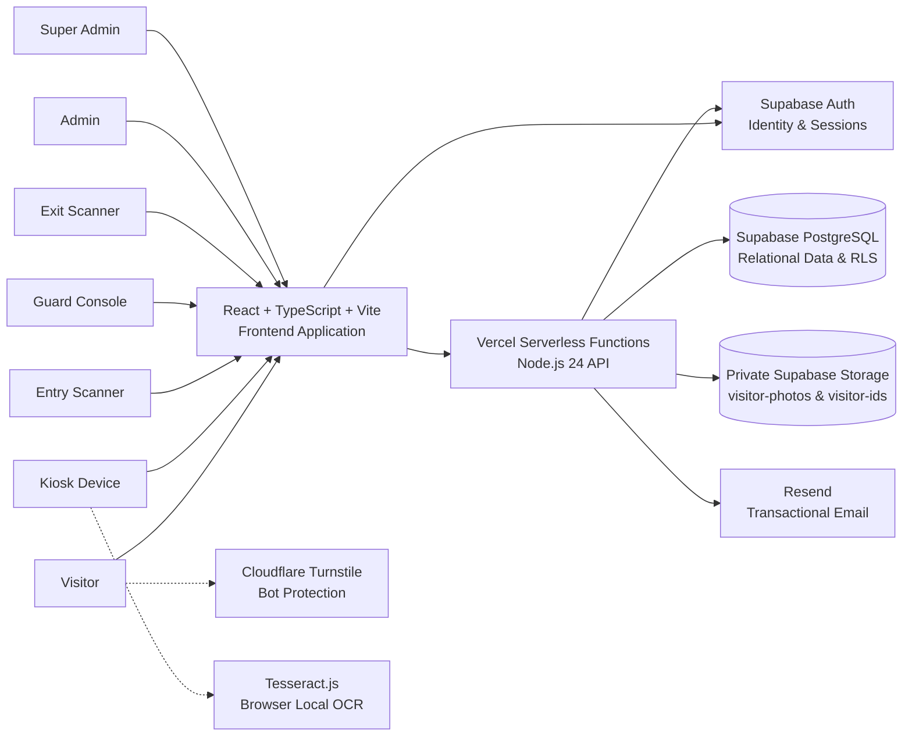
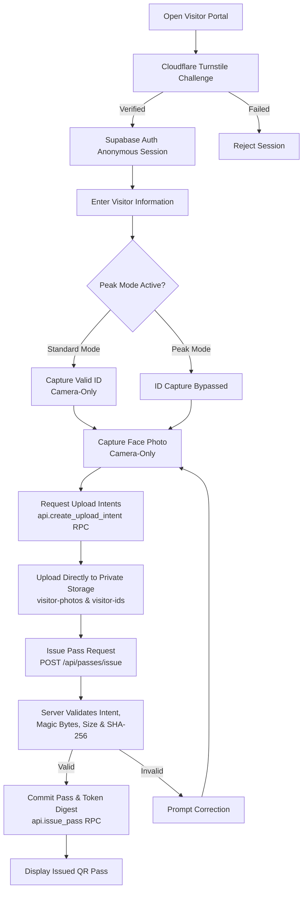
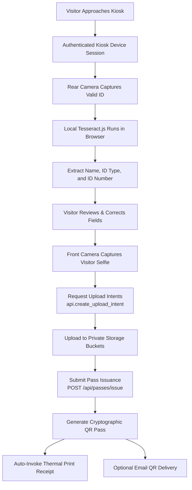
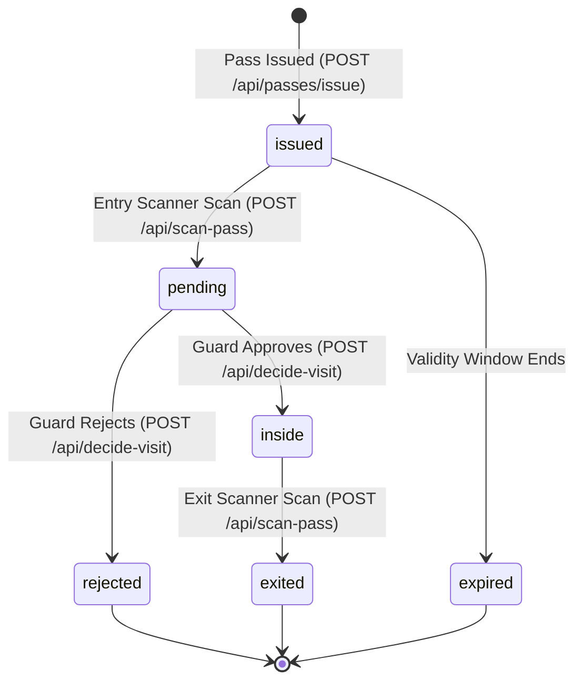
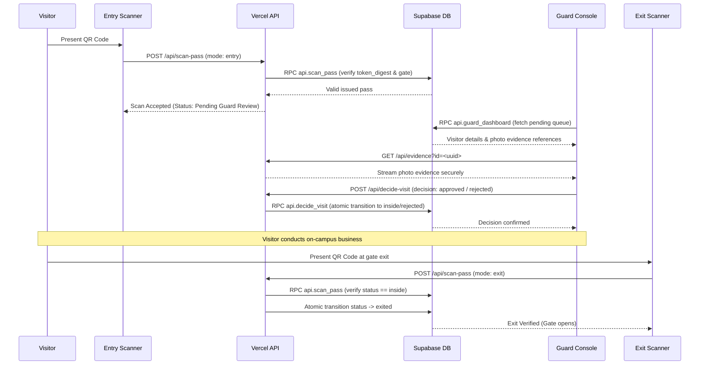
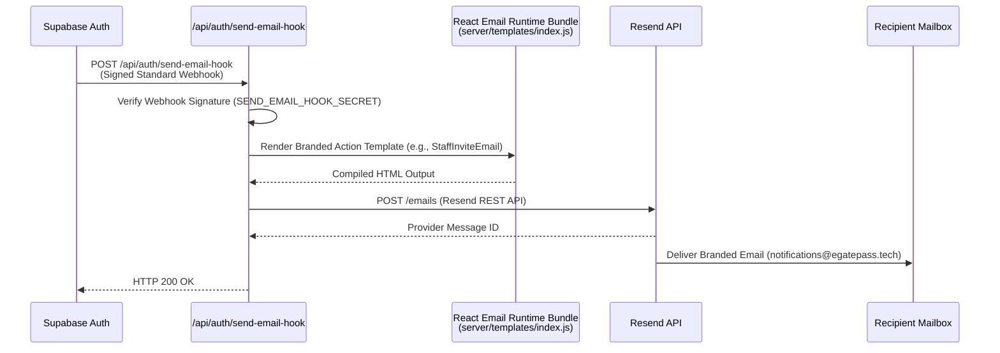
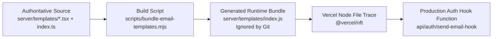
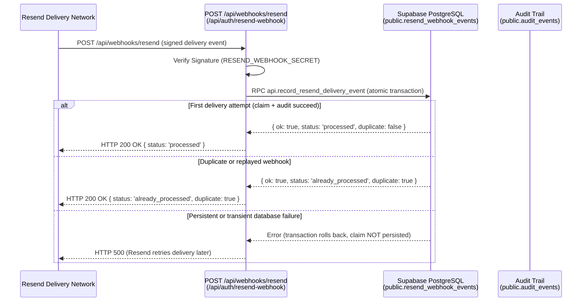
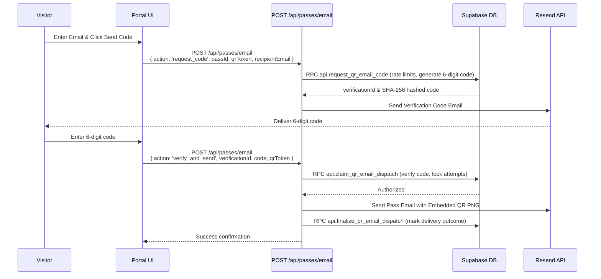
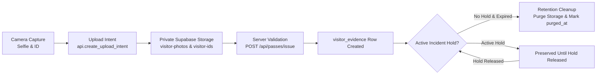

# EARIST E-GatePass

Secure visitor access, digital pass issuance, and gate-management platform for the Eulogio "Amang" Rodriguez Institute of Science and Technology (EARIST).

E-GatePass provides an end-to-end access management pipeline designed to support campus security and visitor accountability. Online visitors register through a public portal protected by Cloudflare Turnstile, while walk-in visitors use campus kiosks equipped with client-side OCR for government ID data extraction. Scanner hardware at campus gates verifies cryptographically signed QR passes, queuing entrants for Guard review before campus entry is granted.

---

## 1. System Context Architecture



---

## 2. Technology Stack

| Layer | Technology | Responsibility |
|---|---|---|
| **Frontend** | React 19, TypeScript, Vite 8 | Single Page Application (SPA), responsive mobile/tablet interfaces |
| **Hosting & CDN** | Vercel | Global edge CDN delivery and frontend asset hosting |
| **Serverless API** | Vercel Functions (Node.js 24) | 27 canonical API endpoints across 6 route groups, verification, and cryptography |
| **Database** | Supabase PostgreSQL | Authoritative relational data, Row Level Security (RLS), and RPCs |
| **Authentication** | Supabase Auth | Anonymous visitor sessions, staff identities, and managed device credentials |
| **Object Storage** | Supabase Storage (Private) | Private storage for visitor photos (`visitor-photos`) and IDs (`visitor-ids`) |
| **Transactional Email** | Resend | Dispatch of system notifications, auth invites, and QR pass delivery |
| **Email Templates** | React Email | Type-safe, branded HTML templates built with TypeScript and TSX |
| **Bot Protection** | Cloudflare Turnstile | Non-intrusive CAPTCHA for public visitor registration via Supabase Auth |
| **Local OCR** | Tesseract.js | Client-side optical character recognition for kiosk ID capture |
| **QR Security** | HMAC-SHA256 & SHA-256 | Cryptographic pass bearer tokens with database-stored SHA-256 digest lookup |
| **Timezone Authority** | `Asia/Manila` (UTC+8) | Institutional schedule enforcement and daily audit boundaries |

---

## 3. Core Capabilities & Workflows

### 3.1 Visitor Registration Portal Flow

Visitors register for campus entry online prior to arrival. Registration enforces camera-only facial and ID capture.



> **Scheduling Note**: Visitors may schedule visits within the institutionally configured scheduling window. The current deployment default uses 30 days ahead.

---

### 3.2 Walk-in Kiosk ID OCR Flow

Kiosk devices located at campus entrances allow walk-in visitors to scan their government ID card for fast, assisted data entry.



*Notice: OCR execution occurs entirely within the client browser memory. No unverified ID image is transmitted to third-party recognition APIs.*

---

### 3.3 Pass Lifecycle State Machine

Passes transition through strictly enforced relational states in the PostgreSQL database:



| Database Status | UI Display Label | Description |
|---|---|---|
| `issued` | Pass Issued | Pass created; valid for presentation at an entry scanner |
| `pending` | Pending Guard Review | Entry scanned; queued on the Guard Console for verification |
| `inside` | Inside Campus | Guard verified identity and approved entry; visitor is on campus |
| `rejected` | Entry Rejected | Guard denied access (e.g., dress code violation, invalid ID) |
| `exited` | Exited Campus | Exit scanned; visit concluded |
| `expired` | Pass Expired | Scheduling validity window elapsed without entry |

---

### 3.4 Gate Entry & Guard Review Sequence



---

### 3.5 Supabase Auth Transactional Email Delivery

System emails (invitations, password resets, email confirmations) are routed through a secure webhook into Resend using compiled React Email templates.



#### Production Build Supply Chain Architecture

To ensure Vercel's Node File Tracer (`@vercel/nft`) packages all React Email templates without module resolution failures:



---


---

### 3.6 Resend Delivery Observability Webhook

Email delivery events are asynchronously reported by Resend back to the platform via a signed standard webhook:



> **CRITICAL ARCHITECTURAL NOTICE**: Neither `/api/auth/send-email-hook` nor `/api/webhooks/resend` functions as an inbound mailbox or email receiver. `notifications@egatepass.tech` does not process inbound user correspondence.

### 3.7 QR Pass Email Verification Flow

Visitors can request a copy of their issued pass via email through a secure two-step verification challenge handled by a single discriminated endpoint:



---

## 4. Institutional Roles & Security

| Actor | Primary Responsibility | Authentication Mechanism |
|---|---|---|
| **Visitor** | Registers online, receives digital QR pass | Anonymous Supabase session with Turnstile verification |
| **Kiosk Device** | Self-service registration & local OCR on campus | Managed device credentials (`devices` table) |
| **Entry Scanner** | Scans QR code at campus gates | Authenticated scanner device bound to gate identifier |
| **Guard** | Reviews pending passes, inspects evidence, approves/rejects | Authenticated staff account (`role = 'guard'`) |
| **Exit Scanner** | Verifies exiting visitors at gate barriers | Authenticated scanner device bound to gate identifier |
| **Admin** | Manages staff accounts, hardware devices, and visitor logs | Authenticated staff account (`role = 'admin'`) |
| **Super Admin** | Configures system settings, retention windows, promotes admins | Authenticated staff account (`role = 'superadmin'`) |

---

## 5. Evidence Lifecycle & Privacy Protection



Visitor evidence is stored exclusively in private storage buckets (`visitor-photos` and `visitor-ids`). Staff view images through `GET /api/evidence?id=<uuid>`, which streams the asset through Vercel with `Cache-Control: private, no-store` and sandbox CSP protections.

---

## 6. Repository Layout

```text
egatepass/
├── README.md                           # Public architecture & system overview
├── vercel.json                         # Vercel deployment, headers & rewrites
├── vite.config.ts                      # Vite build configuration
├── package.json                        # Dependencies, scripts, and prebuild hooks
│
├── api/                                # Vercel Serverless Function entrypoints
├── server/                             # Privileged backend handlers & routes
│   ├── routes/                         # Canonical route handlers (route-map.ts)
│   ├── templates/                      # React Email templates (.tsx) & index.ts
│   └── email.ts                        # Resend provider integration
│
├── src/                                # React frontend SPA
│   ├── components/                     # Reusable UI & modal components
│   ├── pages/                          # Page views (Portal, Kiosk, Guard, Admin)
│   ├── services/                       # Client services (visitorRegistration, guard)
│   └── lib/                            # Scheduling, OCR, and Supabase client
│
├── scripts/
│   └── bundle-email-templates.mjs      # Prebuild React Email bundling script
│
├── supabase/
│   ├── migrations/                     # Sequential PostgreSQL migrations
│   └── config.toml                     # Supabase CLI configuration
│
├── tests/                              # Unit, contract, and migration test suite
└── docs/                               # Detailed operational & security specifications
```

---

## 7. Local Development Quick-Start

### Prerequisites
- **Node.js**: Node.js 24.x recommended (LTS)
- **Package Manager**: npm

### Setup
```bash
# 1. Clone the repository
git clone https://github.com/jsphhbna/egatepass.git
cd egatepass

# 2. Install dependencies
npm install

# 3. Configure local environment
cp .env.example .env.local
# Update .env.local with your Supabase development credentials

# 4. Start local development server
npm run dev

# 5. Run automated test suite
npm test

# 6. Verify production build & email bundle
npm run build
npx vercel build --prod
```

---


### Environment & Secret Isolation Policy
- **Production Scope**: Contains all privileged provider credentials (`SUPABASE_SECRET_KEY`, `PASS_TOKEN_SECRET`, `RATE_LIMIT_HMAC_SECRET`, `CRON_SECRET`, `RESEND_API_KEY`, `SEND_EMAIL_HOOK_SECRET`, `RESEND_WEBHOOK_SECRET`).
- **Generic Preview Scope**: Protected by Vercel SSO; receives ONLY public frontend configuration (`VITE_SUPABASE_URL`, `VITE_SUPABASE_PUBLISHABLE_KEY`, `SUPABASE_URL`). Production privileged secrets are never copied into generic preview deployments.

## 8. Documentation Index

| Document | Purpose |
|---|---|
| [docs/SECURITY.md](docs/SECURITY.md) | Canonical security contract, trust boundaries, actor resolution, and threat matrix |
| [docs/ARCHITECTURE.md](docs/ARCHITECTURE.md) | In-depth engineering specifications, relational entity models, and data flows |
| [docs/DEPLOYMENT.md](docs/DEPLOYMENT.md) | Vercel deployment, migration ordering, Send Email Hook setup, and rollback |
| [docs/OPERATIONS.md](docs/OPERATIONS.md) | Daily administration, staff/device lifecycle, incident holds, and reconciliation |
| [docs/ENVIRONMENT.md](docs/ENVIRONMENT.md) | Authoritative environment variable table and secret rotation rules |
| [docs/ENVIRONMENT_AND_CRON.md](docs/ENVIRONMENT_AND_CRON.md) | Maintenance endpoint specification and cron readiness |
| [docs/MANUAL_QA_RUNBOOK.md](docs/MANUAL_QA_RUNBOOK.md) | Step-by-step test matrix covering desktop, iOS Safari, Kiosk, and gate scanners |
| [docs/SUPER_ADMIN_BOOTSTRAP.md](docs/SUPER_ADMIN_BOOTSTRAP.md) | Initial privilege bootstrap via Supabase `private.bootstrap_super_admin` RPC |
| [docs/CLEAN_DATA_HANDOFF.md](docs/CLEAN_DATA_HANDOFF.md) | Ownership transfer checklist, developer decommissioning, and sign-off |
| [docs/TROUBLESHOOTING.md](docs/TROUBLESHOOTING.md) | Diagnostic matrices for Auth Email Hook, device auth, RLS denials, and scanner errors |
| [docs/IMAGE_SECURITY.md](docs/IMAGE_SECURITY.md) | Camera capture constraints, upload intents, and private storage lifecycle |
| [docs/AUDIT_POLICY.md](docs/AUDIT_POLICY.md) | Audit trail schema, protected action exemptions, and strict sensitive data redaction |
