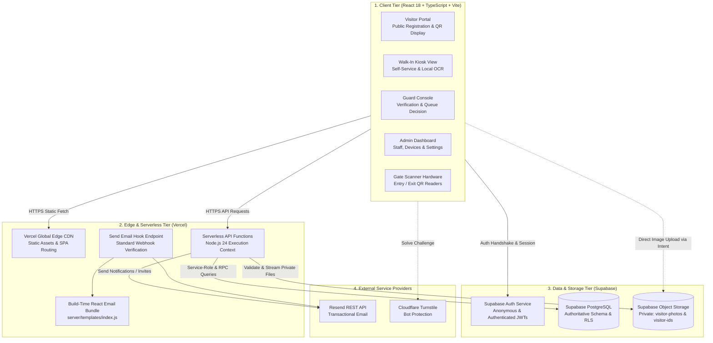
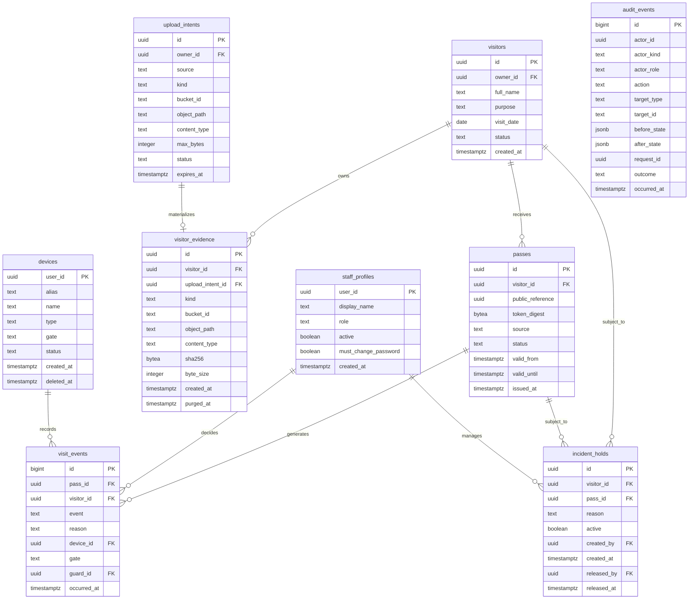
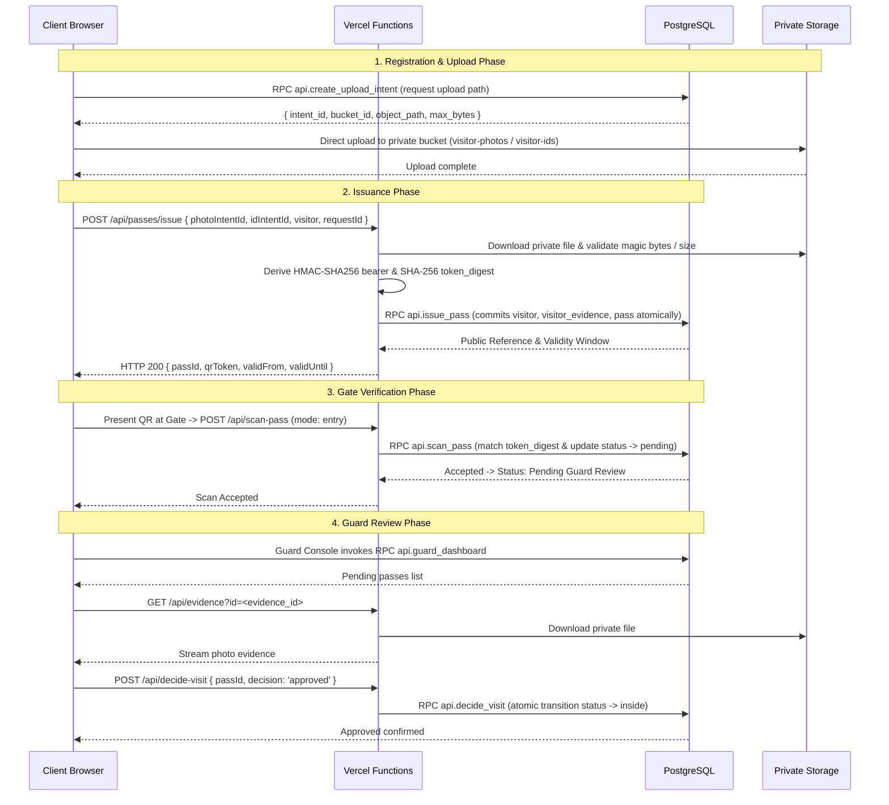

# System Architecture & Technical Specifications

This document details the software architecture, relational data models, subsystem boundaries, and runtime execution pipelines of the EARIST E-GatePass platform.

---

## 1. Subsystem Architecture

EARIST E-GatePass is partitioned into four decoupled architecture tiers:

---

## 2. Authoritative Relational Data Model

The PostgreSQL database enforces relational integrity, unique constraints, and foreign-key cascading rules:

---

## 3. Canonical API Route Architecture

The platform's API surface is declared in `server/route-map.ts`. All endpoints run within Vercel Serverless Function instances:

### 3.1 Admin Router (`/api/admin/*`)
- `GET /api/admin/activity`: Historical audit event query for administrators.
- `GET /api/admin/dashboard`: High-level operational metrics and active gate counters.
- `GET /api/admin/devices`: Hardware scanner fleet inventory and status list.
- `GET /api/admin/emergency`: Real-time campus population roll-call for safety evacuations.
- `GET/POST/DELETE/PATCH /api/admin/holds`: Incident hold management on visitor records.
- `GET /api/admin/records`: Paginated visitor pass log with filtering by date and gate.
- `GET/POST /api/admin/retention-maintenance`: Manual or cron-authenticated retention engine.
- `GET /api/admin/settings`: Institutional configuration (working hours, retention days).
- `GET /api/admin/users`: Staff member list and profile state management.

### 3.2 Gate Router (`/api/*`)
- `POST /api/scan-pass`: Scanner endpoint for entry and exit events; verifies `token_digest` and gate.
- `POST /api/decide-visit`: Guard console decision endpoint (approve or reject entry).
- `GET /api/evidence`: Authenticated proxy for streaming private visitor photos and ID cards.

### 3.3 Passes Router (`/api/passes/*`)
- `POST /api/passes/issue`: Atomically validates evidence upload intents and issues QR gate passes.
- `POST /api/passes/email`: Two-step verification challenge and dispatch of QR passes via email.

### 3.4 Auth & System Router (`/api/*`)
- `POST /api/auth/send-email-hook`: Supabase Auth standard webhook receiver.
- `POST /api/auth/complete-password-change`: Password update handler.
- `POST /api/auth/reset-password`: Trigger password reset email.
- `POST /api/create-user`, `POST /api/update-user`: Staff management endpoints.
- `POST /api/create-device`, `POST /api/update-device`, `DELETE /api/delete-device`: Device lifecycle.
- `POST /api/update-settings`: Super Admin system settings update.
- `POST /api/purge-images`: Super Admin manual image purge.
- `GET /api/reconciliation-items`: Super Admin review of cross-system anomalies.

---

## 4. End-to-End Ingestion & Scan Architecture

---

## 5. Storage Architecture & Privacy Policies

Private storage assets are partitioned into two designated buckets:
1. `visitor-photos`: Face photos captured by online visitors or kiosk cameras.
2. `visitor-ids`: Scanned government or school ID documents.

### Storage Invariants:
- **Zero Public Access**: Buckets are marked private; public URL access is permanently disabled.
- **Access Delegation**: Staff access assets solely via `/api/evidence?id=<uuid>`, which evaluates caller roles (`guard`, `admin`, `superadmin`), pass states, and active incident holds before streaming the image.
- **Ephemeral Upload Intents**: Upload intents expire within 15 minutes. Abandoned uploads are cleaned up during daily retention maintenance.
- **Retention & Purge**: Expired assets are deleted from storage, and `visitor_evidence.purged_at` is stamped in PostgreSQL.
