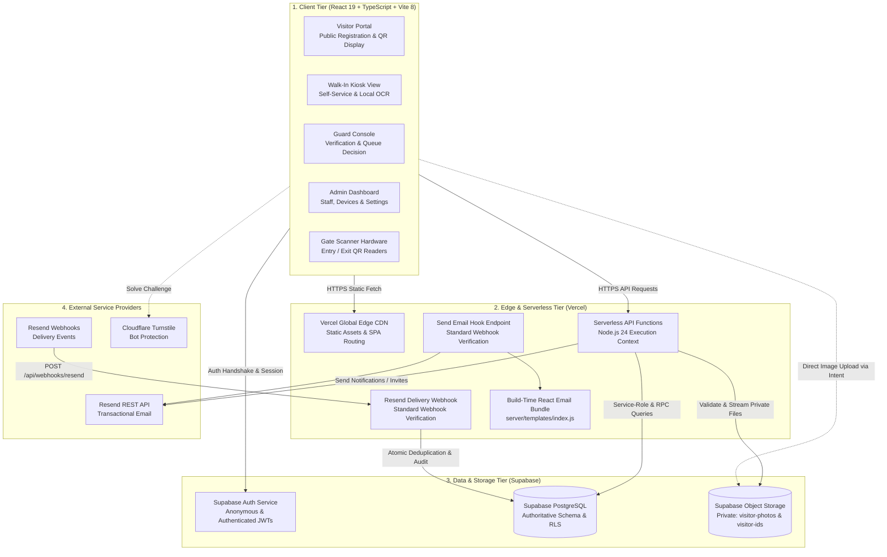
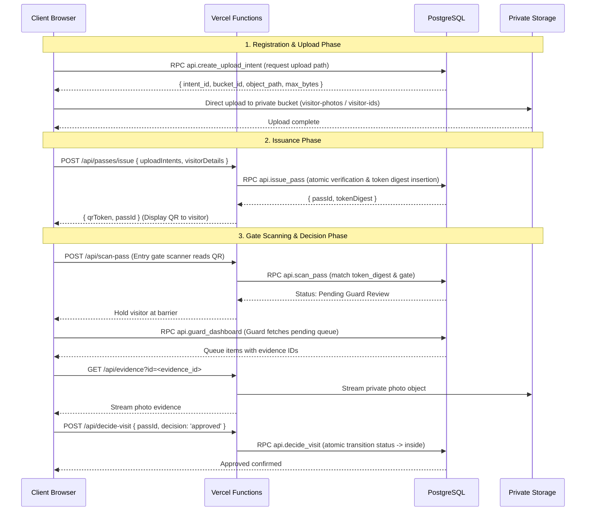

# System Architecture & Technical Specifications

This document details the software architecture, relational data models, subsystem boundaries, and runtime execution pipelines of the EARIST E-GatePass platform.

---

## 1. Subsystem Architecture

EARIST E-GatePass is partitioned into four decoupled architecture tiers:



---

## 2. Authoritative Relational Data Model

The PostgreSQL database enforces relational integrity, unique constraints, and foreign-key cascading rules across 15 canonical application tables:


---

## 3. Canonical API Route Architecture

The platform's API surface is declared in `server/route-map.ts`. All 27 endpoints execute within Vercel Serverless Function instances:

### 3.1 Admin Router (9 routes: `/api/admin/*`)
- `GET /api/admin/activity`: Historical audit event query for administrators.
- `GET /api/admin/dashboard`: High-level operational metrics and active gate counters.
- `GET /api/admin/devices`: Hardware scanner fleet inventory and status list.
- `GET /api/admin/emergency`: Real-time campus population roll-call for safety evacuations.
- `GET, POST, DELETE, PATCH /api/admin/holds`: Incident hold management on visitor records.
- `GET /api/admin/records`: Paginated visitor pass log with filtering by date and gate.
- `GET, POST /api/admin/retention-maintenance`: Manual or cron-authenticated retention engine.
- `GET /api/admin/settings`: Institutional configuration (working hours, retention days).
- `GET /api/admin/users`: Staff member list and profile state management.

### 3.2 Auth Router (4 routes: `/api/auth/*`)
- `POST /api/auth/complete-password-change`: Password update handler.
- `POST /api/auth/reset-password`: Trigger password reset email.
- `POST /api/auth/send-email-hook`: Supabase Auth standard webhook receiver for outbound transactional emails.
- `POST /api/auth/resend-webhook`: Resend delivery observability webhook receiver (external rewrite path: `POST /api/webhooks/resend`).

### 3.3 Passes Router (2 routes: `/api/passes/*`)
- `POST /api/passes/issue`: Atomically validates evidence upload intents and issues QR gate passes.
- `POST /api/passes/email`: Two-step verification challenge and dispatch of QR passes via email.

### 3.4 Device Router (4 routes: `/api/*`)
- `POST /api/create-device`: Register new gate or kiosk scanner device.
- `DELETE /api/delete-device`: Decommission and soft-delete device hardware.
- `POST /api/update-device`: Update device display name, gate binding, or type.
- `POST /api/update-device-auth`: Rotate device login credentials.

### 3.5 Gate Router (3 routes: `/api/*`)
- `POST /api/scan-pass`: Scanner endpoint for entry and exit events; verifies `token_digest` and gate.
- `POST /api/decide-visit`: Guard console decision endpoint (approve or reject entry).
- `GET /api/evidence`: Authenticated proxy for streaming private visitor photos and ID cards.

### 3.6 System Router (5 routes: `/api/*`)
- `POST /api/create-user`: Provision staff account.
- `POST /api/update-user`: Update staff role or status.
- `POST /api/update-settings`: Super Admin system settings update.
- `POST /api/purge-images`: Super Admin manual image purge.
- `GET, PATCH /api/reconciliation-items`: Super Admin review and resolution of cross-system anomalies.

---

## 4. End-to-End Ingestion & Scan Architecture



---

## 5. Storage Architecture & Privacy Policies

Private storage assets are partitioned into two designated buckets:
1. `visitor-photos`: Face photos captured by online visitors or kiosk cameras.
2. `visitor-ids`: Scanned government or school ID documents.

### Storage Invariants:
- **Zero Public Access**: Buckets are marked private; public URL access is permanently disabled.
- **Access Delegation**: Staff access assets solely via `/api/evidence?id=<uuid>`, which evaluates caller roles (`guard`, `admin`, `superadmin`), pass states, and active incident holds before streaming the image.
- **Ephemeral Upload Intents**: Upload intents expire within 15 minutes. Abandoned uploads are cleaned up during daily retention maintenance.
- **Retention & Purge**: Expired assets are deleted from storage, and `visitor_evidence.purged_at` is stamped in PostgreSQL.

---

## 6. Dedicated Email Hooks Architecture

The platform separates outbound email dispatch from inbound delivery feedback using two distinct, decoupled webhook flows:

```text
1. Outbound Auth Dispatch: Supabase Auth Send Email Hook
   Supabase Auth
       ↓ signed standard webhook
   POST /api/auth/send-email-hook
       ↓ (verified via SEND_EMAIL_HOOK_SECRET)
   React Email template rendering
       ↓
   Resend REST API (via RESEND_API_KEY)
   Purpose: Dispatches transactional system emails (staff invites, password resets, magic links).

2. Inbound Delivery Feedback: Resend Delivery Observability Webhook
   Resend Event System
       ↓ signed delivery event
   POST /api/webhooks/resend  (rewritten to /api/auth/resend-webhook)
       ↓ (verified via RESEND_WEBHOOK_SECRET)
   Atomic deduplication (public.resend_webhook_events)
       ↓
   Audit logging (public.audit_events with masked recipient)
   Purpose: Observability of delivery outcome (sent, delivered, delayed, bounced, complained).
```

> **IMPORTANT**: Neither hook is an inbound user mailbox or reply receiver. `notifications@egatepass.tech` does not receive inbound user correspondence.

---

## 7. Performance & Referential Covering Indexes (Migration 20261023020000)

To resolve unindexed foreign key warnings identified during performance reviews and eliminate table-level share locks during parent table mutations, migration `20261023020000_performance_covering_indexes.sql` introduces covering partial btree indexes on:
- `passes(decided_by)`, `passes(entry_device_id)`, `passes(exit_device_id)`
- `visit_events(visitor_id)`, `visit_events(guard_id)`, `visit_events(device_id)`
- `upload_intents(visitor_id)`
- `incident_holds(created_by)`, `incident_holds(released_by)`, `incident_holds(pass_id)`, `incident_holds(visitor_id)`
- `visitors(created_by_device_id)`

---

## 8. Atomic Webhook Idempotency (Migration 20261023140000)

To eliminate race conditions during high-frequency Resend delivery webhook events across concurrent serverless instances, forward migration `20261023140000_resend_webhook_idempotency.sql` introduces the `resend_webhook_events` table:
- Enforces database-level uniqueness on `provider_event_id` (`CONSTRAINT resend_webhook_events_provider_id_unique UNIQUE (provider_event_id)`).
- Replays of already processed webhooks safely return HTTP 200 `already_processed` without inserting duplicate audit events.
