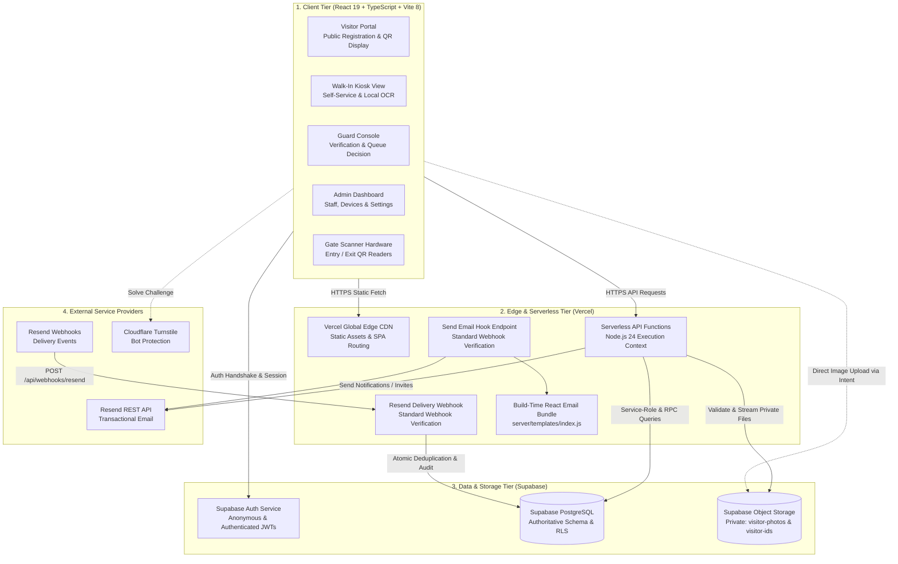
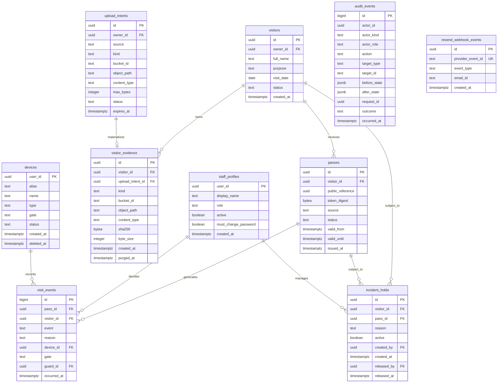
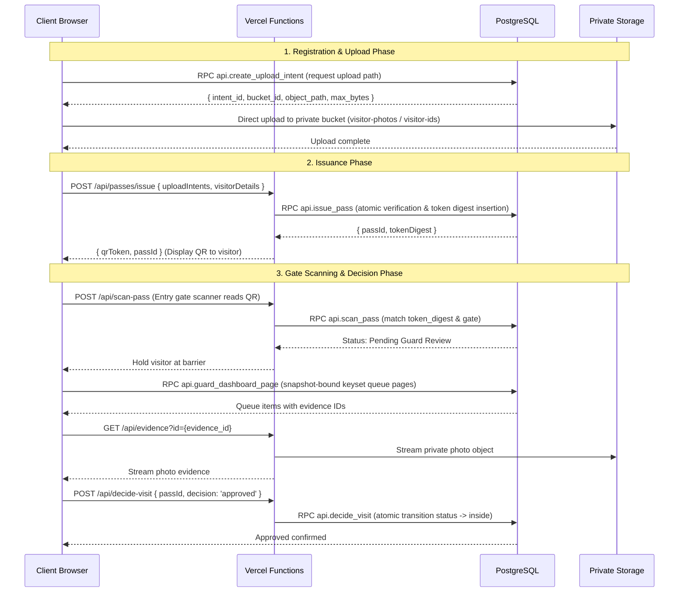

# System Architecture & Technical Specifications

This document details the software architecture, relational data models, subsystem boundaries, and runtime execution pipelines of the EARIST E-GatePass platform.

---

## 1. Subsystem Architecture

EARIST E-GatePass is partitioned into four decoupled architecture tiers:



---

## 2. Authoritative Relational Data Model

The PostgreSQL database enforces relational integrity, unique constraints, and foreign-key cascading rules across 15 canonical application tables:



---

## 3. Canonical API Route Architecture

The platform's API surface is declared in `server/route-map.ts`. All 30 endpoints execute within Vercel Serverless Function instances:

### 3.1 Admin Router (9 routes: `/api/admin/*`)
- `GET /api/admin/activity`: Historical audit event query for administrators.
- `GET /api/admin/dashboard`: High-level operational metrics and active gate counters.
- `GET /api/admin/devices`: Hardware scanner fleet inventory and status list.
- `GET /api/admin/emergency`: Real-time campus population roll-call for safety evacuations.
- `GET, POST, DELETE, PATCH /api/admin/holds`: Incident hold management on visitor records.
- `GET /api/admin/records`: Paginated visitor pass log with filtering by date and gate.
- `GET, POST /api/admin/retention-maintenance`: Manual or cron-authenticated retention engine.
- `GET /api/admin/settings`: Institutional configuration (working hours, retention days).
- `GET /api/admin/users`: Staff member list and profile state management.

### 3.2 Auth Router (4 routes: `/api/auth/*`)
- `POST /api/auth/complete-password-change`: Password update handler.
- `POST /api/auth/reset-password`: Trigger password reset email.
- `POST /api/auth/send-email-hook`: Supabase Auth standard webhook receiver for outbound transactional emails.
- `POST /api/auth/resend-webhook`: Resend delivery observability webhook receiver (external rewrite path: `POST /api/webhooks/resend`).

### 3.3 Passes Router (2 routes: `/api/passes/*`)
- `POST /api/passes/issue`: Atomically validates evidence upload intents and issues QR gate passes.
- `POST /api/passes/email`: Two-step verification challenge and dispatch of QR passes via email.

### 3.4 Device Router (6 routes: `/api/*`)
- `POST /api/create-device`: Register new gate or kiosk scanner device.
- `DELETE /api/delete-device`: Decommission and soft-delete device hardware.
- `POST /api/update-device`: Update device display name, gate binding, or type.
- `POST /api/update-device-auth`: Rotate device login credentials.
- `POST /api/device/reauthenticate`: Trusted server reauthentication of active kiosk device credentials.
- `GET /api/device/thermal-template`: Kiosk endpoint retrieving canonical published thermal pass template.

### 3.5 Gate Router (4 routes: `/api/*`)
- `POST /api/scan-pass`: Scanner endpoint for entry and exit events; verifies `token_digest` and gate.
- `POST /api/decide-visit`: Guard console decision endpoint (approve or reject entry).
- `GET /api/evidence`: Authenticated proxy for streaming private visitor photos and ID cards.
- `POST /api/sync-offline-registration`: Guard offline registration synchronization endpoint with trusted server-side byte inspection and transactional receipt generation.

### 3.6 System Router (5 routes: `/api/*`)
- `POST /api/create-user`: Provision staff account.
- `POST /api/update-user`: Update staff role or status.
- `POST /api/update-settings`: Super Admin system settings update.
- `POST /api/purge-images`: Super Admin manual image purge.
- `GET, PATCH /api/reconciliation-items`: Super Admin review and resolution of cross-system anomalies.

---

## 4. End-to-End Ingestion & Scan Architecture



---

## 5. Storage Architecture & Privacy Policies

Private storage assets are partitioned into two designated buckets:
1. `visitor-photos`: Face photos captured by online visitors or kiosk cameras.
2. `visitor-ids`: Scanned government or school ID documents.

### Storage Invariants:
- **Zero Public Access**: Buckets are marked private; public URL access is permanently disabled.
- **Access Delegation**: Staff access assets solely via `/api/evidence?id=<uuid>`, which evaluates caller roles (`guard`, `admin`, `superadmin`), pass states, and active incident holds before streaming the image.
- **Ephemeral Upload Intents**: Upload intents expire within 15 minutes. Abandoned uploads are cleaned up during daily retention maintenance.
- **Retention & Purge**: Expired assets are deleted from storage, and `visitor_evidence.purged_at` is stamped in PostgreSQL.

---

## 6. Dedicated Email Hooks Architecture

The platform separates outbound email dispatch from inbound delivery feedback using two distinct, decoupled webhook flows:

```text
1. Outbound Auth Dispatch: Supabase Auth Send Email Hook
   Supabase Auth
       ↓ signed standard webhook
   POST /api/auth/send-email-hook
       ↓ (verified via SEND_EMAIL_HOOK_SECRET)
   React Email template rendering
       ↓
   Resend REST API (via RESEND_API_KEY)
   Purpose: Dispatches transactional system emails (staff invites, password resets, magic links).

2. Inbound Delivery Feedback: Resend Delivery Observability Webhook
   Resend Event System
       ↓ signed delivery event
   POST /api/webhooks/resend  (rewritten to /api/auth/resend-webhook)
       ↓ (verified via RESEND_WEBHOOK_SECRET)
   Atomic deduplication (public.resend_webhook_events)
       ↓
   Audit logging (public.audit_events with masked recipient)
   Purpose: Observability of delivery outcome (sent, delivered, delayed, bounced, complained).
```

> **IMPORTANT**: Neither hook is an inbound user mailbox or reply receiver. `notifications@egatepass.tech` does not receive inbound user correspondence.

---

## 7. Performance & Referential Covering Indexes (Migration 20261023020000)

To resolve unindexed foreign key warnings identified during performance reviews and eliminate table-level share locks during parent table mutations, migration `20261023020000_performance_covering_indexes.sql` introduces covering partial btree indexes on:
- `passes(decided_by)`, `passes(entry_device_id)`, `passes(exit_device_id)`
- `visit_events(visitor_id)`, `visit_events(guard_id)`, `visit_events(device_id)`
- `upload_intents(visitor_id)`
- `incident_holds(created_by)`, `incident_holds(released_by)`, `incident_holds(pass_id)`, `incident_holds(visitor_id)`
- `visitors(created_by_device_id)`

---

## 8. Atomic Webhook Idempotency & Transactional RPC (Migrations 20261023140000 & 20261023160000)

To eliminate race conditions and guarantee that delivery audit logs and deduplication claims persist atomically across concurrent serverless invocations:
- Forward migration `20261023140000_resend_webhook_idempotency.sql` introduces the `public.resend_webhook_events` table (`id uuid PRIMARY KEY`, `provider_event_id text UNIQUE NOT NULL`, `event_type text NOT NULL`, `email_id text`, `created_at timestamptz NOT NULL`).
- Forward migration `20261023160000_resend_webhook_transactional_rpc.sql` defines the authoritative PL/pgSQL function `api.record_resend_delivery_event`.
- **Atomicity & Rollback Guarantees**:
  - The provider event claim and the delivery audit entry are executed within a single database transaction.
  - If audit insertion fails or encounters any transient error, the entire transaction rolls back, ensuring the `provider_event_id` is NOT consumed.
  - The webhook handler responds with HTTP 500, enabling Resend's automatic retry policy to re-dispatch the event and achieve successful persistence.
- **Replay / Duplicate Semantics**:
  - If a previously processed `provider_event_id` is received, the unique constraint catches the duplicate and returns `{ ok: true, status: 'already_processed', duplicate: true }`.
  - The webhook handler responds with HTTP 200 `already_processed` and no second audit event is created.
- **Access Boundary**:
  - Execution of `api.record_resend_delivery_event` is strictly revoked from `public`, `anon`, and `authenticated`, granted exclusively to `service_role` for serverless function use.

---

## 9. Institutional Pass Visual Contract & Shared Presentation Architecture

Every visitor pass across all system surfaces adheres to a unified presentation contract:

```text
Pass Presentation Data Flow
  Pass Entity (DB)
        │
        ▼
  createPassPresentation()
        │
        ├── visitorName      (Formatted First, Middle Initial, Last Name)
        ├── visitDate        (Formatted in Asia/Manila, e.g. "October 27, 2026")
        ├── passReference    (Canonical Reference format "EG-XXXXXXXX", derived strictly from passes.public_reference)
        └── qrToken          (Raw opaque HMAC-derived bearer token)
        │
        ├──> Online Pass View (InstitutionalPassCard.tsx)
        ├──> Pass Card PNG Download (renderPassCardToDataUrl)
        ├──> Transactional Pass Email (PassNotificationEmail.tsx)
        ├──> Kiosk Display (KioskPage.tsx)
        └──> MXW01 Thermal Print (thermalRenderer.ts)
```

### Critical Security & Cryptographic Boundary:
- **Opaque Token Invariant**: The QR payload consists exclusively of the raw opaque, HMAC-derived bearer pass token required for scanning. PostgreSQL stores only `SHA-256(raw QR bearer)` in `public.passes.token_digest`. A database compromise never directly leaks the raw scanning QR tokens.
- **Zero PII in QR Payload**: Visitor name, contact number, email, purpose, and date are strictly **NEVER** embedded into the QR payload. All identifiable metadata is rendered visually around the QR code on the institutional card or thermal print.

---

## 10. MXW01 Thermal Printing & Super Admin Template Engine

The physical thermal printing subsystem is designed around hardware reality and strict authority separation:

```text
Thermal Subsystem Architecture
  Super Admin Template Editor (/admin/templates)
        │ (Publish Template)
        ▼
  api.publish_thermal_template (PostgreSQL RPC)
        │
        ▼ (Stores version in public.thermal_templates)
  Kiosk Tablet Browser (/kiosk)
        │
        ├── Fetches active published template (falls back to bundled known-good default)
        ├── Interprets elements (384px canvas, high-contrast monochrome raster)
        └── Dispatches print job via Web Bluetooth (mxw01Manager.ts)
                │
                ▼
            MXW01 Bluetooth Thermal Printer (Native 384px width, 48mm printable)
```

### Core Architecture Invariants:
1. **Single Physical Printer**: Exactly **ONE physical printer** exists in the entire deployment. It is paired and owned exclusively by the **kiosk tablet browser**. Guards do NOT possess a separate thermal printer.
2. **Fail-Safe Printing**: Print failures **NEVER** undo or roll back authoritative pass issuance. If Web Bluetooth disconnects or paper runs out, the pass remains valid and the kiosk presents manual "Print Again" and "Browser Print" controls.
3. **Template Security & Schema Allowlist**: Templates use a strict Zod allowlist schema (`thermalTemplateLayoutSchema`) enforcing a 384px width, bounding coordinates, locked mandatory fields (`institution_logo`, `institution_name`, `visitor_name`, `visit_date`, `qr_code`, `pass_reference`), and strictly rejecting remote URLs, executable scripts, or raw HTML.
4. **Draft & Versioning**: Templates are versioned immutably. Restoring an earlier template creates a new published version rather than mutating history.

---

## 11. Outage Architecture, Guard Recovery & Offline Synchronization

When cloud or internet connectivity is lost, the platform enforces an intentional, fail-closed operational fallback:

```text
Outage Architecture & Authority Delegation
  Cloud Network Failure
        │
        ├── KIOSK DEVICE   ──> FAIL CLOSED (Registration disabled, display Guard notice)
        ├── ENTRY SCANNER  ──> FAIL CLOSED (Scan rejected with network notice, redirect to Guard)
        ├── EXIT SCANNER   ──> FAIL CLOSED (Scan rejected with network notice, redirect to Guard)
        │
        └── GUARD TABLET   ──> ACTIVE OPERATIONAL FALLBACK
                │
                ├── Local IndexedDB Store (egatepass_guard_offline)
                │     ├── Operational Cache: Today's Manila issued/pending/inside passes
                │     ├── Offline Registrations: Walk-in records captured by Guard
                │     └── Offline Event Outbox: Queued entry, exit, and rejection events
                │
                └── Connectivity Restored: Reconnection Sync
                      ├── POST /api/sync-offline-registration -> api.guard_sync_offline_registration (Server-only service_role execution with byte inspection & actor binding)
                      └── api.guard_sync_offline_event (Row-locked atomic lifecycle transition)
```

### Architectural Guarantees:
- **Offline Transition Mutex & Race Elimination**: IndexedDB store preparation and actor shifts are strictly serialized via a global promise-chain mutex (`transitionGuardOfflineStore(actorId)`). Concurrently launched maintenance sweeps, cache updates, or shift handoffs queue deterministically without overlapping store purges or state corruptions.
- **Session Authority Precondition**: The synchronizer (`runOfflineMaintenance`) verifies active Guard session authority via `client.auth.getSession()` *prior* to executing any IndexedDB mutations or network dispatches. If a session is absent or expired, sync immediately halts without mutating local records or resetting sync states.
- **Immediate Outbox Truth**: The Guard UI initializes its outbox counter and synchronization view immediately upon store readiness via `refreshPendingCounts(actorId)` and an actor-bound React effect, ensuring truthful pending badge counts on initial offline reload without requiring extra user interactions.
- **Strict Actor Isolation & Defense-in-Depth**:
  - `saveCachedVisitors(actorId, visitors)` strictly requires a non-empty `actorId` and unconditionally overwrites any visitor record's `actorId` field with the verified actor.
  - `queueOfflineVisitorAction(actorId, params)` verifies that target cached visitors belong to the acting guard (`visitor.actorId === actorId`); mismatches abort the transaction and reject with `'actor_mismatch'`.
  - `recoverInterruptedSyncStates(actorId)` strictly confines state resets (`syncing` -> `pending`) to records belonging exclusively to the specified `actorId`.
- **No Client Secrets**: The IndexedDB store contains strictly operational visitor metadata. No server secrets, service-role keys, or signing keys are ever stored client-side.
- **Strict Actor Binding & Fail-Closed Exclusion**: Every record across `cached_visitors`, `offline_registrations`, and `offline_events` requires a non-null `actorId`. Queries fail closed (`r.actorId === actorId`); records lacking an actor attribution are never read, modified, or synchronized.
- **Identity-Switch Store Purge**: When switching guards (`transitionGuardOfflineStore`), if a prior guard's session was present, all sensitive stores (`cached_visitors`, `offline_registrations`, `offline_events`, `meta`) are purged to ensure the incoming guard starts with clean local storage and zero cross-actor data leakage.
- **Sign-Out Guard**: Clean logout is strictly prevented if `getPendingSyncCount(actorId) > 0`, forcing guards to synchronize outbox items before ending their shift.
- **Centralized Sync Failure Classifier (`classifyOfflineRegistrationSyncFailure`)**: Synchronizer failure branches are unified:
  - Transient or internal errors (network timeouts, 5xx outages, 503 authority failures, unexpected 400 bad requests, or unmapped 422s) preserve local photo and ID binary blobs and upload intent checkpoints, leaving records in `pending` state for automated retry.
  - Stale intent errors (specific 422 codes) clear checkpoints while preserving blobs for re-upload.
  - Authoritative conflicts (HTTP 409) mark registrations as terminal `conflict` and strip local evidence blobs while retaining metadata for audit reconciliation.
- **Idempotent Synchronization**: Each offline registration possesses an immutable UUID `offlineRegistrationId`. Each offline event possesses an immutable UUID `eventId`. Interrupted or replayed sync requests return the existing canonical records without duplication.
- **Row-Level Locking & Conflict Detection**: Server-side sync RPCs lock affected pass rows (`FOR UPDATE`) and verify expected prior statuses. Conflicting server states (e.g. pass already cancelled or exited) are routed to `public.reconciliation_tasks` for administrative audit rather than blindly overwriting authoritative state.
- **Daily Retention Purge**: The local IndexedDB database purges operational caches and processed event receipts daily to ensure client devices do not accumulate a shadow database.

---

## 12. Institutional Upgrades & Specialized Subsystems

### A. Canonical Digital E-GatePass Artifact & Deterministic Font Rendering
- **Bundled Typography (`public/fonts/`)**: Official Google Noto Sans TrueType fonts (`NotoSans-Regular.ttf`, `NotoSans-Bold.ttf`) and SIL Open Font License 1.1 (`OFL.txt`) are statically bundled in the repository, guaranteeing zero external runtime CDN dependencies or Google Fonts network requests. Registered in browser via `@font-face` in `src/index.css`.
- **Verified Regression Character Set**: The canonical pass and PDF paths bundle Noto Sans and verify representative Latin/extended-Latin and institutional punctuation required by the E-GatePass regression contract:
  - ASCII Latin: `A-Z`, `a-z`, `0-9`
  - Common Filipino/Spanish accented Latin: `Ñ`, `ñ`, `É`, `é`, `Á`, `á`, `Ü`, `ü`, `Ç`, `ç`
  - Typographical symbols & punctuation: curly quotes/apostrophes (`’`, `“`, `”`), bullets (`•`), en-dash (`–`), em-dash (`—`)
  - Universal coverage across every worldwide writing system is not claimed; the contract guarantees deterministic rendering for the tested regression set.
- **Server Fontconfig Bootstrapping & Fail-Closed Contract (`server/lib/server-fonts.ts`)**: Serverless image generation boots a localized Fontconfig XML configuration before dynamically importing `sharp`. Fails closed: if mandatory bundled fonts are missing or fontconfig fails, it throws an authoritative error instead of silently falling back to host system fonts.
- **Canonical SVG 2-Line Name Fitting (`fitCanonicalVisitorName`)**: Visitor names are fitted within a defined horizontal bounding box ($x = 30..450$, width $420\text{px}$). Names $\le 24$ graphemes render on a single line ($y = 125, \text{size } 22$). Typical extended names wrap cleanly across two balanced lines ($y = 112, 136, \text{size } 18$) with visit date positioned at $y = 158$ and validity window at $y = 176$, preventing any overlap with the QR container outer rectangle ($y = 182$) or image ($y = 190$). Extremely long names approaching limits enforce a maximum line budget with second-line grapheme-safe ellipsis (`…`), avoiding microscopic text compression.
- **Grapheme-Safe Truncation (`src/lib/textGraphemes.ts`)**: Character counting and string truncation use standard `Intl.Segmenter` (with `Array.from` fallback) to guarantee that Filipino, Spanish, and French names, diacritics, and combining marks (such as in *José Niño Dela Cruz*) are never severed mid-glyph.
- **Institutional PDF Unicode Embedding (`src/lib/reportExport.ts`)**: The browser PDF export engine embeds `NotoSans-Regular.ttf` and `NotoSans-Bold.ttf` directly into the jsPDF Virtual File System as font `EgatepassNoto`, failing closed if fonts cannot be loaded rather than falling back to Helvetica.
- **CSV UTF-8 BOM Encoding**: All CSV exports prepend a UTF-8 Byte Order Mark (`\uFEFF`, raw bytes `EF BB BF`) to ensure Microsoft Excel on Windows immediately decodes non-ASCII characters without mojibake while preserving formula injection neutralization.
- **Pass Reference Font Alignment**: The pass reference field uses `"Egatepass Noto Sans", "Noto Sans", Arial, sans-serif` with `font-weight="bold"`, removing environment-dependent monospace font stacks.
- **Thermal Print Hardware Isolation**: The 384px monochrome MXW01 thermal print architecture remains decoupled, using its dedicated thermal layout engine with grapheme-safe truncation and font preloading; physical Bluetooth transmission remains verified via manual hardware QA.

### B. Unified Camera Subsystem & Mirroring Contract (`src/hooks/useWebcam.ts`, `CameraControls.tsx`)
- **Active Mode Authoritative**: Detects hardware-assigned facing mode via `track.getSettings().facingMode` rather than trusting initial constructor options.
- **Device Enumeration**: Calls `navigator.mediaDevices.enumerateDevices()` post-permission to dynamically hide camera switching controls on single-camera hardware.
- **Mirroring Invariants**:
  - Front camera defaults to preview mirroring (`true`) and face capture mirroring (`true`).
  - Rear camera defaults to unmirrored preview (`false`) and unmirrored capture (`false`).
  - ID / Document Evidence: Preview mirroring may be toggled, but stored capture **always** remains unmirrored (`mirror: false`) to ensure government ID text remains readable.
  - OCR Scanning: Input frame supplied to OCR engines is **strictly unmirrored** regardless of preview state.
- **Generation Fencing & Stream Teardown**: Rapid camera switching terminates every prior track and clears `video.srcObject` before requesting the opposite facing mode, preventing camera locks on Android/Chromium.

### C. Guard Authoritative Search Controller (`src/pages/GuardPage.tsx`, Migration 34)
- **Default Experience Preserved**: The chronological pending queue with keyset/snapshot pagination remains primary; search is not required to view pending visitors.
- **Local Live Filtering**: Queries under 2 characters filter the loaded queue client-side instantly.
- **Authoritative Search RPC (`api.guard_search_pending_queue`)**: Queries >= 2 characters trigger a 280ms debounced server search matching visitor name, contact number, purpose, and public reference with generation fencing. Results deduplicate seamlessly with loaded cards.
- **Clear Search**: Clears search filters instantly restoring the live queue without reloading all passes.

### D. Safe Staff Permanent Decommissioning (`server/routes/system/decommission-user.ts`, Migration 34)
- **Zero Row Deletion**: Preserves `ON DELETE RESTRICT` foreign keys and historical audit attribution on `public.staff_profiles`.
- **Pre-Conditions**: Target must be inactive (`active = false`), cannot be the acting actor (`cannot_decommission_self`), and cannot be an already decommissioned account.
- **Super Admin Reauthentication**: Requires the acting Super Admin's password, verified via an isolated Supabase Auth client using local-only signout (`signOut({ scope: 'local' })`) to preserve the browser session.
- **Auth Suspension & Reconciliation**: Enforces permanent Auth ban (`876000h`). External Auth failures trigger reconciliation tasks rather than rolling back database state.

### E. Unified Report Exports (`src/lib/reportExport.ts`)
- **Dynamic Module Loading**: `exceljs`, `jspdf`, and `jspdf-autotable` are loaded on-demand only when an export is triggered, keeping initial bundle size minimal.
- **Format Contracts**:
  - **CSV (RFC 4180)**: Pure tabular data with no decorative rows; row 1 is always column headers.
  - **XLSX**: Institutional header, metadata block (filters, date, staff actor), frozen table headers, and styled columns.
  - **PDF**: Formatted human-readable report with institutional maroon header, metadata block, and auto-paginated table with page numbering.
- **Security Exclusions**: Never exports raw QR tokens, token digests, storage object paths, signed URLs, or credential secrets.

### F. Online Pre-Registration Identity Verification & Guard Station Redesign (Migrations 38 & 39)
- **Single Camera Rule**: Exactly one custom camera preview exists in the online preregistration flow: **Live Face Capture** (`facingMode = 'user'`). Optional OCR and mandatory valid ID acquisition use the device/browser native file input / image chooser (`<input type="file" accept="image/jpeg,image/png,image/webp">`).
- **Technical Quality Gates**: Both live face capture and valid ID images undergo deterministic client-side technical checks (blur, illumination, resolution, single face detection, face size, and aspect) before identity comparison.
- **Local Face Verification Engine (`server/lib/face-engine.ts`)**: 1:1 biometric comparison using OpenCV Zoo models running in ONNX Runtime inside Node.js:
  - **Detection & Landmarks**: YuNet 640x640 with 5 facial landmarks.
  - **Alignment**: 5-point Umeyama similarity transform mapped to 112x112 canonical reference frame.
  - **Feature Extraction & Matching**: SFace feature extraction producing 128-d L2-normalized feature embeddings evaluated with cosine similarity against canonical threshold `0.363`.
- **Zero Biometric Persistence**: Biometric embeddings, landmarks, bounding boxes, and cropped tensors are strictly ephemerally processed in memory. Zero biometric vectors are saved to database tables or object storage.
- **Server Authority**: `/api/passes/issue` enforces that an unexpired `matched` record exists in `portal_identity_verification_attempts` for `(actorId, requestId, photoIntentId, idIntentId)`. Pass issuance is cryptographically and logically blocked without verified identity.
- **Automatic Online Entry**: Upon gate scanner scan, valid online preregistered passes transition directly to `inside` without entering an approval queue.
- **Guard Station Device View**: Authenticated hardware devices (`device_type = 'guard_station'`) bound to specific gates provide a high-visibility gate monitor displaying real-time entries, full-bleed registration photo, visitor details, and status. Confined strictly to same-gate scans.
- **Legacy Guard Role Deprecation**: Operational guard accounts are retired for sign-in (`legacy_guard_role_disabled`). Kiosk walk-in manual reviews are preserved at `/admin/legacy-guard` for Admin and Super Admin actors.
- **Stale Client & Readability Protection**: `public/build-meta.json` generated at build with `Cache-Control: no-store, max-age=0` powers background build polling and non-destructive update notifications. Institutional light theme strictly enforced (`color-scheme: light`) with WCAG 2.1 AA compliant contrast ratios ($\ge 4.5:1$).

### G. Post-Redesign Contract Closure & Fail-Closed Gate Invariants (Migration 40)
- **Single Canonical Verification Schema**: `portal_identity_verification_attempts` defined in Migration 39 with schema `(owner_id, request_id, photo_intent_id, id_intent_id, outcome, model_name, model_version, verified_at, expires_at)` is the authoritative database contract. `server/routes/passes/verify-identity.ts` writes this exact schema, and `server/routes/passes/issue.ts` queries this exact schema. Invented columns (`actor_id`, `status`, `matched`, `score`) are permanently eliminated.
- **Fail-Closed Wrong-Gate Exit**: `api.scan_pass` enforces `target.gate is not distinct from scanner.gate` before permitting `inside -> exited`. If an exit scan occurs at a mismatched gate, pass status remains `inside`, no `time_out` is recorded, result returns `wrong_gate`, and canonical `invalid_scan` event is logged.
- **Strict Canonical Event Logging**: `api.scan_pass` writes strictly valid `visit_event_type` enums (`scan_entry`, `scan_exit`, `invalid_scan`). Invalid non-enum writes (`scan_failed`, `exit`) are eliminated.
- **Authoritative Guard Authority Deprecation**: Operational authority for legacy human guard accounts is revoked at the database and API boundaries:
  - `api.decide_visit` allows only `admin` and `superadmin` roles; human `guard` calls fail with 42501.
  - `api.create_staff_profile` and `api.update_staff_profile` reject `guard` role with `legacy_guard_role_disabled`.
  - `/guard` UI route restricts access to `guard_station`, `admin`, and `superadmin`.
- **Trusted Face Preflight**: Live face capture undergoes trusted server-side presence and geometry preflight via YuNet (`mode: 'preflight_face'`) before the visitor can advance to the Valid ID step.
- **Unmirrored Biometric Evidence**: The webcam hook allows visual mirroring for visitor preview ergonomics, but captured biometric blobs are strictly non-mirrored (`allowCaptureMirroring: false`, `faceWebcam.capture({ mirror: false })`).
- **High-Resolution ID Normalization**: `normalizeIdentityDocumentImage` standardizes identity document images to long edge ~2000px (max 2400px) at WebP quality 0.92 without upscaling, replacing the old 1024px @ 0.8 compressor.
- **OCR ID Direct Reuse**: Documents uploaded during optional OCR are normalized and saved for identity verification without prompting the visitor for a second upload.
- **Exact-Pinned Model Runtime**: `onnxruntime-node: 1.31.1` is exact-pinned, with model provenance, licenses (Apache-2.0), and SHA-256 hashes documented in `server/models/README.md`.


### G. Portal Actor Continuity, Guard Station Device Model & Layout-Aware OCR (Migrations 40–42)
- **Portal Actor Continuity & Client Separation**: The online visitor pre-registration portal uses a dedicated Supabase client via `requirePortalSupabase()` with storage key `egatepass-portal-auth`. This guarantees complete isolation from operator/staff credentials in `egatepass-operator-auth`. All portal transactions validate that `user.is_anonymous === true` and `user.id === transaction.actorId`. All evidence upload intents, preflight face checks, and biometric identity verification calls strictly carry the visitor bearer token.
- **Guard Station Device Model**: Automated campus gate entry monitoring is delegated to dedicated hardware devices (`device_type = 'guard_station'`) bound to specific gate locations. Human guard accounts (`role = 'guard'`) have been decommissioned from normal gate operations. Attempts to log into legacy guard accounts are intercepted upon authentication, signed out immediately, and presented with a notice directing gate personnel to the Guard Station device.
- **Legacy Admin Walk-in Compatibility**: To preserve operational continuity during emergency walk-in processing, campus administrators and superadmins retain the authority to execute `guard_offline` registration and issuance RPCs (`api.create_upload_intent` with source `guard_offline`, `api.guard_sync_offline_registration`). Legacy guard roles attempting offline creation are rejected with SQLSTATE 42501 `administrator required`.
- **Layout-Aware Structured OCR Pipeline**: Client-side OCR (`src/lib/ocr.ts`) incorporates a 2-pass spatial layout parser reconstructing bounding boxes (`StructuredOcrLine`, `extractStructuredOcrData`). It tolerates common OCR corruptions, strictly excludes label tokens from visitor names, extracts candidates from same-row and below-label geometries, and pre-fills form fields with confidence >= 60 without overwriting user-entered text. Standard LTO Driver's License comma rules separate surname before the comma, final post-comma token to middle name, and preceding tokens to given names. Worker generation fencing eliminates race conditions during rapid retakes or initialization aborts.
