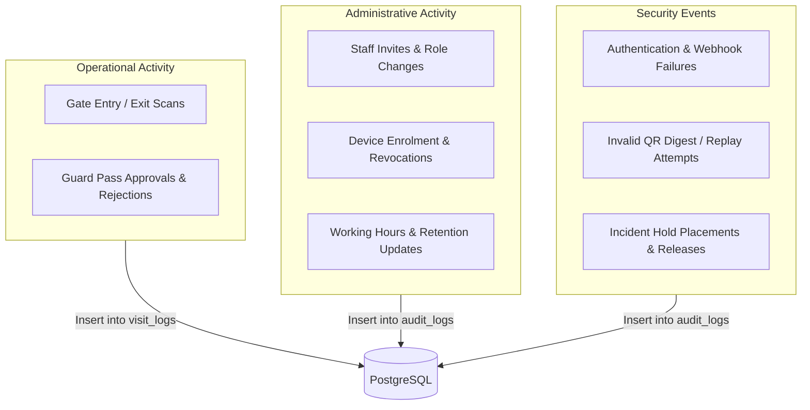
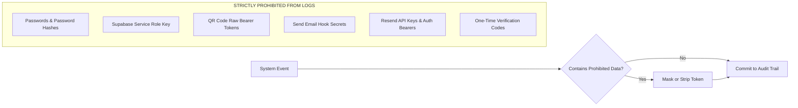

# Audit Logging & Sensitive Data Redaction Policy

This document establishes the audit logging architecture, structured schema, sensitive data redaction standards, and retention guarantees for the EARIST E-GatePass platform.

---

## 1. Audit Log Domains & Storage Architecture

Audit logs provide an immutable, chronologically ordered record of all operational, security, and administrative events across the institution.

Audit tables reject client-side insertions or updates via Row Level Security (RLS). All audit records are authored exclusively by backend serverless functions using parameterized transactions.

---

## 2. Structured Audit Record Schema

Every entry in the `audit_logs` table adheres to the following strict schema:

| Field Name | Type | Description | Example Value |
|---|---|---|---|
| `id` | `UUID` | Unique event identifier | `c3d4e5f6-7890-1234-bcde-fa1b2c3d4e5f` |
| `timestamp` | `TIMESTAMPTZ` | Authoritative UTC timestamp generated by DB | `2026-10-22T08:30:00Z` |
| `actor_id` | `UUID` | Supabase Auth UID or Device ID | `e1f2a3b4-5678-90ab-cdef-1234567890ab` |
| `actor_type` | `VARCHAR(32)` | Identity category: `staff`, `device`, or `system` | `staff` |
| `actor_role` | `VARCHAR(32)` | Resolved DB role: `guard`, `admin`, `superadmin` | `admin` |
| `action` | `VARCHAR(64)` | Standardized event identifier | `staff.create`, `pass.approve` |
| `target_type` | `VARCHAR(32)` | Entity affected: `staff`, `device`, `pass`, `settings` | `staff` |
| `target_id` | `VARCHAR(128)`| Identifier of affected entity | `u_89ab...` |
| `outcome` | `VARCHAR(16)` | Result: `success`, `failure`, `rejected` | `success` |
| `metadata` | `JSONB` | Structured event context (privacy-sanitized) | `{"gate": "Main Gate", "reason": "Official"}` |

---

## 3. Strict Prohibited Logging & Redaction Standard

To prevent credential leakage and comply with security compliance standards, the following sensitive data categories are **STRICTLY PROHIBITED** from appearing in audit logs, system logs, error traces, or metadata fields:

### Prohibited Data Reference Table:

| Sensitive Category | Prohibited Data Type | Permitted Representation in Logs |
|---|---|---|
| **User Credentials** | Raw passwords, password hashes, password reset tokens | Log action `auth.password_reset` with `target_id` only |
| **QR Pass Tokens** | Raw QR bearer token strings | Log only the SHA-256 digest hash (`qr_token_hash`) |
| **API Keys & Secrets** | `SUPABASE_SECRET_KEY`, `RESEND_API_KEY`, `PASS_TOKEN_SECRET` | NEVER log values or partial keys; log provider name only |
| **Webhook Secrets** | `SEND_EMAIL_HOOK_SECRET` | Log only webhook ID and signature status (`valid`/`invalid`) |
| **Verification Codes** | 6-digit one-time email confirmation codes | Log `qr_email.challenge_dispatched` with target email hash |
| **Service Tokens** | Authorization Bearer JWTs | Log resolved `actor_id` and `actor_role` |

---

## 4. Protected Audit Events

Certain audit actions are critical to the legal and security integrity of the campus gate system. These events are classified as **Protected Audit Actions** and are permanently exempt from automated retention cleanup:

1. `staff.create` and `staff.deactivate` (Staff lifecycle tracking).
2. `staff.promote` (Super Admin and Admin privilege escalation).
3. `device.register` and `device.revoke` (Hardware scanner authentication).
4. `settings.update` (Modifications to working hours, retention rules, or gate policies).
5. `incident_hold.create` and `incident_hold.release` (Chain of custody for security investigations).
6. `auth.security_violation` (Repeated rate limit breaches, invalid webhook signatures, or tampered QR tokens).

---

## 5. Audit Log Retention & Archiving

- **Standard Retention Window**: Configured between 90 to 1095 days (Default: 365 days / 1 year).
- **Automated Pruning**: Non-protected audit events older than the configured window are pruned during daily maintenance.
- **Permanent Archival**: Prior to automated purging, institutions requiring compliance records can export audit data via the Super Admin CSV export tool.