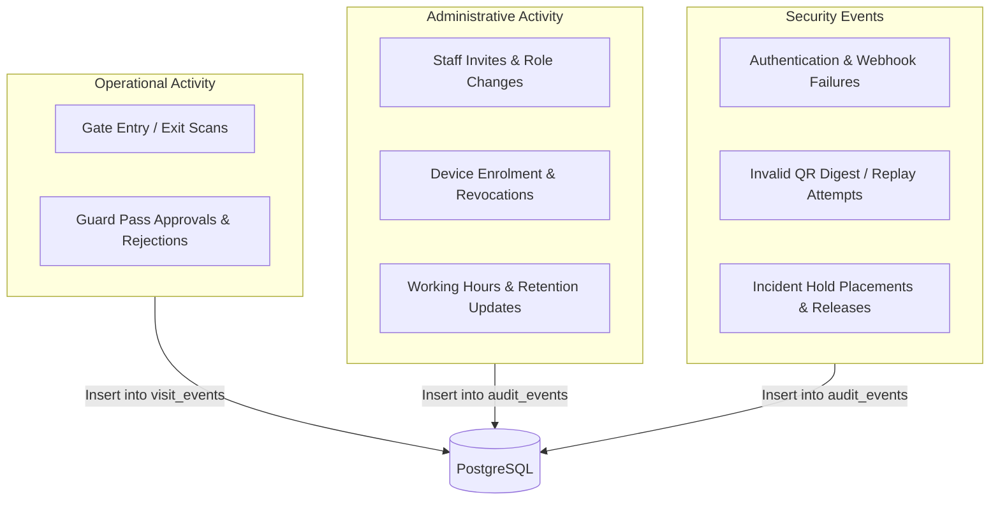
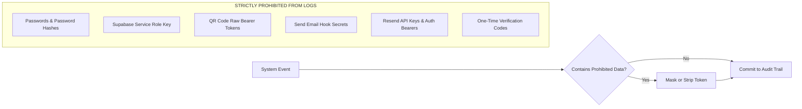

# Audit Logging & Sensitive Data Redaction Policy

This document establishes the audit logging architecture, structured schema, sensitive data redaction standards, and retention guarantees for the EARIST E-GatePass platform.

---

## 1. Audit Log Domains & Storage Architecture

Audit logs provide an immutable, chronologically ordered record of all operational, security, and administrative events across the institution.

Audit tables reject client-side insertions or updates via Row Level Security (RLS). All audit records are authored exclusively by backend serverless functions and `SECURITY DEFINER` stored procedures.

---

## 2. Structured Audit Record Schema

Every entry in the `audit_events` table adheres to the following strict schema:

| Field Name | Type | Description | Example Value |
|---|---|---|---|
| `id` | `BIGINT` | Unique event sequence identifier | `1042` |
| `actor_id` | `UUID` | Supabase Auth UID or Device ID | `e1f2a3b4-5678-90ab-cdef-1234567890ab` |
| `actor_kind` | `TEXT` | Identity category: `staff`, `device`, or `system` | `staff` |
| `actor_role` | `TEXT` | Resolved DB role: `guard`, `admin`, `superadmin` | `admin` |
| `action` | `TEXT` | Standardized canonical event identifier | `superadmin_created` |
| `target_type` | `TEXT` | Entity affected: `staff`, `device`, `pass`, `settings` | `staff` |
| `target_id` | `TEXT` | Identifier of affected entity | `u_89ab...` |
| `before_state` | `JSONB` | Entity state prior to mutation (sanitized) | `{"role": "admin"}` |
| `after_state` | `JSONB` | Entity state after mutation (sanitized) | `{"role": "superadmin"}` |
| `request_id` | `UUID` | Correlating HTTP request identifier | `b2c3d4e5-6789-0123-cdef-ab1234567890` |
| `outcome` | `TEXT` | Result: `success`, `failure`, `rejected` | `success` |
| `occurred_at` | `TIMESTAMPTZ` | Authoritative UTC timestamp generated by DB | `2026-10-22T08:30:00Z` |

---

## 3. Strict Prohibited Logging & Redaction Standard

To prevent credential leakage and comply with security compliance standards, the following sensitive data categories are **STRICTLY PROHIBITED** from appearing in audit events, system logs, error traces, or metadata fields:

### Prohibited Data Reference Table:

| Sensitive Category | Prohibited Data Type | Permitted Representation in Logs |
|---|---|---|
| **User Credentials** | Raw passwords, password hashes, password reset tokens | Log action with `target_id` only; zero password data |
| **QR Pass Tokens** | Raw QR bearer token strings | Log only the SHA-256 digest hash (`passes.token_digest`) |
| **API Keys & Secrets** | `SUPABASE_SECRET_KEY`, `RESEND_API_KEY`, `PASS_TOKEN_SECRET`, `RATE_LIMIT_HMAC_SECRET`, `CRON_SECRET` | NEVER log values or partial keys; log provider name only |
| **Webhook Secrets** | `SEND_EMAIL_HOOK_SECRET`, `RESEND_WEBHOOK_SECRET` | Log only webhook ID and signature status (`valid`/`invalid`) |
| **Email Recipient Identities** | Unmasked email addresses in delivery event audits | Mask recipient email address (`v***r@...`) before inserting into `audit_events` |
| **Verification Codes** | 6-digit one-time email confirmation codes | Log verification challenge ID with hashed code |
| **Service Tokens** | Authorization Bearer JWTs | Log resolved `actor_id` and `actor_role` |

---

## 4. Protected Audit Events

Certain audit actions are critical to the legal and security integrity of the campus gate system. These events are classified as **Protected Audit Actions** and are permanently exempt from automated retention cleanup:

1. `initial_superadmin_bootstrapped`
2. `superadmin_created`
3. `admin_created`
4. `admin_deleted`
5. `device_registered`
6. `device_deleted`
7. `settings_updated`
8. `device_credentials_updated`
9. `user_role_and_status_changed`
10. `user_role_changed`
11. `user_reactivated`
12. `user_deactivated`
13. `maintenance.retention_run`
14. `security_hold_created`
15. `security_hold_released`

---

## 5. Audit Event Retention & Archiving

### 5.1 Webhook Idempotency Event Retention
- **Table**: `public.resend_webhook_events`
- **Purpose**: Deduplication cache for inbound delivery event IDs (`provider_event_id`).
- **Policy Classification**: `OPTIONAL HARDENING — retention period requires explicit policy`.
- **Operational Scope**: The table is append-only for deduplication. Bounded periodic cleanup (e.g. purging provider event IDs older than the maximum provider replay window of 7-30 days) may be implemented once an institutional retention policy is established. Table volume is negligible at present, and deduplication guarantees remain fully active.

- **Standard Retention Window**: Configured between 90 to 1095 days (Default: 365 days / 1 year).
- **Automated Pruning**: Non-protected audit events older than the configured window are pruned during retention maintenance.
- **Permanent Archival**: Prior to automated purging, institutions requiring compliance records can export audit data via the Super Admin export tools.
