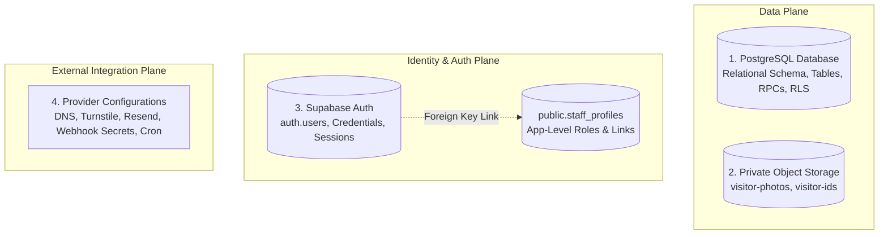
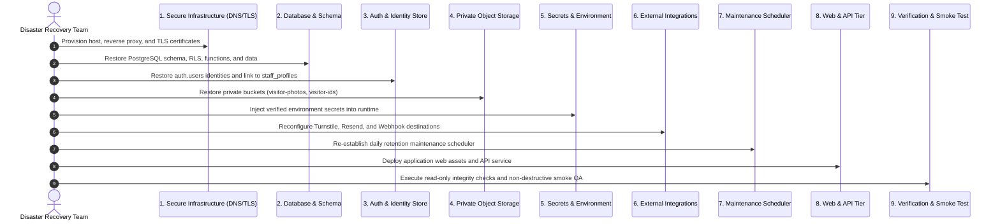

# Institutional Backup & Disaster Recovery Runbook

This document defines the disaster recovery architecture, recoverable asset classification, authoritative restoration sequence, and validation runbook for the EARIST E-GatePass platform.

---

## 1. Classification of Recoverable Asset Classes

A complete institutional disaster recovery strategy must account for **four distinct asset classes**. Backing up the database alone is insufficient to recover the full platform.

---

### Asset Class 1: PostgreSQL Relational Database
- **Scope**:
  - Table schemas, indexes, constraints, and sequences.
  - Relational application data (`visitors`, `passes`, `audit_events`, `app_settings`, `reconciliation_tasks`, `incident_holds`, `devices`).
  - Stored procedures and functions in schemas `api`, `public`, and `private`.
  - Row-Level Security (RLS) policies on all tables.
  - Database triggers and event listeners.
  - Migration history tracking table (`supabase_migrations`).
- **Database Backup Boundary**:
  > [!IMPORTANT]
  > **Database dumps contain ONLY metadata records for visitor evidence.**
  > The database records the storage path (e.g. `visitor_evidence.storage_path`), but the actual binary image data resides in object storage. Restoring the database without restoring object storage leaves passes with broken photo evidence links.

---

### Asset Class 2: Private Object Storage Buckets
- **Scope**:
  - `visitor-photos`: Face selfie images captured during visitor registration and kiosk check-in.
  - `visitor-ids`: Government/institutional ID card scans captured for identity verification.
- **Critical Recovery Invariants**:
  1. **Strict Privacy**: Storage buckets **MUST NEVER** be restored or re-created with public read access (`public = false`).
  2. **Path Integrity**: Binary objects must be restored to their exact relative paths matching `visitor_evidence.storage_path` (e.g. `visitor-photos/<visitor-id>/<timestamp>.jpg`).
  3. **MIME & Metadata**: File content types (`image/jpeg`, `image/png`) must be preserved to prevent corrupted rendering when accessed via presigned URLs.

---

### Asset Class 3: Identity & Authentication State
- **Scope**:
  - `auth.users`: Hashed passwords, email addresses, MFA factors, confirmation timestamps, and system UUIDs.
  - `auth.identities`: Account identity provider bindings.
- **Profile vs. Identity Decoupling**:
  > [!WARNING]
  > **Restoring `public.staff_profiles` alone does NOT restore usable user accounts.**
  > `public.staff_profiles.user_id` references `auth.users.id`. If the authentication store is lost, restoring the application database will yield orphaned staff profiles whose associated users cannot authenticate or reset their passwords. Identity backups must either be recovered from the Supabase Auth backup or re-provisioned via secure administrative invitation.

---

### Asset Class 4: External Provider Configurations & Secret Inventory
- **Scope**:
  - Authoritative DNS records (A, CNAME, TXT for SPF and DKIM).
  - Cloudflare Turnstile widget ID, allowed domain list, and mode.
  - Resend verified sender domain, MX records, and API key permissions.
  - Supabase Auth Site URL and Allowed Redirect URLs (`/reset-password`, `/login`).
  - Webhook endpoint URLs and shared secrets (`SEND_EMAIL_HOOK_SECRET`, `RESEND_WEBHOOK_SECRET`).
  - Scheduled maintenance execution configuration and shared bearer token (`CRON_SECRET`).
- **Credential Storage Rule**:
  - Configuration settings are documented in version control, but **NO secret values or production API keys are committed to Git**.
  - All secret keys must be held in a secure institutional password manager or secrets vault.

---

## 2. Authoritative Conceptual Restoration Sequence

In the event of a catastrophic infrastructure loss, recovery must execute in the following exact sequence to preserve dependencies:

### Detailed Sequence Steps:
1. **Establish Secure Infrastructure**: Provision server hardware, reverse proxy, firewall rules, and TLS termination. Ensure HTTPS is enforced before handling client traffic.
2. **Restore PostgreSQL Database**: Restore schema, tables, `schema('api')` RPCs, triggers, and table rows up to the desired backup point.
3. **Restore Identity / Auth Contract**: Restore `auth.users` identities, ensuring foreign key alignment with `public.staff_profiles.user_id`.
4. **Restore Private Object Storage**: Recreate private buckets (`public = false`) and sync backed-up images preserving object paths and permissions.
5. **Configure Environment Secrets**: Populate production environment variables (`SUPABASE_SECRET_KEY`, `PASS_TOKEN_SECRET`, `RATE_LIMIT_HMAC_SECRET`, `CRON_SECRET`, etc.) from secure vault.
6. **Configure External Integrations**:
   - Update Cloudflare Turnstile allowed domains.
   - Verify Resend DKIM/SPF DNS records.
   - Configure Supabase Auth Site URL and Redirect URLs.
   - Configure Supabase Auth Send Email Hook to point to `POST /api/auth/send-email-hook`.
   - Configure Resend Webhook to point to `POST /api/webhooks/resend`.
7. **Configure Scheduler**: Configure cron schedule (`0 18 * * *` UTC / `02:00 AM` Asia/Manila) with `CRON_SECRET`.
8. **Deploy Application Tier**: Deploy static SPA files and start supervised Node.js API runtime with required security headers.
9. **Run Read-Only Integrity Checks**: Verify database RLS, staff profile linkage, and audit log non-repudiation.
10. **Controlled End-to-End Smoke Test**: Complete visitor pass issuance, scanner authentication, and admin login to confirm operational readiness.

---

## 3. Institutional RPO & RTO Policy

> [!NOTE]
> **INSTITUTIONAL POLICY REQUIRED**
> Recovery objectives must be formally determined and ratified by the EARIST Information and Communications Technology (ICT) administration based on institutional risk tolerance, hardware capacity, and regulatory guidelines.

| Disaster Recovery Parameter | Parameter Definition | Recommended Starting Target | Ratified Institutional Policy |
|---|---|---|---|
| **RPO (Recovery Point Objective)** | Maximum acceptable duration of data loss during a disaster. | 24 Hours (Daily Backups) | *[ INSTITUTIONAL POLICY REQUIRED ]* |
| **RTO (Recovery Time Objective)** | Maximum acceptable system outage duration before service is restored. | 4 Hours | *[ INSTITUTIONAL POLICY REQUIRED ]* |
| **Database Backup Frequency** | Cadence of automated relational database snapshots. | Daily full dump + WAL archiving | *[ INSTITUTIONAL POLICY REQUIRED ]* |
| **Object Storage Backup Frequency** | Cadence of synchronization for private evidence objects. | Daily incremental sync | *[ INSTITUTIONAL POLICY REQUIRED ]* |
| **Backup Retention Window** | Duration for which snapshots are preserved before deletion. | 30 days rolling retention | *[ INSTITUTIONAL POLICY REQUIRED ]* |
| **Off-Site Storage Location** | Geographically isolated secondary backup storage. | Secondary campus data center or cold cloud vault | *[ INSTITUTIONAL POLICY REQUIRED ]* |
| **Restore Drill Cadence** | Frequency of simulated recovery exercises in staging. | Semi-annually / Annual | *[ INSTITUTIONAL POLICY REQUIRED ]* |

---

## 4. Non-Production Restore Drill Checklist

> [!CAUTION]
> **NEVER EXECUTE A DISASTER RECOVERY DRILL AGAINST THE LIVE PRODUCTION ENVIRONMENT.**
> All restoration testing must be performed on an isolated staging server or non-production Supabase instance.

Before declaring a backup valid, operators must execute the following non-destructive verification checklist in a staging environment:

- [ ] **1. Migration History Alignment**:
  - Query `SELECT * FROM supabase_migrations ORDER BY version DESC LIMIT 5;`.
  - Confirm migration version matches the latest committed migration in the repository.
- [ ] **2. Staff Profile & Auth Linkage**:
  - Query `SELECT p.display_name, p.role, u.email FROM public.staff_profiles p JOIN auth.users u ON p.user_id = u.id;`.
  - Confirm staff profiles link to valid, active authentication identities.
- [ ] **3. Pass State Machine Consistency**:
  - Query pass counts by status: `SELECT status, count(*) FROM public.passes GROUP BY status;`.
  - Verify zero orphaned passes or invalid state transitions.
- [ ] **4. Audit Record Integrity**:
  - Query `SELECT count(*) FROM public.audit_events WHERE action = 'superadmin.bootstrap';`.
  - Confirm historical governance audit records remain present and immutable.
- [ ] **5. Private Storage Path Linkage**:
  - Query `SELECT storage_path FROM public.visitor_evidence LIMIT 5;`.
  - Request a presigned URL using `supabase.storage.from('visitor-photos').createSignedUrl(storage_path, 60)`.
  - Confirm image downloads successfully and renders a valid photograph.
- [ ] **6. Storage Bucket Privacy Enforced**:
  - Attempt unauthenticated HTTP GET request directly to public storage URL:
    `curl -I https://<staging-ref>.supabase.co/storage/v1/object/public/visitor-photos/<path>`.
  - **Must return HTTP 400 or HTTP 403 Forbidden** (proving bucket is strictly private).
- [ ] **7. Staff Authentication & MFA**:
  - Log in with a test administrator account via staging web portal.
  - Confirm session token is issued and role permissions are correctly resolved.
- [ ] **8. Retention Maintenance Dry Run**:
  - Invoke maintenance endpoint in dry-run mode:
    `curl -X POST https://staging.example.edu/api/admin/retention-maintenance -H "Authorization: Bearer $CRON_SECRET" -d '{"dryRun": true}'`.
  - Confirm response contains `"status": "success"` and reports evaluated counts without errors.
