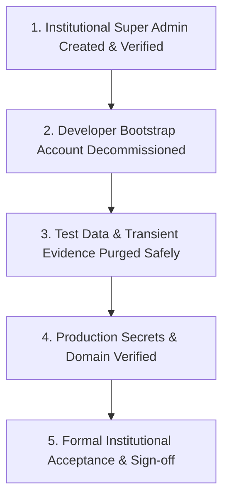

# Institutional Ownership & Clean Data Handoff

This document defines the formal handover protocol for transferring administrative sovereignty, production infrastructure, and clean data state of the EARIST E-GatePass platform to the official EARIST administration.

---

## 1. Handoff Milestone Checklist



| Phase | Task Description | Verification Criteria | Status |
|---|---|---|---|
| **Identity** | Establish institutional Super Admin | Institutional email logged in with role `superadmin` | [ ] COMPLETE |
| **Security** | Decommission developer accounts | Developer bootstrap identity deactivated and Auth access revoked/banned. Permanent deletion performed only through separately authorized operator cleanup when required. | [ ] COMPLETE |
| **Data Hygiene** | Review & purge known test records | Database contains only real institutional records | [ ] COMPLETE |
| **Storage** | Purge test storage objects | Storage buckets contain no transient test artifacts | [ ] COMPLETE |
| **Devices** | Re-enroll physical scanner hardware | Physical Entry/Exit tablets active with gate tags | [ ] COMPLETE |
| **Email** | Verify Resend domain & hook | `egatepass.tech` DNS verified; hook returns HTTP 200 | [ ] COMPLETE |
| **Bot Protection** | Verify Cloudflare Turnstile | Managed Turnstile active on `egatepass.tech` | [ ] COMPLETE |
| **Repository** | Git repository clean & untracked state | Public Git clean; no local DevKit/AI files tracked | [ ] COMPLETE |

---

## 2. Institutional Handoff Ownership Matrix

This matrix establishes formal institutional accountability across all operational categories. **Under no circumstances may plain-text passwords, tokens, or API secrets be written into this document.**

| Operational Category | System Component | Current Owner | Institutional Owner | Handoff Status | Verification Method |
|---|---|---|---|---|---|
| **Git Repository** | Source code & configuration (`jsphhbna/egatepass`) | Modernization Lead | EARIST ICT Department | Ready for Transfer | Verify repository admin permissions granted to institutional GitHub organization. |
| **Application Server** | Vercel production deployment & serverless runtime | Capstone Team Vercel Team | EARIST ICT Vercel Team | Ready for Transfer | Verify project transfer accepted in Vercel dashboard and custom domain active. |
| **Database** | Supabase PostgreSQL 17.x relational instance | Capstone Supabase Org | EARIST ICT Supabase Org | Ready for Transfer | Verify project transfer accepted in Supabase dashboard and DB connection active. |
| **Authentication** | Supabase Auth (GoTrue) service & user accounts | Capstone Supabase Org | EARIST ICT Supabase Org | Ready for Transfer | Verify institutional Super Admin can authenticate and manage staff accounts. |
| **Private Storage** | Supabase Storage (`visitor-photos`, `visitor-ids`) | Capstone Supabase Org | EARIST ICT Supabase Org | Ready for Transfer | Verify bucket privacy (`public = false`) and authenticated image retrieval. |
| **Domain Registrar** | Domain registration (`egatepass.tech`) | get.tech / Orderbox Account | EARIST ICT Domain Custodian | Ready for Transfer | Confirm account management transfer or domain authorization code transfer. |
| **DNS Authority** | Authoritative DNS records (Apex, CNAME, TXT) | Orderbox DNS Manager | EARIST ICT DNS Manager | Ready for Transfer | Query `dig egatepass.tech +trace` to confirm authoritative nameservers. |
| **TLS Certificates** | Edge HTTPS certificate lifecycle | Vercel Managed Let's Encrypt | EARIST ICT Webmaster | Maintained | Inspect SSL certificate chain in browser visiting `https://egatepass.tech`. |
| **Transactional Email** | Resend sending domain & API account | Capstone Resend Account | EARIST ICT Systems Admin | Ready for Transfer | Verify invitation email dispatches with institutional DKIM/SPF passing. |
| **Bot Protection** | Cloudflare Turnstile widget & managed challenge | Capstone Cloudflare Account | EARIST ICT Security Admin | Ready for Transfer | Verify Turnstile widget challenge completes on public `/get-pass` portal. |
| **Backup Storage** | Off-site snapshots & database dumps | Capstone Team Storage | EARIST Data Center / ICT Vault | Ready for Provisioning | Verify first non-production restore drill completed in staging environment. |
| **Monitoring & Telemetry** | Serverless function & database error logs | Vercel / Supabase Dashboards | EARIST ICT NOC / Operations | Ready for Transfer | Confirm institutional operations team has dashboard read/alert access. |
| **Incident Response** | Campus security hold & incident escalation | Capstone Security Lead | EARIST Chief of Security / ICT | Ready for Transition | Execute test incident hold creation and release in Admin console. |
| **Privacy & Data Governance** | Retention enforcement & audit trail custody | Capstone Compliance Lead | EARIST Data Protection Officer | Ready for Transition | Confirm daily retention maintenance runs and audit ledger non-repudiation. |
| **Super Admin Custody** | First human Super Admin credentials | Bootstrap Operator | Director of ICT, EARIST | In Progress | Institutional Super Admin logs in, sets MFA, and confirms staff list access. |
| **Device Credential Custody** | Gate scanner and kiosk tablet logins | Capstone Device Admin | EARIST Campus Security Guard Lead | Ready for Transition | Re-issue device passwords in Admin console and verify scanner login on gates. |

---

## 3. Deployment Manifest Template

The deployment manifest captures the exact, non-secret state of the production environment at handoff. It serves as the baseline record for subsequent institutional operations and audits.

```text
================================================================================
EARIST E-GATEPASS PRODUCTION DEPLOYMENT MANIFEST
================================================================================
Release Baseline Information:
  Git Repository:              github.com/jsphhbna/egatepass
  Git Commit SHA:              [ Commit SHA at handoff ]
  Release Date:                [ ISO 8601 Date / Time ]
  Tested Node.js Runtime:      Node.js 24.x
  PostgreSQL Version:          Supabase PostgreSQL 17.x
  Database Migration Head:     [ Latest applied migration filename ]

Network & Domain Authority:
  Canonical Application Origin: https://egatepass.tech
  Authoritative Registrar:     get.tech
  Authoritative DNS Engine:    Orderbox
  Apex A Record:               216.198.79.1 (Vercel Edge)
  TLS Certificate Issuer:      Let's Encrypt / Vercel Edge

Storage & Data Plane:
  Database Project ID:         [ Supabase Project Reference ]
  Private Storage Buckets:     visitor-photos (private), visitor-ids (private)
  Scheduled Maintenance:       Daily at 18:00 UTC (02:00 AM Asia/Manila) via /api/admin/retention-maintenance
  Maintenance Batch Bound:     50 records per invocation

External Integrations:
  Transactional Email Sender:  EARIST E-GatePass <notifications@egatepass.tech>
  Email Service Provider:      Resend (DKIM, SPF verified)
  Bot Protection Provider:     Cloudflare Turnstile (Managed Challenge)
  Auth Redirect URL Allowlist: https://egatepass.tech/reset-password, https://egatepass.tech/**

Operational State & Governance:
  Initial Super Admin State:   Bootstrapped and confirmed (public.staff_profiles locked)
  Developer Accounts Status:   Deactivated and suspended
  Active Scanner Devices:      [ Count of registered Gate and Kiosk devices ]
  Known Operational Limits:    MXW01 Web Bluetooth direct printing supported on Android/Chromium with browser print fallback; physical hardware acceptance pending on-site testing
  Latest Database Snapshot:    [ Timestamp of verified pre-handoff backup ]
  Latest Restore Drill Date:   [ Timestamp of verified staging restore drill ]
================================================================================
```

---

## 4. Safe Data Sanitization Protocol

Before handing over to live institutional operations, transient test data generated during user acceptance testing must be reviewed and removed safely.

> **CRITICAL DATA INTEGRITY WARNING**: Never execute bulk wildcard deletion scripts or drop tables in production. Foreign-key relationships across `passes`, `visitors`, `visitor_evidence`, `visit_events`, and `staff_profiles` must be respected. Specifically, `public.staff_profiles.user_id` references `auth.users(id)` with `ON DELETE RESTRICT`; attempting to delete an Auth user in the dashboard while their staff profile exists will be rejected. Standard decommissioning is deactivation in Staff Management plus Auth access suspension (`ban_duration: '876000h'`).

### Recommended Procedural Order:
1. **Identify Test Records**:
   - Query candidate test records using explicit IDs, known test timestamps, or specific test UUIDs recorded during validation runs.
   - Example review query:
     ```sql
     SELECT id, full_name, visit_date, created_at
     FROM public.visitors
     ORDER BY created_at DESC
     LIMIT 50;
     ```
2. **Review Candidate Rows**:
   - Ensure selected rows correspond strictly to test exercises and do not touch legitimate institutional entries.
3. **Execute Targeted Application Maintenance**:
   - Utilize administrative purge endpoints (e.g., `POST /api/purge-images` and `POST /api/admin/retention-maintenance`) to clean up transient storage files through the application logic.
4. **Foreign-Key Safe Cleanup**:
   - When manual database cleanup of specific verified test records is required, delete child rows first (`visit_events`, `visitor_evidence`, `incident_holds`, `passes`) before parent `visitors` records, or rely on foreign key constraints.
5. **Database Backup**:
   - Always take a full Supabase PostgreSQL database backup before performing any destructive administrative maintenance.

---

## 5. Infrastructure & Credentials Transfer Procedures

### 5.1 Supabase Project Ownership
1. Go to **Supabase Dashboard > Project Settings > General**.
2. Click **Transfer Project**.
3. Enter the institutional administrator's Supabase account email (e.g. `ict.director@earist.edu.ph`).
4. Institutional owner accepts the transfer.

### 5.2 Vercel Project Team Ownership
1. Navigate to **Vercel Dashboard > Project Settings > Transfer Project**.
2. Transfer project to the official institutional team scope.

### 5.3 Domain & Authoritative DNS Handover
- **Domain registrar / DNS management**: `get.tech`
- **Authoritative DNS infrastructure**: `Orderbox`
- Ensure `get.tech` / Orderbox DNS credentials and management access are transferred to institutional IT administration.
- Web routing: Apex `@ A 216.198.79.1` routes to Vercel production edge.
- Mail authentication: Resend CNAMEs (`send`, `rsend`) and DKIM TXT (`resend._domainkey`) route to Resend.
- DMARC: `_dmarc TXT "v=DMARC1; p=none;"` in monitoring mode.
- Inbound Mail: Zero MX records (inbound email receiving disabled).
- **Cloudflare Boundary**: Cloudflare's role is Turnstile bot protection ONLY. Cloudflare does NOT host authoritative DNS and does NOT proxy or CDN web traffic for `egatepass.tech`.

---

## 6. Final Verification & Acceptance Sign-off

Upon completion of the above steps, both the Lead Engineer and the EARIST Institutional Project Sponsor execute the sign-off record:

```text
================================================================================
EARIST E-GATEPASS PRODUCTION ACCEPTANCE SIGNOFF
================================================================================
Target Production Host:  https://egatepass.tech
Database Provider:       Supabase PostgreSQL
Email Provider:          Resend (notifications@egatepass.tech)
Institutional Lead:      Director of ICT, EARIST
Lead System Architect:   Modernization Team Lead

I hereby confirm that all test accounts and transient test evidence have been
reviewed and sanitized, institutional Super Admin privileges have been
successfully verified, all production credentials have been transferred, and
the system is accepted for live campus gate management.

Signed: ______________________________    Date: ________________________
        (Institutional Administrator)
================================================================================
```
