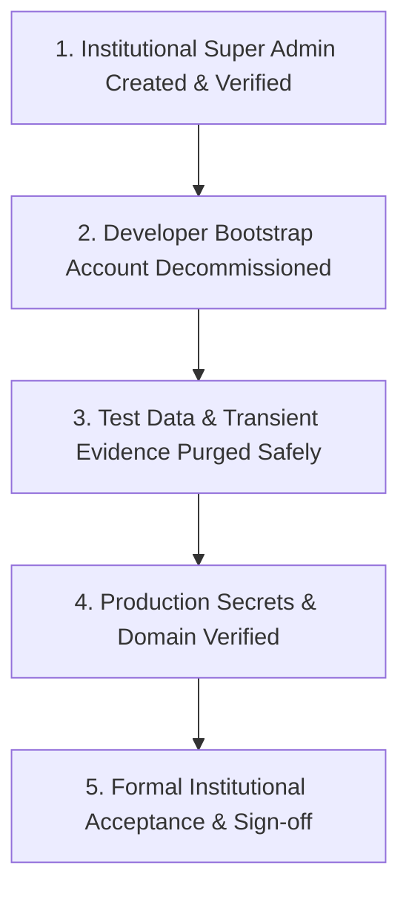

# Institutional Ownership & Clean Data Handoff

This document defines the formal handover protocol for transferring administrative sovereignty, production infrastructure, and clean data state of the EARIST E-GatePass platform to the official EARIST administration.

---

## 1. Handoff Milestone Checklist



| Phase | Task Description | Verification Criteria | Status |
|---|---|---|---|
| **Identity** | Establish institutional Super Admin | Institutional email logged in with role `superadmin` | [ ] COMPLETE |
| **Security** | Decommission developer accounts | Developer bootstrap identity deactivated & deleted | [ ] COMPLETE |
| **Data Hygiene** | Review & purge known test records | Database contains only real institutional records | [ ] COMPLETE |
| **Storage** | Purge test storage objects | Storage buckets contain no transient test artifacts | [ ] COMPLETE |
| **Devices** | Re-enroll physical scanner hardware | Physical Entry/Exit tablets active with gate tags | [ ] COMPLETE |
| **Email** | Verify Resend domain & hook | `egatepass.tech` DNS verified; hook returns HTTP 200 | [ ] COMPLETE |
| **Bot Protection** | Verify Cloudflare Turnstile | Managed Turnstile active on `egatepass.tech` | [ ] COMPLETE |
| **Repository** | Git repository clean & untracked state | Public Git clean; no local DevKit/AI files tracked | [ ] COMPLETE |

---

## 2. Safe Data Sanitization Protocol

Before handing over to live institutional operations, transient test data generated during user acceptance testing must be reviewed and removed safely.

> **CRITICAL DATA INTEGRITY WARNING**: Never execute bulk wildcard deletion scripts or drop tables in production. Foreign-key relationships across `passes`, `visitors`, `visitor_evidence`, and `visit_events` must be respected.

### Recommended Procedural Order:
1. **Identify Test Records**:
   - Query candidate test records using explicit IDs, known test timestamps, or specific test UUIDs recorded during validation runs.
   - Example review query:
     ```sql
     SELECT id, full_name, visit_date, created_at
     FROM public.visitors
     ORDER BY created_at DESC
     LIMIT 50;
     ```
2. **Review Candidate Rows**:
   - Ensure selected rows correspond strictly to test exercises and do not touch legitimate institutional entries.
3. **Execute Targeted Application Maintenance**:
   - Utilize administrative purge endpoints (e.g., `POST /api/purge-images` and `POST /api/admin/retention-maintenance`) to clean up transient storage files through the application logic.
4. **Foreign-Key Safe Cleanup**:
   - When manual database cleanup of specific verified test records is required, delete child rows first (`visit_events`, `visitor_evidence`, `incident_holds`, `passes`) before parent `visitors` records, or rely on foreign key constraints.
5. **Database Backup**:
   - Always take a full Supabase PostgreSQL database backup before performing any destructive administrative maintenance.

---

## 3. Infrastructure & Credentials Transfer

### 3.1 Supabase Project Ownership
1. Go to **Supabase Dashboard > Project Settings > General**.
2. Click **Transfer Project**.
3. Enter the institutional administrator's Supabase account email (e.g. `ict.director@earist.edu.ph`).
4. Institutional owner accepts the transfer.

### 3.2 Vercel Project Team Ownership
1. Navigate to **Vercel Dashboard > Project Settings > Transfer Project**.
2. Transfer project to the official institutional team scope.

### 3.3 Domain & Authoritative DNS Handover
- **Domain registrar / DNS management**: `get.tech`
- **Authoritative DNS infrastructure**: `Orderbox`
- Ensure `get.tech` / Orderbox DNS credentials and management access are transferred to institutional IT administration.
- Web routing: Apex `@ A 216.198.79.1` routes to Vercel production edge.
- Mail authentication: Resend CNAMEs (`send`, `rsend`) and DKIM TXT (`resend._domainkey`) route to Resend.
- DMARC: `_dmarc TXT "v=DMARC1; p=none;"` in monitoring mode.
- Inbound Mail: Zero MX records (inbound email receiving disabled).
- **Cloudflare Boundary**: Cloudflare's role is Turnstile bot protection ONLY. Cloudflare does NOT host authoritative DNS and does NOT proxy or CDN web traffic for `egatepass.tech`.

---

## 4. Final Verification & Acceptance Sign-off

Upon completion of the above steps, both the Lead Engineer and the EARIST Institutional Project Sponsor execute the sign-off record:

```text
================================================================================
EARIST E-GATEPASS PRODUCTION ACCEPTANCE SIGNOFF
================================================================================
Target Production Host:  https://egatepass.tech
Database Provider:       Supabase PostgreSQL
Email Provider:          Resend (notifications@egatepass.tech)
Institutional Lead:      Director of ICT, EARIST
Lead System Architect:   Modernization Team Lead

I hereby confirm that all test accounts and transient test evidence have been
reviewed and sanitized, institutional Super Admin privileges have been
successfully verified, all production credentials have been transferred, and
the system is accepted for live campus gate management.

Signed: ______________________________    Date: ________________________
        (Institutional Administrator)
================================================================================
```
