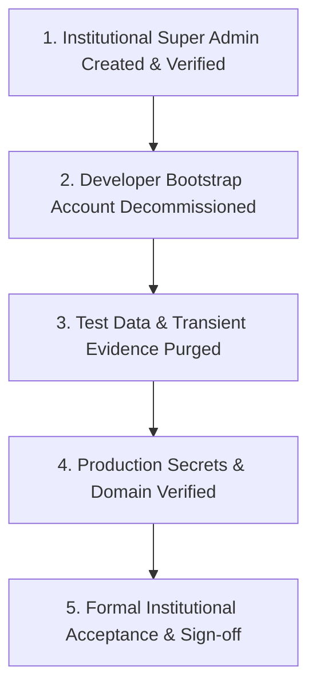

# Institutional Ownership & Clean Data Handoff

This document defines the formal handover protocol for transferring complete administrative sovereignty, production infrastructure, and clean data state of the EARIST E-GatePass platform to the official EARIST administration.

---

## 1. Handoff Milestone Checklist



| Phase | Task Description | Verification Criteria | Status |
|---|---|---|---|
| **Identity** | Establish institutional Super Admin | Institutional email logged in with role `superadmin` | [ ] COMPLETE |
| **Security** | Decommission developer accounts | Developer bootstrap identity deactivated & deleted | [ ] COMPLETE |
| **Data Hygiene** | Purge test visitor & pass records | Database contains only real institutional records | [ ] COMPLETE |
| **Storage** | Purge test storage objects | Supabase `visitor-evidence` contains no test files | [ ] COMPLETE |
| **Devices** | Re-enroll physical scanner hardware | Physical Entry/Exit tablets active with gate tags | [ ] COMPLETE |
| **Email** | Verify Resend domain & hook | `egatepass.tech` DNS verified; hook HTTP 200 | [ ] COMPLETE |
| **Bot Protection** | Verify Cloudflare Turnstile | Managed Turnstile active on `egatepass.tech` | [ ] COMPLETE |
| **Repository** | Git repository clean & untracked state | Public Git clean; no local DevKit/AI files tracked | [ ] COMPLETE |

---

## 2. Step-by-Step Data Sanitization Procedure

Before handing over to production, remove all development and automated test artifacts.

> **SAFETY NOTICE**: Never drop entire database tables or disable RLS in production. Use targeted administrative SQL scripts to preserve schema structure, sequences, and foreign key integrity.

### 2.1 Purging Test Visitors & Gate Passes
In the Supabase SQL Editor:
```sql
-- Remove all test visitor passes and associated logs
DELETE FROM visit_logs WHERE pass_id IN (
    SELECT id FROM gate_passes WHERE notes LIKE '%[TEST]%' OR visitor_name LIKE '%Test%'
);

DELETE FROM gate_passes WHERE notes LIKE '%[TEST]%' OR visitor_name LIKE '%Test%';

DELETE FROM visitors WHERE email LIKE '%@example.com' OR full_name LIKE '%Test%';
```

### 2.2 Purging Test Uploads in Storage
1. In the Supabase Dashboard, open **Storage > visitor-evidence**.
2. Select files marked with test prefixes or expired test dates.
3. Click **Delete Objects**.

### 2.3 Resetting Audit Trail for Production Baseline
Retain security records while purging development tests:
```sql
DELETE FROM audit_logs WHERE actor_email LIKE '%test%' OR target_type = 'test_fixture';
```

---

## 3. Infrastructure & Credentials Transfer

### 3.1 Supabase Project Ownership
1. Go to **Supabase Dashboard > Project Settings > General**.
2. Click **Transfer Project**.
3. Enter the institutional administrator's Supabase account email (e.g. `ict.director@earist.edu.ph`).
4. Institutional owner accepts the transfer.

### 3.2 Vercel Project Team Ownership
1. Navigate to **Vercel Dashboard > Project Settings > Transfer Project**.
2. Transfer project to the official `EARIST ICT Team` scope.

### 3.3 Domain & DNS Handover
- Ensure Cloudflare DNS records for `egatepass.tech` and subdomains are managed within the institutional Cloudflare team account.

---

## 4. Final Verification & Acceptance Sign-off

Upon completion of the above steps, both the Lead Engineer and the EARIST Institutional Project Sponsor execute the sign-off record:

```text
================================================================================
EARIST E-GATEPASS PRODUCTION ACCEPTANCE SIGNOFF
================================================================================
Target Production Host:  https://egatepass.tech
Database Provider:       Supabase Enterprise PostgreSQL
Email Provider:          Resend (notifications@egatepass.tech)
Institutional Lead:      Director of ICT, EARIST
Lead System Architect:   Modernization Team Lead

I hereby confirm that all test accounts and synthetic evidence have been
purged, institutional Super Admin privileges have been successfully verified,
all production credentials have been transferred, and the system is accepted
for live campus gate management.

Signed: ______________________________    Date: ________________________
        (Institutional Administrator)
================================================================================
```