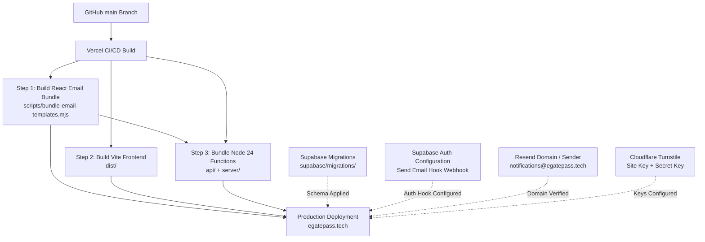
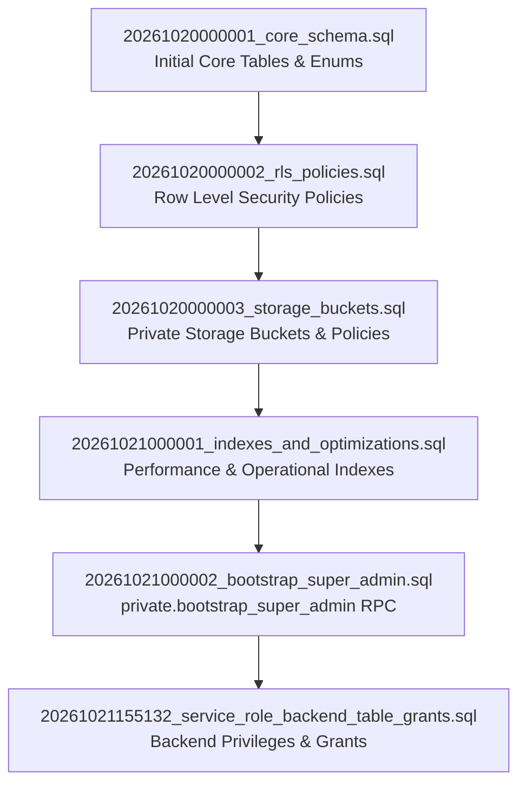
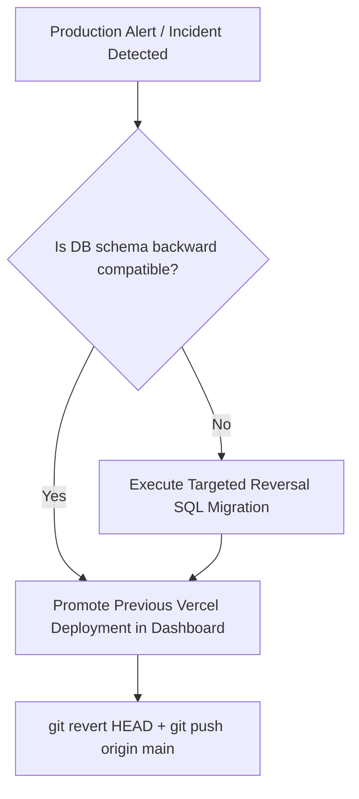

# Production Deployment Guide

This guide details the production deployment architecture and step-by-step procedures for the EARIST E-GatePass platform.

---

## 1. System Deployment Architecture

EARIST E-GatePass runs entirely across four production platforms:
- **Vercel**: Edge/Frontend CDN hosting and Node.js 24 Serverless API Functions.
- **Supabase**: PostgreSQL database, Row Level Security (RLS), Supabase Auth, and private Object Storage.
- **Resend**: Transactional email delivery service.
- **Cloudflare**: DNS and Turnstile bot protection.



---

## 2. Pre-Deployment Checklist

Before merging to `main` or triggering a production deployment:

1. **Working Tree and Commit Status**:
   - Ensure git working tree is clean.
   - Verify `git status` and record the pre-release commit SHA:
     ```bash
     git rev-parse HEAD
     ```
2. **Local Validation**:
   - Run typechecking and tests:
     ```bash
     npm run typecheck:api
     npm run build
     npm test
     ```
3. **Vercel Production Trace Simulation**:
   - Verify file tracing and bundling succeed without missing modules:
     ```bash
     vercel build --prod
     ```
   - Confirm `.vercel/output/functions/api/auth/[...route].func/server/templates/index.js` was generated and contains all 9 templates.

---

## 3. Environment Variables Configuration

Set these environment variables in your Vercel Project Settings (**Settings > Environment Variables**):

| Variable | Scope | Secret? | Purpose / Value Description |
|---|---|---|---|
| `VITE_SUPABASE_URL` | Production, Preview, Dev | No | Supabase public API endpoint (e.g. `https://xyz.supabase.co`) |
| `VITE_SUPABASE_PUBLISHABLE_KEY` | Production, Preview, Dev | No | Supabase publishable anonymous key |
| `VITE_TURNSTILE_SITE_KEY` | Production, Preview, Dev | No | Cloudflare Turnstile public widget site key |
| `SUPABASE_URL` | Production, Preview, Dev | No | Supabase server URL (same as `VITE_SUPABASE_URL`) |
| `SUPABASE_SECRET_KEY` | Production, Preview | **Yes** | Supabase service-role key (bypasses RLS for privileged backend operations) |
| `PASS_TOKEN_SECRET` | Production, Preview | **Yes** | Cryptographic secret (min 32 chars) for HMAC signing of QR pass bearers |
| `RESEND_API_KEY` | Production, Preview | **Yes** | API key from Resend dashboard (`re_...`) |
| `RESEND_FROM_EMAIL` | Production, Preview | No | Authoritative sender address: `EARIST E-GatePass <notifications@egatepass.tech>` |
| `SEND_EMAIL_HOOK_SECRET` | Production, Preview | **Yes** | Secret for Supabase Auth Standard Webhook signature verification |
| `CRON_SECRET` | Production, Preview | **Yes** | Shared bearer secret for authenticating automated cron maintenance tasks |

---

## 4. Supabase Database Migrations

Database migrations are stored in `supabase/migrations/` and must be applied in sequential order.

### Migration Order



### Applying Migrations
- **Via Supabase CLI**:
  ```bash
  supabase db push
  ```
- **Via Supabase Dashboard**:
  Execute SQL files sequentially in the **SQL Editor** of the production Supabase project.

---

## 5. Supabase Auth Send Email Hook Configuration

The system uses a Supabase Auth Send Email Hook to route all system emails through Resend using our custom React Email templates.

1. Navigate to **Authentication > Hooks** in the Supabase Dashboard.
2. Select **Send Email** hook.
3. Configure Hook details:
   - **Hook Type**: `HTTP Webhook`
   - **Endpoint URL**: `https://egatepass.tech/api/auth/send-email-hook`
   - **HTTP Method**: `POST`
   - **Secret**: Set to the exact same value as `SEND_EMAIL_HOOK_SECRET` configured in Vercel.
4. Supabase Auth will sign all incoming webhook requests with standard webhook headers (`webhook-id`, `webhook-timestamp`, `webhook-signature`), which `server/auth-email-hook.ts` validates before dispatching.

---

## 6. Email Delivery & Sender Setup (Resend)

1. Verify domain `egatepass.tech` in the Resend dashboard:
   - Configure SPF, DKIM, and DMARC TXT records in Cloudflare DNS.
   - Wait for domain status: **Verified**.
2. Set sender email to:
   ```text
   EARIST E-GatePass <notifications@egatepass.tech>
   ```
3. Test delivery through automated tests or an administrative test invite.

---

## 7. Cloudflare Turnstile Configuration

1. In the Cloudflare Dashboard, navigate to **Turnstile Sites**.
2. Add `egatepass.tech` and localhost development origins.
3. Choose **Managed** mode.
4. Copy the **Site Key** to `VITE_TURNSTILE_SITE_KEY` and the **Secret Key** to `TURNSTILE_SECRET_KEY` in Vercel.

---

## 8. Post-Deployment Smoke Test Runbook

Immediately after deployment:

1. **Public Landing & Security Headers**:
   - Visit `https://egatepass.tech`.
   - Verify `Strict-Transport-Security`, `Content-Security-Policy`, and other security headers are returned.
2. **Visitor Registration**:
   - Register a visitor pass on the public portal.
   - Complete Turnstile verification.
   - Capture a photo and valid ID (camera-only).
   - Confirm pass issuance displays the QR code.
3. **Device / Staff Authentication**:
   - Log into a scanner device account (e.g. Entry scanner).
   - Log into an Admin account.
4. **Auth Email Hook Test**:
   - Send an admin invite or password reset.
   - Verify recipient receives an email branded with EARIST logo within seconds.
5. **Vercel Function Logs**:
   - Check Vercel Function logs for `/api/auth/send-email-hook` and confirm HTTP 200 responses with zero `ERR_MODULE_NOT_FOUND` errors.

---

## 9. Rollback Procedure

If a critical production defect is detected:



1. **Instant Frontend/API Rollback**:
   - In the Vercel Dashboard, go to **Deployments**.
   - Select the previous stable deployment and click **Redeploy / Assign Domain**. Instant traffic switchover takes < 5 seconds.
2. **Git Synchronization**:
   - Revert the problematic commit locally:
     ```bash
     git revert <bad-commit-sha>
     git push origin main
     ```
3. **Database Safeguard**:
   - Production migrations must always be written in a backward-compatible manner (expand-contract pattern) so older API versions continue to function.