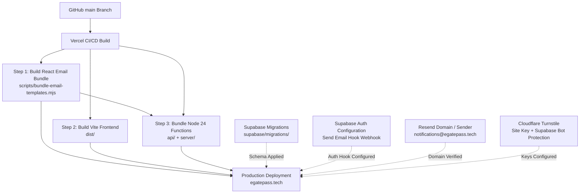
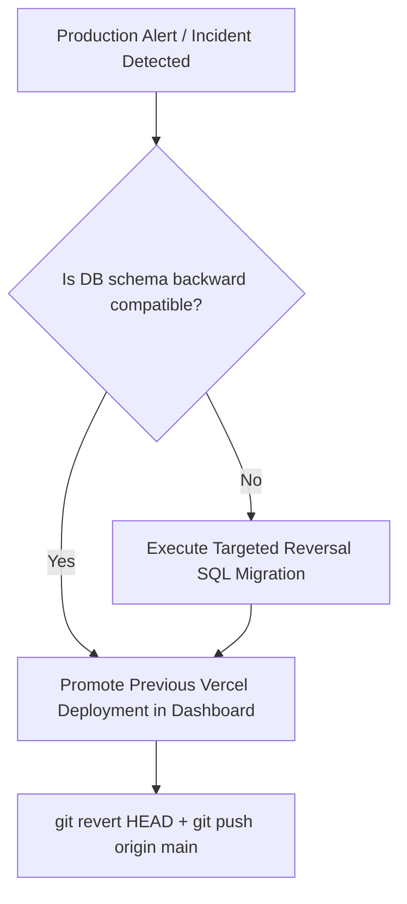

# Production Deployment Guide

This guide details the production deployment architecture and step-by-step procedures for the EARIST E-GatePass platform.

---

## 1. System Deployment Architecture

EARIST E-GatePass runs across external production service providers:
- **Vercel**: Edge/Frontend CDN hosting and Node.js 24 Serverless API Functions.
- **Supabase**: PostgreSQL database, Row Level Security (RLS), Supabase Auth, and private Object Storage (`visitor-photos`, `visitor-ids`).
- **Resend**: Transactional email delivery and delivery observability webhooks.
- **Cloudflare**: Cloudflare Turnstile bot protection widget (Managed mode) ONLY. Cloudflare does NOT manage authoritative DNS or proxy web traffic.
- **get.tech / Orderbox**: Authoritative DNS infrastructure and registrar for `egatepass.tech`. Apex routes to Vercel (`@ A 216.198.79.1`), mail authentication routes to Resend DKIM/SPF, DMARC monitoring mode (`p=none`), zero MX records.



---

## 2. Pre-Deployment Checklist

Before merging to `main` or triggering a production deployment:

1. **Working Tree and Commit Status**:
   - Ensure git working tree is clean.
   - Verify `git status` and record the pre-release commit SHA:
     ```bash
     git rev-parse HEAD
     ```
2. **Local Validation**:
   - Run typechecking and tests:
     ```bash
     npm run typecheck:api
     npm run build
     npm test
     ```
3. **Vercel Production Trace Simulation**:
   - Verify file tracing and bundling succeed without missing modules:
     ```bash
     npx vercel build --prod
     ```
   - Confirm `.vercel/output/functions/api/auth/[...route].func/server/templates/index.js` was generated and contains all 9 templates.

---

## 3. Environment Variables & Scope Isolation

Configure environment variables in your Vercel Project Settings (**Settings > Environment Variables**):

| Variable | Scope | Secret? | Purpose / Value Description |
|---|---|---|---|
| `VITE_SUPABASE_URL` | Production, Preview, Dev | No | Supabase public API endpoint (e.g. `https://xyz.supabase.co`) |
| `VITE_SUPABASE_PUBLISHABLE_KEY` | Production, Preview, Dev | No | Supabase publishable anonymous key |
| `VITE_TURNSTILE_SITE_KEY` | Production, Dev | No | Cloudflare Turnstile public widget site key (Production-only in Vercel) |
| `SUPABASE_URL` | Production, Preview, Dev | No | Supabase server URL (same as `VITE_SUPABASE_URL`) |
| `SUPABASE_SECRET_KEY` | **Production Only** | **Yes** | Supabase service-role key (bypasses RLS for privileged backend operations) |
| `PASS_TOKEN_SECRET` | **Production Only** | **Yes** | Cryptographic secret (min 32 chars) for HMAC signing of QR pass bearers |
| `RATE_LIMIT_HMAC_SECRET` | **Production Only** | **Yes** | Dedicated cryptographic key (min 32 chars) for client IP rate-limit HMAC |
| `CRON_SECRET` | **Production Only** | **Yes** | Shared bearer secret for authenticating retention maintenance requests |
| `RESEND_API_KEY` | **Production Only** | **Yes** | API key from Resend dashboard (`re_...`) |
| `RESEND_FROM_EMAIL` | Production, Dev | No | Authoritative sender address: `EARIST E-GatePass <notifications@egatepass.tech>` |
| `SEND_EMAIL_HOOK_SECRET` | **Production Only** | **Yes** | Secret for Supabase Auth Standard Webhook signature verification |
| `RESEND_WEBHOOK_SECRET` | **Production Only** | **Yes** | Secret for Resend Delivery Webhook standard signature verification |

> **PREVIEW ENVIRONMENT ISOLATION RULE**: Production privileged server secrets (`SUPABASE_SECRET_KEY`, `PASS_TOKEN_SECRET`, `RATE_LIMIT_HMAC_SECRET`, `CRON_SECRET`, `RESEND_API_KEY`, `SEND_EMAIL_HOOK_SECRET`, `RESEND_WEBHOOK_SECRET`) MUST NEVER be injected into generic Vercel Preview environments. Generic Preview environments are SSO-protected and receive only public frontend configuration.

---

## 4. Supabase Database Migrations

Database migrations are stored in `supabase/migrations/` and must be applied in sequential order.

### Applying Migrations
- **Via Supabase CLI**:
  ```bash
  npx supabase db push --yes
  ```
- **Forward Migration Policy**:
  Existing applied migrations must never be altered retroactively. All schema additions (such as `20261023140000_resend_webhook_idempotency.sql`) are committed as new forward migrations.

---

## 5. Webhook Integration Architecture

The platform operates two distinct, single-purpose webhooks. **Neither webhook is an inbound user mailbox or reply receiver.**

### 5.1 Outbound Auth Email Dispatch: Supabase Auth Send Email Hook
- **Purpose**: Routes all authentication emails (staff invites, password resets, magic links) through our branded React Email templates via Resend.
- **Endpoint URL**: `https://egatepass.tech/api/auth/send-email-hook`
- **Method**: `POST`
- **Verification**: Verified using `standardwebhooks` protocol with `SEND_EMAIL_HOOK_SECRET`.
- **Configuration**: Supabase Dashboard > **Authentication > Hooks > Send Email**.

### 5.2 Inbound Delivery Observability: Resend Delivery Webhook
- **Purpose**: Reports real-time delivery outcomes (sent, delivered, delayed, bounced, complained) of dispatched emails.
- **Endpoint URL**: `https://egatepass.tech/api/webhooks/resend` (rewritten to `/api/auth/resend-webhook`)
- **Method**: `POST`
- **Verification**: Verified using Svix / Standard Webhook signatures with `RESEND_WEBHOOK_SECRET`.
- **Operational Status**: **Verified operational** (real `email.sent` and `email.delivered` provider events observed in production).
- **Transactional Idempotency**: Atomic database claim and delivery audit logging via authoritative RPC `api.record_resend_delivery_event` (Migrations `20261023140000` and `20261023160000`).
- **Atomic Rollback**: If delivery audit insertion fails, the entire transaction rolls back, leaving `provider_event_id` unconsumed so provider retry can re-dispatch safely.
- **Replay**: Replays return HTTP 200 `already_processed` with no duplicate audit record.
- **Privacy**: Recipient emails are masked (`v***r@...`) before storing in `audit_events`.
- **Configuration**: Resend Dashboard > **Webhooks**.

---

## 6. Email Delivery & Sender Setup (Resend)

1. **Domain Verification**:
   - `egatepass.tech` is verified in Resend with DKIM and SPF TXT records.
   - Open tracking and click tracking are disabled in Resend dashboard settings.
2. **Sender Identity**:
   ```text
   EARIST E-GatePass <notifications@egatepass.tech>
   ```
3. **Legacy SMTP Credential (Manual Action Required)**:
   > [!IMPORTANT]
   > **MANUAL OWNER ACTION REQUIRED**
   > - **Provider**: Resend
   > - **Resource**: API key named `egatepass-supabase-smtp`
   > - **Action**: Revoke/delete the legacy key in Resend dashboard after verifying no SMTP fallback is intentionally retained.
   > - **Impact**: Current Send Email Hook + Resend REST API architecture remains unaffected.
   > - **Verification afterward**: Confirm Supabase Auth Send Email Hook still succeeds and test invitation/password-reset email delivers.

---

## 7. Cloudflare Turnstile Configuration

1. In the Cloudflare Dashboard, verify the Turnstile widget for `egatepass.tech`.
2. Widget runs in **Managed** mode.
3. Public site key is configured in `VITE_TURNSTILE_SITE_KEY` in Vercel (Production-only).
4. Turnstile Secret Key is configured in Supabase Dashboard under **Authentication > Bot Protection / CAPTCHA**.
5. **Fail-Closed Protection**: In Production, any missing site key or missing CAPTCHA response on protected surfaces (visitor portal, staff login, forgot password) fails closed immediately.

---

## 8. Post-Deployment Smoke Test Runbook

Immediately after deployment:

1. **Public Landing & Security Headers**:
   - Visit `https://egatepass.tech`.
   - Verify `Strict-Transport-Security`, `Content-Security-Policy`, and other security headers are returned.
2. **Visitor Registration**:
   - Register a visitor pass on the public portal.
   - Complete Turnstile verification.
   - Capture a photo and valid ID (camera-only).
   - Confirm pass issuance displays the QR code.
3. **Staff / Scanner Authentication**:
   - Log into a scanner device account (e.g. Entry scanner).
   - Log into an Admin account.
4. **Auth Email Hook Test**:
   - Send an admin invite or password reset.
   - Verify recipient receives an email branded with EARIST logo within seconds.
5. **Resend Webhook Verification**:
   - Check Vercel Function logs for `/api/webhooks/resend`. Verify HTTP 200 responses with zero unhandled exceptions.

---

## 9. Rollback Procedure

If a critical production defect is detected:



1. **Instant Frontend/API Rollback**:
   - In the Vercel Dashboard, go to **Deployments**.
   - Select the previous stable deployment and click **Redeploy / Assign Domain**. Instant traffic switchover takes < 5 seconds.
2. **Git Synchronization**:
   - Revert the problematic commit locally:
     ```bash
     git revert <bad-commit-sha>
     git push origin main
     ```
3. **Database Safeguard**:
   - Production migrations must always be written in a backward-compatible manner (expand-contract pattern) so older API versions continue to function.
