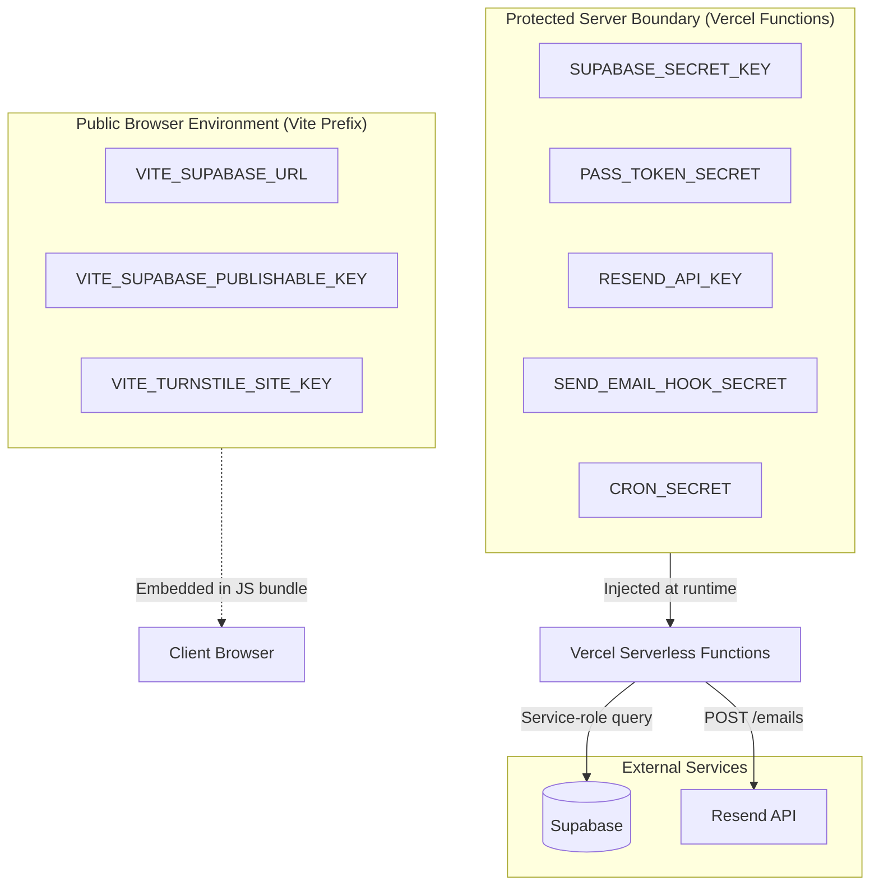

# Environment Variables Contract

This document is the authoritative specification for all configuration and secrets across the client, serverless functions, and external integrations in the EARIST E-GatePass platform.

> **CRITICAL SECURITY RULE**: Never commit real secret values, credentials, or production tokens into version control. Local overrides belong in `.env.local`, which is strictly ignored by Git.

---

## 1. Complete Environment Variables Matrix

| Variable | Scope | Secret? | Used By | Required? | Example Format / Notes |
|---|---|---|---|---|---|
| `VITE_SUPABASE_URL` | Browser & Vite Build | No | Client application (`src/lib/supabase.ts`) | **Yes** | `https://xyzproject.supabase.co` |
| `VITE_SUPABASE_PUBLISHABLE_KEY` | Browser & Vite Build | No | Client application (`src/lib/supabase.ts`) | **Yes** | `eyJhbGciOiJIUzI1Ni...` (Supabase anonymous / publishable key) |
| `VITE_TURNSTILE_SITE_KEY` | Browser & Vite Build | No | Visitor registration Turnstile widget | **Yes** in prod | `0x4AAAAAA...` (Cloudflare Turnstile site key) |
| `SUPABASE_URL` | Vercel Serverless | No | Node.js API Functions (`server/supabase.ts`) | **Yes** | `https://xyzproject.supabase.co` |
| `SUPABASE_SECRET_KEY` | Vercel Serverless | **Yes** | Server-side admin client (`server/supabase.ts`) | **Yes** | `eyJhbGciOiJIUzI1Ni...` (Supabase service-role secret; bypasses RLS) |
| `PASS_TOKEN_SECRET` | Vercel Serverless | **Yes** | QR token derivation (`server/routes/passes/issue.ts`) | **Yes** | Random alphanumeric string, **minimum 32 characters** |
| `RESEND_API_KEY` | Vercel Serverless | **Yes** | Transactional email & Auth Email Hook (`server/email.ts`) | **Yes** | `re_abc123_xyz...` |
| `RESEND_FROM_EMAIL` | Vercel Serverless | No | Sender identity for transactional emails | **Yes** | `EARIST E-GatePass <notifications@egatepass.tech>` |
| `SEND_EMAIL_HOOK_SECRET` | Vercel Serverless | **Yes** | Supabase Auth Send Email Hook verification | **Yes** | Shared secret configured in Supabase Auth Webhook settings |
| `CRON_SECRET` | Vercel Serverless | **Yes** | Bearer auth for retention maintenance requests | **Yes** | Random alphanumeric string, **minimum 32 characters** |

> **Turnstile Secret Key Note**: The Cloudflare Turnstile Secret Key is configured directly in the Supabase Dashboard under **Authentication > CAPTCHA / Bot & Abuse Protection**, as Supabase Auth performs token validation during `signInAnonymously`. It is not configured as an environment variable in Vercel.

---

## 2. Environment Classification & Trust Boundaries



### 2.1 Browser-Visible Variables (`VITE_*`)
- Variables prefixed with `VITE_` are bundled directly into the compiled JavaScript bundle by Vite.
- They are accessible to anyone inspecting browser network traffic or HTML sources.
- They must NEVER contain service-role keys, database passwords, or private signing secrets.

### 2.2 Server-Only Secrets
- Injected exclusively into Vercel Serverless Function execution containers.
- They are completely invisible to the frontend and are omitted from client bundles.
- They govern administrative database access, cryptographic signing, webhook authentication, and email dispatch.

---

## 3. Local Development Configuration (`.env.local`)

For local development, create a `.env.local` file at the root of the repository:

```env
# Client Configuration
VITE_SUPABASE_URL=http://127.0.0.1:54321
VITE_SUPABASE_PUBLISHABLE_KEY=eyJhbGciOiJIUzI1NiIsInR5cCI6IkpXVCJ9.your-local-anon-key
VITE_TURNSTILE_SITE_KEY=1x00000000000000000000AA

# Server Configuration
SUPABASE_URL=http://127.0.0.1:54321
SUPABASE_SECRET_KEY=eyJhbGciOiJIUzI1NiIsInR5cCI6IkpXVCJ9.your-local-service-role-key
PASS_TOKEN_SECRET=local-development-pass-token-secret-minimum-32-chars-long
RESEND_API_KEY=re_local_dummy_key_for_testing
RESEND_FROM_EMAIL="EARIST E-GatePass <notifications@egatepass.tech>"
SEND_EMAIL_HOOK_SECRET=local-development-send-email-hook-secret-minimum-32-chars
CRON_SECRET=local-development-cron-secret-minimum-32-chars
```

---

## 4. Production Secret Rotation Guidelines

1. **`PASS_TOKEN_SECRET`**:
   - Because QR pass bearer tokens are derived with HMAC, existing physical QR code verification relies on the stored digest `passes.token_digest`. Rotating this secret causes subsequent idempotent issuance replay attempts to detect a secret mismatch. Rotate during scheduled maintenance.
2. **`SEND_EMAIL_HOOK_SECRET`**:
   - Update in Supabase Auth Webhook settings simultaneously with Vercel environment variables.
3. **`SUPABASE_SECRET_KEY`**:
   - Regenerate in the Supabase Dashboard under **Project Settings > API > JWT Secrets**.
   - Update in Vercel environment variables and redeploy immediately.
