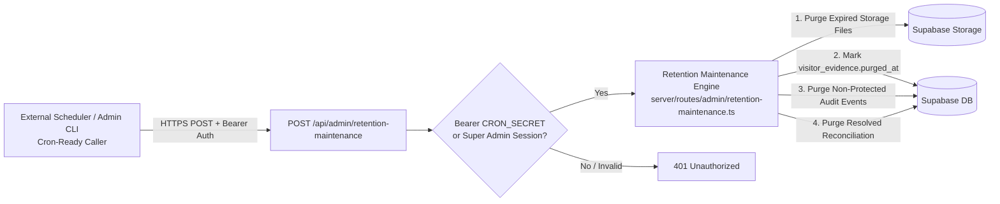
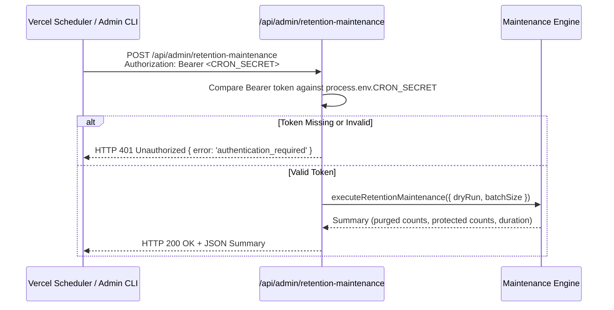
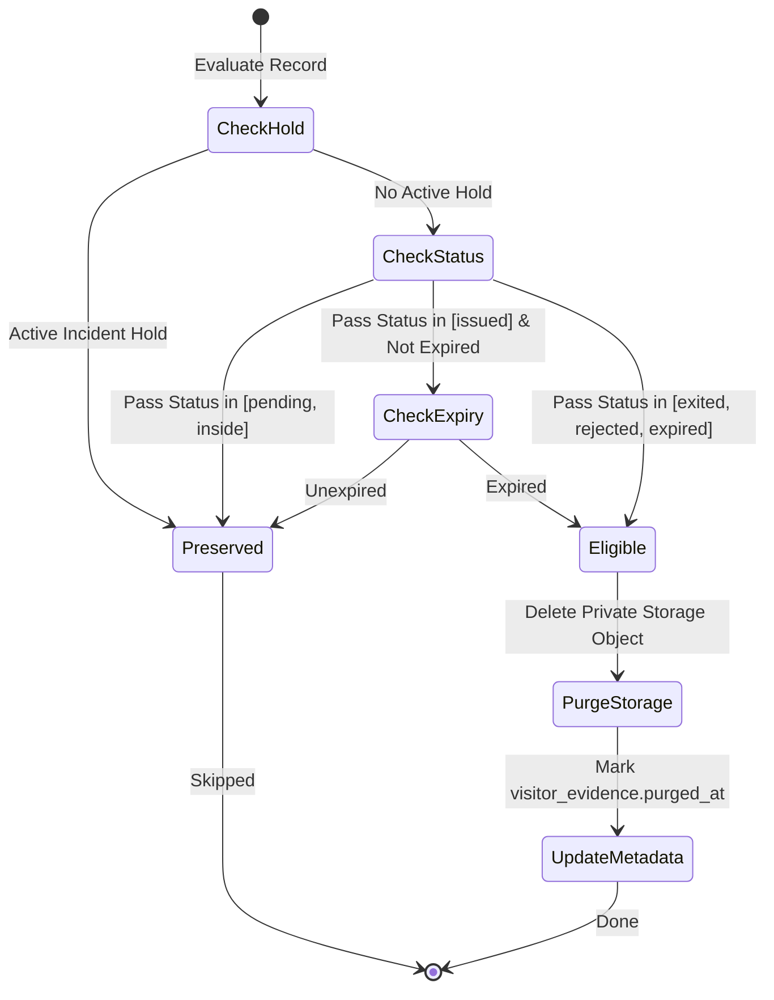

# Maintenance Operations & Cron Readiness

This document describes the retention maintenance architecture, cron-ready invocation contracts, and security policies governing daily retention cleanup and cross-system reconciliation.

---

## 1. Cron Configuration Status & Reality

> **IMPORTANT OPERATIONAL NOTE**: The repository does **NOT** currently configure an automatic schedule in `vercel.json`. Retention maintenance is **cron-ready** via its authenticated HTTP endpoint, but automated scheduling requires explicit institutional configuration by the platform owner.



---

## 2. Maintenance Endpoint Specification

The canonical endpoint for retention maintenance is:

```text
POST /api/admin/retention-maintenance
GET  /api/admin/retention-maintenance
```

### 2.1 Authentication & Caller Authority
The endpoint supports dual authentication mechanisms:
1. **Machine-to-Machine (Cron)**: Requires `Authorization: Bearer <CRON_SECRET>`.
2. **Interactive Super Admin**: Requires an active Supabase Auth session with `role = 'superadmin'`.

### 2.2 Request Parameters (JSON Body)
```json
{
  "dryRun": false,
  "batchSize": 50
}
```
- `dryRun` (boolean, default: `false`): When `true`, evaluates eligible records without performing storage deletions or database updates.
- `batchSize` (integer, default: `50`, min: `1`, max: `200`): Bounded batch size to prevent serverless function timeouts.

---

## 3. Invocation Authentication Sequence



---

## 4. Maintenance Execution Logic & Invariants



### Safety Invariants Enforced:
1. **Pass Status Protection**: Passes in status `pending` or `inside` are NEVER purged.
2. **Active Passes**: Passes that are currently active and unexpired are NEVER purged.
3. **Incident Holds**: Any visitor or pass with an active row in `public.incident_holds` is indefinitely protected from deletion until released by an administrator.
4. **Protected Audit Events**: Security-critical governance actions are permanently preserved:
   - **Current Canonical Actions**:
     `superadmin.bootstrap`, `staff.create`, `staff.update`,
     `device.create`, `device.update`, `device.retire`, `device.password_update`,
     `settings_updated`, `maintenance.retention_run`,
     `security_hold_created`, `incident_hold.released`
   - **Backward-Compatible Legacy Aliases**:
     `initial_superadmin_bootstrapped`, `superadmin_created`, `admin_created`, `admin_deleted`,
     `device_registered`, `device_deleted`, `device_credentials_updated`,
     `user_role_and_status_changed`, `user_role_changed`, `user_reactivated`, `user_deactivated`,
     `security_hold_released`

---

## 5. Manual Invocation & Operator Diagnostics

Administrators can manually trigger maintenance from the terminal:

```bash
curl -X POST https://egatepass.tech/api/admin/retention-maintenance \
  -H "Authorization: Bearer $CRON_SECRET" \
  -H "Content-Type: application/json" \
  -d '{"batchSize": 50, "dryRun": false}'
```

### Expected Response:
```json
{
  "status": "success",
  "purged": {
    "storageFiles": 14,
    "auditEvents": 42,
    "reconciliationTasks": 2
  },
  "protected": {
    "incidentHoldsActive": 3,
    "activeInsidePasses": 12
  },
  "durationMs": 380
}
```

---

## 6. Enabling Scheduled Vercel Cron (Optional Post-Handoff Step)

If the institutional owner wishes to enable automated daily cron execution, add the following to `vercel.json` and deploy:

```json
{
  "crons": [
    {
      "path": "/api/admin/retention-maintenance",
      "schedule": "0 18 * * *"
    }
  ]
}
```
*(Note: 18:00 UTC corresponds to 02:00 AM Asia/Manila time. Do not add this configuration without institutional sign-off).*
