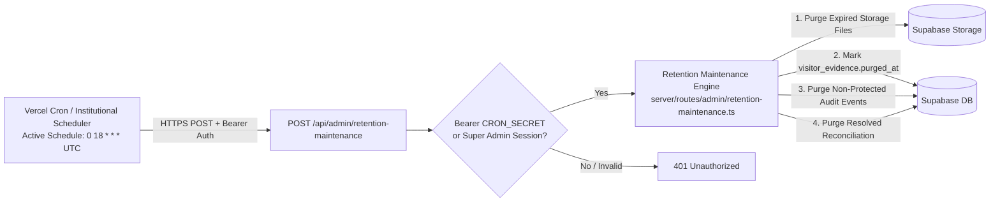
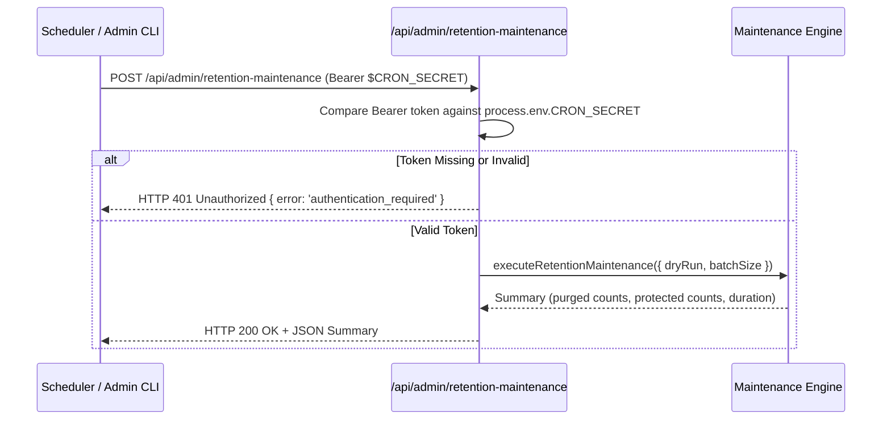
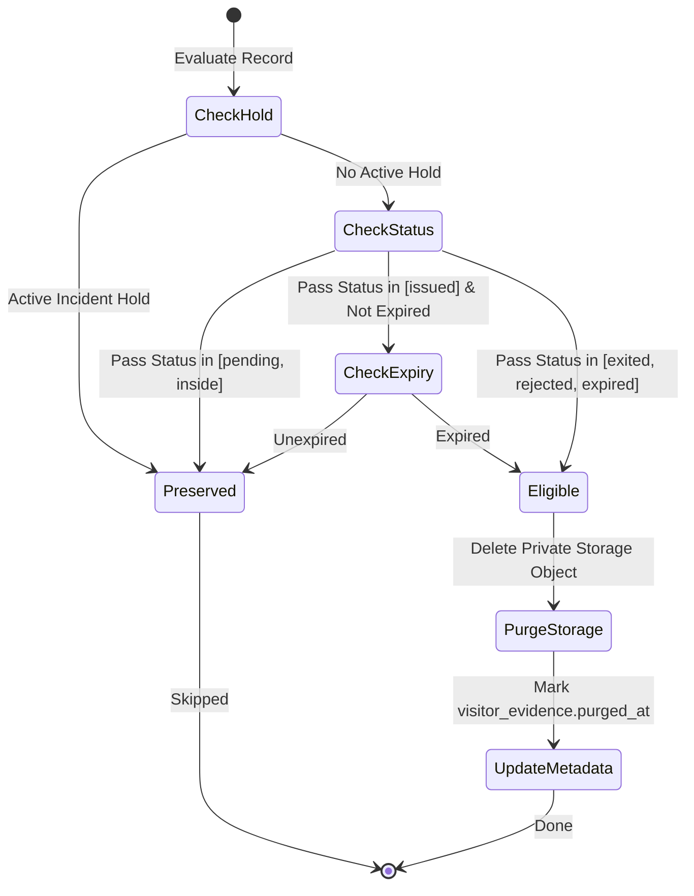

# Maintenance Operations & Scheduled Cron Architecture

This document describes the retention maintenance architecture, production cron configuration in `vercel.json`, self-hosted scheduler invocation contracts, and security policies governing daily retention cleanup and cross-system reconciliation.

---

## 1. Cron Configuration Status & Production Schedule

> **OPERATIONAL STATUS**: Scheduled retention maintenance is **configured and active** in `vercel.json`. It is not merely "cron-ready"—it executes automatically in production.

### Production Schedule Specification:
- **Configured Target**: `/api/admin/retention-maintenance`
- **Schedule Expression**: `0 18 * * *`
- **Cron Expression Timezone**: **UTC** (18:00 UTC)
- **Local Time Equivalent**: Approximately **02:00 AM Asia/Manila** on the next calendar day (UTC+8).
- **Configuration Source**: Committed in `vercel.json` under `crons`:
  ```json
  {
    "crons": [
      {
        "path": "/api/admin/retention-maintenance",
        "schedule": "0 18 * * *"
      }
    ]
  }
  ```



---

## 2. Maintenance Endpoint Specification

The canonical endpoint for retention maintenance is:

```text
POST /api/admin/retention-maintenance
GET  /api/admin/retention-maintenance
```

### 2.1 Authentication & Caller Authority
The endpoint supports dual authentication mechanisms:
1. **Machine-to-Machine (Cron / Scheduled Jobs)**: Requires HTTP header `Authorization: Bearer <CRON_SECRET>` where `<CRON_SECRET>` matches `process.env.CRON_SECRET`.
2. **Interactive Super Admin**: Requires an active Supabase Auth session with `role = 'superadmin'`.

### 2.2 Request Parameters (JSON Body)
```json
{
  "dryRun": false,
  "batchSize": 50
}
```
- `dryRun` (boolean, default: `false`): When `true`, evaluates eligible records without performing storage deletions or database updates.
- `batchSize` (integer, default: `50`, min: `1`, max: `200`): Bounded batch size to prevent serverless function timeouts or excessive database transaction duration.

---

## 3. Invocation Authentication Sequence



---

## 4. Maintenance Execution Logic & Invariants



### Safety Invariants Enforced:
1. **Pass Status Protection**: Passes in status `pending` or `inside` are NEVER purged.
2. **Active Passes**: Passes that are currently active and unexpired are NEVER purged.
3. **Incident Holds**: Any visitor or pass with an active row in `public.incident_holds` is indefinitely protected from deletion until explicitly released by an administrator.
4. **Protected Audit Events**: Security-critical governance actions are permanently preserved:
   - **Current Canonical Actions**:
     `superadmin.bootstrap`, `staff.create`, `staff.update`,
     `device.create`, `device.update`, `device.retire`, `device.password_update`,
     `settings_updated`, `maintenance.retention_run`,
     `security_hold_created`, `incident_hold.released`
   - **Backward-Compatible Legacy Aliases**:
     `initial_superadmin_bootstrapped`, `superadmin_created`, `admin_created`, `admin_deleted`,
     `device_registered`, `device_deleted`, `device_credentials_updated`,
     `user_role_and_status_changed`, `user_role_changed`, `user_reactivated`, `user_deactivated`,
     `security_hold_released`

---

## 5. Self-Hosted Scheduled Maintenance & Terminal Invocation

For an institution-owned server or off-Vercel deployment, scheduled maintenance must be configured using an operating system scheduler (e.g. Linux cron, systemd timer) invoking `/api/admin/retention-maintenance`.

### 5.1 Invocation Command Contract
Administrators or scheduled system tasks invoke the endpoint with the machine secret:

```bash
curl -X POST https://gatepass.example.edu/api/admin/retention-maintenance \
  -H "Authorization: Bearer $CRON_SECRET" \
  -H "Content-Type: application/json" \
  -d '{"batchSize": 50, "dryRun": false}'
```

> **Security Rule**: Never expose `$CRON_SECRET` as a literal in shell scripts, cron tabs, or command histories. Always pass it via an environment variable loaded from a protected credential store.

### 5.2 Expected JSON Response:
```json
{
  "status": "success",
  "purged": {
    "storageFiles": 14,
    "auditEvents": 42,
    "reconciliationTasks": 2
  },
  "protected": {
    "incidentHoldsActive": 3,
    "activeInsidePasses": 12
  },
  "durationMs": 380
}
```

### 5.3 Operational Best Practices:
- **Bounded Batches**: Processing runs in bounded batches (default 50). If a massive backlog exists, successive runs will progressively clear the backlog without table locks.
- **Dry Run Verification**: Prior to policy adjustments or after database restorations, execute with `{"dryRun": true}` to preview candidates without executing physical deletes.
- **Log Review**: Ensure scheduler logs redirect to a monitored log file (e.g. `/var/log/egatepass-maintenance.log`) and check for HTTP 200 responses.
- **Retry Behavior**: If a maintenance run encounters a transient database or network error, it will exit with a non-zero status. Schedulers should log the alert and retry on the next regular daily cycle. Unfinished items remain eligible for subsequent runs.
