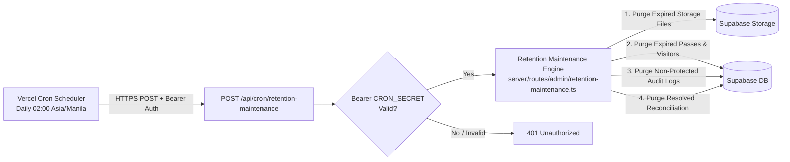
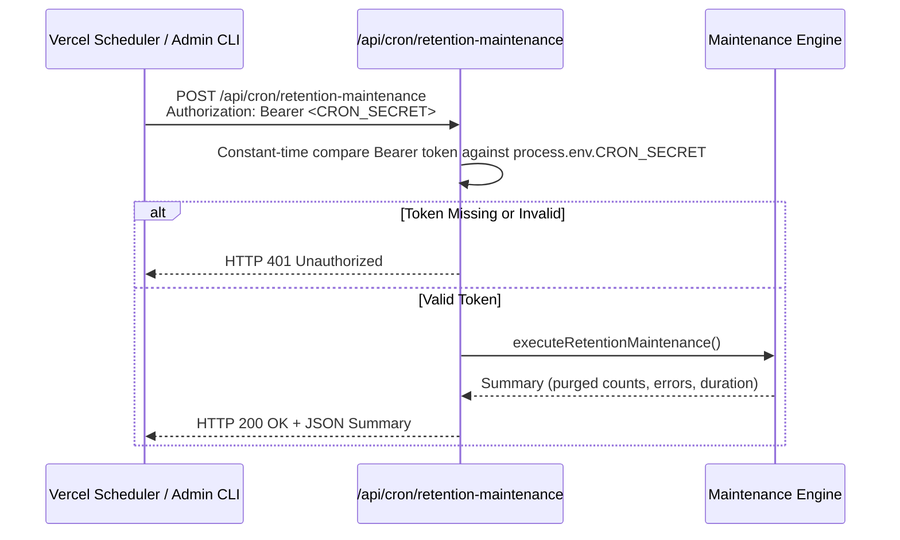
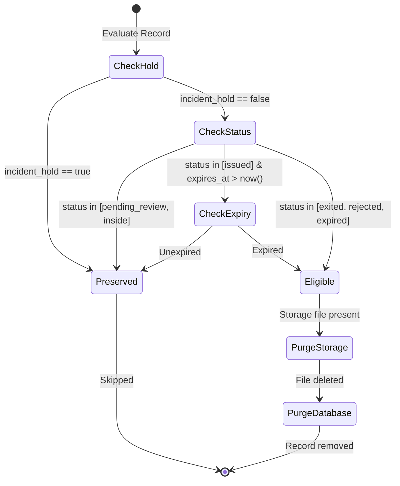

# Automated Maintenance & Vercel Cron

This document describes the automated maintenance architecture, background cron execution, and security policies governing daily retention cleanup and cross-system reconciliation.

---

## 1. Automated Cron Architecture

E-GatePass utilizes **Vercel Cron Jobs** to trigger scheduled maintenance tasks. Unlike legacy scheduled functions, maintenance is triggered as an authenticated HTTPS POST request to our serverless endpoint:



---

## 2. Vercel Cron Configuration (`vercel.json`)

Scheduled jobs are declared in `vercel.json` under the `crons` array:

```json
{
  "crons": [
    {
      "path": "/api/cron/retention-maintenance",
      "schedule": "0 18 * * *"
    }
  ]
}
```
> *Note: UTC `18:00` corresponds to `02:00 AM` Asia/Manila Standard Time (UTC+8), ensuring maintenance executes during lowest gate traffic hours.*

---

## 3. Security & Invocation Authentication

The maintenance endpoint is protected against unauthorized invocation using the `CRON_SECRET` environment variable:



---

## 4. Maintenance Execution Logic & Policies

The retention engine processes records in bounded batches (up to 100 items per category) using deterministic server cursors.



### Safety Rules Enforced:
1. **Pass Status Protection**: No pass in `pending_review` or `inside` status is ever deleted.
2. **Valid Passes**: Passes that are currently active and unexpired are never deleted.
3. **Incident Holds**: Any visitor or pass tagged with `incident_hold = true` is indefinitely protected from deletion until an authorized administrator explicitly releases the hold.
4. **Audit Trail Protection**: High-severity security events, role changes, privilege escalations, and system settings updates are categorized as protected actions and are never automatically deleted.

---

## 5. Manual Maintenance & Operator Diagnostics

Administrators can manually trigger maintenance from the terminal or admin dashboard:

```bash
curl -X POST https://egatepass.tech/api/cron/retention-maintenance \
  -H "Authorization: Bearer $CRON_SECRET" \
  -H "Content-Type: application/json"
```

### Expected JSON Response:
```json
{
  "status": "success",
  "purged": {
    "storageFiles": 14,
    "gatePasses": 8,
    "visitors": 8,
    "auditLogs": 42,
    "reconciliationTasks": 2
  },
  "protected": {
    "incidentHoldsActive": 3,
    "activeInsidePasses": 12
  },
  "durationMs": 420
}
```

---

## 6. Failure Handling & Reconciliation Tasks

If storage deletion or database updates encounter network timeouts or partial provider errors:
1. The error does not abort the entire maintenance run.
2. The partial failure is inserted into the `reconciliation_tasks` table.
3. Super Admins are notified on the admin dashboard to inspect, retry, or acknowledge the task.