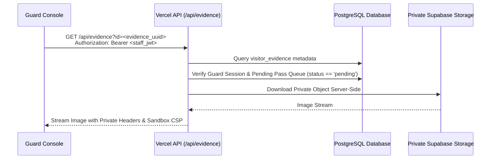
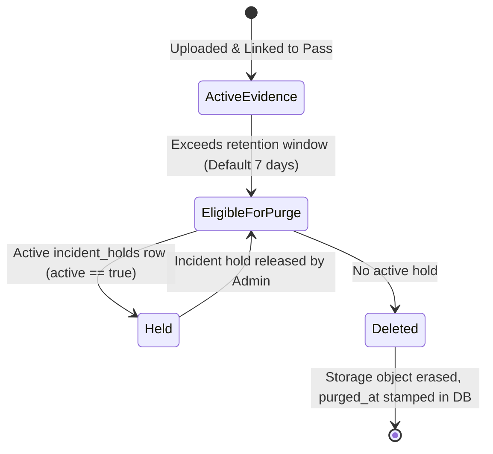

# Evidence & Image Security Policy

This document defines the security architecture, privacy controls, and storage lifecycle governing visitor photos and valid ID captures in the EARIST E-GatePass platform.

---

## 1. Storage Architecture Overview

All visitor evidence is stored exclusively in **private Supabase Storage buckets** (`visitor-photos` and `visitor-ids`) protected by database policies and server-issued upload intents.

```mermaid
flowchart TD
    Browser[Visitor / Kiosk Browser]
    Vercel[Vercel Serverless API]
    Storage[(Private Supabase Storage<br/>visitor-photos & visitor-ids)]
    DB[(PostgreSQL Database)]

    Browser -->|1. Request Upload Intent<br/>api.create_upload_intent RPC| DB
    DB -->>|2. Return intent_id, bucket_id, object_path| Browser

    Browser -->|3. Upload Image Directly<br/>storage.from(bucket).upload| Storage
    Browser -->|4. Submit Pass Registration<br/>POST /api/passes/issue| Vercel

    Vercel -->|5. Verify Magic Bytes & Size| Storage
    Vercel -->|6. Commit Evidence Record<br/>api.issue_pass RPC| DB
```

---

## 2. Ingestion Controls & Anti-Abuse Measures

### 2.1 Camera-Only Capture Constraint
- Valid ID and facial photos must be captured directly from a physical camera stream (MediaDevices API / WebRTC).
- File upload pickers and photo gallery selection are disabled on mobile devices to prevent upload of pre-recorded, manipulated, or downloaded synthetic images.

### 2.2 Server-Authorized Upload Intents
- Clients cannot upload arbitrary files directly to Supabase Storage.
- Before any file can be stored, the client must invoke the stored procedure `api.create_upload_intent`.
- The database generates an isolated, unguessable path:
  ```text
  <caller-uuid>/<intent-uuid>/<kind>.<extension>
  ```
  where `kind` is `photo` or `id`.
- The intent is valid for a single upload and expires within 15 minutes.

### 2.3 Server-Side Content & Magic Bytes Validation
When the pass registration is finalized via `POST /api/passes/issue`, the server inspects the uploaded asset:
- **Maximum File Size**: 5 MiB (`5242880` bytes).
- **Allowed MIME Types**: `image/jpeg`, `image/png`, `image/webp`.
- **Magic Bytes Verification**: Inspects leading header bytes (`FF D8 FF` for JPEG, `89 50 4E 47` for PNG, `RIFF...WEBP` for WebP) to prevent disguised executable uploads.

---

## 3. Storage Privacy & Access Delegation

The `visitor-photos` and `visitor-ids` Supabase Storage buckets are marked **Private** (public read access is disabled).



| Actor | Read Evidence | Request Intent | Delete Evidence | Authorization Mechanism |
|---|---|---|---|---|
| **Anonymous Public** | **DENIED** | Allowed (with Turnstile) | **DENIED** | No public read access |
| **Visitor** | Local camera preview | Allowed (own session) | **DENIED** | Session / Upload intent |
| **Kiosk Device** | Local camera preview | Allowed (kiosk device) | **DENIED** | Device bearer token |
| **Guard** | Allowed (Pending queue) | **DENIED** | **DENIED** | `/api/evidence?id=<uuid>` |
| **Admin** | Allowed (Audit / Holds) | **DENIED** | **DENIED** | `/api/evidence?id=<uuid>` |
| **Super Admin** | Allowed | **DENIED** | Manual Purge only | `/api/evidence?id=<uuid>` |
| **Retention Engine** | **DENIED** | **DENIED** | Automatic Purge | Service-role maintenance |

---

## 4. Evidence Retention & Purge Lifecycle

The platform is designed to support data-minimization and retention practices relevant to the Philippine Data Privacy Act of 2012 (RA 10173). Photographic evidence is retained only for the minimal operational window required for campus safety.



### Retention Rules:
1. **Configurable Window**: Super Admins configure photo retention between 1 to 90 days (Default: 7 days).
2. **Safety Margin**: Active passes (`issued`, `pending`, `inside`) retain their evidence regardless of calendar age until formally closed (`exited` or `rejected`).
3. **Incident Holds**: If a security incident occurs on campus, an Admin or Super Admin flags the record with an **Incident Hold** (`public.incident_holds`). Evidence with an active hold is completely immune to retention purge until formally released.
4. **Purge Semantics**: Retention maintenance deletes the binary asset from Supabase Storage and stamps `visitor_evidence.purged_at = now()`. Metadata is retained for audit traceability without storing personal biometric imagery.

---

## 5. Storage Reconciliation & Orphan Cleanup

If a visitor uploads an image but abandons the registration before pass issuance:
- The upload intent expires after 15 minutes.
- The retention maintenance engine identifies unreferenced files and expired pending upload intents.
- Orphaned intents are marked `expired` and associated files purged.
- Failed deletions are recorded in `reconciliation_tasks` for operator visibility.
