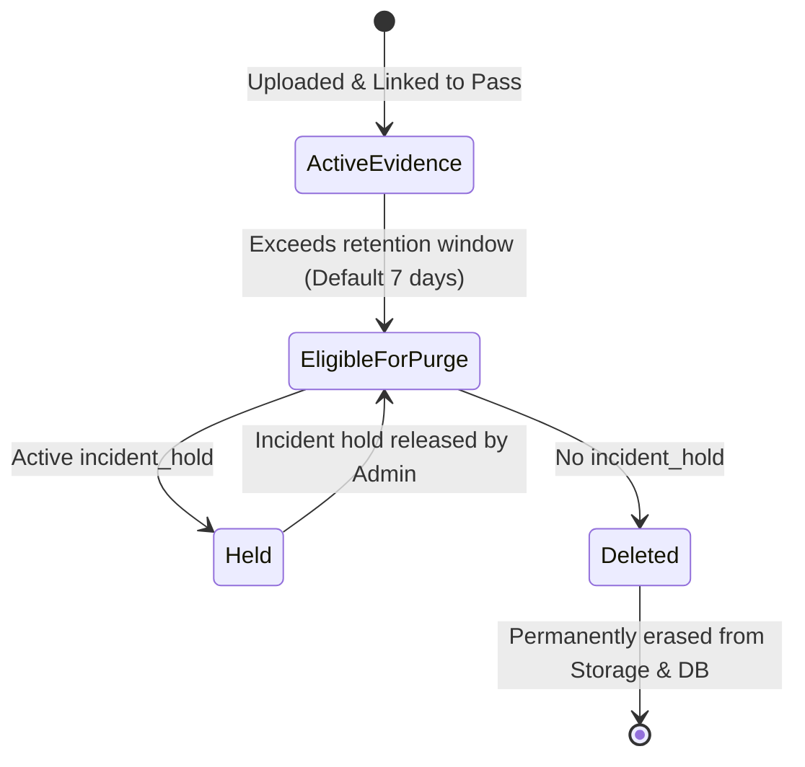

# Evidence & Image Security Policy

This document defines the security architecture, privacy controls, and storage lifecycle governing visitor photos and valid ID captures in the EARIST E-GatePass platform.

---

## 1. Storage Architecture Overview

All visitor evidence is stored exclusively in **private Supabase Storage buckets** protected by Row Level Security (RLS) and server-issued upload intents.

```mermaid
flowchart TD
    Browser[Visitor / Kiosk Browser]
    Vercel[Vercel Serverless API]
    Storage[(Private Supabase Storage<br/>visitor-evidence Bucket)]
    DB[(PostgreSQL Database)]

    Browser -->|1. Request Upload Intent| Vercel
    Vercel -->|2. Verify Turnstile & Rate Limits| Vercel
    Vercel -->|3. Generate Private File Path| Storage
    Vercel -->>|4. Return Upload Intent| Browser

    Browser -->|5. Upload Image Directly| Storage
    Browser -->|6. Submit Pass Registration| Vercel

    Vercel -->|7. Verify Magic Bytes & Size| Storage
    Vercel -->|8. Record Evidence Metadata| DB
```

---

## 2. Ingestion Controls & Anti-Abuse Measures

### 2.1 Camera-Only Capture Constraint
- Valid ID and facial photos must be captured directly from a physical camera stream (MediaDevices API / WebRTC).
- File upload pickers and photo gallery selection are disabled to prevent upload of pre-recorded, manipulated, or downloaded synthetic images.

### 2.2 Server-Authorized Upload Intents
- Clients cannot upload arbitrary files directly to Supabase Storage.
- Before any file can be stored, the client must request an **Upload Intent** from `/api/passes/upload-intent`.
- The server generates an isolated, unguessable path:
  ```text
  evidence/{visitor_id}/{timestamp}_{random_uuid}.jpg
  ```
- The intent is valid for a single upload and expires within 15 minutes.

### 2.3 Server-Side Content & Magic Bytes Validation
When the pass registration is finalized, the server inspects the uploaded asset:
- **Maximum File Size**: 5 MB.
- **Allowed MIME Types**: `image/jpeg`, `image/png`.
- **Magic Bytes Verification**: Inspects leading header bytes (`FF D8 FF` for JPEG, `89 50 4E 47` for PNG) to prevent disguised executable uploads.

---

## 3. Storage Privacy & Access Matrix

The `visitor-evidence` Supabase Storage bucket is marked **Private** (public read access is disabled).

```mermaid
sequenceDiagram
    participant Guard as Guard Console
    participant API as Vercel API
    participant Storage as Supabase Storage

    Guard->>API: GET /api/guard/evidence/{pass_id}
    API->>API: Verify Guard Session & Assigned Gate
    API->>Storage: Generate Short-Lived Signed URL (60 seconds)
    Storage-->>API: Signed URL
    API-->>Guard: Render Image in Guard Review Modal
    Note over Guard: URL expires in 60 seconds; cannot be shared
```

| Actor | Read Evidence | Upload Intent | Delete Evidence | Authorization Mechanism |
|---|---|---|---|---|
| **Anonymous Public** | **DENIED** | Allowed (with Turnstile) | **DENIED** | No public read access |
| **Visitor** | Self-preview only | Allowed (own pass) | **DENIED** | Session / Upload intent |
| **Kiosk Device** | Immediate preview | Allowed (kiosk token) | **DENIED** | Device bearer token |
| **Guard** | Allowed (Pending passes) | **DENIED** | **DENIED** | Short-lived signed URL |
| **Admin** | Allowed (Audit / Review) | **DENIED** | **DENIED** | Admin session + Signed URL |
| **Super Admin** | Allowed | **DENIED** | Manual Purge only | Super Admin session |
| **Retention Cron** | **DENIED** | **DENIED** | Automatic Purge | Service-role cron engine |

---

## 4. Evidence Retention & Purge Lifecycle

In adherence with the Philippine Data Privacy Act (Republic Act No. 10173), photographic evidence is retained only for the minimal operational window required for campus safety.



### Retention Rules:
1. **Configurable Window**: Super Admins configure photo retention between 1 to 90 days (Default: 7 days).
2. **Safety Margin**: Active passes (`issued`, `pending_review`, `inside`) retain their evidence regardless of calendar age until formally closed (`exited` or `rejected`).
3. **Incident Holds**: If a security incident occurs on campus, an Admin or Super Admin flags the record with an **Incident Hold**. Evidence with an active hold is completely immune to automated retention purge until formally released.

---

## 5. Storage Reconciliation & Orphan Cleanup

If a visitor uploads an image but abandons the registration before pass issuance:
- The upload intent expires after 15 minutes.
- The daily retention cron identifies unreferenced files in the `evidence/` bucket prefix.
- Orphaned files are automatically deleted during the 02:00 AM maintenance window.
- Failed deletions are recorded in `reconciliation_tasks` for operator visibility.