# Institutional Deployment & Portability Architecture

This document is the authoritative institutional handoff specification for the EARIST E-GatePass platform. It provides the architectural, operational, and configuration truth required for an institutional IT team to inherit, operate, self-host, or migrate the system.

---

## 1. Logical System Architecture vs. Current Capstone Implementation

To evaluate portability and plan long-term ownership, institutional administrators must distinguish between **logical system responsibilities** (permanent behavioral and security invariants) and **current capstone implementation choices** (the specific cloud services selected for initial deployment).

| Logical System Component | Logical Responsibility & Security Invariant | Current Implementation Choice | Coupling Level | Portability & Handoff Reality |
|---|---|---|---|---|
| **Web Client Tier** | Single-Page Application (SPA) providing visitor self-service, scanner interfaces, and administration consoles. Access controls enforced on all views. | React 19 + Vite 6 + TypeScript + Tailwind CSS | Highly Portable | Standard static asset bundle (`dist/`). Can be hosted behind any HTTPS web server with SPA rewrite support. |
| **Application & API Runtime** | REST and serverless HTTP handlers executing validation, cryptography, rate limiting, and administrative RPC orchestration. | Vercel Serverless Functions (Node.js 24.x) | Partially Coupled | Route logic lives in `server/` and entrypoints in `api/`. Packaged for Vercel; running outside Vercel requires an HTTP server adapter process. |
| **Authentication Service** | Identity management, password hashing, session tokens, staff accounts, scanner credentials, and auth lifecycle hooks. | Supabase Auth (GoTrue) | Tightly Coupled | High runtime coupling to `@supabase/supabase-js` and Supabase Auth admin methods. Replacing requires rewrite of identity layer. |
| **Relational Database** | ACID data store with Row-Level Security (RLS), stored procedures in `api` schema, triggers, and audit ledger. | Supabase PostgreSQL 17.x | Tightly Coupled | Uses Postgres features, PostgREST conventions, and Supabase security schemas (`auth`, `storage`). Migration requires Supabase-compatible PostgreSQL. |
| **Private Object Storage** | Strictly confidential storage for visitor selfie captures and government ID scans. Must never permit unauthenticated public reads. | Supabase Storage (private buckets: `visitor-photos`, `visitor-ids`) | Tightly Coupled | Direct dependency on `storage.from(...)` client and storage RLS policies. Migrating to standard S3/MinIO requires code-level storage adapter. |
| **Transactional Email** | Secure dispatch of account invitations, password resets, and verification messages with branded HTML templates. | Resend REST API + React Email templates | Decoupled / Portable | Decoupled behind `server/email.ts` and Supabase Auth Send Email Hook. Can be adapted to another transactional provider or institutional SMTP gateway with modest adapter changes. |
| **Bot & Abuse Protection** | Managed CAPTCHA challenge protecting public pass issuance and authentication endpoints against automated abuse. | Cloudflare Turnstile | Decoupled / Portable | Client widget invokes Turnstile API; private token verified via Supabase Auth bot protection. Can be replaced with alternative bot protection if required. |
| **Scheduled Maintenance** | Daily execution of data retention, evidence purging, audit cleanup, and reconciliation verification. | Vercel Cron (`vercel.json`) | Decoupled / Portable | The maintenance engine is an authenticated HTTP endpoint (`POST /api/admin/retention-maintenance`). Any external scheduler (e.g. Linux cron, systemd timer) can invoke it. |
| **Authoritative DNS & TLS** | Public hostname resolution, HTTPS certificate issuance, and domain security records (SPF, DKIM). | Registrar: get.tech / Orderbox; Edge TLS: Vercel automated Let's Encrypt | Standard Infrastructure | Standard domain ownership transfer. Any institutional DNS and TLS infrastructure can terminate traffic. |

### Invariant Security Rules vs. Implementation Decisions
- **Invariant**: Visitor photos and ID card scans MUST remain strictly private, encrypted at rest, and accessible only via short-lived, authenticated presigned URLs.
  - *Current implementation*: Private Supabase Storage buckets governed by storage RLS policies.
- **Invariant**: Pass issuance and credential endpoints MUST be protected against network flooding and automated dictionary attacks.
  - *Current implementation*: Client-side Cloudflare Turnstile combined with server-side HMAC rate limiting.
- **Invariant**: All gate passes MUST possess cryptographic integrity verifiable offline by scanners.
  - *Current implementation*: HMAC-SHA256 signature tokens derived via server-held `PASS_TOKEN_SECRET`.

---

## 2. Supported Institutional Deployment Models

Four deployment models are viable for EARIST institutional handoff, ranging from immediate administrative transfer of hosted services to on-premises infrastructure hosting.

```mermaid
flowchart TD
    subgraph ModelA["Model A: Hosted Ownership Transfer"]
        VercelA["Vercel Pro/Team"] --> SupabaseA["Supabase Hosted Project"]
        SupabaseA --> ResendA["Resend Account"]
        VercelA --> TurnstileA["Cloudflare Turnstile"]
    end

    subgraph ModelB["Model B: EARIST App Server + Hosted Services"]
        ProxyB["EARIST HTTPS Reverse Proxy<br>Nginx / Caddy"] --> NodeB["EARIST Supervised Node.js Runtime<br>SPA Static Files + API Adapter"]
        NodeB --> SupabaseB["Current / Managed Supabase Project"]
        NodeB --> ResendB["Resend / Institution Email"]
    end

    subgraph ModelC["Model C: Institution-Controlled Supabase"]
        AppC["EARIST Application Host"] --> SupabaseSelf["Self-Hosted Supabase Stack<br>PostgreSQL, Auth, Storage, PostgREST"]
        SupabaseSelf --> EmailC["Transactional Email Gateway"]
    end

    subgraph ModelD["Model D: Complete Supabase Replacement"]
        AppD["Application Code Rewrite Required<br>FOLLOW-UP ENGINEERING REQUIRED"]
        AppD --> PlainPG["Plain PostgreSQL"]
        AppD --> CustomAuth["Custom Identity / OAuth"]
        AppD --> CustomS3["MinIO / S3 Storage"]
    end
```



---

### Model A — Transfer Current Hosted Deployment (Recommended Baseline)
In this model, administrative ownership of existing cloud accounts is transferred directly to the EARIST IT department:
- **GitHub**: Repository transferred to official institution organization (e.g. `github.com/earist`).
- **Vercel**: Project ownership transferred to EARIST institutional Vercel team account.
- **Supabase**: Organization and project transferred to EARIST IT administrative email (`ict.director@earist.edu.ph`).
- **Resend**: Account and verified sending domain (`egatepass.tech` or institutional domain) transferred to EARIST IT.
- **Cloudflare Turnstile**: Widget ownership transferred to institutional Cloudflare account.
- **Domain Registrar**: Domain management transferred via get.tech / Orderbox auth code or organization contact update.

*Refer to [CLEAN_DATA_HANDOFF.md](file:///docs/CLEAN_DATA_HANDOFF.md) for administrative ownership procedures.*

---

### Model B — EARIST-Owned Application Server + Existing External Services
In this model, EARIST hosts the web application and API tier on institution-owned servers or virtual machines, while retaining the existing hosted Supabase, Resend, and Turnstile services.

```text
Incoming HTTPS Request
        ↓
EARIST HTTPS Reverse Proxy (Nginx / Caddy)
    ├── Static Route (/assets/*, index.html) ──> Web Client Static Files (dist/)
    └── API Route (/api/*) ────────────────────> Node.js 24.x Application Runtime (HTTP Adapter)
                                                         ↓
                                       Supabase / Resend / Turnstile
```

#### Application Packaging Reality & Boundary
- Running `npm run build` creates the Vite client bundle in `dist/`.
- **CRITICAL**: `npm run build` alone does **NOT** produce a self-hosted production server. The current repository is structured for Vercel serverless execution, with individual route handlers under `server/` and export shims in `api/`.
- To execute outside Vercel, institutional engineers must configure a Node.js HTTP server adapter (such as an Express or Fastify server mounting the canonical route handlers in `server/routes/`).
- **Status**: `FOLLOW-UP ENGINEERING REQUIRED` if non-Vercel application server deployment is selected.

---

### Model C — Institution-Controlled Supabase
In this model, EARIST deploys an on-premises or private-cloud Supabase-compatible stack (running the official Supabase Docker Compose containers for PostgreSQL, GoTrue/Auth, Storage, and PostgREST).

#### Invariants That Must Be Preserved:
1. **Auth Identities**: Must preserve UUID identity structure, password hash algorithms, and session token issuance.
2. **Database Schema & Migrations**: All migrations in `supabase/migrations/` must be executed sequentially up to the current migration head.
3. **RPC Contracts**: All 27 functions in `schema('api')` must exist with identical signatures, parameter names, and security definer contexts.
4. **Row-Level Security (RLS)**: Default deny on all tables, with granular role-based policies strictly enforced.
5. **Private Storage Buckets**: Must create buckets `visitor-photos` and `visitor-ids` configured as strictly private (`public = false`). Storage RLS policies in `storage.objects` must match migration definitions.
6. **Auth Send Email Hook**: Must configure GoTrue to dispatch authentication emails to `POST /api/auth/send-email-hook`.

---

### Model D — Replace Supabase Completely (High Engineering Effort)
> [!WARNING]
> **THIS IS NOT A HOSTING-ONLY MIGRATION.**
> The E-GatePass application code directly depends upon the Supabase SDK and its ecosystem APIs.

The application contains active source dependencies on:
- `@supabase/supabase-js` client runtime (`src/lib/supabase.ts`, `server/supabase.ts`).
- Supabase Auth methods: `signInWithPassword`, `signOut`, `resetPasswordForEmail`, `updateUser`, `signInAnonymously`.
- Supabase Admin Auth methods: `admin.auth.admin.inviteUserByEmail`, `admin.auth.admin.deleteUser`.
- Supabase Storage API: `supabase.storage.from('visitor-photos').createSignedUploadUrl`, `download`, `remove`.
- Supabase PostgREST client: `supabase.schema('api').rpc(...)` and table querying.
- Supabase GoTrue Send Email Webhook integration.

Replacing Supabase with ordinary PostgreSQL and separate identity/storage providers requires extensive engineering:
1. Rewriting the authentication layer and session management.
2. Building an S3/MinIO storage abstraction to replace Supabase Storage.
3. Replacing PostgREST RPC dispatch with a dedicated REST/GraphQL API layer.
4. Comprehensive security revalidation and penetration testing.

**Status**: `FOLLOW-UP ENGINEERING REQUIRED`. Do not attempt without a dedicated development team and formal validation.

---

## 3. Provider Dependency & Portability Matrix

| Provider | Service Category | Application Coupling | Replacement Complexity | Code Modification Required? | Key Migration Considerations |
|---|---|---|---|---|---|
| **Vercel** | Static hosting & serverless runtime | Moderate | Low to Medium | **Deployment Adapter Required** | Static assets are portable. Serverless functions in `api/` require an HTTP server wrapper (e.g. Express/Fastify). Reverse proxy must reproduce security headers and SPA rewrites. |
| **Supabase Database** | PostgreSQL relational database | High | Medium | **No** (if Supabase-compatible) | Fully compatible with self-hosted Supabase PostgreSQL 17.x. Requires `api` schema RPCs, RLS policies, triggers, and extensions (`pgcrypto`, `uuid-ossp`). |
| **Supabase Auth** | User authentication & session management | High | High | **Yes** (if replaced with non-Supabase identity) | Deeply integrated into frontend navigation guards and backend token verification. Moving to another auth provider requires extensive client and API refactoring. |
| **Supabase Storage** | Private evidence object storage | High | High | **Yes** (if replaced with S3/MinIO) | Relies on Supabase Storage REST API and signed URL semantics. Migration requires storage client abstraction and file copy preserving exact object paths. |
| **Resend** | Transactional email delivery | Low | Low | **Minimal** | Isolated to `server/email.ts`. Can be swapped for an alternative transactional API (SendGrid, Mailgun) or institutional SMTP with minimal edits. |
| **Cloudflare Turnstile** | Bot challenge protection | Low | Low | **Minimal** | Client widget in `src/components/TurnstileWidget.tsx`. Can be replaced with alternative CAPTCHA service with minor component and auth config adjustment. |
| **get.tech / Orderbox** | Domain registration & DNS | Low | Trivial | **No** | Standard DNS record migration (A, CNAME, TXT for SPF/DKIM). No code impact. |

---

## 4. Self-Hosted Security Boundaries & Server Configuration

When deploying the application tier on an EARIST-owned server or virtual machine, the following security and networking controls must be implemented at the reverse proxy and operating system levels.

### 4.1 HTTPS Requirement & TLS Termination
- **Mandatory Invariant**: The application **MUST** be served exclusively over HTTPS.
- **Why**:
  - Browser camera APIs (`navigator.mediaDevices.getUserMedia`) required for visitor photo and ID scanning are blocked by browsers on non-secure origins (`http://`).
  - WebRTC video streams fail on plain HTTP.
  - Session cookies and bearer tokens require `Secure` attributes.
  - Cloudflare Turnstile enforces secure origins.
- **Implementation**: Terminate TLS at the reverse proxy (Nginx, Caddy, or Apache) using institutional certificates or Let's Encrypt automated issuance.

---

### 4.2 Security Headers Replication (From `vercel.json`)
> [!IMPORTANT]
> **Vercel security headers do NOT automatically transfer to self-hosted web servers.**
> When running outside Vercel, the reverse proxy MUST be configured to emit the exact security headers specified in `vercel.json`.

The reverse proxy must inject the following headers on all responses:

```text
Content-Security-Policy: default-src 'self'; script-src 'self' 'unsafe-inline' https://challenges.cloudflare.com; style-src 'self' 'unsafe-inline' https://fonts.googleapis.com; font-src 'self' https://fonts.gstatic.com data:; img-src 'self' data: blob: https://*.supabase.co; connect-src 'self' https://*.supabase.co wss://*.supabase.co https://challenges.cloudflare.com; frame-src https://challenges.cloudflare.com; object-src 'none'; base-uri 'self'; form-action 'self'; frame-ancestors 'none';
Strict-Transport-Security: max-age=63072000; includeSubDomains; preload
X-Content-Type-Options: nosniff
X-Frame-Options: DENY
Referrer-Policy: strict-origin-when-cross-origin
Permissions-Policy: camera=(self), microphone=(), geolocation=(), browsing-topics=()
```

*Security Warning: Never permit eval execution (unsafe-eval) in the Content-Security-Policy.*

---

### 4.3 SPA Routing vs. API Handler Routing
The replacement reverse proxy must correctly separate client SPA navigation from backend API calls:
- **Non-API Routes**: All paths that do not start with `/api/` (e.g. `/get-pass`, `/login`, `/kiosk`, `/guard`, `/admin/*`) must be served by rewriting to `/index.html` to allow client-side React Router navigation.
- **API Routes**: All paths starting with `/api/` must be proxied directly to the Node.js application process and **NEVER** rewritten to `/index.html`.

**Example Nginx Configuration**:
```nginx
server {
    listen 443 ssl http2;
    server_name gatepass.example.edu;

    # TLS certificates
    ssl_certificate /etc/ssl/certs/gatepass.crt;
    ssl_certificate_key /etc/ssl/private/gatepass.key;

    # Security Headers
    add_header Content-Security-Policy "default-src 'self'; script-src 'self' 'unsafe-inline' https://challenges.cloudflare.com; style-src 'self' 'unsafe-inline' https://fonts.googleapis.com; font-src 'self' https://fonts.gstatic.com data:; img-src 'self' data: blob: https://*.supabase.co; connect-src 'self' https://*.supabase.co wss://*.supabase.co https://challenges.cloudflare.com; frame-src https://challenges.cloudflare.com; object-src 'none'; base-uri 'self'; form-action 'self'; frame-ancestors 'none';" always;
    add_header Strict-Transport-Security "max-age=63072000; includeSubDomains; preload" always;
    add_header X-Content-Type-Options "nosniff" always;
    add_header X-Frame-Options "DENY" always;
    add_header Referrer-Policy "strict-origin-when-cross-origin" always;
    add_header Permissions-Policy "camera=(self), microphone=(), geolocation=(), browsing-topics=()" always;

    root /var/www/egatepass/dist;
    index index.html;

    # Backend API handlers
    location /api/ {
        proxy_pass http://127.0.0.1:3000;
        proxy_http_version 1.1;
        proxy_set_header Host $host;
        proxy_set_header X-Real-IP $remote_addr;
        proxy_set_header X-Forwarded-For $remote_addr; # Replace client-supplied header
        proxy_set_header X-Forwarded-Proto $scheme;
    }

    # Single-Page Application fallback
    location / {
        try_files $uri $uri/ /index.html;
    }
}
```

---

### 4.4 Reverse Proxy Security & Client-IP Rate Limit Trust
- Current pass issuance network rate limiting (`server/routes/passes/issue.ts`) reads `X-Forwarded-For` and `X-Real-IP` headers to compute client network identifiers.
- On an institution-owned reverse proxy, **incoming client-supplied forwarding headers MUST NOT be trusted directly**, as malicious clients can spoof arbitrary IP addresses to bypass rate limits.
- The institutional reverse proxy MUST explicitly overwrite or sanitize `X-Forwarded-For` with the verified client socket IP (`$remote_addr`).
- **Status**: `FOLLOW-UP ENGINEERING/DEPLOYMENT VALIDATION REQUIRED` for self-hosted production setups to verify client-IP spoofing is impossible.

---

### 4.5 Process Supervision
The Node.js application process must be managed by a robust process supervisor ensuring:
- Automatic restart on uncaught exceptions or transient failures.
- Startup on system boot.
- Zero-downtime graceful reload capability.
- Standardized log capture and rotation.

*Recommended options for institutional environments*:
- **systemd** service unit (Linux native standard)
- **PM2** runtime process manager
- **Docker** / OCI container supervised by Docker daemon, Podman, or Kubernetes

---

## 5. Network & Firewall Connectivity Matrix

The application host requires specific outbound connectivity and inbound accessibility to operate:

### Outbound Network Access Requirements
| Destination Service | Protocol / Port | Target Address | Purpose |
|---|---|---|---|
| **Supabase Gateway** | HTTPS (443) / WSS (443) | `<project-ref>.supabase.co` | Database PostgREST queries, Auth admin, Storage uploads/downloads |
| **Resend API** | HTTPS (443) | `api.resend.com` | Transactional email dispatch |
| **Cloudflare Turnstile** | HTTPS (443) | `challenges.cloudflare.com` | Bot challenge validation |
| **DNS Resolvers** | DNS (53 UDP/TCP) | Institutional DNS / 1.1.1.1 | Hostname resolution for external APIs |
| **NTP Time Server** | NTP (123 UDP) | Institutional NTP / pool.ntp.org | Server clock synchronization (critical for token verification) |

### Inbound Network Access Requirements
| Source Caller | Protocol / Port | Endpoint Path | Purpose |
|---|---|---|---|
| **Public Browsers & Mobile Clients** | HTTPS (443) | `/*`, `/api/*` | Visitor registration, kiosk operation, scanner apps, admin console |
| **Supabase Auth Hook** | HTTPS (443) | `/api/auth/send-email-hook` | Outbound transactional email dispatch triggered by Supabase Auth |
| **Resend Event System** | HTTPS (443) | `/api/webhooks/resend` | Inbound delivery observability events (`sent`, `delivered`, etc.) |
| **Institutional Scheduler** | Localhost or HTTPS (443) | `/api/admin/retention-maintenance` | Machine-authenticated daily retention maintenance invocation |

---

## 6. Self-Hosted Scheduled Maintenance

In the Vercel hosted environment, retention maintenance is triggered automatically via Vercel Cron. For a self-hosted or institution-managed deployment, an independent system scheduler must invoke the maintenance endpoint.

### Execution Schedule & Timezone
- **Configured Schedule**: `0 18 * * *`
- **Timezone**: UTC (18:00 UTC)
- **Manila Local Time**: Approximately **02:00 AM Asia/Manila** next calendar day (UTC+8).
- **Target Endpoint**: `POST /api/admin/retention-maintenance`

### Invocation Contract & Machine Authentication
The scheduler must call the endpoint with an HTTP Bearer token matching the server's `CRON_SECRET`:

```bash
# Example Linux cron entry (runs at 02:00 AM Asia/Manila daily)
0 2 * * * curl -s -X POST https://gatepass.example.edu/api/admin/retention-maintenance \
  -H "Authorization: Bearer $CRON_SECRET" \
  -H "Content-Type: application/json" \
  -d '{"batchSize": 50, "dryRun": false}' >> /var/log/egatepass-maintenance.log 2>&1
```

> **Security Rule**: Never hardcode actual secret values in scripts or cron files. Load `$CRON_SECRET` from a secure environment file with restricted read permissions (`chmod 600`).

### Maintenance Execution Parameters & Behavior
- **Batch Size**: Bounded between 1 and 200 (default: 50). Large backlogs are processed across successive runs without locking tables.
- **Dry Run**: Pass `{"dryRun": true}` to evaluate eligible records without deleting storage objects or modifying database records.
- **Incident Holds**: Records associated with active entries in `public.incident_holds` are strictly protected from deletion.
- **Active Passes**: Passes in status `pending` or `inside` are permanently protected.
- **Protected Audit Events**: Critical governance actions (`superadmin.bootstrap`, `staff.create`, `device.create`, etc.) are permanently preserved.

---

## 7. Monitoring & Operational Observability

The platform produces structured operational telemetry that should be integrated into institutional monitoring tools:

| Signal Category | Critical Observable Event | Current Provider Location | Self-Hosted Monitoring Strategy |
|---|---|---|---|
| **API Errors** | HTTP 5xx responses, unhandled exceptions | Vercel Function Logs | Reverse proxy error logs (`error.log`) + Node process stdout/stderr |
| **Auth Hook Failures** | Non-200 responses on `/api/auth/send-email-hook` | Vercel Logs / Supabase Hook Logs | Alert on HTTP != 200 on auth hook endpoint |
| **Email Delivery Failures** | Bounced, complained, or failed delivery events | Resend Dashboard / `audit_events` | Query `public.audit_events` where `action = 'email.failed'` |
| **Webhook Ingestion Errors** | 400 Bad Signature on `/api/webhooks/resend` | Vercel Function Logs | Monitor 4xx count on webhook endpoint |
| **Retention Failures** | Non-200 response or error trace in maintenance run | Vercel Cron Logs | Cron execution exit code != 0 or JSON response `status != "success"` |
| **Reconciliation Tasks** | Unresolved items in `public.reconciliation_tasks` | Admin Console (`AdminReconciliation.tsx`) | Alert when `status = 'pending'` count exceeds threshold |
| **Storage Failures** | Failed presigned upload or download requests | Supabase Storage Logs | Application error log pattern matching on storage exceptions |
| **Abuse Thresholds** | Excessive 429 Too Many Requests responses | Vercel Logs | Reverse proxy rate limit alert or SIEM log correlation |
| **Database Connectivity** | Connection pool timeouts or database query drops | Supabase Database Metrics | Database connection health monitoring |

### Dedicated Health Endpoint Status
> [!NOTE]
> **No dedicated production health check endpoint (e.g. `/api/health`) currently exists in the application.**
> Institutional load balancers or container orchestrators requiring an HTTP health probe must either probe the root URL (`GET /` returning HTTP 200 with static HTML) or implement a dedicated lightweight health handler.
> **Status**: `FOLLOW-UP ENGINEERING REQUIRED` if a dedicated health route is mandated by institutional infrastructure.

---

## 8. Data Migration & Infrastructure Change Checklist

Before performing any infrastructure cutover, domain change, or database migration:

- [ ] **Pre-Migration Full Backup**: Execute complete database dump and private storage backup according to [BACKUP_AND_RECOVERY.md](file:///docs/BACKUP_AND_RECOVERY.md).
- [ ] **Migration Plan & Rollback Criteria**: Establish explicit go/no-go rollback checkpoints.
- [ ] **Secret Rotation**: Re-issue high-entropy secrets (`PASS_TOKEN_SECRET`, `CRON_SECRET`, `RATE_LIMIT_HMAC_SECRET`) if migrating servers.
- [ ] **Application Origin Update**: Set `APP_BASE_URL` to the new canonical origin (e.g. `https://gatepass.example.edu`).
- [ ] **Supabase Auth Redirect Configuration**: In Supabase Dashboard, update **Site URL** and **Allowed Redirect URLs** to include the new domain.
- [ ] **Email Branding Verification**: Verify all transactional email header artwork resolves correctly from the new application origin.
- [ ] **Webhook Endpoints Update**: Update Supabase Auth Send Email Hook and Resend Webhook destinations to the new hostname.
- [ ] **Security Headers Validation**: Verify reverse proxy emits full CSP, HSTS, and framing protections.
- [ ] **Storage Bucket Privacy Check**: Confirm `visitor-photos` and `visitor-ids` are private.
- [ ] **End-to-End QA Run**: Complete full verification cycle according to [MANUAL_QA_RUNBOOK.md](file:///docs/MANUAL_QA_RUNBOOK.md).
