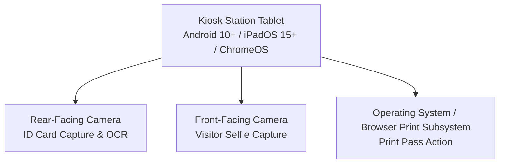
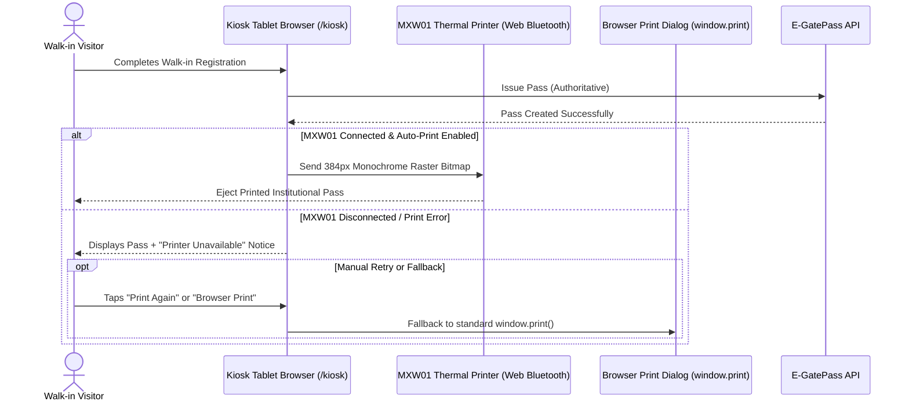

# Kiosk Operational Hardware Specification

This document defines the currently supported hardware configurations, camera specifications, environmental prerequisites, and current printing behavior for EARIST E-GatePass walk-in kiosk stations.

---

## 1. Supported Kiosk Station Hardware

The campus walk-in kiosk interface (`/kiosk`) is engineered as a responsive web application running on tablet hardware within an institutional enclosure or stand.

### 1.1 Device Class & Form Factor Requirements
- **Supported Device Types**:
  - Android Tablet (Android 10 or later recommended).
  - Apple iPad (iPadOS 15 or later).
  - Touch-enabled Windows 11 tablet or ChromeOS device with front and rear cameras.
- **Display Specifications**:
  - Minimum Screen Size: 10.1 inches recommended for visitor readability and touch accessibility.
  - Minimum Resolution: 1280 × 800 pixels (1920 × 1200 recommended).
  - Touch Digitizer: Multi-touch capacitive screen.
  - Orientation: Both landscape and portrait orientations are supported by the kiosk layout.
- **Physical Enclosure & Power**:
  - Lockable security enclosure securing the tablet against theft and concealing physical navigation buttons (home/power).
  - Continuous AC power delivery with high-durability charging cable pass-through.
  - Proper ventilation to prevent thermal throttling during continuous multi-hour operation.

---

## 2. Camera Hardware & Browser Permissions

The kiosk workflow relies on client-side camera captures for visitor verification and OCR identity extraction:

### 2.1 Camera Specifications
- **Rear Camera (ID Document Scanning)**:
  - Resolution: Minimum 5.0 Megapixels with continuous autofocus.
  - Lighting: Integrated LED flash or well-lit kiosk kiosk bay to ensure crisp ID card capture for optical character recognition (OCR).
  - Purpose: Captures government or institutional photo ID.
- **Front Camera (Visitor Selfie Capture)**:
  - Resolution: Minimum 2.0 Megapixels.
  - Purpose: Captures clear face portrait of the visitor for guard station verification.

### 2.2 HTTPS & Browser Permission Invariant
- **Critical Requirement**: The kiosk **MUST** access the application over a secure **HTTPS** origin (`https://...`).
- **Browser Security Policy**: Modern browsers (Chromium, WebKit, Safari) strictly disable access to `navigator.mediaDevices.getUserMedia` when loaded over insecure HTTP (`http://`).
- **Initial Setup Permission**: On initial provisioning of the kiosk browser, the operator must set camera permissions to **Always Allow** for the authorized origin.

---

## 3. MXW01 Direct Thermal Printing & Workflow Specification

> [!IMPORTANT]
> **MXW01 DIRECT HARDWARE THERMAL PRINTING SPECIFICATION**
> Direct thermal receipt printing is implemented for the **MXW01 portable Bluetooth thermal printer** (384px native width, 48mm printable area).
> **Single Printer Architecture**: There is exactly **ONE physical printer** in the deployment, owned exclusively by the **kiosk tablet browser**. Guards do NOT possess a separate thermal printer.
> **Fail-Safe Printing Invariant**: Print failures **NEVER roll back pass issuance**. Once an authoritative pass is issued, failure to connect or print to the physical hardware renders a notification with "Print Again" and "Browser Print" fallbacks without generating duplicate passes.

### 3.1 Device Specifications & Browser Compatibility
- **Hardware Model**: MXW01 portable 58mm Bluetooth BLE thermal printer (delegating physical protocol to `mxw01-thermal-printer`).
- **Print Width**: Native 384 pixels (48mm printable area at 203 DPI / 8 dots/mm).
- **Driver/Ecosystem**: `mxw01-thermal-printer` (MIT licensed, zero external runtime dependencies) utilizing standard Web Bluetooth GATT service.
- **Browser Requirement**: Chromium-based browser (Google Chrome, Microsoft Edge) running over secure **HTTPS**.
- **Platform Compatibility**: Android Tablet (Target deployment), ChromeOS, or Windows tablet. Apple iOS/iPadOS Safari does not support Web Bluetooth and automatically defaults to the system `window.print()` path.

### 3.2 Bluetooth Pairing & Safe Reconnection Lifecycle
1. **Initial Pairing**:
   - The kiosk operator opens **Device Settings** (protected by kiosk device password re-authentication).
   - Tapping **Connect MXW01** initiates `navigator.bluetooth.requestDevice()` filtering for MXW01 GATT services.
   - User grants permission in the browser Bluetooth device picker.
2. **Session Reconnection**:
   - On subsequent launches, the kiosk invokes `navigator.bluetooth.getDevices()` to attempt zero-interaction reconnection to a previously authorized printer.
   - If permissions expire or device is powered off, the UI safely falls back to disconnected state without crashing the registration wizard.

### 3.3 Protected Device Settings & Controls
Kiosk device settings (`/kiosk` > Gear Icon) are strictly protected by the Kiosk Device Password (verified via trusted server endpoint `/api/device/reauthenticate`) to prevent visitors from tampering with hardware configuration:
- **Connection Status**: Real-time indicator (`connected`, `connecting`, `disconnected`, `error`).
- **Connect / Disconnect**: Explicit Bluetooth lifecycle controls.
- **Auto-Print Toggle**: Enables or disables immediate printing upon pass issuance.
- **Print Darkness / Intensity**: High-contrast monochrome rendering tuning.
- **Test Print**: Dispatches an official 384px EARIST diagnostic ticket verifying alignment, cutter, and feed.

### 3.4 Fallback Printing Subsystem
If Web Bluetooth is unsupported by the browser, disabled in hardware, or the printer runs out of thermal paper:
- The kiosk registration flow continues smoothly without blocking.
- If direct Bluetooth printing is unavailable, disabled, or fails, a fallback **Browser Print** / **Print Pass** button triggers standard `window.print()` with `@media print` CSS rules tailored for receipt rolls or standard paper.

> **Hardware Testing Boundary Note**: E-GatePass integrates the MXW01 through the `mxw01-thermal-printer` Web Bluetooth library and renders a 384px monochrome raster. The software integration path is covered by automated tests. Physical protocol/service discovery and actual paper output remain subject to validation on the deployed MXW01 hardware (**PHYSICAL MXW01 ACCEPTANCE: NOT YET TESTED**).

---

## 4. Multi-Device / PC Print Server Architecture Boundary

### Integration Status: `NOT YET IMPLEMENTED`
The current production architecture strictly deploys a **single physical MXW01 printer owned exclusively by the kiosk tablet browser via Web Bluetooth**.
Device-to-device WebRTC printing, local LAN print servers, PC-hosted print queues, or Guard-station receipt printers are explicitly excluded from this deployment boundary:
- **Status**: `NOT YET IMPLEMENTED` / Intentionally Rejected.
- **Architectural Boundary**: Guard stations do not operate thermal printers; walk-in printing is exclusive to the kiosk tablet.

