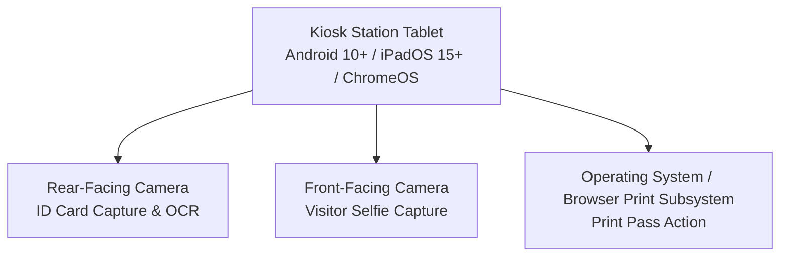
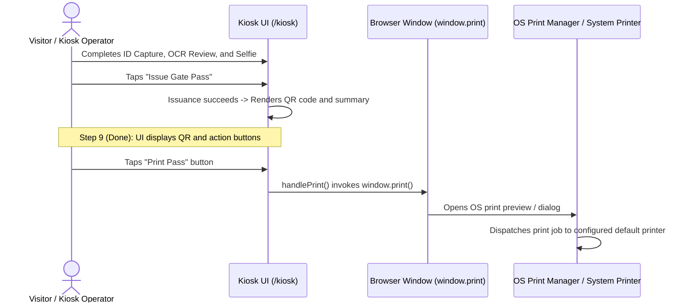

# Kiosk Operational Hardware Specification

This document defines the currently supported hardware configurations, camera specifications, environmental prerequisites, and current printing behavior for EARIST E-GatePass walk-in kiosk stations.

---

## 1. Supported Kiosk Station Hardware

The campus walk-in kiosk interface (`/kiosk`) is engineered as a responsive web application running on tablet hardware within an institutional enclosure or stand.

### 1.1 Device Class & Form Factor Requirements
- **Supported Device Types**:
  - Android Tablet (Android 10 or later recommended).
  - Apple iPad (iPadOS 15 or later).
  - Touch-enabled Windows 11 tablet or ChromeOS device with front and rear cameras.
- **Display Specifications**:
  - Minimum Screen Size: 10.1 inches recommended for visitor readability and touch accessibility.
  - Minimum Resolution: 1280 × 800 pixels (1920 × 1200 recommended).
  - Touch Digitizer: Multi-touch capacitive screen.
  - Orientation: Both landscape and portrait orientations are supported by the kiosk layout.
- **Physical Enclosure & Power**:
  - Lockable security enclosure securing the tablet against theft and concealing physical navigation buttons (home/power).
  - Continuous AC power delivery with high-durability charging cable pass-through.
  - Proper ventilation to prevent thermal throttling during continuous multi-hour operation.

---

## 2. Camera Hardware & Browser Permissions

The kiosk workflow relies on client-side camera captures for visitor verification and OCR identity extraction:

### 2.1 Camera Specifications
- **Rear Camera (ID Document Scanning)**:
  - Resolution: Minimum 5.0 Megapixels with continuous autofocus.
  - Lighting: Integrated LED flash or well-lit kiosk kiosk bay to ensure crisp ID card capture for optical character recognition (OCR).
  - Purpose: Captures government or institutional photo ID.
- **Front Camera (Visitor Selfie Capture)**:
  - Resolution: Minimum 2.0 Megapixels.
  - Purpose: Captures clear face portrait of the visitor for guard station verification.

### 2.2 HTTPS & Browser Permission Invariant
- **Critical Requirement**: The kiosk **MUST** access the application over a secure **HTTPS** origin (`https://...`).
- **Browser Security Policy**: Modern browsers (Chromium, WebKit, Safari) strictly disable access to `navigator.mediaDevices.getUserMedia` when loaded over insecure HTTP (`http://`).
- **Initial Setup Permission**: On initial provisioning of the kiosk browser, the operator must set camera permissions to **Always Allow** for the authorized origin.

---

## 3. Current Printing Workflow & Behavioral Truth

> [!IMPORTANT]
> **CURRENT PRINTING BEHAVIOR SPECIFICATION**
> Current kiosk printing relies strictly on the standard **browser and operating-system print subsystem** initiated by human interaction with the **Print Pass** button.
> The application does **NOT** automatically print receipts immediately upon pass issuance.

### Current Print Execution Details:
1. **Pass Display**: Upon successful issuance, the kiosk displays the pass QR code, visitor full name, visit date, purpose, and validity window.
2. **Action Controls**: The UI presents three explicit action controls:
   - **Print Pass** (invokes `handlePrint()` -> `window.print()`)
   - **Email my QR code** (opens modal for visitor email delivery)
   - **Next Visitor** (resets kiosk wizard for the next visitor)
3. **Print Styling**: The page applies `@media print` CSS rules in `src/pages/KioskPage.tsx` to hide navigation headers, cards, and buttons, rendering a clean pass layout suitable for standard desktop, thermal, or PDF printers configured in the operating system.

---

## 4. Future Thermal Printer Integration (Boundary & Status)

### Integration Status: `NOT YET IMPLEMENTED`
Dedicated direct-to-hardware thermal receipt printing (such as portable Bluetooth mini thermal printers like the MXW01 / Fun Print series, ESC/POS byte streaming, or raw USB serial printing) is a **planned hardware enhancement**.

### Engineering & Verification Boundaries:
- **No Direct Bluetooth Printing in Current Code**: The current codebase does not implement Web Bluetooth API pairing, ESC/POS command generation, or direct byte streaming to proprietary thermal printer hardware.
- **Hardware Integration Requirement**: Device-specific thermal printer integration requires:
  1. Driver/SDK evaluation for targeted thermal printing hardware.
  2. Protocol implementation (e.g. ESC/POS, raster bitmap, or Web Bluetooth).
  3. Physical testing on actual campus hardware verifying paper width, print density, QR code readability by gate scanners, and reconnect behavior.
- **Documentation Boundary**: Detailed hardware pairing, baud rates, and printer-specific configurations will be authored and ratified in this document only **AFTER** physical implementation and testing are complete.
