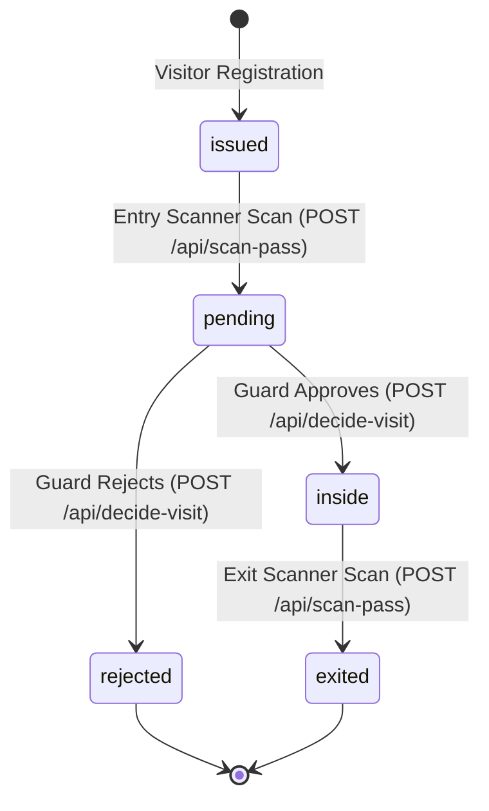

# Manual QA Runbook & Verification Matrix

This runbook provides complete step-by-step procedures for manual testing and pre-release validation across all user roles, devices, and edge cases in the EARIST E-GatePass platform.

---

## 1. Visitor Portal (Desktop & iPhone Safari)

### 1.1 Desktop Browser Workflow
1. Navigate to `https://egatepass.tech`.
2. Confirm landing page, hero section, and navigation render without layout shift.
3. Click **Get Your Gate Pass** (`/get-pass`).
4. Complete the Cloudflare Turnstile verification widget.
5. Fill out visitor information: Full Name, Purpose of Visit, Department/Host.
6. Select Visit Date:
   - Confirm past dates are disabled and rejected.
   - Confirm dates beyond the configured scheduling window (default: 30 days) are blocked.
7. Capture Face Photo using webcam (camera-only capture).
8. Provide Valid ID using either rear camera capture OR file/gallery image upload (JPEG, PNG, WebP).
9. Submit registration.
10. **Delivery Gate Verification**:
    - Pass is issued, transitioning directly to the Delivery Gate before QR reveal.
    - Strongly encourage verified email delivery (`Verify Email & Send My E-GatePass`).
    - Alternatively, choose `Continue without email` to open the 5-second timed countdown warning dialog. Confirming after 5 seconds reveals the pass QR code with a persistent warning banner to save the pass before leaving.
    - Confirm `beforeunload` browser prompt warns against accidental page refresh or closing until email is verified or pass is downloaded.
11. **Expected Result**: Pass status displays `issued`. QR code renders with the EARIST logo centered inside (error correction level H) without reducing scanner reliability.

### 1.2 iPhone Safari Mobile Verification (Critical Mobile Checks)
1. Open Safari on an iPhone (e.g. iPhone 12/13/14/15/SE viewport).
2. Navigate to `/get-pass`.
3. **Check iOS Input Auto-Zoom**: Tap into each text input field.
   - **Expected**: Screen DOES NOT zoom in unexpectedly (inputs enforce a minimum `16px` font size).
4. **Check Native Date Input Overflow**:
   - Inspect the Visit Date picker input on narrow screens (< 375px width).
   - **Expected**: Date input does NOT overflow horizontally outside its form/card container.
5. **Portal Valid ID (Camera OR Upload)**:
   - Tap **Take Photo** to use rear camera, or switch to **Upload ID** to select an image from gallery/files.
   - Verify file picker allows selecting JPEG, PNG, or WebP images (uploaded ID images are locally processed and compressed to WebP before evidence upload, and the resulting evidence blob must satisfy the authoritative secure upload-intent limit of 5 MB).
   - Verify unsupported image formats trigger a clear warning message (`This image format is not supported. Please choose a JPEG, PNG, or WebP image.`).
   - Verify selecting the same file again after clearing works seamlessly.
5b. **Optional Local OCR Autofill**:
   - In Step 1 (Details), tap **Autofill from ID**.
   - Take photo or upload valid ID; confirm OCR runs locally in browser memory without sending image to external services.
   - Confirm extracted names prefill empty fields while preserving existing user-entered values.
   - Confirm form NEVER auto-submits upon OCR completion, allowing visitor to review and edit all fields.
   - Confirm the ID image used during OCR is retained as valid ID evidence for Step 3.
6. **Independent Retake ID & Selfie**:
   - Tap **Retake ID**: Only the ID preview is cleared; the face photo preview remains intact.
   - Tap **Retake Photo**: Only the face photo is cleared; ID preview remains intact.
7. **Object URL Lifecycle Cleanup**:
   - Switch tabs or navigate away after capturing photos.
   - **Expected**: No memory leaks or orphaned `blob:` URLs in browser memory.

---

## 2. Kiosk Flow (Android / Tablet Mode)

1. Open Kiosk view (`/kiosk`) on an authorized tablet device.
2. Ensure Kiosk device is logged in with valid device credentials.
3. **Capture Valid ID (Rear Camera)**:
   - Hold a Philippine Government ID (e.g. Driver's License, UMID, National ID, Student ID) up to the rear camera.
   - Tap capture.
4. **Local Tesseract OCR Extraction**:
   - Observe the scanning indicator.
   - Confirm OCR attempts to extract visitor name fields locally (first name, middle name when available, and last name) in browser memory without server transmission.
   - Confirm the visitor reviews and completes remaining required information manually.
5. **Visitor Review / Correction**:
   - Allow visitor to edit/correct any misread characters.
6. **Capture Visitor Selfie (Front Camera)**:
   - Switch to front camera and take selfie.
7. **Pass Generation & Printing**:
   - Click **Issue Gate Pass**.
   - Confirm pass is issued and displays QR code along with visitor summary and action buttons.
   - Click **Print Pass** and confirm browser print dialog (`window.print()`) is invoked. (Note: Thermal printer device integration is a planned hardware enhancement. Current kiosk printing relies on the browser/operating-system print path).
   - Confirm optional **Email my QR code** and **Next Visitor** buttons are available and responsive.

---

## 3. Gate Entry, Guard Review, and Exit Sequence



### 3.1 Entry Scanner Device
1. Log in at `/device/login` using Entry Scanner credentials (assigned to `Main Gate`).
2. Present an `issued` QR code pass to the scanner camera.
3. **Expected State Transition**:
   - Entry device calls `POST /api/scan-pass` (mode: `entry`).
   - Scanner displays: **Scan Accepted — Pending Guard Review**.
   - Database pass status transitions from `issued` to `pending`.
4. Scan the same QR code again immediately.
   - **Expected**: Scanner displays warning that pass is already pending review.

### 3.2 Guard Console Review
1. Log in as `guard` at `/login`.
2. Navigate to **Guard Console** (`/guard`).
3. Confirm the scanned pass appears in the **Pending Entry** queue loaded via RPC `api.guard_dashboard_page` (snapshot/keyset queue paging).
4. Inspect visitor selfie photo, captured valid ID, visit purpose, and destination (streamed via `GET /api/evidence?id=<evidence_id>`).
5. Click **Approve Entry**:
   - Route `POST /api/decide-visit` executes with `decision: 'approved'`.
   - **Expected State Transition**: Pass status transitions from `pending` to `inside`.
6. Alternatively, click **Reject Entry** and provide a reason (e.g. "Invalid ID", "Dress Code Violation"):
   - Route `POST /api/decide-visit` executes with `decision: 'rejected'`.
   - **Expected State Transition**: Pass status transitions from `pending` to `rejected`.

### 3.3 Exit Scanner Device
1. Log in at `/device/login` using Exit Scanner credentials.
2. Present a pass currently in `inside` status.
3. **Expected State Transition**:
   - Exit device calls `POST /api/scan-pass` (mode: `exit`).
   - Scanner displays: **Exit Verified — Have a Safe Day**.
   - Database pass status transitions from `inside` to `exited`.
4. Present an `exited` or `expired` pass:
   - **Expected**: Exit device displays: **Invalid or Already Exited Pass**.

---

## 4. Administrative & Governance QA

### 4.1 Admin Operations
1. Log in as `admin`.
2. **Staff Creation**: Invite a new Guard with a valid email via `POST /api/create-user`.
   - Confirm Supabase Auth user and `staff_profiles` row created (`active = true`).
   - Confirm invite email delivered via Resend with EARIST branding.
3. **Device Management**: Register an Entry scanner device for "East Gate" via `POST /api/create-device`.
   - Confirm device credentials generated.
4. **Deactivation**: Deactivate a test guard account via `POST /api/update-user`.
   - Confirm the test guard is instantly blocked from logging in.

### 4.2 Super Admin Governance
1. Log in as `superadmin`.
2. **Settings**: Modify working hours or retention windows via `POST /api/update-settings`.
   - Confirm changes persist to `public.app_settings` table.
3. **Last Super Admin Demotion Protection**:
   - Attempt to deactivate or change the role of the only active Super Admin.
   - **Expected API Response**: HTTP 409 with body `{ error: 'cannot_remove_last_superadmin' }`.
   - **Expected UI Toast**: *"Cannot demote or deactivate the last remaining Super Admin."*
4. **Incident Hold**:
   - Locate an active or exited pass and apply an **Incident Hold** via `POST /api/admin/holds`.
   - Confirm hold row created in `public.incident_holds` with `active = true`.

### 4.3 Isolated-Database Super Admin Bootstrap Contract QA

> [!CAUTION]
> **ISOLATED TEST DATABASE ONLY**: Never test destructive or one-time bootstrap failure scenarios against an established production database. Once any row exists in `public.staff_profiles`, bootstrap is permanently locked. Conduct this QA suite exclusively in an isolated staging or local test environment.

#### Test Execution Protocol:
1. **Valid Confirmed Human**:
   - Create confirmed human Auth user (`email_confirmed_at IS NOT NULL`, `is_anonymous = false`, non-empty usable email).
   - Execute `SELECT private.bootstrap_super_admin('<UUID>'::uuid, 'Initial Super Admin');`.
   - **Expected**: Succeeded (returns `void`). Profile created in `public.staff_profiles` with `role = 'superadmin'`, `active = true`, `must_change_password = true`. Audit event recorded with `action = 'superadmin.bootstrap'`, `actor_kind = 'system'`, `actor_role = 'bootstrap'`.
2. **Missing User**:
   - Execute bootstrap with non-existent UUID.
   - **Expected**: Failed with error code `23503`: *"Auth user does not exist"*.
3. **Anonymous User**:
   - Execute bootstrap targeting an anonymous Auth user (`is_anonymous = true`).
   - **Expected**: Failed with error code `23514`: *"anonymous users cannot be bootstrapped as super admin"*.
4. **Unconfirmed User**:
   - Execute bootstrap targeting an unconfirmed user (`email_confirmed_at IS NULL`).
   - **Expected**: Failed with error code `23514`: *"bootstrap target email must be confirmed"*.
5. **Device Pseudo-User**:
   - Execute bootstrap targeting an identity ending with `@devices.egatepass.invalid`.
   - **Expected**: Failed with error code `23514`: *"managed device identities cannot be bootstrapped as super admin"*.
6. **Invalid Display Name**:
   - Execute bootstrap with blank display name or single-character display name.
   - **Expected**: Failed with error code `23514`: *"display name must be between 2 and 120 characters"*.
7. **Any Existing Staff Profile**:
   - In a database containing an existing Guard, Admin, or Super Admin profile, attempt bootstrap.
   - **Expected**: Failed with error code `23514`: *"bootstrap is allowed only before the first staff profile"*.
8. **Second Bootstrap Attempt**:
   - Immediately attempt a second bootstrap after successful initial bootstrap.
   - **Expected**: Failed with error code `23514`: *"bootstrap is allowed only before the first staff profile"*.

---

## 5. Transactional Email Verification

### 5.1 Supabase Auth Send Email Hook
1. Trigger a password reset from the login screen (`/forgot-password`).
2. Verify delivery in recipient inbox:
   - **Sender**: `EARIST E-GatePass <notifications@egatepass.tech>`
   - **Branding**: Official EARIST Logo rendered at top.
   - **Action**: Clean, responsive button linking to reset password form.
3. Verify Vercel Function logs:
   - `/api/auth/send-email-hook` returned HTTP 200.

### 5.2 QR Pass Email Delivery
1. On the issued pass screen, enter an email address to receive the QR pass.
2. Calls `POST /api/passes/email` with `action: 'request_code'`.
3. Verify one-time 6-digit verification code is delivered.
4. Enter verification code (`action: 'verify_and_send'`).
5. Verify follow-up email delivers the QR pass with full visitor details.

---

## 6. Retention & Cleanup Verification

1. Create a test expired pass with expired photo evidence.
2. Trigger retention maintenance:
   ```bash
   curl -X POST https://egatepass.tech/api/admin/retention-maintenance \
     -H "Authorization: Bearer <CRON_SECRET>" \
     -H "Content-Type: application/json" \
     -d '{"batchSize": 50, "dryRun": false}'
   ```
3. Verify test photo is deleted from Supabase Storage bucket (`visitor-photos`).
4. Verify `visitor_evidence.purged_at` is stamped.
5. Verify pass record with active `incident_holds` is preserved untouched.

---

## 7. Security-Negative QA Matrix

| Test Case | Procedure | Expected Outcome |
|---|---|---|
| **Role Spoofing** | Guard attempts to call `POST /api/create-user` | HTTP 403 Forbidden |
| **Tampered QR Token** | Alter characters in scanned QR code string | HTTP 404 Pass Not Found / Invalid Digest |
| **Expired Pass Entry** | Scan pass with `valid_until < now()` | HTTP 409 Pass Has Expired |
| **Wrong Gate Exit** | Scan pass on Exit scanner before Entry scan | HTTP 409 Pass is not inside |
| **Forged Webhook** | Send mock POST to `/api/auth/send-email-hook` with invalid signature | HTTP 401 Unauthorized |
| **Recovery Session Confinement** | Attempt to call `/api/scan-pass` using a password recovery token | HTTP 403 Recovery Session Forbidden |
| **Unauthenticated Maintenance** | Call `/api/admin/retention-maintenance` without Bearer secret | HTTP 401 Unauthorized |
