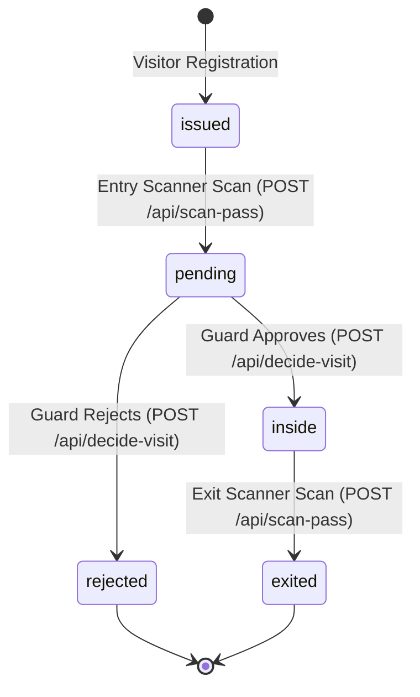

# Manual QA Runbook & Verification Matrix

This runbook provides complete step-by-step procedures for manual testing and pre-release validation across all user roles, devices, and edge cases in the EARIST E-GatePass platform.

---

## 1. Visitor Portal (Desktop & iPhone Safari)

### 1.1 Desktop Browser Workflow
1. Navigate to `https://egatepass.tech`.
2. Confirm landing page, hero section, and navigation render without layout shift.
3. Click **Get Your Gate Pass** (`/get-pass`).
4. Complete the Cloudflare Turnstile verification widget.
5. Fill out visitor information: Full Name, Purpose of Visit, Department/Host.
6. Select Visit Date:
   - Confirm past dates are disabled and rejected.
   - Confirm dates beyond the configured scheduling window (default: 30 days) are blocked.
7. Capture Face Photo using webcam (camera-only capture).
8. Provide Valid ID using either rear camera capture OR file/gallery image upload (JPEG, PNG, WebP).
9. Submit registration.
10. **Delivery Gate Verification**:
    - Pass is issued, transitioning directly to the Delivery Gate before QR reveal.
    - Strongly encourage verified email delivery (`Verify Email & Send My E-GatePass`).
    - Alternatively, choose `Continue without email` to open the 5-second timed countdown warning dialog. Confirming after 5 seconds reveals the pass QR code with a persistent warning banner to save the pass before leaving.
    - Confirm `beforeunload` browser prompt warns against accidental page refresh or closing until email is verified or pass is downloaded.
11. **Expected Result**: Pass status displays `issued`. QR code renders with the EARIST logo centered inside (error correction level H) without reducing scanner reliability.

### 1.2 iPhone Safari Mobile Verification (Critical Mobile Checks)
1. Open Safari on an iPhone (e.g. iPhone 12/13/14/15/SE viewport).
2. Navigate to `/get-pass`.
3. **Check iOS Input Auto-Zoom**: Tap into each text input field.
   - **Expected**: Screen DOES NOT zoom in unexpectedly (inputs enforce a minimum `16px` font size).
4. **Check Native Date Input Overflow**:
   - Inspect the Visit Date picker input on narrow screens (< 375px width).
   - **Expected**: Date input does NOT overflow horizontally outside its form/card container.
5. **Portal Valid ID (Camera OR Upload)**:
   - Tap **Take Photo** to use rear camera, or switch to **Upload ID** to select an image from gallery/files.
   - Verify file picker allows selecting JPEG, PNG, or WebP images (uploaded ID images are locally processed and compressed to WebP before evidence upload, and the resulting evidence blob must satisfy the authoritative secure upload-intent limit of 5 MB).
   - Verify unsupported image formats trigger a clear warning message (`This image format is not supported. Please choose a JPEG, PNG, or WebP image.`).
   - Verify selecting the same file again after clearing works seamlessly.
5b. **Optional Local OCR Autofill**:
   - In Step 1 (Details), tap **Autofill from ID**.
   - Take photo or upload valid ID; confirm OCR runs locally in browser memory without sending image to external services.
   - Confirm extracted names prefill empty fields while preserving existing user-entered values.
   - Confirm form NEVER auto-submits upon OCR completion, allowing visitor to review and edit all fields.
   - Confirm the ID image used during OCR is retained as valid ID evidence for Step 3.
6. **Independent Retake ID & Selfie**:
   - Tap **Retake ID**: Only the ID preview is cleared; the face photo preview remains intact.
   - Tap **Retake Photo**: Only the face photo is cleared; ID preview remains intact.
7. **Object URL Lifecycle Cleanup**:
   - Switch tabs or navigate away after capturing photos.
   - **Expected**: No memory leaks or orphaned `blob:` URLs in browser memory.

---

## 2. Kiosk Flow (Android / Tablet Mode)

1. Open Kiosk view (`/kiosk`) on an authorized tablet device.
2. Ensure Kiosk device is logged in with valid device credentials.
3. **Capture Valid ID (Rear Camera)**:
   - Hold a Philippine Government ID (e.g. Driver's License, UMID, National ID, Student ID) up to the rear camera.
   - Tap capture.
4. **Local Tesseract OCR Extraction**:
   - Observe the scanning indicator.
   - Confirm OCR attempts to extract visitor name fields locally (first name, middle name when available, and last name) in browser memory without server transmission.
   - Confirm the visitor reviews and completes remaining required information manually.
5. **Visitor Review / Correction**:
   - Allow visitor to edit/correct any misread characters.
6. **Capture Visitor Selfie (Front Camera)**:
   - Switch to front camera and take selfie.
7. **Pass Generation & Printing**:
   - Click **Issue Gate Pass**.
   - Click **Print Pass** / **Print Thermal Pass**. If MXW01 Bluetooth is connected, confirm direct thermal printing triggers. If disconnected or unsupported, confirm browser print fallback opens.
   - Confirm optional **Email my QR code** and **Next Visitor** buttons are available and responsive.

---

## 3. Gate Entry, Guard Review, and Exit Sequence



### 3.1 Entry Scanner Device
1. Log in at `/device/login` using Entry Scanner credentials (assigned to `Main Gate`).
2. Present an `issued` QR code pass to the scanner camera.
3. **Expected State Transition**:
   - Entry device calls `POST /api/scan-pass` (mode: `entry`).
   - Scanner displays: **Scan Accepted — Pending Guard Review**.
   - Database pass status transitions from `issued` to `pending`.
4. Scan the same QR code again immediately.
   - **Expected**: Scanner displays warning that pass is already pending review.

### 3.2 Guard Console Review
1. Log in as `guard` at `/login`.
2. Navigate to **Guard Console** (`/guard`).
3. Confirm the scanned pass appears in the **Pending Entry** queue loaded via RPC `api.guard_dashboard_page` (snapshot/keyset queue paging).
4. Inspect visitor selfie photo, captured valid ID, visit purpose, and destination (streamed via `GET /api/evidence?id=<evidence_id>`).
5. Click **Approve Entry**:
   - Route `POST /api/decide-visit` executes with `decision: 'approved'`.
   - **Expected State Transition**: Pass status transitions from `pending` to `inside`.
6. Alternatively, click **Reject Entry** and provide a reason (e.g. "Invalid ID", "Dress Code Violation"):
   - Route `POST /api/decide-visit` executes with `decision: 'rejected'`.
   - **Expected State Transition**: Pass status transitions from `pending` to `rejected`.

### 3.3 Exit Scanner Device
1. Log in at `/device/login` using Exit Scanner credentials.
2. Present a pass currently in `inside` status.
3. **Expected State Transition**:
   - Exit device calls `POST /api/scan-pass` (mode: `exit`).
   - Scanner displays: **Exit Verified — Have a Safe Day**.
   - Database pass status transitions from `inside` to `exited`.
4. Present an `exited` or `expired` pass:
   - **Expected**: Exit device displays: **Invalid or Already Exited Pass**.

---

## 4. Administrative & Governance QA

### 4.1 Admin Operations
1. Log in as `admin`.
2. **Staff Creation**: Invite a new Guard with a valid email via `POST /api/create-user`.
   - Confirm Supabase Auth user and `staff_profiles` row created (`active = true`).
   - Confirm invite email delivered via Resend with EARIST branding.
3. **Device Management**: Register an Entry scanner device for "East Gate" via `POST /api/create-device`.
   - Confirm device credentials generated.
4. **Deactivation**: Deactivate a test guard account via `POST /api/update-user`.
   - Confirm the test guard is instantly blocked from logging in.

### 4.2 Super Admin Governance
1. Log in as `superadmin`.
2. **Settings**: Modify working hours or retention windows via `POST /api/update-settings`.
   - Confirm changes persist to `public.app_settings` table.
3. **Last Super Admin Demotion Protection**:
   - Attempt to deactivate or change the role of the only active Super Admin.
   - **Expected API Response**: HTTP 409 with body `{ error: 'cannot_remove_last_superadmin' }`.
   - **Expected UI Toast**: *"Cannot demote or deactivate the last remaining Super Admin."*
4. **Incident Hold**:
   - Locate an active or exited pass and apply an **Incident Hold** via `POST /api/admin/holds`.
   - Confirm hold row created in `public.incident_holds` with `active = true`.

### 4.3 Isolated-Database Super Admin Bootstrap Contract QA

> [!CAUTION]
> **ISOLATED TEST DATABASE ONLY**: Never test destructive or one-time bootstrap failure scenarios against an established production database. Once any row exists in `public.staff_profiles`, bootstrap is permanently locked. Conduct this QA suite exclusively in an isolated staging or local test environment.

#### Test Execution Protocol:
1. **Valid Confirmed Human**:
   - Create confirmed human Auth user (`email_confirmed_at IS NOT NULL`, `is_anonymous = false`, non-empty usable email).
   - Execute `SELECT private.bootstrap_super_admin('<UUID>'::uuid, 'Initial Super Admin');`.
   - **Expected**: Succeeded (returns `void`). Profile created in `public.staff_profiles` with `role = 'superadmin'`, `active = true`, `must_change_password = true`. Audit event recorded with `action = 'superadmin.bootstrap'`, `actor_kind = 'system'`, `actor_role = 'bootstrap'`.
2. **Missing User**:
   - Execute bootstrap with non-existent UUID.
   - **Expected**: Failed with error code `23503`: *"Auth user does not exist"*.
3. **Anonymous User**:
   - Execute bootstrap targeting an anonymous Auth user (`is_anonymous = true`).
   - **Expected**: Failed with error code `23514`: *"anonymous users cannot be bootstrapped as super admin"*.
4. **Unconfirmed User**:
   - Execute bootstrap targeting an unconfirmed user (`email_confirmed_at IS NULL`).
   - **Expected**: Failed with error code `23514`: *"bootstrap target email must be confirmed"*.
5. **Device Pseudo-User**:
   - Execute bootstrap targeting an identity ending with `@devices.egatepass.invalid`.
   - **Expected**: Failed with error code `23514`: *"managed device identities cannot be bootstrapped as super admin"*.
6. **Invalid Display Name**:
   - Execute bootstrap with blank display name or single-character display name.
   - **Expected**: Failed with error code `23514`: *"display name must be between 2 and 120 characters"*.
7. **Any Existing Staff Profile**:
   - In a database containing an existing Guard, Admin, or Super Admin profile, attempt bootstrap.
   - **Expected**: Failed with error code `23514`: *"bootstrap is allowed only before the first staff profile"*.
8. **Second Bootstrap Attempt**:
   - Immediately attempt a second bootstrap after successful initial bootstrap.
   - **Expected**: Failed with error code `23514`: *"bootstrap is allowed only before the first staff profile"*.

---

## 5. Transactional Email Verification

### 5.1 Supabase Auth Send Email Hook
1. Trigger a password reset from the login screen (`/forgot-password`).
2. Verify delivery in recipient inbox:
   - **Sender**: `EARIST E-GatePass <notifications@egatepass.tech>`
   - **Branding**: Official EARIST Logo rendered at top.
   - **Action**: Clean, responsive button linking to reset password form.
3. Verify Vercel Function logs:
   - `/api/auth/send-email-hook` returned HTTP 200.

### 5.2 QR Pass Email Delivery
1. On the issued pass screen, enter an email address to receive the QR pass.
2. Calls `POST /api/passes/email` with `action: 'request_code'`.
3. Verify one-time 6-digit verification code is delivered.
4. Enter verification code (`action: 'verify_and_send'`).
5. Verify follow-up email delivers the QR pass with full visitor details.

---

## 6. Retention & Cleanup Verification

1. Create a test expired pass with expired photo evidence.
2. Trigger retention maintenance:
   ```bash
   curl -X POST https://egatepass.tech/api/admin/retention-maintenance \
     -H "Authorization: Bearer <CRON_SECRET>" \
     -H "Content-Type: application/json" \
     -d '{"batchSize": 50, "dryRun": false}'
   ```
3. Verify test photo is deleted from Supabase Storage bucket (`visitor-photos`).
4. Verify `visitor_evidence.purged_at` is stamped.
5. Verify pass record with active `incident_holds` is preserved untouched.

---

## 7. Security-Negative QA Matrix

| Test Case | Procedure | Expected Outcome |
|---|---|---|
| **Role Spoofing** | Guard attempts to call `POST /api/create-user` | HTTP 403 Forbidden |
| **Tampered QR Token** | Alter characters in scanned QR code string | HTTP 404 Pass Not Found / Invalid Digest |
| **Expired Pass Entry** | Scan pass with `valid_until < now()` | HTTP 409 Pass Has Expired |
| **Wrong Gate Exit** | Scan pass on Exit scanner before Entry scan | HTTP 409 Pass is not inside |
| **Forged Webhook** | Send mock POST to `/api/auth/send-email-hook` with invalid signature | HTTP 401 Unauthorized |
| **Recovery Session Confinement** | Attempt to call `/api/scan-pass` using a password recovery token | HTTP 403 Recovery Session Forbidden |
| **Unauthenticated Maintenance** | Call `/api/admin/retention-maintenance` without Bearer secret | HTTP 401 Unauthorized |

---

## 8. Institutional Pass Visual Presentation QA

1. **Online Pass Presentation**:
   - Register a visitor online at `/get-pass`.
   - Verify pass card renders:
     - Institution header: `EARIST E-GATEPASS`
     - Visitor Name: Formatted as `FIRSTNAME M. LASTNAME`
     - Visit Date: `Asia/Manila` date (e.g. `October 27, 2026`)
     - High-contrast centered QR code
     - Canonical Pass Reference: `Ref: EG-XXXXXXXX`
     - Recovery guidance note: `Lost access to your QR? Present a valid ID to the Guard for recovery.`
   - Confirm raw cryptographic QR token string is **NEVER** displayed as visible text.
2. **Download Pass Card**:
   - Click **Download Pass**.
   - Verify downloaded PNG file contains the complete institutional card (Name, Date, QR, Reference, Institution header), not just the isolated QR square.
3. **Email Pass Presentation**:
   - Verify transactional email contains the institutional card formatting with Visitor Name, Visit Date, Pass Reference, and QR image.
4. **Kiosk Presentation Contract**:
   - Complete walk-in registration at `/kiosk`.
   - Verify the displayed pass matches the canonical institutional pass card presentation.

---

## 9. MXW01 Kiosk Direct Bluetooth Thermal Printing QA

> [!NOTE]
> Physical paper output and hardware-level protocol acceptance remain subject to on-site testing (**PHYSICAL MXW01 ACCEPTANCE: NOT YET TESTED**).

1. **Hardware Preparation**:
   - Ensure MXW01 thermal printer is charged and loaded with 57mm thermal roll.
   - Power on the printer.
2. **Device Settings & Pairing**:
   - On the Kiosk tablet (`/kiosk`), tap the Gear icon in the header.
   - Re-enter this kiosk device's password when prompted.
   - **First authorization**: Tap **Connect MXW01** / **Choose Printer**. In the browser device picker, select the MXW01 device and click **Pair**. Confirm status badge updates to **Connected**.
   - **Subsequent reconnect**: Uses a previously authorized browser device via `navigator.bluetooth.getDevices()` and does not reopen the browser chooser unless authorization is missing or the operator explicitly chooses another printer.
3. **Test Print**:
   - Tap **Test Print**.
   - Verify printer feeds and prints an official 384px EARIST diagnostic slip.
4. **Issuance & Printing**:
   - Complete a walk-in registration.
   - Verify thermal pass prints automatically if auto-print is enabled, or prints upon tapping **Print Pass (MXW01)**.
   - Verify printed paper ticket:
     - Header: `EARIST E-GATEPASS`
     - Visitor Name and Visit Date are clearly legible.
     - Printed QR code scans cleanly on physical gate scanners.
     - Reference `Ref: EG-XXXXXXXX` is printed at the bottom.
5. **Print Failure Issuance Immunity (Critical)**:
   - Power off the MXW01 printer.
   - Complete a kiosk pass issuance.
   - **Expected**: Pass creation succeeds completely. The UI displays the valid pass alongside a clear "Printer Unavailable" notice with **Printer Settings** and **Browser Print** buttons (truthful direct **Print Again** is only shown if the direct printer is actually connected). The pass is NEVER rolled back or duplicated.
6. **Physical Disconnect & Browser Print Fallback**:
   - Physical power-off transitions the UI to Disconnected through the browser `gattserverdisconnected` event.
   - Tap **Browser Print**.
   - Verify the browser's native `window.print()` dialog opens with styled print media layout.

---

## 10. Super Admin Thermal Template Editor QA

1. **Access Control**:
   - Log in as `guard` or `admin` and attempt to navigate to `/admin/templates`.
   - Verify access is blocked.
   - Log in as `superadmin` and navigate to **Print Templates** in the sidebar.
2. **Template Layout Canvas**:
   - Verify 384px thermal canvas preview.
   - Test dragging elements, adjusting font size, alignment, canvas height, and QR size.
3. **Mandatory Elements Locking**:
   - Attempt to delete mandatory elements (`visitor_name`, `visit_date`, `qr_code`, `pass_reference`).
   - Confirm delete button is disabled or blocked for mandatory components.
4. **Save Draft & Publishing**:
   - Make a styling change and tap **Save Draft**.
   - Tap **Publish Template**.
   - Confirm success toast and verify active published version increments.
5. **Rollback / Version History**:
   - Open version history and select an earlier template version.
   - Tap **Restore This Version**.
   - Confirm a new published version is created with the restored layout without corrupting history.

---

## 11. Guard Visitor Recovery QA

1. **Lost QR Scenario**:
   - Locate an active pass issued for today's date in `Asia/Manila`.
   - Assume visitor lost phone or has no email access.
2. **Recovery Search**:
   - On the Guard Console (`/guard`), tap **Visitor Recovery**.
   - Search by visitor last name, contact number, or `EG-XXXXXXXX` reference.
   - Confirm search matches only today's operationally active passes (`issued`, `pending`, `inside`).
3. **Evidence Inspection**:
   - Tap on the visitor card to expand.
   - Confirm visitor registration photo selfie and valid ID image are rendered securely via `GET /api/evidence`.
   - Compare physical ID presented by the visitor to the on-screen evidence.
4. **Manual Gate Actions**:
   - If visitor is entering: tap **Approve Entry** (or **Reject Entry** if unverified).
   - If visitor is leaving without QR: tap **Record Exit**.
   - Confirm database audit log records `source = 'visitor_recovery'` and attributes action to the guard actor.

---

## 12. Fail-Closed Outage & Guard Offline Operations QA

1. **Network Disconnect Simulation**:
   - Disconnect internet / Wi-Fi on the test kiosk, scanner, and guard tablets.
2. **Kiosk Fail-Closed Test**:
   - On `/kiosk`, attempt walk-in registration.
   - Confirm screen displays: **SERVICE TEMPORARILY UNAVAILABLE — Please proceed directly to the Guard for registration and verification.**
   - Confirm normal intake is disabled and no partial passes are issued.
3. **Entry & Exit Scanner Fail-Closed Test**:
   - Present a QR code to the offline Entry scanner.
   - Confirm scanner displays: **NETWORK UNAVAILABLE — Entry verification is temporarily unavailable. Please proceed directly to the Guard for manual verification.**
   - Confirm scanner does **NOT** falsely label the pass as invalid, expired, or forged.
4. **Guard Offline Operations**:
   - On the Guard tablet (`/guard`), observe the prominent yellow/red Offline Banner showing pending records count.
   - **Offline Recovery**: Search for a previously cached visitor; tap **Approve Entry**. Confirm event is saved to the local IndexedDB outbox.
   - **Offline Registration**: Open **Offline Registration** tab. Enter walk-in visitor details, capture selfie, capture ID image. Tap **Approve Entry**. Confirm Time-In is recorded automatically and record is stored locally in IndexedDB with an immutable `offlineRegistrationId`.
   - **Page Reload Test**: Refresh the Guard page while completely offline. Confirm application shell reloads and all offline outbox records remain intact in IndexedDB.
5. **Reconnection & Synchronization**:
   - Re-enable Wi-Fi / internet connectivity.
   - Confirm the Guard sync manager triggers background synchronization.
   - Confirm offline registrations synchronize via `POST /api/sync-offline-registration` (uploading photo/ID evidence and generating canonical server passes without duplication).
   - Confirm outbox lifecycle events synchronize via PostgREST RPC `api.guard_sync_offline_event` (executing row locking and transitioning passes to `inside` or `exited`). Do NOT expect offline events to call `/api/scan-pass` or `/api/decide-visit`.
   - Confirm local outbox records are acknowledged and cleared from the tablet store.

---

## 13. Root-Cause Closure & Deep Dive Acceptance Scenarios

### 13.1 Guard Offline Lifecycle
1. **Pre-Cache Visitor**:
   - While online on `/guard`, ensure operational cache is populated with an issued visitor pass at version `N`.
2. **Lose Backend & Approve Visitor**:
   - Simulate backend outage (disconnect Wi-Fi / block API).
   - Locate cached visitor in Visitor Recovery, tap **Approve Entry**.
   - Verify pass locally transitions to `inside` at projected version `N + 1`, and outbox queues approval expecting `issued` / version `N`.
3. **Exit Visitor Before Reconnect**:
   - While still offline, search the same visitor in Visitor Recovery.
   - Tap **Record Exit**.
   - Verify pass transitions to terminal exited state locally, and outbox queues exit event expecting `inside` / projected version `N + 1`.
4. **Reconnect & Chronological Synchronization**:
   - Restore backend connectivity. Trigger or await synchronization.
   - Verify approval syncs first (server becomes `inside` / version `N + 1`), then exit syncs (server becomes `exited` / version `N + 2`).
   - Confirm zero version conflict or state error occurs on server.

### 13.2 Offline-Created Visitor Lifecycle (Exit Before Reconnect)
1. **Disconnect & Register Offline**:
   - With backend offline, navigate to **Offline Registration**.
   - Enter visitor details, capture selfie and ID, tap **Approve Entry**.
   - Confirm registration is saved with local projected status `inside` and version `1`.
2. **Record Exit While Still Offline**:
   - In Visitor Recovery, search for the offline-created visitor.
   - Tap **Record Exit**.
   - Verify local pass transitions to exited, queuing exit event expecting `inside` / version `1`.
3. **Reconnect & Canonical Remapping**:
   - Re-enable connectivity.
   - Confirm sync coordinator syncs registration first, creating canonical server pass at version `1`.
   - Confirm sync coordinator remaps local registration ID to canonical pass ID in cached pass and queued exit event.
   - Confirm exit event syncs cleanly against canonical pass, resulting in `exited` status on server.

### 13.3 Authoritative Server Rejection (No Offline Bypass)
1. **Trigger Server Refusal**:
   - With network online, attempt an action on a pass that triggers an authoritative server error (e.g., 403 Forbidden, 409 Conflict, expired pass, or status mismatch).
2. **Verify Truthful Error Handling**:
   - Confirm the UI displays the truthful server refusal error message.
   - Confirm the client does NOT misclassify the server error as transport failure.
   - Confirm NO offline approval or exit action is queued in IndexedDB.

### 13.4 Cache Preservation During Snapshot Refresh
1. **Create Unsynchronized Local Visitor**:
   - While offline, create an approved offline registration.
2. **Reconnect & Refresh Snapshot**:
   - Restore backend connectivity while a full authoritative server snapshot refresh executes.
3. **Verify Preservation**:
   - Confirm `atomicReplaceCachedVisitors()` does NOT wipe the pending/syncing local offline visitor.
   - Confirm local visitor remains actionable and present until canonical sync finishes.

### 13.5 MXW01 Bluetooth Lifecycle & Fallback
1. **Pair & Test Ticket**:
   - On Kiosk tablet settings, tap **Connect MXW01** / **Choose Printer** and authorize printer via browser chooser.
   - Tap **Test Print**; confirm diagnostic ticket prints.
2. **Successful Direct Print**:
   - Issue a kiosk pass. Confirm thermal pass prints and status confirms direct print.
3. **Forced Failure & Browser Fallback**:
   - Turn off printer power or allow paper to run out.
   - Issue a kiosk pass.
   - Confirm pass issuance succeeds authoritatively and UI displays **Printer Unavailable** with fallback **Browser Print** button (truthful **Print Again** is only displayed if direct printer is connected).
   - Confirm UI NEVER displays "Pass printed via MXW01" on failure.
   - Tap **Browser Print**; verify native `window.print()` dialog opens.
4. **Reconnect & Disconnect Verification**:
   - Power printer back on; verify automatic or manual reconnection via `reconnect()` retrieves previously authorized device via `navigator.bluetooth.getDevices()` without opening the browser chooser.
   - Power printer off again; verify native `gattserverdisconnected` event triggers React status transition to `disconnected`.

### 13.6 Thermal Template Update on Open Kiosks
1. **Open Kiosk**:
   - Keep `/kiosk` open in an active browser tab.
2. **Publish New Template**:
   - In Super Admin `/admin/templates`, modify layout (e.g. adjust element position or label) and tap **Publish Template**.
3. **Print Without Full Page Reload**:
   - On the open kiosk, complete a walk-in pass issuance and trigger print.
   - Verify `refreshPublishedTemplate()` fetches the new published template immediately prior to rasterization without requiring a manual page refresh.

### 13.7 Pass Issuance Replay & Evidence Invalidation
1. **Simulate Lost Response on Issue**:
   - On kiosk or portal, complete registration.
   - Simulate a network disconnect immediately after `POST /api/passes/issue` commits on the server.
2. **Idempotent Retry**:
   - Tap retry.
   - Confirm client resubmits the exact same `requestId`, `photoIntentId`, and `idIntentId`.
   - Confirm server returns existing canonical pass without `intent_mismatch` or duplicate evidence uploads.
3. **Evidence Replacement Invalidation**:
   - If ID or photo is retaken / replaced (or re-scanned with OCR), confirm previously stored intent IDs are cleared.

### 13.8 Native Web Share Cancellation
1. **Open Share Sheet**:
   - On issued pass screen, tap **Share**.
2. **Cancel Sheet**:
   - Dismiss or cancel the native OS share sheet (throws `AbortError`).
3. **Verify Clean Exit**:
   - Confirm zero error toasts are displayed.
   - Confirm NO automatic pass download is triggered.

### 13.9 Password Reset CAPTCHA Consistency
1. **Public Reset**:
   - Navigate to `/forgot-password`, solve Turnstile challenge, submit reset request. Confirm valid token is sent.
2. **Authenticated Staff Reset (PasswordResetCard)**:
   - On staff profile/settings, trigger password reset. Confirm Turnstile challenge is solved and token is sent to `sendPasswordReset()`.
3. **Guard Password Reset Modal**:
   - On `/guard`, open reset password modal. Confirm Turnstile widget is present, solved, and verified before email dispatch.

---

## 14. Institutional Upgrades Manual QA Runbook

### 14.1 Required Field UX Verification
1. Navigate to `/get-pass` (Online Registration) and `/kiosk` (Kiosk Registration).
2. Verify introductory notice is present: *"Fields marked * are required."*
3. Verify required fields visibly render a red asterisk `*` and accessible `(required)` screen-reader text:
   - First Name *
   - Last Name *
   - Contact Number *
   - Purpose of Visit *
   - Visit Date *
   - Privacy Consent *
4. Verify optional fields visibly render `(Optional)` with muted styling (e.g. `Middle Name (Optional)`).
5. Select a Visit Purpose requiring details (e.g. *Official Business*). Verify the conditional details field visibly appears with `*` and required attributes. Change to *General Inquiry* and verify details field is hidden.
6. Verify actual input elements receive `required` and `aria-required="true"`.

### 14.2 Camera Controls & Mirroring Verification
> [!NOTE]
> Physical camera hardware behavior remains subject to manual acceptance on physical devices (**PHYSICAL CAMERA ACCEPTANCE: REQUIRES DEVICE TESTING**).
1. Open camera on a multi-camera device (e.g., Android phone or tablet).
2. Verify Front camera starts by default with mirrored preview and mirrored face capture.
3. Tap **Switch Camera**: verify old video stream tracks stop cleanly and rear camera activates with unmirrored preview and unmirrored capture.
4. Tap **Mirror**: verify mirror state toggles.
5. In ID Document capture: verify preview mirroring can be enabled, but captured ID image remains unmirrored so text is readable.
6. In Kiosk OCR scan: verify OCR source frame is unmirrored regardless of preview mirror state.
7. Rapidly switch cameras twice: verify no orphaned media streams remain locked.

### 14.3 Canonical Digital Pass Parity Verification
1. Register a visitor pass online at `/get-pass`.
2. Observe on-screen pass presentation.
3. Download the pass PNG and share via Web Share API.
4. Request email dispatch and inspect the attached PNG `egatepass-EG-XXXXXXXX.png`.
5. Complete a walk-in registration at `/kiosk` and observe the digital on-screen pass.
6. **Compare Visual Artifacts**: Verify the on-screen card, downloaded card, shared card, and email attachment all use the exact same canonical SVG layout, fonts, institutional maroon/gold branding, pass reference, and QR code placement.
7. Confirm email attachment is named `egatepass-EG-XXXXXXXX.png` and no longer `earist-gate-pass-qr.png`.
8. Verify physical thermal print via MXW01 remains isolated using the 384px thermal template layout.

### 14.4 Visitor Instructions & Privacy Configuration QA
1. As Super Admin, navigate to **System Settings > Visitor Instructions**.
2. Edit instructions (e.g., modify text, add an item up to 8 items). Save settings.
3. Generate a new pass online (`/get-pass`): verify updated instructions render in the *"Before You Arrive"* panel.
4. Generate a kiosk pass: verify the same instructions render on the kiosk success screen.
5. Email pass: verify the email body contains the configured instructions.
6. Verify privacy notice displays configured retention days (`image_retention_days` and `visitor_retention_days`) rather than hardcoded numbers.

### 14.5 Visitor Records Date Range & Report Exports QA
1. Navigate to **Visitor Records** (`/admin/records`).
2. Test date presets: **Today**, **Last 7 Days**, **This Month**, and verify `From Date` and `To Date` populate with Asia/Manila calendar dates.
3. Test **Reset Filters**: verify dates, status, and search reset and trigger a single root query.
4. Test invalid range: set `From Date` after `To Date` and verify error toast without crashing.
5. Tap **Export** and choose:
   - **CSV**: Open downloaded file. Verify row 1 contains column headers and no decorative rows exist. Verify sensitive secrets (`qrToken`, `tokenDigest`, evidence paths) are absent.
   - **Excel**: Open `.xlsx` in spreadsheet viewer. Verify institutional header, filter metadata block, frozen table headers, and styled rows.
   - **PDF**: Open `.pdf`. Verify maroon banner header, applied filters, and formatted paginated table with page numbers.
6. Repeat exports on **Admin Audit Logs** (`/admin/audit-logs`) for Visitor Activity and Administrative Activity.

### 14.6 Guard Authoritative Search & Waiting-Time QA
1. On Guard Console (`/guard`), verify live pending queue displays chronological oldest-first visitors without requiring a search.
2. In the Search input, type 1 character: verify local filtering on loaded cards only.
3. Type >= 2 characters (e.g., visitor surname or contact number): verify 280ms debounce triggers authoritative server search via `api.guard_search_pending_queue`.
4. Verify search returns visitors even if they were outside the initial 50 loaded passes.
5. Tap **Clear Search**: verify the normal live queue instantly returns without reloading all passes.
6. Verify waiting-time badges: cards display `Waiting X min` with subtle tone thresholds (0–5m normal, 5–10m attention, 10m+ long wait).

### 14.7 Safe Staff Permanent Decommission QA
> [!CAUTION]
> Never test decommissioning on the only active Super Admin account.
1. Create a disposable test staff account (e.g. `test-guard@earist.ph`).
2. Deactivate the account. Confirm login is denied.
3. As Super Admin, open **User Management** and click the **Inactive** tab.
4. Click **Permanently Decommission**.
5. In the modal, enter an incorrect password: verify rejection with *"Incorrect Super Admin password"*.
6. Enter correct Super Admin password and a valid reason (e.g., *"Staff departed institution"*): verify success.
7. Verify account moves to the **Decommissioned** tab with decommission timestamp and reason.
8. Verify no Reactivate button or role editor is available.
9. Verify Super Admin remains logged in (local signout preserved the browser session).
10. Verify historical audit records attribute prior actions to the decommissioned staff user.


## 15. Guard Offline Security, Privacy & Inverted Date Range Verification

### 15.1 Guard Offline Registration Server Authority Verification
1. **Intake Offline Visitor**: On the Guard page, switch to "Register Offline Visitor" while offline. Complete form with selfie and valid ID.
2. **Inspect Network on Reconnect**: Restore network connection and observe sync network traffic.
3. **Verify Route Target**: Confirm synchronization posts to `/api/sync-offline-registration` and NOT directly to Supabase RPC.
4. **Verify Database Privilege**: Attempting direct RPC call from browser console as `authenticated` must return permission denied.

### 15.2 Cross-Guard Sign-Out Block
1. Disconnect network on Guard terminal.
2. Record an offline entry scan or intake an offline visitor.
3. Click "Sign Out".
4. **Expected**: System attempts sync, then displays notification that unsynchronized records remain on the device and blocks logout.
5. Restore network, allow sync to complete, then click "Sign Out".
6. **Expected**: Sign-out proceeds cleanly and IndexedDB sensitive cache is cleared.

### 15.3 Inverted Date Range Audit Validation
1. Navigate to Admin > Audit and Activity.
2. Set "From" date to tomorrow and "To" date to today.
3. **Expected**:
   - Inline message appears: *"Start date cannot be later than end date."*
   - Table displays *"Start date cannot be later than end date."* without querying backend.
   - Export CSV, Excel, and PDF buttons are disabled.

### 15.4 Forced Actor Switch Purge & Unattributed Record Rejection
1. **Setup Shift Transfer Scenario**: Guard A logs in and records offline actions while offline.
2. **Forced Actor Switch**: Guard B logs in on the same browser (or `transitionGuardOfflineStore(guardB)` triggers).
3. **Verify Store Purge**:
   - Inspect IndexedDB stores: `cached_visitors`, `offline_registrations`, `offline_events`, and `meta` are completely emptied.
   - Guard B's pending outbox badge shows 0.
   - Guard B cannot see, approve, or synchronize any records created by Guard A.
4. **Unattributed Record Rejection**:
   - If an unattributed record (`actorId = null` or missing) is artificially injected into IndexedDB, verify that `getOfflineRegistrations(guardB)`, `getOfflineEvents(guardB)`, and `searchCachedVisitors(guardB)` fail closed and omit the unattributed record completely.

### 15.5 Evidence-Safe Sync Failure Classifier Verification
1. **Intake Offline Registration**: Complete an offline registration on the Guard console while disconnected.
2. **Simulate Transient / Network / 5xx Outage**:
   - Intercept `/api/sync-offline-registration` and return HTTP 503 or simulate network disconnection.
   - Trigger sync via `runOfflineMaintenance()`.
   - **Expected**: Registration remains in `pending` state with photo and ID blobs intact. Checkpoints are retained.
3. **Simulate Unexpected 400 Bad Request**:
   - Return HTTP 400 with generic error message.
   - **Expected**: Classifier treats this as `transient_or_internal`. Local photo and ID blobs are preserved; registration remains `pending`.
4. **Simulate Server 409 Conflict**:
   - Return HTTP 409 `{"status": "conflict", "reason": "pass_already_exists"}`.
   - **Expected**: Classifier marks registration as terminal `conflict`. Binary blobs (`photoBlob`, `idBlob`) are stripped from IndexedDB, while relational record and error metadata remain intact for reconciliation.

## 16. Deterministic Text Rendering, Font Embedding & Outbox Truth QA

### 16.1 Special Unicode Visitor Names & Grapheme Integrity
1. **Register Pass with Accented Characters**:
   - Register a visitor with name `José Niño Dela Cruz` and purpose `Académico – Registrar Verification • Special Permit`.
2. **Inspect On-Screen Presentation**:
   - Verify all accented letters (`é`, `ñ`), dashes (`–`), and bullets (`•`) render crisp and clear without mojibake, boxes, or substitution marks.
3. **Inspect Server Email Attachment**:
   - Check the delivered email attachment `egatepass-EG-XXXXXXXX.png`. Verify sharp serverless rasterization matches on-screen appearance perfectly.

### 16.2 2-Line Visitor Name Fitting on Digital Passes
1. **Register Pass with Long Full Name**:
   - Register a visitor with name `Maria Concepcion Dela Cruz Hernandez` (> 24 graphemes).
2. **Verify 2-Line Layout**:
   - Verify the name wraps into two balanced lines: Line 1 (`Maria Concepcion` at $y \approx 112$) and Line 2 (`Dela Cruz Hernandez` at $y \approx 136$).
   - Verify visit date shifts to $y \approx 158$ and validity window shifts to $y \approx 176$.
   - Verify no text overlaps with the QR code box ($y \ge 182$).

### 16.3 PDF Report Export with Bundled Noto Sans
1. Navigate to **Visitor Records** (`/admin/records`).
2. Filter or search for visitors with accented characters.
3. Tap **Export > PDF**.
4. Open the generated `.pdf` file in a PDF reader.
5. Verify all columns, headers, footers, and special Unicode characters render cleanly using embedded Noto Sans font (`EgatepassNoto`).

### 16.4 CSV Report Export with UTF-8 BOM in Microsoft Excel
1. In **Visitor Records** or **Audit Logs**, tap **Export > CSV**.
2. Open the downloaded `.csv` file directly in Microsoft Excel on Windows.
3. Verify that non-ASCII characters (`ñ`, `é`, `•`, `–`) display correctly without requiring manual text-import wizard configuration (UTF-8 BOM `\uFEFF` detected automatically).

### 16.5 Guard Initial Reload Outbox Truth
1. Disconnect the Guard tablet from the network.
2. Record an offline entry scan or intake an offline visitor.
3. Note the outbox pending count shows `1`.
4. Hard-refresh the browser tab (`Ctrl+F5` or `Cmd+Shift+R`).
5. **Expected**: Immediately upon store initialization, the pending outbox badge displays `1` and the outbox tab lists the pending item without requiring the guard to tap "Sync Now" or trigger extra actions.


### 16.6 Guard Station Monitor & Gate Confinement (Migration 40)
1. Log in on a hardware device account provisioned with `type = 'guard_station'` and `gate = 'Gate 1'`.
2. Navigate to `/guard`. Verify the high-visibility Guard Station monitor is displayed.
3. Confirm that personal guard logins are rejected with HTTP 403 `legacy_guard_role_disabled`.
4. Scan a valid online preregistered pass at Gate 1 entry scanner.
5. Verify the pass automatically transitions to `inside` (`scan_entry` recorded) and immediately appears on the Guard Station monitor with full-bleed registration photo.
6. Attempt to exit through a scanner at Gate 2. Verify the exit is rejected with `wrong_gate` and `invalid_scan` is logged.
7. Exit through the scanner at Gate 1. Verify the exit is recorded as `scan_exit` and status updates to `exited`.

### 16.7 Online Pre-Registration Biometric Flow & Single Camera Rule
1. Navigate to `/get-pass`.
2. Fill visitor details or optionally select an ID image for OCR autofill (using native file picker).
3. Advance to Live Face Capture. Verify only ONE custom camera exists with front-facing mirrored preview.
4. Capture face. Verify captured blob is physically unmirrored.
5. Confirm server face-presence/geometry preflight runs before advancing to Valid ID.
6. Provide or reuse valid ID (normalized at ~2000px, 0.92 WebP).
7. Execute identity verification. Verify matching succeeds against SFace/YuNet before review and pass generation.

### 16.8 Portal Actor Continuity & Multi-Actor Isolation QA (Migrations 40–42)
1. **Simultaneous Operator & Visitor Sessions**:
   - Log into `/admin` on a browser tab with an Administrator account.
   - Open `/get-pass` in a second tab.
   - Complete visitor pre-registration on `/get-pass`.
   - Inspect network request headers: confirm all requests to `api.create_upload_intent`, storage uploads, `/api/passes/verify-identity`, and `/api/passes/issue` carry the anonymous visitor token and NEVER the Administrator token.
2. **Legacy Guard Account Sign-In Rejection**:
   - Attempt to log in at `/login` with a legacy Guard email and password.
   - Confirm login fails with: *"This legacy Guard account is disabled. Gate monitoring now uses a Guard Station device."*
   - Confirm the session is immediately signed out and the user is NOT redirected to `/guard`.
3. **Guard Station Gate Monitoring**:
   - Log into `/device/login` with a Guard Station device account (`device_type = 'guard_station'`).
   - Observe the live entry feed displaying recent online visitor entries with full-bleed photos.
4. **Layout-Aware OCR Autofill**:
   - On `/get-pass`, upload a sample Philippine Driver's License or National ID during optional OCR.
   - Verify names are extracted without label corruption.
   - Verify existing entered fields are not overwritten.
   - Verify Driver's License comma format correctly assigns surname before comma, middle name to final token, and given name to preceding tokens.
