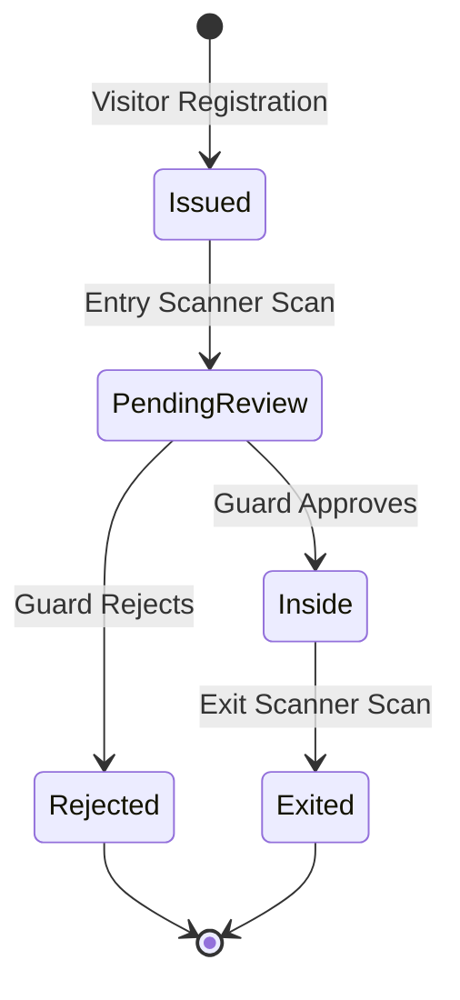

# Manual QA Runbook & Verification Matrix

This runbook provides complete step-by-step procedures for manual testing and pre-release validation across all user roles, devices, and edge cases in the EARIST E-GatePass platform.

---

## 1. Visitor Portal (Desktop & iPhone Safari)

### 1.1 Desktop Browser Workflow
1. Navigate to `https://egatepass.tech`.
2. Confirm landing page, hero section, and navigation render without layout shift.
3. Click **Get Your Gate Pass** (`/get-pass`).
4. Complete the Cloudflare Turnstile verification widget.
5. Fill out visitor information: Full Name, Purpose of Visit, Department/Host.
6. Select Visit Date:
   - Confirm past dates are disabled and rejected.
   - Confirm dates beyond maximum allowed scheduling window (e.g. 14 days) are blocked.
7. Capture Face Photo using webcam.
8. Capture Valid ID using webcam (camera-only capture).
9. Submit registration.
10. **Expected Result**: Pass status displays `issued`. QR code renders clearly with visitor details.

### 1.2 iPhone Safari Mobile Verification (Critical Mobile Fixes)
1. Open Safari on an iPhone (e.g. iPhone 12/13/14/15/SE viewport).
2. Navigate to `/get-pass`.
3. **Check iOS Input Auto-Zoom**: Tap into each text input field.
   - **Expected**: Screen DOES NOT zoom in unexpectedly (inputs use `16px` base font size).
4. **Check Native Date Input Overflow**:
   - Inspect the Visit Date picker input on narrow screens (< 375px width).
   - **Expected**: Date input does NOT overflow horizontally outside its form/card container.
5. **Camera-Only ID Capture**:
   - Tap **Capture Valid ID**.
   - **Expected**: Native camera launches directly; file/photo library picker is NOT invoked.
6. **Independent Retake ID & Selfie**:
   - Tap **Retake ID**.
   - **Expected**: Only the ID preview is cleared; the face photo preview remains intact.
   - Tap **Retake Photo**.
   - **Expected**: Only the face photo is cleared; ID preview remains intact.
7. **Object URL Lifecycle Cleanup**:
   - Switch tabs or navigate away after capturing photos.
   - **Expected**: No memory leaks or orphaned `blob:` URLs in browser memory.

---

## 2. Kiosk Flow (Android / Tablet Mode)

1. Open Kiosk view (`/kiosk`) on an authorized tablet device.
2. Ensure Kiosk device is logged in with valid device credentials.
3. **Capture Valid ID (Rear Camera)**:
   - Hold a Philippine Government ID (e.g. Driver's License, UMID, National ID, Student ID) up to the rear camera.
   - Tap capture.
4. **Local Tesseract OCR Extraction**:
   - Observe the scanning indicator.
   - Confirm OCR parses Full Name, ID Type, and ID Number locally in the browser without server transmission.
5. **Visitor Review / Correction**:
   - Allow visitor to edit/correct any misread characters.
6. **Capture Visitor Selfie (Front Camera)**:
   - Switch to front camera and take selfie.
7. **Pass Generation & Printing**:
   - Click **Issue Gate Pass**.
   - Confirm pass is issued and browser print dialog (`window.print()`) opens automatically with thermal receipt layout.
   - Confirm optional **Email QR Pass** button is available.

---

## 3. Gate Entry, Guard Review, and Exit Sequence



### 3.1 Entry Scanner Device
1. Log in at `/device/login` using Entry Scanner credentials (assigned to `Main Gate`).
2. Present an `issued` QR code pass to the scanner camera.
3. **Expected State Transition**:
   - Entry device displays: **Scan Accepted — Pending Guard Review**.
   - Pass status transitions from `issued` to `pending_review`.
4. Scan the same QR code again immediately.
   - **Expected**: Scanner displays warning that pass is already under review.

### 3.2 Guard Console Review
1. Log in as `Guard` at `/login`.
2. Navigate to **Guard Console** (`/guard`).
3. Confirm the scanned pass appears in the **Pending Entry** queue.
4. Inspect visitor selfie photo, captured valid ID, visit purpose, and destination.
5. Click **Approve Entry**.
   - **Expected State Transition**: Pass status transitions from `pending_review` to `inside`.
6. Alternatively, click **Reject Entry** and provide a reason (e.g. "Invalid ID", "Dress Code Violation").
   - **Expected State Transition**: Pass status transitions from `pending_review` to `rejected`.

### 3.3 Exit Scanner Device
1. Log in at `/device/login` using Exit Scanner credentials.
2. Present a pass currently in `inside` status.
3. **Expected State Transition**:
   - Exit device displays: **Exit Verified — Have a Safe Day**.
   - Pass status transitions from `inside` to `exited`.
4. Present an `exited` or `expired` pass.
   - **Expected**: Exit device displays: **Invalid or Already Exited Pass**.

---

## 4. Administrative & Governance QA

### 4.1 Admin Operations
1. Log in as `Admin`.
2. **Staff Creation**: Invite a new Guard with a valid email.
   - Confirm Supabase user and `staff_profiles` row created.
   - Confirm invite email delivered via Resend with EARIST branding.
3. **Device Management**: Register an Entry scanner device for "East Gate".
   - Confirm device credentials generated.
4. **Deactivation**: Deactivate a test guard account.
   - Confirm the test guard is instantly blocked from logging in.

### 4.2 Super Admin Governance
1. Log in as `Super Admin`.
2. **Settings**: Modify working hours or retention windows.
   - Confirm changes persist to `system_settings` table.
3. **Last Super Admin Demotion Protection**:
   - Attempt to deactivate or change the role of the only active Super Admin.
   - **Expected**: Action blocked with error message: *"Cannot demote or deactivate the last remaining Super Admin."*
4. **Incident Hold**:
   - Locate an active or exited pass and apply an **Incident Hold**.
   - Confirm hold badge appears on visitor record.

---

## 5. Transactional Email Verification

### 5.1 Supabase Auth Send Email Hook
1. Trigger a password reset from the login screen (`/forgot-password`).
2. Verify delivery in recipient inbox:
   - **Sender**: `EARIST E-GatePass <notifications@egatepass.tech>`
   - **Branding**: Official EARIST Logo rendered at top.
   - **Action**: Clean, responsive button linking to reset password form.
3. Verify Vercel Function logs:
   - `/api/auth/send-email-hook` returned HTTP 200.

### 5.2 QR Pass Email Delivery
1. On the issued pass screen, enter an email address to receive the QR pass.
2. Verify one-time 6-digit verification code is delivered.
3. Enter verification code.
4. Verify follow-up email delivers the QR pass with full visitor details.

---

## 6. Retention & Cleanup Verification

1. Create a test expired pass with expired photo evidence.
2. Trigger retention maintenance:
   ```bash
   curl -X POST https://egatepass.tech/api/cron/retention-maintenance \
     -H "Authorization: Bearer <CRON_SECRET>"
   ```
3. Verify test photo is deleted from Supabase Storage bucket.
4. Verify pass record with active `incident_hold` is preserved untouched.

---

## 7. Security-Negative QA Matrix

| Test Case | Procedure | Expected Outcome |
|---|---|---|
| **Role Spoofing** | Guard attempts to call `POST /api/admin/staff` | HTTP 403 Forbidden |
| **Tampered QR Token** | Alter characters in scanned QR code string | HTTP 400 Invalid QR Token Digest |
| **Expired Pass Entry** | Scan pass with `expires_at < now()` | HTTP 400 Pass Has Expired |
| **Wrong Gate Exit** | Scan pass on Exit scanner before Entry scan | HTTP 400 Pass Not Inside Campus |
| **Forged Webhook** | Send mock POST to `/api/auth/send-email-hook` with invalid signature | HTTP 401 Unauthorized |
| **Turnstile Bypass** | Post to `/api/passes` without `turnstileToken` | HTTP 400 Bot Verification Failed |
| **Unauthenticated Cron** | Call `/api/cron/retention-maintenance` without Bearer secret | HTTP 401 Unauthorized |