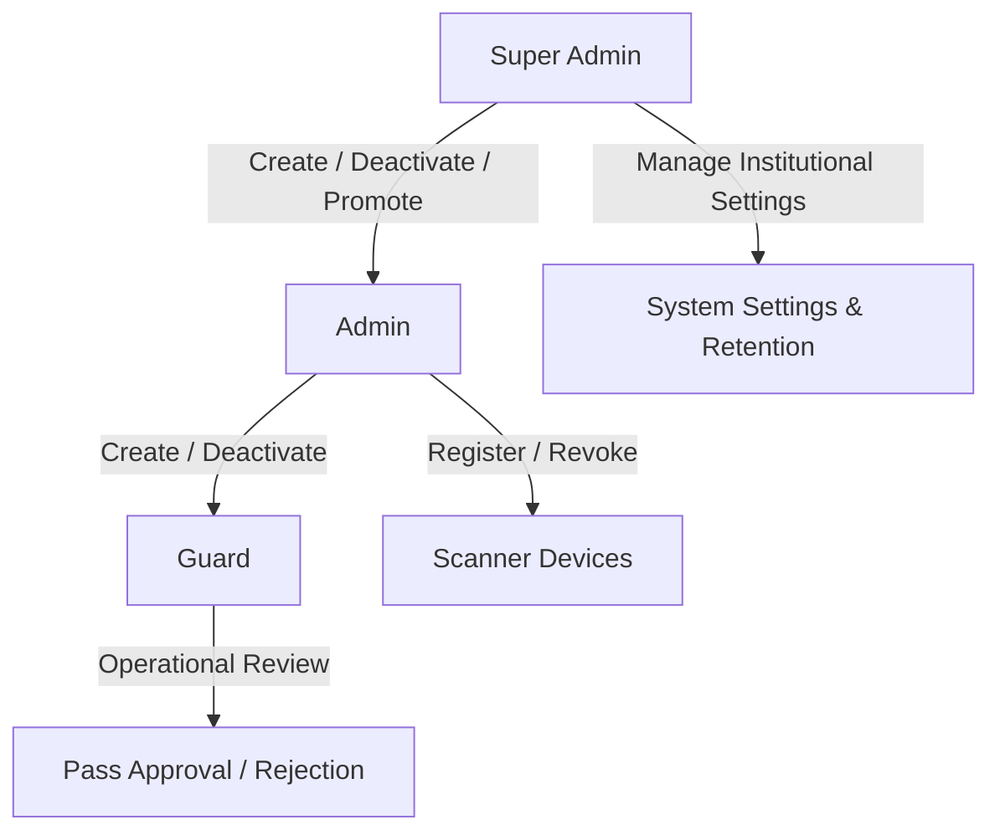
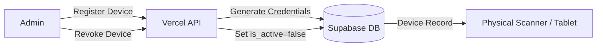
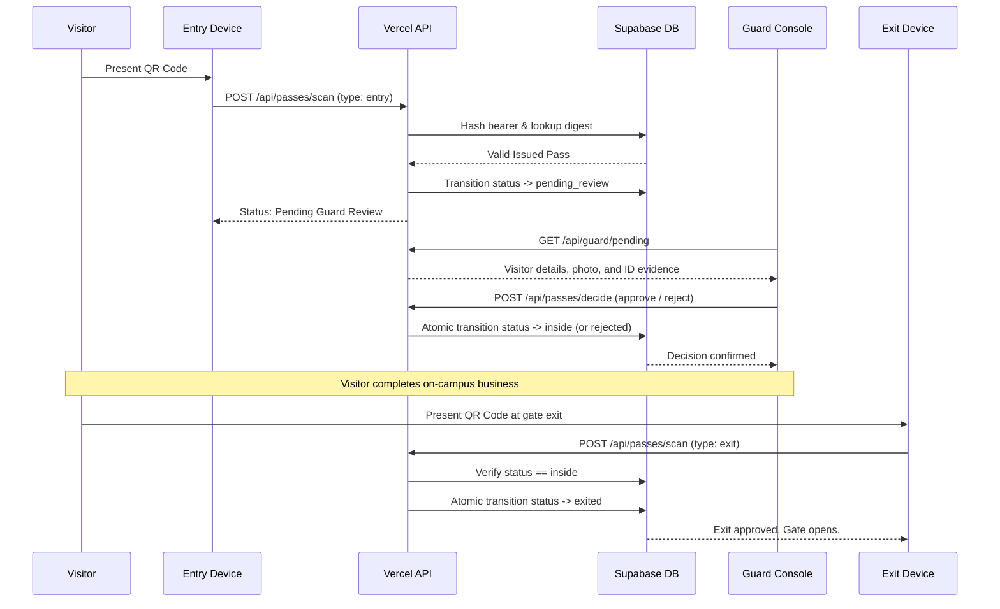
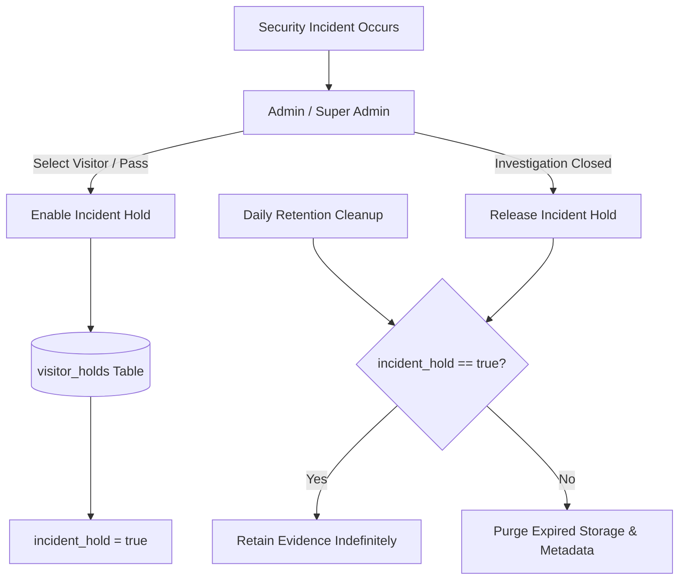
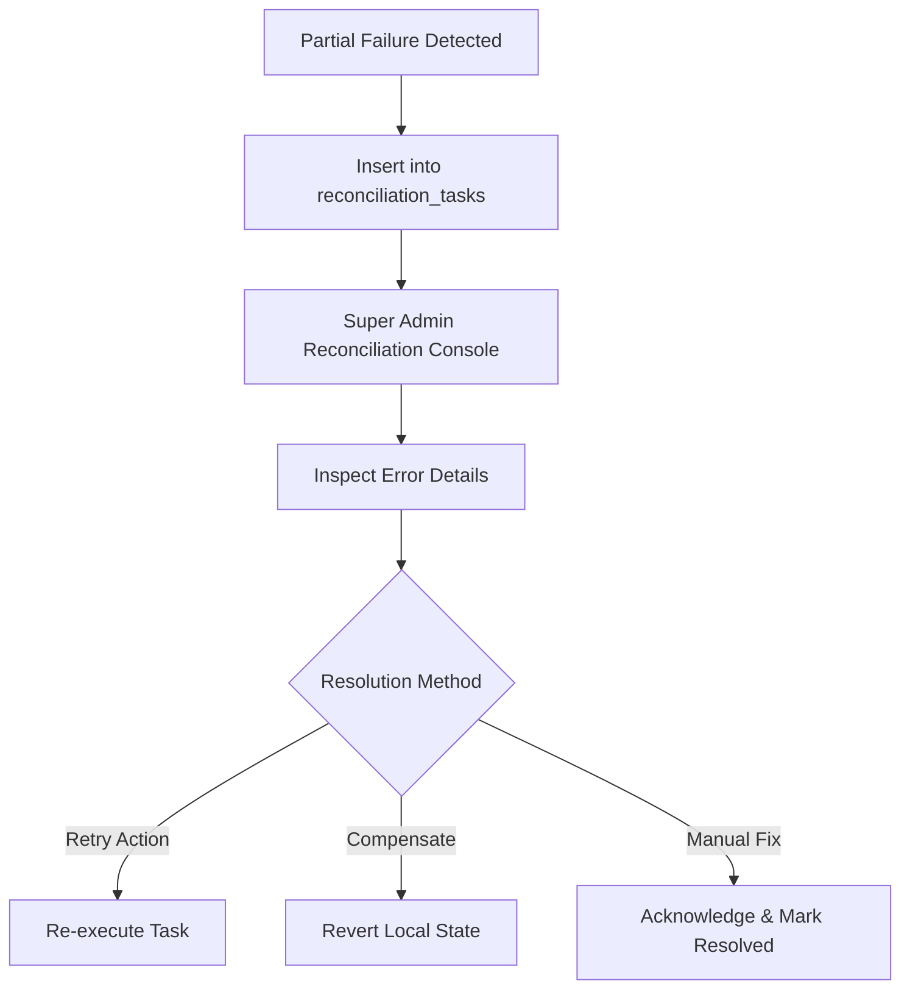

# Daily Operations & Administration Guide

This runbook guides system administrators, Super Admins, and security officers in the routine management, incident response, and governance of EARIST E-GatePass.

---

## 1. Identity & Access Management

E-GatePass separates human staff profiles from dedicated scanning devices. All administrative actions require authenticated Supabase sessions and DB-enforced roles.



### 1.1 Staff Account Management

#### Creating a Staff User
1. Navigate to **Admin Dashboard > Staff Management**.
2. Click **Add Staff Member**.
3. Enter legal name, official EARIST email address, and select role (`Guard` or `Admin`).
4. The server creates the Supabase Auth identity, inserts the `staff_profiles` row, and triggers an automated invite email via Resend.
5. The staff member clicks the secure link in their email to set their initial password.

#### Staff Deactivation & Re-activation
- To suspend access, click **Deactivate** on the user row.
- The server sets `staff_profiles.is_active = false`.
- Any subsequent API request by that user is immediately rejected with HTTP 403.
- Historical audit and visit records remain attributed to the deactivated user.

#### Super Admin Promotion & Last Super Admin Safeguard
- Only an active Super Admin can promote an existing Admin to Super Admin.
- The system enforces a strict invariant in `server/routes/admin/staff.ts`: **The last active Super Admin can NEVER be deactivated, demoted, or deleted**. Any attempt will be blocked with an explicit error.

---

### 1.2 Device Account Management

Dedicated gate hardware (Kiosks, Entry Scanners, Exit Scanners) run authenticated device sessions bound to physical gates.



#### Device Registration
1. In **Admin Dashboard > Device Management**, click **Register New Device**.
2. Specify Device Name, Type (`entry`, `exit`, `kiosk`), and Gate identifier (e.g. `Main Gate`).
3. Note the generated device credentials.
4. On the physical device (e.g. Samsung tablet or scanner), log into `/device/login`.

#### Device Revocation
- If a device is lost, stolen, or decommissioned, an Admin clicks **Revoke**.
- The device status is set to `is_active = false`, instantly invalidating its session and preventing further scans.

---

## 2. Daily Visitor & Gate Workflows

### 2.1 Visitor Portal & Kiosk Registration
- **Online Visitors**: Access `https://egatepass.tech`, solve Turnstile, fill out personal and visit details, capture camera-only photo and valid ID, and obtain an issued pass with a cryptographically signed QR code.
- **Walk-in Visitors (Kiosk)**: Use the campus kiosk tablet. Rear camera captures the visitor's valid ID, local Tesseract OCR extracts information for review, front camera captures a selfie, and a QR pass is displayed and printed.

### 2.2 Gate Entry, Guard Review, and Exit Sequence



---

## 3. Incident Holds & Evidence Preservation

In the event of an investigation, theft, or security incident on campus, security officers can place an **Incident Hold** on visitor records.



1. Navigate to **Admin Dashboard > Visitor Records**.
2. Find the visitor or pass under investigation and click **Place Incident Hold**.
3. Enter the official incident case number and reason.
4. While the hold is active, automated retention cleanup is suspended for that visitor's records, photos, and ID evidence regardless of age.
5. When cleared, click **Release Hold** to return the record to standard retention rules.

---

## 4. Retention Maintenance Operations

Retention policies comply with Philippine Data Privacy Act (DPA) requirements to minimize unnecessary storage of visitor personal data and biometric photos.

### Configurable Retention Windows (Super Admin only):
- **Visitor Records**: Default 30 days (Range: 7 to 365 days).
- **Evidence Photos / IDs**: Default 7 days (Range: 1 to 90 days).
- **Standard Audit Logs**: Default 365 days (Range: 90 to 1095 days).
- **Resolved Reconciliation Tasks**: Default 90 days (Range: 30 to 365 days).

### Running Retention Maintenance
- **Automated**: Vercel Cron triggers daily with bearer `CRON_SECRET`.
- **Manual Execution**:
  A Super Admin can trigger immediate maintenance from the admin dashboard or via authenticated terminal command:
  ```bash
  curl -X POST https://egatepass.tech/api/cron/retention-maintenance \
    -H "Authorization: Bearer <CRON_SECRET>"
  ```
- **Safety Invariants**:
  - Passes in status `pending_review` or `inside` are NEVER purged.
  - Active passes that have not expired are NEVER purged.
  - Any record with an active `incident_hold` is NEVER purged.
  - Protected audit events (security violations, role changes, credential updates) are NEVER automatically purged.

---

## 5. Cross-System Reconciliation

When an operation touches multiple external boundaries (e.g. Supabase Auth, Storage, Resend email) and fails midway, a reconciliation task is logged to prevent silent state drift.



1. Open **Super Admin Dashboard > Reconciliation**.
2. Review pending or failed tasks.
3. Click **Details** to see the service boundary, payload reference, and error trace.
4. Choose **Retry** to re-dispatch the external call, or **Resolve** once manual corrections are in place.

---

## 6. Email Troubleshooting Operations

If a staff member or visitor reports non-receipt of an email:

1. **Verify Sender & Domain Status**:
   - Check the Resend dashboard at `https://resend.com/domains` and verify `egatepass.tech` is verified.
2. **Inspect Send Email Hook Function Logs**:
   - In Vercel, open **Logs** for `/api/auth/send-email-hook`.
   - Ensure the hook is receiving HTTP 200 responses.
   - Verify that `scripts/bundle-email-templates.mjs` was executed in the deployment build.
3. **Check Recipient Spam / Quarantine**:
   - Some institutional mail systems quarantine external notifications; ensure `notifications@egatepass.tech` is allowlisted.
4. **Resend Delivery Activity**:
   - Inspect the Resend Logs tab to view delivery status (Delivered, Bounced, or Complained).