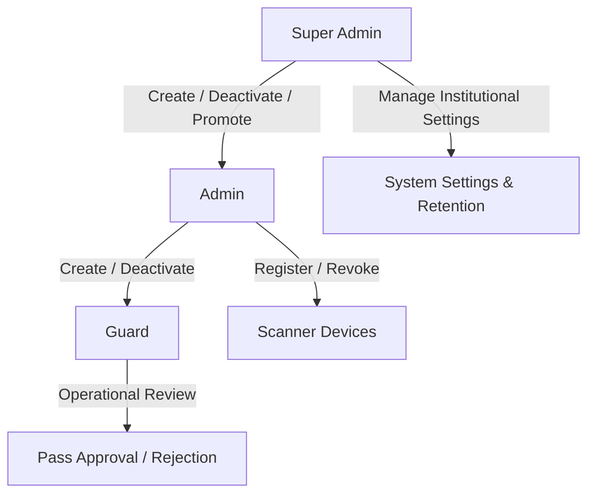
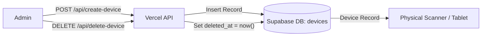
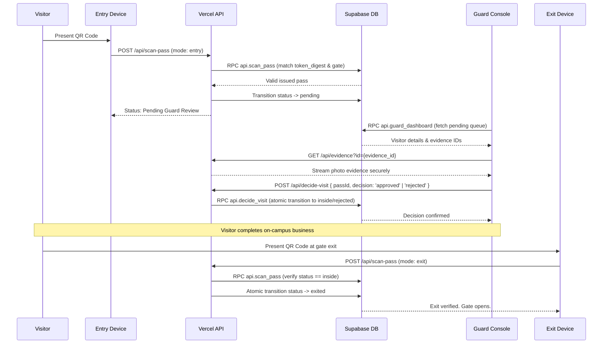
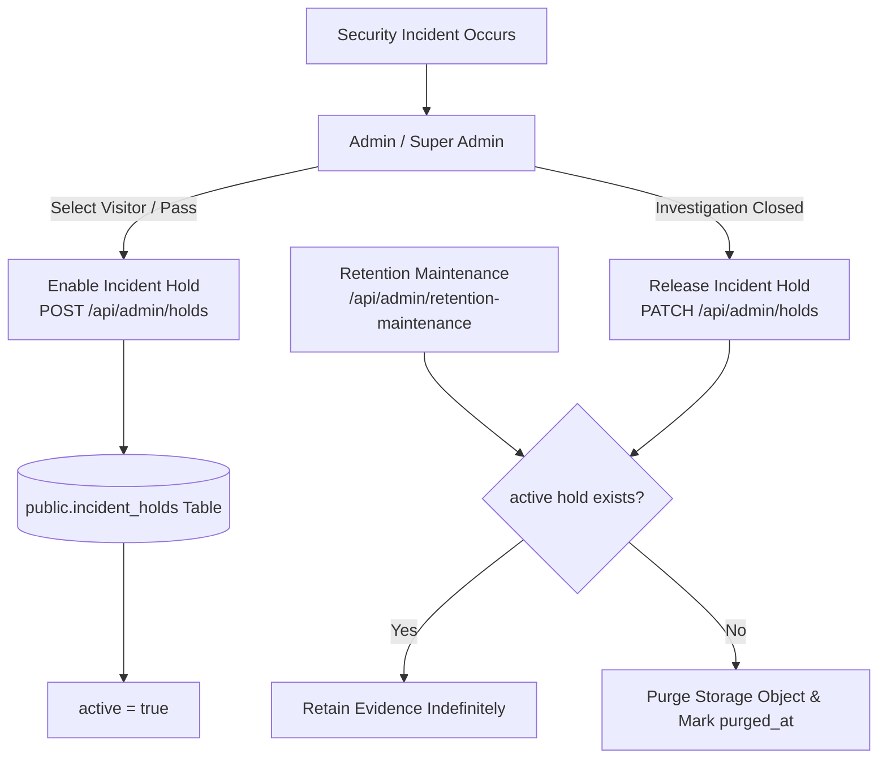
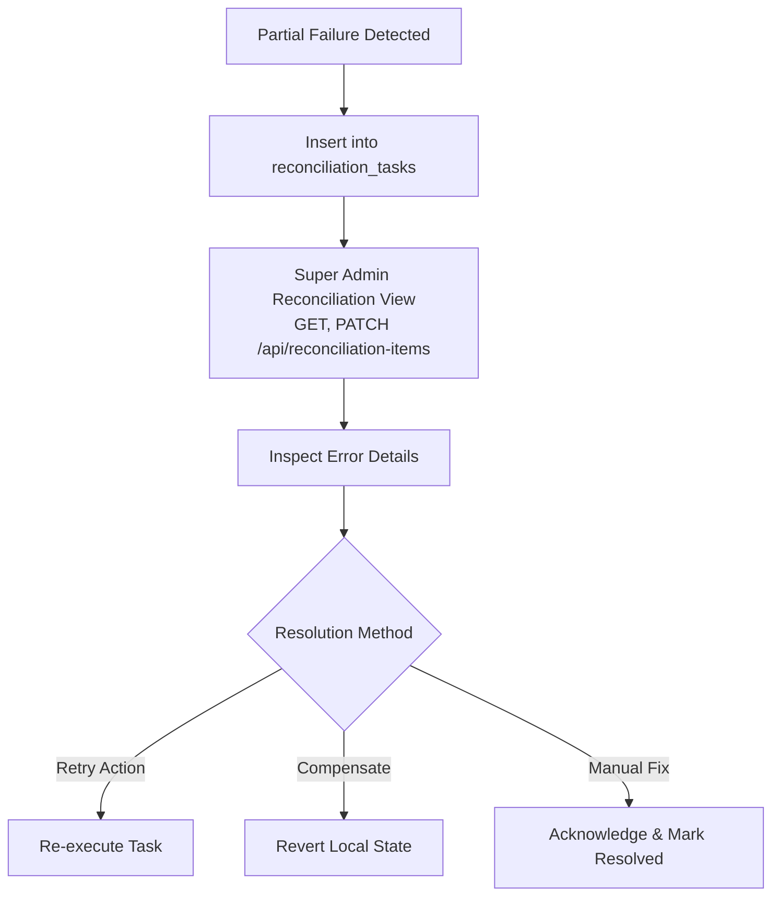

# Daily Operations & Administration Guide

This runbook guides system administrators, Super Admins, and security officers in the routine management, incident response, and governance of EARIST E-GatePass.

---

## 1. Identity & Access Management

E-GatePass separates human staff profiles from dedicated scanning devices. All administrative actions require authenticated Supabase sessions and DB-enforced roles.



### 1.1 Staff Account Management

#### Creating a Staff User
1. Navigate to **Admin Dashboard > Staff Management** (`/admin/users`).
2. Click **Add Staff Member**.
3. Enter legal name, official EARIST email address, and select role (`guard` or `admin`).
4. The serverless route `POST /api/create-user` creates the Supabase Auth identity, inserts the `staff_profiles` row, and triggers an automated invite email via Resend.
5. **Password Onboarding Lifecycle**:
   - **New Guard via `create-user`**: Flagged with `must_change_password = true`.
   - **New Admin via `create-user`**: Flagged with `must_change_password = true`.
   - **Initial bootstrap Super Admin**: Flagged with `must_change_password = true` via `private.bootstrap_super_admin`.
   - **Existing onboarded Admin promoted to Super Admin**: Role updates through Staff Management (`POST /api/update-user` -> `api.update_staff_profile`). Promotion does NOT reset `must_change_password` for an account that has already completed onboarding.
   - Upon initial login for flagged accounts, staff are directed to the mandatory password replacement workflow (`/api/auth/complete-password-change`), which verifies current credentials, updates the password, and finalizes onboarding.

#### Staff Deactivation & Re-activation
- To suspend access, click **Deactivate** on the user row.
- The serverless route `POST /api/update-user` sets `staff_profiles.active = false`.
- Any subsequent API request by that user is immediately rejected with HTTP 403.
- Historical audit events and visit records remain attributed to the user.

#### Super Admin Promotion & Last Super Admin Safeguard
- Only an active Super Admin can promote an existing Admin to Super Admin.
- The system enforces a strict invariant across database and API layers: **The last active Super Admin can NEVER be deactivated or demoted**. This is guarded by the database trigger `private.protect_last_superadmin` on `public.staff_profiles`, enforced by `api.update_staff_profile`, and surfaced by `POST /api/update-user` as HTTP 409 `cannot_remove_last_superadmin` (translated in the Staff Management UI as *"Cannot demote or deactivate the last remaining Super Admin."*).

---

### 1.2 Device Account Management

Dedicated gate hardware (Kiosks, Entry Scanners, Exit Scanners) run authenticated device sessions bound to physical gates.



#### Device Registration
1. In **Admin Dashboard > Device Management** (`/admin/devices`), click **Register New Device**.
2. Specify Device Name, Type (`entry`, `exit`, `kiosk`), and Gate identifier (e.g. `Main Gate`).
3. Note the generated device credentials.
4. On the physical device (e.g. tablet or scanner), log into `/device/login`.

#### Device Revocation
- If a device is lost, stolen, or decommissioned, an Admin clicks **Revoke**.
- The serverless endpoint `DELETE /api/delete-device` sets `deleted_at = now()` and updates status, instantly invalidating its session and preventing further scans.

---

## 2. Daily Visitor & Gate Workflows

### 2.1 Visitor Portal & Kiosk Registration
- **Online Visitors**: Access `https://egatepass.tech`, solve Turnstile, fill out personal and visit details manually or via optional browser-local OCR autofill, capture camera-only facial selfie and valid ID via rear camera or supported image upload (JPEG, PNG, WebP), obtain an issued pass with an EARIST-branded center logo QR code (error correction level H), and secure pass delivery through the verified email delivery gate (or intentionally continue without email after a 5-second timed warning).
- **Walk-in Visitors (Kiosk)**: Use the campus kiosk tablet. Rear camera captures the visitor's valid ID, local Tesseract OCR extracts information for review, front camera captures a selfie, and a QR pass is displayed with a manual "Print Pass" control. (Note: Thermal printer device integration is a planned hardware enhancement. Current kiosk printing relies on the browser/operating-system print path invoked via the Print Pass action).

### 2.2 Gate Entry, Guard Review, and Exit Sequence



---

## 3. Incident Holds & Evidence Preservation

In the event of an investigation, theft, or security incident on campus, security officers can place an **Incident Hold** on visitor records.



1. Navigate to **Admin Dashboard > Visitor Records** or **Incident Holds** (`/admin/holds`).
2. Find the visitor or pass under investigation and click **Place Incident Hold**.
3. Enter the official incident case number and reason.
4. While the hold is active (`active = true`), retention maintenance is suspended for that visitor's records, photos, and ID evidence regardless of age.
5. When cleared, release the hold to return the record to standard retention rules.

---

## 4. Retention Maintenance Operations

Retention policies are designed to support data-minimization and retention practices relevant to the Philippine Data Privacy Act of 2012 (RA 10173).

### Configurable Retention Windows (Super Admin only):
- **Visitor Records**: Default 30 days (Range: 7 to 365 days).
- **Evidence Photos / IDs**: Default 7 days (Range: 1 to 90 days).
- **Standard Audit Logs**: Default 365 days (Range: 90 to 1095 days).
- **Resolved Reconciliation Tasks**: Default 90 days (Range: 30 to 365 days).

### Running Retention Maintenance
- **Execution**: The endpoint `GET/POST /api/admin/retention-maintenance` supports invocation with `Authorization: Bearer <CRON_SECRET>` or an authorized Super Admin session.
- **Manual Execution via Terminal**:
  ```bash
  curl -X POST https://egatepass.tech/api/admin/retention-maintenance \
    -H "Authorization: Bearer <CRON_SECRET>" \
    -H "Content-Type: application/json" \
    -d '{"batchSize": 50, "dryRun": false}'
  ```
- **Safety Invariants**:
  - Passes in status `pending` or `inside` are NEVER purged.
  - Active passes that have not expired are NEVER purged.
  - Any record with an active row in `public.incident_holds` is NEVER purged.
  - Protected audit events are NEVER automatically purged:
    - **Current Canonical Actions**:
      `superadmin.bootstrap`, `staff.create`, `staff.update`,
      `device.create`, `device.update`, `device.retire`, `device.password_update`,
      `settings_updated`, `maintenance.retention_run`,
      `security_hold_created`, `incident_hold.released`
    - **Backward-Compatible Legacy Aliases** (preserved for historical databases):
      `initial_superadmin_bootstrapped`, `superadmin_created`, `admin_created`, `admin_deleted`,
      `device_registered`, `device_deleted`, `device_credentials_updated`,
      `user_role_and_status_changed`, `user_role_changed`, `user_reactivated`, `user_deactivated`,
      `security_hold_released`

---

## 5. Cross-System Reconciliation

When an operation touches multiple external boundaries (e.g. Supabase Auth, Storage, Resend email) and fails midway, a reconciliation task is logged to prevent silent state drift.



1. Open **Super Admin Dashboard > Reconciliation**.
2. Review pending or failed tasks via `GET /api/reconciliation-items` and update task status via `PATCH /api/reconciliation-items`.
3. Click **Details** to see the service boundary, payload reference, and error trace.
4. Choose **Retry** to re-dispatch the external call, or **Resolve** once manual corrections are in place.

---

## 6. Email Delivery & Webhook Operations

The platform operates two separate, dedicated webhook flows:
- **Outbound Auth Email Hook** (`POST /api/auth/send-email-hook`): Invoked by Supabase Auth to send transactional emails via React Email and Resend API.
- **Inbound Delivery Observability Webhook** (`POST /api/webhooks/resend`): Invoked by Resend to notify E-GatePass of delivery status (`sent`, `delivered`, `delayed`, `bounced`, `complained`, `failed`).
  - **Provider webhook/signature chain**: Verified operational (historical `email.sent` and `email.delivered` provider events observed in production).
  - **Transactional webhook RPC (`api.record_resend_delivery_event`)**: Deployed, database/test verified, and production-verified with signed delivery events (including historical `email.sent` and `email.delivered` events). Operators should repeat the verification procedure after infrastructure migration.
  - **Atomic Transaction & Replay**: Executed via transactional RPC `api.record_resend_delivery_event` (Migrations `20261023140000` and `20261023160000`). Replays return HTTP 200 `already_processed`. If audit logging fails, transaction rolls back so provider retry can reprocess the event.
- **Webhook Table Retention**: Classified as `OPTIONAL HARDENING — retention period requires explicit policy`. `public.resend_webhook_events` volume is minimal and append-only deduplication remains active.
- **Legacy SMTP Key Cleanup**:
  > [!IMPORTANT]
  > **MANUAL OWNER ACTION REQUIRED**
  > - **Provider**: Resend
  > - **Resource**: API key named `egatepass-supabase-smtp`
  > - **Action**: Revoke/delete the legacy key in Resend dashboard after verifying no SMTP fallback is intentionally retained.
  > - **Impact**: Current Send Email Hook + Resend REST API architecture remains unaffected.

> **CRITICAL NOTICE**: Neither webhook is an inbound email mailbox or interactive reply processor. `notifications@egatepass.tech` is a non-monitored transactional sender identity.

If a staff member or visitor reports non-receipt of an email:

1. **Verify Sender & Domain Status**:
   - In Resend Dashboard, verify `egatepass.tech` domain is verified with DKIM and SPF.
2. **Inspect Outbound Send Email Hook Logs**:
   - In Vercel Logs, filter by `/api/auth/send-email-hook`. Ensure HTTP 200 responses.
3. **Inspect Inbound Resend Webhook Logs**:
   - In Vercel Logs, filter by `/api/webhooks/resend`. Ensure incoming delivery events return HTTP 200.
4. **Resend Delivery Activity**:
   - Inspect the Resend dashboard Logs tab to view delivery status (`Delivered`, `Bounced`, or `Complained`).
