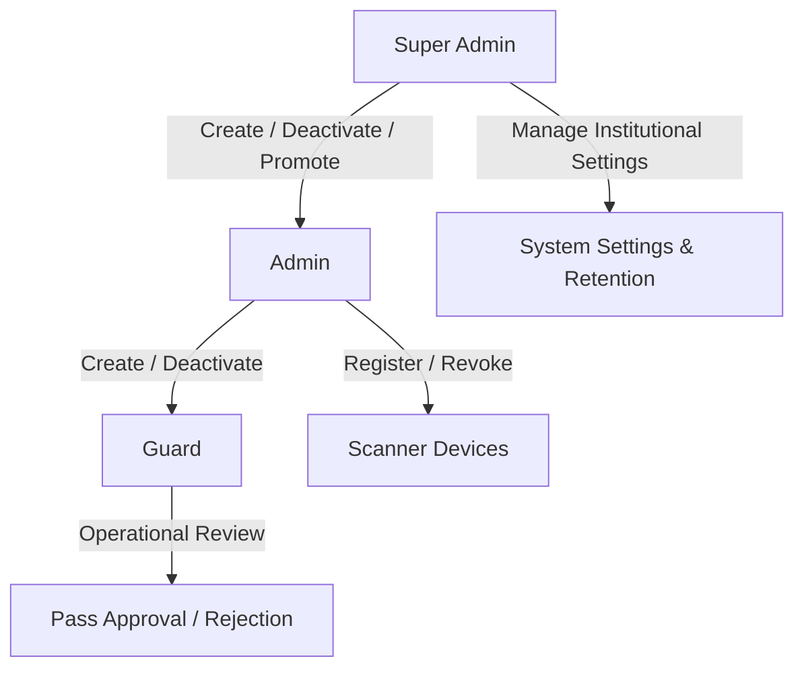
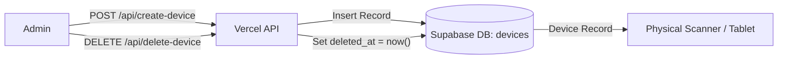
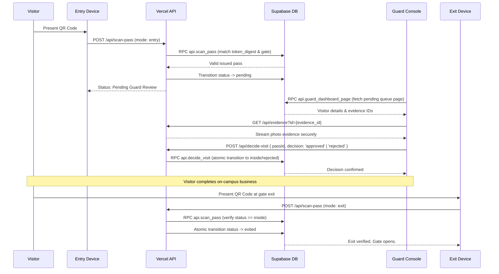
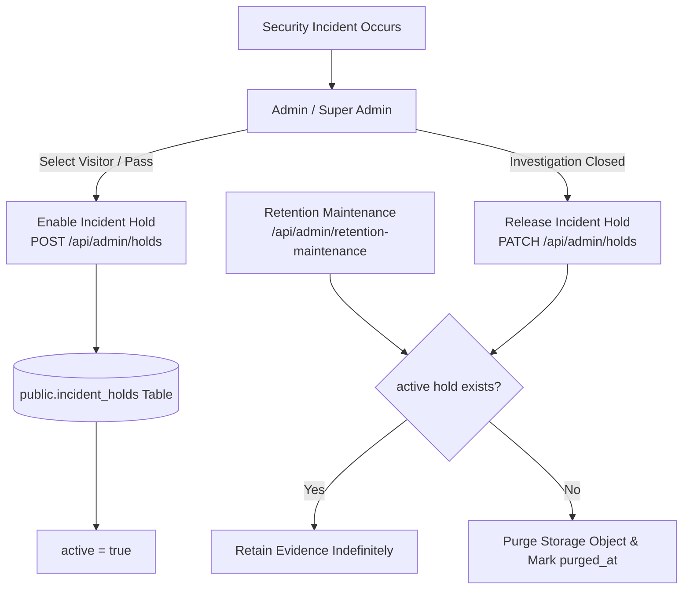
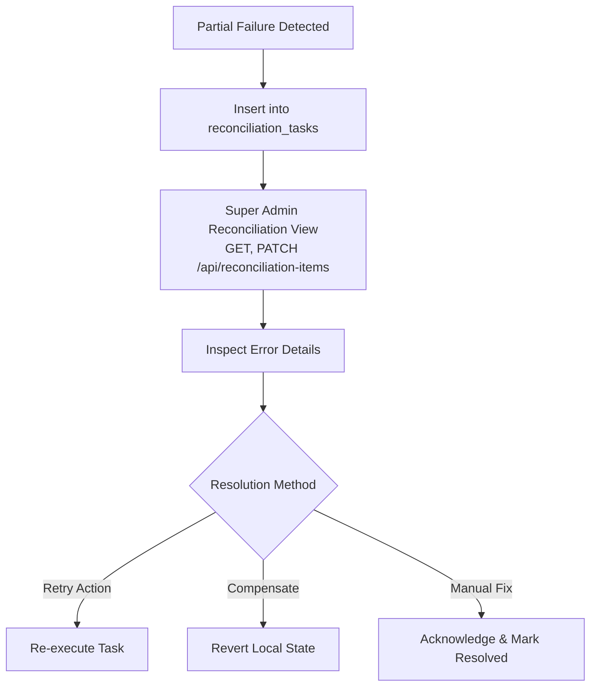

# Daily Operations & Administration Guide

This runbook guides system administrators, Super Admins, and security officers in the routine management, incident response, and governance of EARIST E-GatePass.

---

## 1. Identity & Access Management

E-GatePass separates human staff profiles from dedicated scanning devices. All administrative actions require authenticated Supabase sessions and DB-enforced roles.



### 1.1 Staff Account Management

#### Creating a Staff User
1. Navigate to **Admin Dashboard > Staff Management** (`/admin/users`).
2. Click **Add Staff Member**.
3. Enter legal name, official EARIST email address, and select role (`admin`).
4. *Guard Role Deprecation*: Operational personal guard accounts are deprecated (`legacy_guard_role_disabled`). General campus guard operations use dedicated `guard_station` hardware devices. For kiosk walk-in pass review, administrators use `/admin/legacy-guard`.
5. The serverless route `POST /api/create-user` creates the Supabase Auth identity, inserts the `staff_profiles` row, and triggers an automated invite email via Resend.
5. **Password Onboarding Lifecycle**:
   - **New Guard via `create-user`**: Flagged with `must_change_password = true`.
   - **New Admin via `create-user`**: Flagged with `must_change_password = true`.
   - **Initial bootstrap Super Admin**: Flagged with `must_change_password = true` via `private.bootstrap_super_admin`.
   - **Existing onboarded Admin promoted to Super Admin**: Role updates through Staff Management (`POST /api/update-user` -> `api.update_staff_profile`). Promotion does NOT reset `must_change_password` for an account that has already completed onboarding.
   - Upon initial login for flagged accounts, staff are directed to the mandatory password replacement workflow (`/api/auth/complete-password-change`), which verifies current credentials, updates the password, and finalizes onboarding.

#### Staff Deactivation & Re-activation
- To suspend access, click **Deactivate** on the user row.
- The serverless route `POST /api/update-user` sets `staff_profiles.active = false`.
- Any subsequent API request by that user is immediately rejected with HTTP 403.
- Historical audit events and visit records remain attributed to the user.

#### Super Admin Promotion & Last Super Admin Safeguard
- Only an active Super Admin can promote an existing Admin to Super Admin.
- The system enforces a strict invariant across database and API layers: **The last active Super Admin can NEVER be deactivated or demoted**. This is guarded by the database trigger `private.protect_last_superadmin` on `public.staff_profiles`, enforced by `api.update_staff_profile`, and surfaced by `POST /api/update-user` as HTTP 409 `cannot_remove_last_superadmin` (translated in the Staff Management UI as *"Cannot demote or deactivate the last remaining Super Admin."*).

---

### 1.2 Device Account Management

Dedicated gate hardware (Kiosks, Entry Scanners, Exit Scanners) run authenticated device sessions bound to physical gates.



#### Device Registration
1. In **Admin Dashboard > Device Management** (`/admin/devices`), click **Register New Device**.
2. Specify Device Name, Type (`entry`, `exit`, `kiosk`, `guard_station`), and Gate identifier (e.g. `Main Gate`). Guard Station devices operate as the high-visibility gate display at the guard station.
3. Note the generated device credentials.
4. On the physical device (e.g. tablet or scanner), log into `/device/login`.

#### Device Revocation
- If a device is lost, stolen, or decommissioned, an Admin clicks **Revoke**.
- The serverless endpoint `DELETE /api/delete-device` sets `deleted_at = now()` and updates status, instantly invalidating its session and preventing further scans.

---

## 2. Daily Visitor & Gate Workflows

### 2.1 Visitor Portal & Kiosk Registration
- **Online Visitors**: Pre-register at `https://egatepass.tech`. Optional OCR with native image chooser allows autofilling details. Followed by mandatory Live Face Capture (user camera with face guide oval; the single custom camera in the flow) verified by technical quality gate, then Valid ID (native image chooser or reused OCR document) verified by technical quality gate. Local face engine performs 1:1 biometric comparison. Once verified, review details and generate official E-GatePass. The pass transitions directly to `inside` on gate scanner scan with zero manual guard approval queue required.
- **Walk-in Visitors (Kiosk)**: Use the campus kiosk tablet. Rear camera captures the visitor's valid ID, local Tesseract OCR extracts information for review, front camera captures a selfie, and a QR pass is displayed. Kiosk printing supports direct Web Bluetooth thermal printing via MXW01 with fail-safe issuance and browser/operating-system print fallback. (Physical hardware testing was not performed in software repairs and requires on-site manual QA).

### 2.1.1 Deterministic Typography, Unicode Integrity & Export Encoding
- **Tested Regression Character Set**: The canonical pass and PDF paths bundle Noto Sans and verify representative Latin/extended-Latin (ASCII Latin, Filipino/Spanish accented Latin such as *Ñ/ñ*, *É/é*, *Á/á*, *Ü/ü*, *Ç/ç*) and institutional punctuation (curly apostrophes/quotes, bullets, en/em dashes) required by the E-GatePass regression contract.
- **Spreadsheet Compatibility (Excel UTF-8 BOM)**: Generated CSV reports prepend a UTF-8 Byte Order Mark (`\uFEFF`, raw bytes `EF BB BF`), ensuring Excel on Windows opens reports with proper UTF-8 decoding rather than mojibake or mangled characters, while formula injection defenses remain active.
- **Embedded PDF Fonts**: PDF report exports embed official Google Noto Sans TrueType fonts directly (`EgatepassNoto`), failing closed if font binaries cannot be retrieved rather than silently substituting default Helvetica.
- **Server Font Fail-Closed Contract**: Serverless Sharp pass generation fails closed if bundled TTF assets or fontconfig environment cannot be verified, preventing unintentional fallback to unknown host system fonts.
- **Guard Console Outbox Truth**: When a guard logs in or shifts change, the local outbox counter and queue immediately reflect accurate local pending counts without requiring manual refreshes or extra actions.

### 2.2 Gate Entry, Guard Review, and Exit Sequence



---

## 3. Incident Holds & Evidence Preservation

In the event of an investigation, theft, or security incident on campus, security officers can place an **Incident Hold** on visitor records.



1. Navigate to **Admin Dashboard > Visitor Records** or **Incident Holds** (`/admin/holds`).
2. Find the visitor or pass under investigation and click **Place Incident Hold**.
3. Enter the official incident case number and reason.
4. While the hold is active (`active = true`), retention maintenance is suspended for that visitor's records, photos, and ID evidence regardless of age.
5. When cleared, release the hold to return the record to standard retention rules.

---

## 4. Retention Maintenance Operations

Retention policies are designed to support data-minimization and retention practices relevant to the Philippine Data Privacy Act of 2012 (RA 10173).

### Configurable Retention Windows (Super Admin only):
- **Visitor Records**: Default 30 days (Range: 7 to 365 days).
- **Evidence Photos / IDs**: Default 7 days (Range: 1 to 90 days).
- **Standard Audit Logs**: Default 365 days (Range: 90 to 1095 days).
- **Resolved Reconciliation Tasks**: Default 90 days (Range: 30 to 365 days).

### Running Retention Maintenance
- **Execution**: The endpoint `GET/POST /api/admin/retention-maintenance` supports invocation with `Authorization: Bearer <CRON_SECRET>` or an authorized Super Admin session.
- **Manual Execution via Terminal**:
  ```bash
  curl -X POST https://egatepass.tech/api/admin/retention-maintenance \
    -H "Authorization: Bearer <CRON_SECRET>" \
    -H "Content-Type: application/json" \
    -d '{"batchSize": 50, "dryRun": false}'
  ```
- **Safety Invariants**:
  - Passes in status `pending` or `inside` are NEVER purged.
  - Active passes that have not expired are NEVER purged.
  - Any record with an active row in `public.incident_holds` is NEVER purged.
  - Protected audit events are NEVER automatically purged:
    - **Current Canonical Actions**:
      `superadmin.bootstrap`, `staff.create`, `staff.update`,
      `device.create`, `device.update`, `device.retire`, `device.password_update`,
      `settings_updated`, `maintenance.retention_run`,
      `security_hold_created`, `incident_hold.released`
    - Backward-Compatible Legacy Aliases (preserved for historical databases):
      `initial_superadmin_bootstrapped`, `superadmin_created`, `admin_created`, `admin_deleted`,
      `device_registered`, `device_deleted`, `device_credentials_updated`,
      `user_role_and_status_changed`, `user_role_changed`, `user_reactivated`, `user_deactivated`,
      `security_hold_released`
  - **Anonymous Auth Cleanup**:
    - Anonymous Auth cleanup conservatively targets orphan anonymous identities older than 24 hours.
    - Auth users are enumerated with server-side pagination beyond 1,000 users.
    - Destructive candidate deletion strictly respects the configured `batchSize` ceiling per run.
    - Protection lookups (`visitors`, `upload_intents`, `staff_profiles`, `devices`) fail closed: any lookup failure immediately aborts candidate deletion for the entire run, deleting zero users.

---

## 5. Cross-System Reconciliation

When an operation touches multiple external boundaries (e.g. Supabase Auth, Storage, Resend email) and fails midway, a reconciliation task is logged to prevent silent state drift.



1. Open **Super Admin Dashboard > Reconciliation**.
2. Review pending or failed tasks via `GET /api/reconciliation-items` and update task status via `PATCH /api/reconciliation-items`.
3. Click **Details** to see the service boundary, payload reference, and error trace.
4. Choose **Retry** to re-dispatch the external call, or **Resolve** once manual corrections are in place.

---

## 6. Email Delivery & Webhook Operations

The platform operates two separate, dedicated webhook flows:
- **Outbound Auth Email Hook** (`POST /api/auth/send-email-hook`): Invoked by Supabase Auth to send transactional emails via React Email and Resend API.
- **Inbound Delivery Observability Webhook** (`POST /api/webhooks/resend`): Invoked by Resend to notify E-GatePass of delivery status (`sent`, `delivered`, `delayed`, `bounced`, `complained`, `failed`).
  - **Provider webhook/signature chain**: Verified operational (historical `email.sent` and `email.delivered` provider events observed in production).
  - **Transactional webhook RPC (`api.record_resend_delivery_event`)**: Deployed, database/test verified, and production-verified with signed delivery events (including historical `email.sent` and `email.delivered` events). Operators should repeat the verification procedure after infrastructure migration.
  - **Atomic Transaction & Replay**: Executed via transactional RPC `api.record_resend_delivery_event` (Migrations `20261023140000` and `20261023160000`). Replays return HTTP 200 `already_processed`. If audit logging fails, transaction rolls back so provider retry can reprocess the event.
- **Webhook Table Retention**: Classified as `OPTIONAL HARDENING — retention period requires explicit policy`. `public.resend_webhook_events` volume is minimal and append-only deduplication remains active.
- **Legacy SMTP Key Cleanup**:
  > [!IMPORTANT]
  > **MANUAL OWNER ACTION REQUIRED**
  > - **Provider**: Resend
  > - **Resource**: API key named `egatepass-supabase-smtp`
  > - **Action**: Revoke/delete the legacy key in Resend dashboard after verifying no SMTP fallback is intentionally retained.
  > - **Impact**: Current Send Email Hook + Resend REST API architecture remains unaffected.

> **CRITICAL NOTICE**: Neither webhook is an inbound email mailbox or interactive reply processor. `notifications@egatepass.tech` is a non-monitored transactional sender identity.

If a staff member or visitor reports non-receipt of an email:

1. **Verify Sender & Domain Status**:
   - In Resend Dashboard, verify `egatepass.tech` domain is verified with DKIM and SPF.
2. **Inspect Outbound Send Email Hook Logs**:
   - In Vercel Logs, filter by `/api/auth/send-email-hook`. Ensure HTTP 200 responses.
3. **Inspect Inbound Resend Webhook Logs**:
   - In Vercel Logs, filter by `/api/webhooks/resend`. Ensure incoming delivery events return HTTP 200.
4. **Resend Delivery Activity**:
   - Inspect the Resend dashboard Logs tab to view delivery status (`Delivered`, `Bounced`, or `Complained`).

---

## 7. MXW01 Thermal Printing Operations

The kiosk station operates a single dedicated **MXW01 Bluetooth thermal receipt printer** (384px print width) for printing paper passes for walk-in visitors:

### 7.1 Single Printer Architecture
- **Kiosk-Only Ownership**: The single physical MXW01 printer is paired and controlled exclusively by the **kiosk tablet browser** via Web Bluetooth.
- **No Guard Printer**: Gate guards do not maintain physical printers. All printed passes originate at the kiosk station.

### 7.2 Initial Setup & Pairing Procedure
1. Power on the MXW01 printer (hold power button until blue LED flashes).
2. On the kiosk tablet, open the `/kiosk` page.
3. Tap the **Gear Icon** in the sidebar to open **Device Settings**.
4. Re-enter this kiosk device's password when prompted to unlock settings.
5. In the Thermal Printer section:
   - **First authorization**: Tap **Connect MXW01**. The Chromium Bluetooth device picker will appear. Choose/authorize the MXW01 device and tap **Pair** (Note: Physical protocol discovery and paper output remain subject to on-site testing: **PHYSICAL MXW01 ACCEPTANCE: NOT YET TESTED**).
   - **Subsequent reconnect**: Tap **Reconnect MXW01** or allow background reconnect. It uses a previously authorized browser device and does not reopen the chooser unless authorization is missing or the operator explicitly chooses another printer.
6. Confirm status changes to **Connected** (Green badge). Physical power-off transitions the UI to Disconnected through the browser GATT disconnect event.
7. Tap **Test Print** to verify paper alignment, darkness, and cutter feed.

### 7.3 Daily Operation & Maintenance
- **Auto-Print**: When enabled, the kiosk automatically sends the 384px raster print job to the printer immediately upon successful pass creation.
- **Fail-Safe Invariant**: If the printer disconnects, runs out of paper, or suffers a Bluetooth timeout, the pass is **NOT** cancelled or rolled back. The visitor is presented with a clear notice, and the operator or visitor can tap **Print Again** (when connected) or **Browser Print** (falling back to the standard system print dialog).
- **Paper Roll Replacement**: Use standard 57mm × 30mm thermal receipt rolls. Ensure the thermal-coated side faces the thermal head (paper feeds from underneath).

---

## 8. Super Admin Thermal Template Management

Super Admins configure and publish the visual layout of printed thermal tickets via the built-in layout editor at `/admin/templates`:

### 8.1 Authorization & Access Control
- **Super Admin Exclusive**: Only users with the `superadmin` role may create, edit, publish, or restore thermal templates.
- **Guards and Admins**: Have zero access to template editing.
- **Kiosk Devices**: Only retrieve the active published template for rendering.

### 8.2 Template Invariants & Validation
- **Canvas Width**: Fixed at native 384 pixels.
- **Mandatory Elements**: The template schema enforces the permanent existence of:
  - Institution Logo (`institution_logo`)
  - Institution Name (`institution_name`)
  - Visitor Full Name (`visitor_name`)
  - Visit Date (`visit_date`)
  - Opaque Pass QR Code (`qr_code`)
  - Pass Reference (`pass_reference`)
- Mandatory elements cannot be deleted from a publishable template.
- **Security Validation**: All template layouts are validated against a strict server-side Zod schema. Remote URLs, scripts, and arbitrary HTML are rejected.
- **Bundled Fallback**: If network connectivity fails or remote template data cannot be parsed, the kiosk automatically falls back to an embedded known-good default template.

---

## 9. Guard Visitor Recovery Operations

When a registered visitor arrives at the gate but cannot present their QR code (e.g. lost phone, dead battery, misplaced email):

### 9.1 Recovery Search Scope
1. On the **Guard Console** (`/guard`), tap the **Visitor Recovery** tab.
2. The search scope is strictly bounded to **today's date in Asia/Manila** and active passes (`issued`, `pending`, `inside`).
3. Search by **Visitor Full Name**, **Contact Number**, or **Pass Reference** (`EG-XXXXXXXX`).

### 9.2 Identity Verification & Evidence Review
1. Tap on the matching visitor record to expand details.
2. Review the visitor's registration photo selfie and captured valid ID streamed securely via `GET /api/evidence?id=<evidence_id>`.
3. Require the visitor to present a physical government ID and physically verify identity against the displayed evidence.

### 9.3 Manual Operational Actions
- **Approve Entry**: If the visitor is in `issued` or `pending` status and identity is verified, tap **Approve Entry**. The pass status transitions to `inside` and the audit event records `action = 'approve_entry'`, `source = 'visitor_recovery'`.
- **Reject Entry**: If identity or credentials fail physical verification, tap **Reject Entry** and record the reason.
- **Record Exit**: If an un-exited visitor is leaving and cannot present their QR code, the Guard verifies the record and taps **Record Exit** to transition the pass to `exited`.

---

## 10. Guard Offline Operations & Connectivity Outage Procedures

In the event of an institutional network outage, fiber cut, or cloud service disruption:

### 10.1 System-Wide Fail-Closed Invariants
- **Kiosk Station**: Immediately disables visitor registration. The screen displays:
  ```text
  SERVICE TEMPORARILY UNAVAILABLE
  Visitor registration is currently unavailable.
  Please proceed directly to the Guard for registration and verification.
  ```
- **Entry & Exit Scanners**: Scan submissions fail closed. The scanner displays a prominent network failure notice directing the visitor to the Guard. The scanner does **NOT** falsely report the QR code as invalid, expired, or forged.

### 10.2 Guard Operational Fallback
The Guard tablet serves as the sole operational access authority during an outage:
1. **Offline Banner**: When the backend cannot be reached, the Guard Console displays a yellow/red offline banner indicating offline operation and the count of un-synchronized outbox records.
2. **Offline Recovery of Existing Visitors**:
   - The Guard searches the local IndexedDB cache (automatically populated with today's operational passes while online).
   - The Guard performs physical identity verification using cached visitor evidence.
   - Guard taps **Approve Entry** or **Record Exit**.
   - The action is appended to the local IndexedDB event outbox with an immutable UUID `eventId`.
3. **Offline Walk-in Intake**:
   - For unregistered walk-in visitors, the Guard opens the **Offline Registration** tab.
   - The Guard physically inspects the visitor's physical government ID.
   - The Guard enters visitor name, contact, purpose, and captures a live facial photo and valid ID photo using the tablet camera.
   - The Guard taps **Approve Entry** (recording Time-In automatically) or **Reject Entry**.
   - An immutable UUID `offlineRegistrationId` is stamped, and the record is stored locally in IndexedDB.

### 10.3 Automatic Reconnection Synchronization
When cloud connectivity returns:
1. The Guard Console detects connectivity and initiates background synchronization via `guardSyncManager.ts`.
2. Offline walk-in registrations synchronize first via `api.sync_offline_registration` (uploading evidence photos, creating canonical visitor and pass records).
3. Queued lifecycle events synchronize via `api.sync_offline_event` (evaluating prior state, locking rows with `FOR UPDATE`, and transitioning pass status).
4. Synchronized entries are acknowledged and safely purged from the local device store.
5. In the rare event of a state conflict (e.g. visitor was already rejected online prior to outage), a reconciliation record is logged in `public.reconciliation_tasks` for administrative review without overwriting data.

---

## 11. Institutional Reporting, Search & Staff Lifecycle Operations

### 11.1 Guard Live & Authoritative Queue Search
- **Live Local Filtering**: For queries under 2 characters, currently loaded pending queue passes are filtered immediately in the browser matching name or purpose.
- **Authoritative Server Search**: For queries >= 2 characters, after a 280ms debounce, `api.guard_search_pending_queue` searches all pending passes across the database without requiring "Load All". Matches on visitor full name, contact number, purpose, or public reference (`EG-XXXXXXXX`).
- **Generation Fencing & Deduping**: Fast queries never get overwritten by delayed slow queries. Local and authoritative cards are deduped by pass ID.
- **Clear Search**: Restores the live queue snapshot instantly without reloading or resetting pagination.
- **Queue Age Visibility**: Displays waiting age prominently (e.g. `Waiting 3 min`, `Waiting 12 min`) with subtle tone thresholds (0–5m normal, 5–10m attention, 10m+ long wait).

### 11.2 Visitor Records Date-Range Filtering
- **Range Support**: Selectable `From Date` and `To Date` inputs validated in `Asia/Manila` time.
- **Presets**: `Today`, `Last 7 Days`, `This Month`, and `Custom` quickly populate the date bounds.
- **Server Validation**: The server validates format (`YYYY-MM-DD`) and rejects invalid ranges where `dateFrom > dateTo` with HTTP 400.
- **Reset Filters**: One-click action resets dates, status, and search query while triggering a single clean root query.

### 11.3 Unified Report Exports
- **Formats Available**: CSV, Excel (`.xlsx`), and PDF (`.pdf`) available across Visitor Records and Admin Audit Logs.
- **Full Traversal**: Exports traverse the entire filtered dataset across keyset cursor pagination up to safety limit `EXPORT_MAX_ROWS`, not just the current view page.
- **Clean RFC 4180 CSV**: Pure machine-readable rows without decorative headers.
- **Institutional XLSX**: Includes metadata header (filters, date, staff actor), frozen table header, and styled rows.
- **Institutional PDF**: Human-readable layout with maroon institutional header banner, applied filters, and paginated table with page numbering.
- **Data Hygiene**: Sensitive secrets (raw QR tokens, token digests, storage object paths, signed URLs, credentials) are strictly stripped from all export formats.

### 11.4 Configurable Visitor Instructions & Privacy Notices
- **Admin Configuration**: Super Admins configure 1–8 institutional reminder instructions in **System Settings > Visitor Instructions**.
- **Public & Email Distribution**: Instructions immediately propagate to:
  - Online Visitor Portal success screen ("Before You Arrive" panel)
  - Kiosk Registration success screen ("Before You Arrive" panel)
  - Pass delivery email body (`PassIssuedEmail.tsx`)
- **Configurable Retention Notices**: UI privacy text displays actual configured days (`image_retention_days` and `visitor_retention_days`) rather than hardcoded durations.

### 11.5 Safe Staff Permanent Decommissioning
1. **Deactivate Target Staff**: Staff account must first be set to Inactive (`active = false`). Active accounts cannot be decommissioned.
2. **Select Action**: Super Admin opens **User Management**, selects the **Inactive** tab, and clicks **Permanently Decommission**.
3. **Re-Authentication Modal**: Super Admin enters their own current password and a reason (5–240 characters).
4. **Permanent State Transition**:
   - `public.staff_profiles` row is updated with `decommissioned_at = now()`, `decommissioned_by = auth.uid()`, and `decommission_reason`. Row is NOT deleted.
   - Historical audit attribution remains linked via foreign key.
   - Auth user is suspended for 876,000 hours (`banned_until`).
   - If Auth suspension encounters partial failure, database state remains committed and an administrative reconciliation item is created.
   - Account appears under the **Decommissioned** filter tab with no Reactivate or credential reset actions available.


## 9. Guard Offline Operations & Shift Change Procedures

### 9.1 Cross-Guard Actor Binding & Shift Change Procedures
- **Actor-Bound Offline Stores**: All local registrations, cached visitor passes, and outbox actions are bound to the active guard's UUID (`actorId`) in IndexedDB (`egatepass_guard_offline`).
- **Fail-Closed Unattributed Isolation**: Any record lacking a valid `actorId` is excluded by fail-closed queries and will never be assigned, displayed, or executed during sync.
- **Identity-Switch Store Purge**: When a new guard logs in on a shared terminal (`transitionGuardOfflineStore(nextActorId)`), if `lastActorId` differs from `nextActorId`, the previous guard's sensitive local stores (`cached_visitors`, `offline_registrations`, `offline_events`, `meta`) are fully purged. Guard B starts with an empty cache and 0 pending records.
- **Strictly Blocked Sign-Out with Pending Records**: When a guard attempts to sign out, the application checks `getPendingSyncCount(actorId)`. If unsynchronized records exist:
  - The client attempts an immediate synchronization if network connectivity is detected.
  - If records remain unsynchronized, sign-out is strictly blocked with an error toast (*"Cannot sign out while offline records remain pending. Please connect to the network to sync your work."*) to prevent biometric evidence loss and audit attribution gaps.
- **Centralized Synchronization Error Classification**:
  - `classifyOfflineRegistrationSyncFailure` governs offline sync outcomes:
    - Unexpected 400 responses, unknown 422 errors, network timeouts, and 5xx/503 authority outages are classified as transient, keeping local photo/ID blobs and checkpoints in `pending` state for automatic retry.
    - Stale upload intent 422 errors clear checkpoints while keeping blobs for fresh intent acquisition.
    - Only explicit HTTP 409 server conflicts mark registrations terminal and strip local photo/ID blobs while preserving relational audit metadata.

### 9.2 Audit Log Date Range Validation
- Date filters on `/api/admin/activity` strictly reject inverted ranges (`dateFrom > dateTo`) with HTTP 400 `invalid_date_range`.
- The Admin UI disables network queries and exports when date inputs are inverted and displays an inline notice: *"Start date cannot be later than end date."*
