# Security Architecture & Threat Model

This document serves as the authoritative security specification, trust boundary definition, and threat-mitigation contract for the EARIST E-GatePass platform.

---

## 1. System Trust Boundaries

EARIST E-GatePass enforces strict security perimeters across untrusted clients, privileged serverless execution containers, authoritative database layers, and third-party integrations.

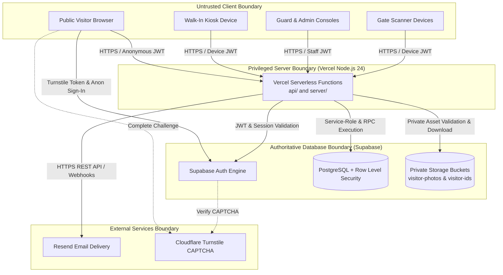

> **CORE AUTHORIZATION PRINCIPLE**: All client-side UI restrictions, role state variables, and route guards are user-experience controls only. Authoritative security enforcement resides exclusively within serverless endpoint middleware, database Row Level Security (RLS) policies, and `SECURITY DEFINER` stored procedures.

---

## 2. Multi-Actor Authentication

Incoming requests present Supabase Auth JSON Web Tokens (JWT) verified cryptographically against Supabase Auth public keys. The system resolves identity across three distinct actor classes:

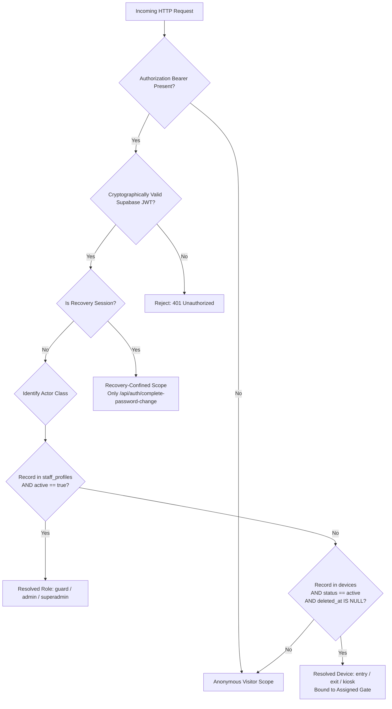

### Identity Resolution Rules:
1. **Anonymous Visitors**: Have valid Supabase Auth anonymous UIDs. Confined to requesting upload intents and submitting pass issuance.
2. **Staff Members**: Identified by a matching row in `public.staff_profiles` where `active = true`. Full operational eligibility also requires a confirmed Auth email (`email_confirmed_at IS NOT NULL`), completed password onboarding (`must_change_password = false`), privacy acceptance (`privacy_accepted_at IS NOT NULL`), an unconfined session (not recovery-confined), and an authorized staff role (`guard`, `admin`, `superadmin`).
3. **Managed Devices**: Identified by a matching row in `public.devices` where `status = 'active'` and `deleted_at IS NULL`. Types: `entry`, `exit`, `kiosk`.
4. **Recovery Sessions**: Explicitly flagged when authenticated via recovery magic links. Confined strictly to password reset and blocked from scanner, guard, and admin operations (`recovery_session_forbidden`).

---

## 3. Server-Side Authorization Sequence

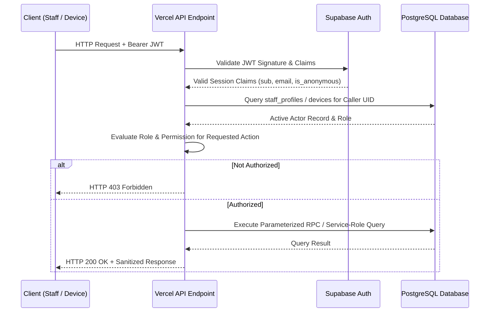

---

## 4. Institutional Role & Permission Matrix

| Operation / Capability | Anonymous Visitor | Kiosk Device | Entry Scanner | Exit Scanner | Guard | Admin | Super Admin |
|---|---|---|---|---|---|---|---|
| **Register Visitor Pass** (`/api/passes/issue`) | Allowed | Allowed | Denied | Denied | Denied | Denied | Denied |
| **Request Upload Intent** (`api.create_upload_intent`) | Allowed | Allowed | Denied | Denied | Denied | Denied | Denied |
| **Request QR Code by Email** (`/api/passes/email`) | Allowed | Allowed | Denied | Denied | Denied | Denied | Denied |
| **Scan Entry Pass** (`/api/scan-pass`, mode: `entry`) | Denied | Denied | **Allowed** | Denied | Denied | Denied | Denied |
| **Scan Exit Pass** (`/api/scan-pass`, mode: `exit`) | Denied | Denied | Denied | **Allowed** | Denied | Denied | Denied |
| **Guard Queue RPC** (`api.guard_dashboard_page`) | Denied | Denied | Denied | Denied | **Allowed** | **Allowed** | **Allowed** |
| **Approve / Reject Pass** (`/api/decide-visit`) | Denied | Denied | Denied | Denied | **Allowed** | **Allowed** | **Allowed** |
| **Stream Evidence Image** (`/api/evidence`) | Denied | Denied | Denied | Denied | **Allowed** (Pending) | **Allowed** | **Allowed** |
| **Manage Staff Accounts** (`/api/admin/users`, `/api/create-user`) | Denied | Denied | Denied | Denied | Denied | **Allowed** | **Allowed** |
| **Manage Hardware Devices** (`/api/admin/devices`, `/api/create-device`) | Denied | Denied | Denied | Denied | Denied | **Allowed** | **Allowed** |
| **Manage Incident Holds** (`/api/admin/holds`) | Denied | Denied | Denied | Denied | Denied | View Only | **Allowed** (Create & Release) |
| **Update System Settings** (`/api/update-settings`) | Denied | Denied | Denied | Denied | Denied | Denied | **Allowed** |
| **Execute Retention Maintenance** (`/api/admin/retention-maintenance`) | Denied | Denied | Denied | Denied | Denied | Denied | **Allowed** / Cron |
| **Review Reconciliation Tasks** (`/api/reconciliation-items`) | Denied | Denied | Denied | Denied | Denied | Denied | **Allowed** |
| **Promote Admin to Super Admin** (`POST /api/update-user` -> `api.update_staff_profile`) | Denied | Denied | Denied | Denied | Denied | Denied | **Allowed** |

---

## 5. Super Admin Bootstrap & Privilege Protection

To eliminate insecure public bootstrap endpoints, the initial Super Admin account is established through a database-level stored procedure:

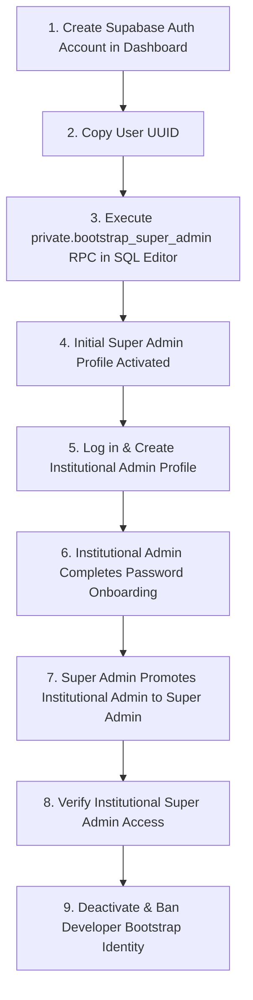

### Safety Invariants:
- **One-Time Lock (Before First Staff Profile)**: Bootstrap is allowed only before the FIRST staff profile exists. Once any row exists in `public.staff_profiles` (whether Guard, Admin, or Super Admin), bootstrap is permanently locked.
- **Confirmed Human Target Validation**: Database logic verifies the target user exists in `auth.users`, is non-anonymous (`is_anonymous = false`), has a confirmed email (`email_confirmed_at IS NOT NULL`), rejects managed device pseudo-identities (`@devices.egatepass.invalid`), and requires display name length between 2 and 120 characters.
- **Database Operator Restriction**: Execution is restricted to authorized database operators (`postgres`, `supabase_admin`) and revoked from `public`, `anon`, and `authenticated`.
- **Last Super Admin Demotion Protection**: Protection is enforced at three distinct layers:
  1. **Database trigger**: `private.protect_last_superadmin` on `public.staff_profiles` blocks any UPDATE that would leave zero active Super Admins.
  2. **Stored Procedure**: `api.update_staff_profile` enforces operator checks and translates trigger violations.
  3. **API Layer**: `POST /api/update-user` translates trigger exception `23514` to HTTP 409 `cannot_remove_last_superadmin`, which the UI presents as *"Cannot demote or deactivate the last remaining Super Admin."*
- **Safe Decommissioning**: Standard decommissioning consists of deactivating the staff profile via Staff Management and suspending the Auth account (`ban_duration: '876000h'`). Direct Auth user deletion in Supabase Dashboard is blocked by `ON DELETE RESTRICT` foreign key constraints on `staff_profiles.user_id`.

---

## 6. QR Code Cryptographic Tokens & Digest Lookup

Gate passes use high-entropy cryptographically derived bearer tokens. Plaintext QR tokens are never stored in the database.

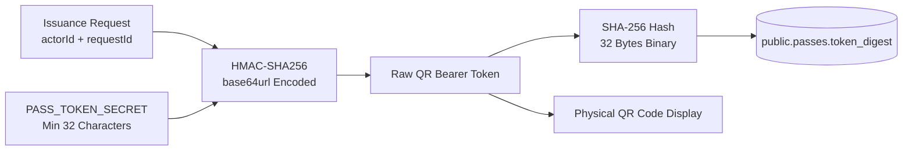

### Cryptographic Properties:
1. **Derivation**: `qrToken = createHmac('sha256', PASS_TOKEN_SECRET).update(actorId + ':' + requestId).digest('base64url')`.
2. **Digest Storage**: PostgreSQL stores only `SHA-256(qrToken)` in `public.passes.token_digest`. A database-only read compromise of token digests does not directly reveal the raw QR bearer, assuming the bearer retains sufficient entropy and `PASS_TOKEN_SECRET` remains uncompromised.
3. **Secret Rotation**: Physical QR code verification relies on the stored digest. Idempotent issuance replay recomputes the bearer using the current secret and safely detects secret rotation without corrupting issued passes.
4. **Visual Branding & Scanner Reliability**: All visitor QR codes (portal display, download, share, kiosk display, browser print, and email attachment) composite the EARIST seal in the center using High Error Correction (`errorCorrectionLevel: 'H'`), a safe 17% width ratio, and a solid white backing box. Center branding alters only visual image rendering; it NEVER mutates the underlying raw `qrToken`, its SHA-256 digest, or gate scanner verification.

---

## 7. Gate Device Scan Authorization Sequence

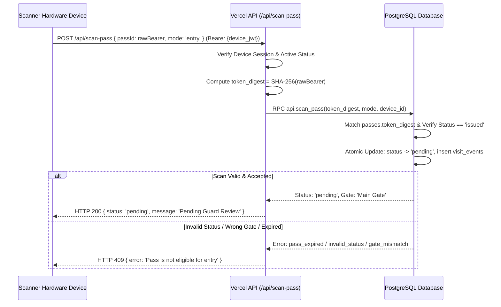

---

## 8. Pass State Machine Invariants

Pass lifecycle transitions are governed by database-enforced state checks:

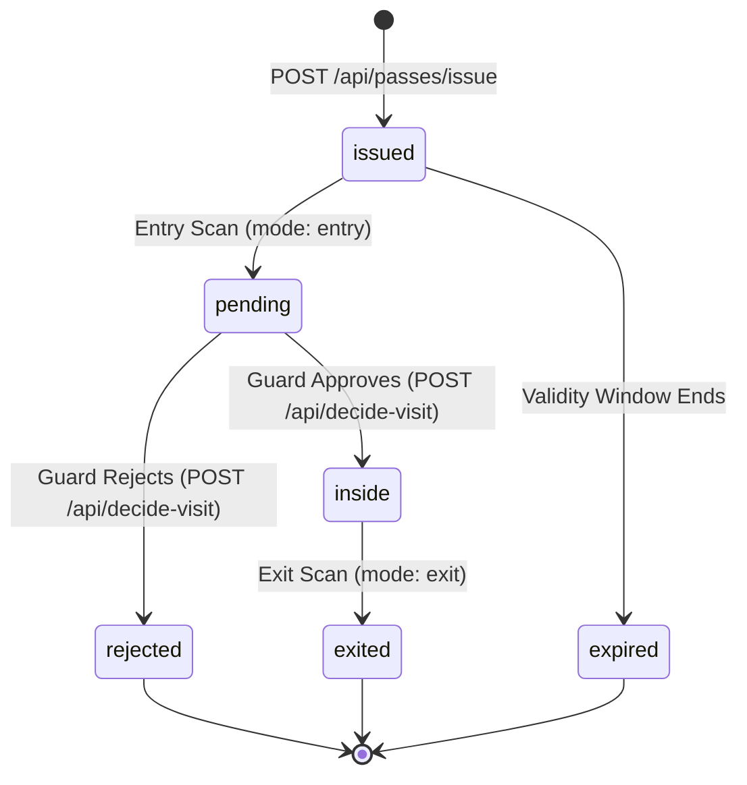

---

## 9. Evidence Ingestion & Upload Intent Architecture

To prevent arbitrary file storage injection, clients cannot upload directly without pre-authorized intents:

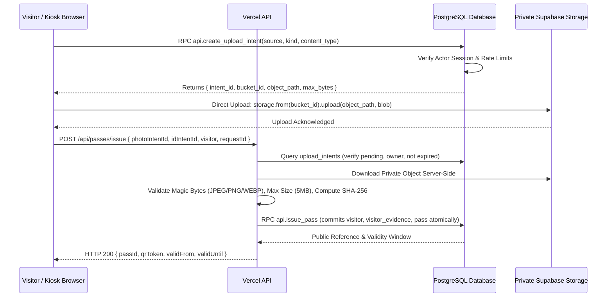

---

## 10. Evidence Retrieval & Viewing Security

Staff review visitor evidence strictly through an authenticated server proxy:

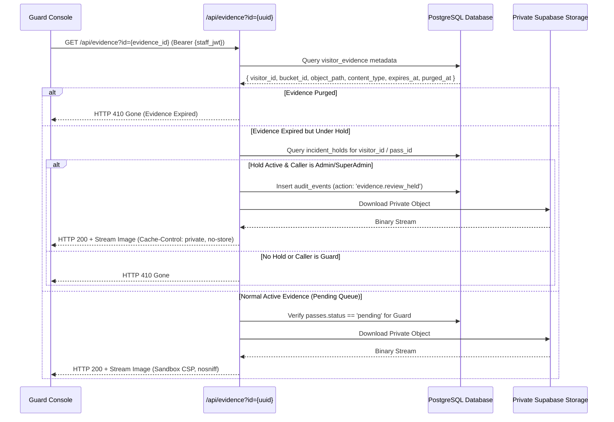

---

## 11. Transactional Email Security & Supply Chain

### 11.1 Supabase Auth Webhook Verification
Supabase Auth dispatches authentication events to `/api/auth/send-email-hook` using standard webhooks:
- Each incoming request is verified using the `standardwebhooks` protocol and `SEND_EMAIL_HOOK_SECRET`.
- Tampered headers, mismatched timestamps (> 5 min skew), or missing signatures are rejected with HTTP 401.

### 11.2 Email Build Supply Chain Architecture
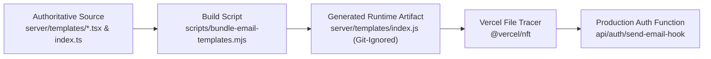

---

## 12. QR Pass Email Verification Challenge

Visitors requesting their QR pass via email must satisfy an anti-abuse challenge:

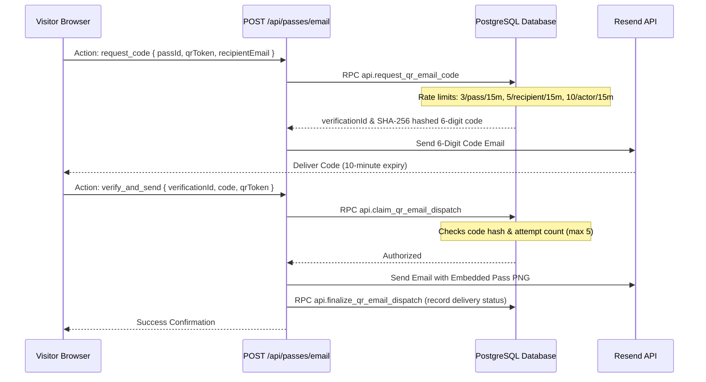

---

## 13. Cloudflare Turnstile Bot Protection & Abuse Controls

### 13.1 Generic Preview Isolation & Server Secret Boundary
To maintain cryptographic boundaries and prevent experimental or pull-request builds from querying production databases or sending live emails:
- **Server Privileged Secret Isolation**: All privileged server credentials (`SUPABASE_SECRET_KEY`, `PASS_TOKEN_SECRET`, `RATE_LIMIT_HMAC_SECRET`, `CRON_SECRET`, `RESEND_API_KEY`, `SEND_EMAIL_HOOK_SECRET`, `RESEND_WEBHOOK_SECRET`) are strictly restricted to the **Production** scope in Vercel. Generic Preview scopes receive ONLY public frontend configuration (`VITE_SUPABASE_URL`, `VITE_SUPABASE_PUBLISHABLE_KEY`, `SUPABASE_URL`).
- **Zero Production Fallback**: Server functions executing in Preview never receive production service-role or signing credentials.
- **SSO Deployment Protection**: Generic Preview deployments are protected by Vercel SSO deployment protection.

### 13.2 Turnstile Fail-Closed Enforcement Across Protected Surfaces
Cloudflare Turnstile is configured in Managed mode for authoritative bot protection:
- `VITE_TURNSTILE_SITE_KEY` is scoped to Production in Vercel.
- In Production, every protected human surface (**Visitor Portal**, **Staff Login**, **Forgot Password**) strictly fails closed: if the Turnstile site key is missing or the client omits a valid CAPTCHA response token, the action is blocked immediately at the client boundary with a security configuration error.
- In preview/local environments where `import.meta.env.PROD` is false, developer flow bypass is safely permitted.

### 13.3 Cryptographic Key Separation & Abuse Control Invariants
- Pass issuance rate limiting uses a dedicated, high-entropy server secret (`RATE_LIMIT_HMAC_SECRET`) with a minimum of 32 characters (256 bits of entropy).
- Cryptographic key separation is complete: the rate limiter NEVER falls back to `PASS_TOKEN_SECRET` or any other system secret. In Production, missing or undersized `RATE_LIMIT_HMAC_SECRET` immediately throws HTTP 503 `abuse_control_unavailable`.

### 13.4 Resend Delivery Webhook Observability & Atomic Idempotency
- Transactional email delivery outcomes are monitored via a dedicated Standard Webhooks receiver (`/api/webhooks/resend` rewritten to `/api/auth/resend-webhook`).
- Webhook payloads are verified cryptographically via Svix / Standard Webhook signatures against `RESEND_WEBHOOK_SECRET`. In Production, missing secrets fail closed with HTTP 503 `webhook_secret_unconfigured`.
- Replay and race protection is guaranteed at the database level via table `public.resend_webhook_events` (`provider_event_id UNIQUE`). Replays return HTTP 200 `already_processed` without duplicate audit logging.
- Recipient email addresses are masked (`v***r@...`) in `audit_events` to preserve privacy.
- **Neither webhook is an inbound email mailbox or reply processor.**

### 13.4 Supabase Free-Tier Security Advisor Review
Supabase Security Advisor reports `auth_leaked_password_protection` as disabled. This feature is restricted to paid Supabase tiers and is an accepted platform limitation on the current Free plan. In accordance with zero-cost architecture guidelines, password security is strictly enforced at the application boundary via mandatory 12+ character complexity, mixed-case, numbers, and symbols.

### 13.5 Content Security Policy (CSP) Directives Justification
The production CSP header enforces tight origins with explicit exemptions:
- `wasm-unsafe-eval`: Authoritatively required for client-side Tesseract.js WebAssembly OCR compilation in browser web workers.
- `style-src 'unsafe-inline'`: Required for dynamic toast notification styling (Sonner) and Radix UI dialog portal locking.
- `script-src 'unsafe-inline'`: Required for Cloudflare Turnstile explicit widget execution.

Cloudflare Turnstile protects public visitor registration, staff/device authentication, and password recovery from automated attacks:
- **Public Visitor Portal**: Non-intrusive challenge required before issuing an anonymous session.
- **Staff & Device Login (`/login`)**: Challenge verification token required for human staff credentials.
- **Password Recovery (`/forgot-password`)**: Challenge verification token required before issuing password reset emails.
- **Anonymous Pass Issuance Abuse Boundary**: Pass issuance is authoritative and concurrency-safe, rate limited by client bucket hex key via the `api.consume_rate_limit` database function on `public.rate_limit_buckets`. Idempotent replay of identical requests remains permitted.

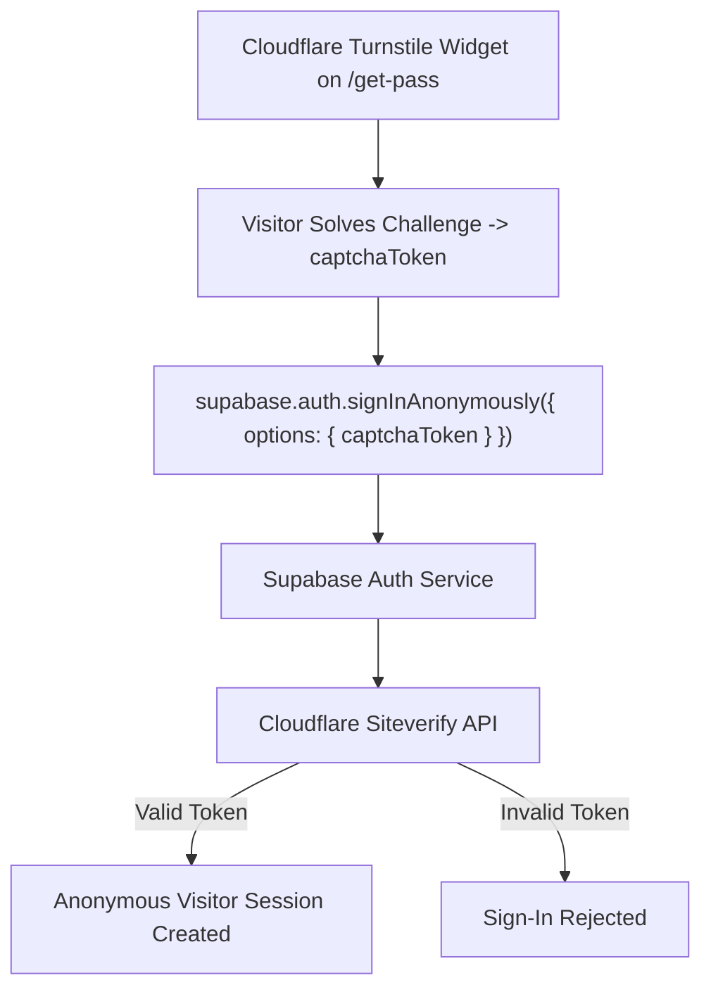

*Note: The Cloudflare Turnstile Secret Key is configured in the Supabase Dashboard under Authentication > CAPTCHA / Bot & Abuse Protection. Vercel server functions do not require `Turnstile server secret`.*

---

## 14. Incident Holds & Evidence Retention

Campus security investigations require evidence preservation beyond standard retention windows:

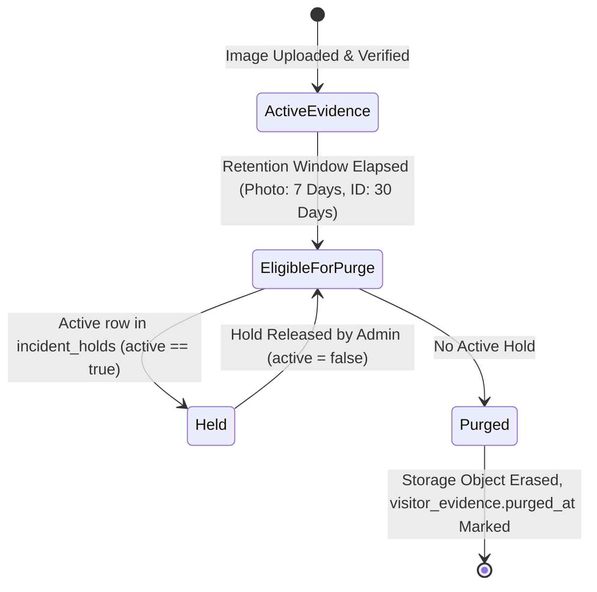

---

## 15. Cross-System Reconciliation

When an operation spans multiple systems (PostgreSQL, Storage, Resend) and encounters partial network failures:
1. The error does not abort without a record.
2. An entry is recorded in `public.reconciliation_tasks` with payload references and error details.
3. Super Admins review, retry, or acknowledge pending reconciliation items via `GET /api/reconciliation-items`.

---

## 16. Browser Security Headers (`vercel.json`)

| Security Header | Directive / Value | Purpose |
|---|---|---|
| **Content-Security-Policy** | Strict origin policy with script, frame, and connect constraints | Mitigates XSS, data exfiltration, and unauthorized frame embedding |
| **Strict-Transport-Security** | `max-age=31536000; includeSubDomains; preload` | Forces HTTPS and protects against SSL stripping |
| **X-Frame-Options** | `DENY` | Prevents clickjacking by blocking iframe rendering |
| **X-Content-Type-Options** | `nosniff` | Blocks MIME-type sniffing by browsers |
| **Referrer-Policy** | `strict-origin-when-cross-origin` | Limits referrer leakage to third-party domains |
| **Permissions-Policy** | `camera=(self), microphone=(), geolocation=()` | Restricts hardware API access to own origin |

---

## 17. Environment Secret Classification

### Browser-Safe Client Configuration (`VITE_*`)
- `VITE_SUPABASE_URL`: Public Supabase API endpoint.
- `VITE_SUPABASE_PUBLISHABLE_KEY`: Supabase publishable browser key (`sb_publishable_...`; intentionally public and governed by RLS).
- `VITE_TURNSTILE_SITE_KEY`: Public site key for Cloudflare Turnstile widget.

### Protected Server Secrets (Vercel Functions Only — Production Scope)
- `SUPABASE_SECRET_KEY`: Service-role key for backend operations; bypasses RLS.
- `PASS_TOKEN_SECRET`: Cryptographic secret (minimum 32 characters) for HMAC QR tokens.
- `RATE_LIMIT_HMAC_SECRET`: Dedicated cryptographic key (minimum 32 characters) for network rate-limiting HMAC.
- `CRON_SECRET`: Bearer authentication token for maintenance endpoints.
- `RESEND_API_KEY`: API key for transactional email delivery.
- `SEND_EMAIL_HOOK_SECRET`: Shared secret for Supabase Auth Send Email Hook verification.
- `RESEND_WEBHOOK_SECRET`: Shared secret for Resend Delivery Webhook verification.
- `RESEND_FROM_EMAIL`: Non-secret server configuration (`EARIST E-GatePass <notifications@egatepass.tech>`).

---

## 18. Threat Model & Mitigation Matrix

| Threat Scenario | Trust Boundary | Primary Mitigation Control | Enforcement Layer | Residual Risk |
|---|---|---|---|---|
| **Client Modifies User Role** | Untrusted Client | Roles stored in `staff_profiles`; client writes blocked | PostgreSQL RLS & Schema | Compromise of server service-role key |
| **Visitor Reads Other IDs** | Untrusted Client | Private Storage buckets; access proxy verifies role | `server/routes/gate/evidence.ts` | Stolen staff credentials |
| **Device Spoofs Device Type** | Managed Device | Hardware type bound to database `devices` row | Database device record | Physical compromise of scanner device |
| **Scanner Used at Wrong Gate** | Scanner Device | Scans checked against device gate assignment | Stored procedure `api.scan_pass` | Human error in gate assignment |
| **Stolen Token Digest** | Database Boundary | Raw token is HMAC-derived; only SHA-256 digest stored | PostgreSQL `passes.token_digest` | Weak secret or brute-force if secret leaked |
| **Replayed QR Bearer** | Gate Scanner | Pass transitions to `pending` upon first scan | Database atomic transaction | Scanning before original visitor arrives |
| **Concurrent Pass Issuance** | Visitor Registration | Idempotency key and unique token digest constraints | PostgreSQL unique constraints | Client timeout with unreturned token |
| **Forged Storage Path** | Storage Ingestion | Pre-authorized upload intents with random paths | RPC `api.create_upload_intent` | Abandoned upload intent before expiry |
| **Email Bombing / Spam** | External Integration | Tiered rate limits (pass, recipient, actor) | RPC `api.request_qr_email_code` | Distributed spam across multiple passes |
| **Forged Email Webhook** | Auth Hook Endpoint | Standard Webhook HMAC signature verification | `/api/auth/send-email-hook` | Leaked webhook secret |
| **Password Recovery Tampering** | Auth Workflow | Recovery session confined; blocked from admin/scanner | `getVerifiedSessionContext` | Attacker controls victim email inbox |
| **Accidental Last Admin Removal** | Staff Governance | Defensive check blocks demoting last Super Admin | Stored procedure & API route | Database manual override via SQL editor |
| **Evidence Deleted During Incident** | Retention Engine | Active `incident_holds` suspend automated purge | Stored procedures & cron handler | Failure of human officer to place hold |
| **Turnstile Challenge Bypass** | Public Registration | Challenge verified by Supabase Auth before session | Supabase Auth CAPTCHA | Sophisticated CAPTCHA solving farms |

---

## 19. Thermal Print Template Security Model

The thermal print template subsystem introduces a dynamic layout engine for physical ticket rendering. To prevent arbitrary code injection, cross-site scripting (XSS), or malicious image exfiltration:

### 19.1 Strict Allowlist Schema Enforcement
- **Client & Server Schema Validation**: All template JSON payloads are validated using the strict Zod schema `thermalTemplateLayoutSchema`.
- **Allowed Element Types**: Only explicit primitives are recognized: `institution_logo`, `institution_name`, `visitor_name`, `visit_date`, `qr_code`, `pass_reference`, `static_text`, `divider`, `rectangle`.
- **Rejection of Arbitrary Markup**: Any unexpected properties, script tags, HTML tags, or remote resource URLs (`http://`, `https://`) are strictly rejected.
- **Canvas Bounds**: Fixed at 384px width with bounded coordinates (`0 <= x <= 384`, `y >= 0`, `height <= 1200`). Coordinate overflow or oversized dimensions trigger immediate schema rejection.

### 19.2 Role Authorization
- **Super Admin Exclusive**: Only authenticated sessions with `staff_profiles.role = 'superadmin'` are authorized to call `api.save_thermal_template_draft` and `api.publish_thermal_template`.
- **Tamper Resistance**: Mandatory elements (`institution_name`, `visitor_name`, `visit_date`, `qr_code`, `pass_reference`) cannot be removed from a published template.

---

## 20. Guard Offline Operations & Device Storage Threat Model

During connectivity outages, operational access authority delegates to the Guard tablet. This section defines the localized storage threat model, retention invariants, and synchronization security controls:

### 20.1 Client Storage Threat Model & Honest Boundaries
- **Storage Technology**: Browser IndexedDB (`egatepass_guard_offline`).
- **Storage Boundary**: Data is isolated by browser Same-Origin Policy (`https://egatepass.tech`) and protected by the physical device screen lock.
- **Honest Security Boundary**: Browser IndexedDB is **NOT** a tamper-proof hardware security module (HSM) or hardware-backed TPM. Physical extraction from an unlocked device or rooted OS is possible.
- **Zero Server Secrets**: No server service-role keys, database passwords, or signing secrets are EVER written to browser local storage, IndexedDB, or client cookies.

### 20.2 Operational Cache Scoping, Actor Isolation & Evidence Stripping
- **Minimal Operational Footprint**: The tablet only caches operationally relevant passes: today's date in `Asia/Manila` in `issued`, `pending`, or `inside` status. Historical passes are excluded.
- **IndexedDB v2 & Strict Actor-Binding Contract**: IndexedDB store (`egatepass_guard_offline`) enforces mandatory `actorId` attributes across `cached_visitors`, `offline_registrations`, and `offline_events`.
- **Fail-Closed Unattributed Record Rejection**: Any legacy or malformed record lacking an authenticating `actorId` is strictly excluded by fail-closed queries (`r.actorId === actorId`) and will NEVER be assigned, read, or executed during sync.
- **Cross-Guard Data Privacy & Identity-Switch Purge**: When switching guards (`transitionGuardOfflineStore(nextActorId)`), if a previous guard was active (`lastActorId` differs from `nextActorId`), all sensitive local stores (`cached_visitors`, `offline_registrations`, `offline_events`, and `meta`) are immediately purged from IndexedDB so Guard B starts with a clean slate and zero remnant biometric or operational data from Guard A.
- **Strictly Blocked Clean Logout with Pending Records**: To prevent evidence loss and audit attribution failure, Guard clean logout is strictly blocked whenever `getPendingSyncCount(actorId) > 0`. Guards must restore network connectivity and synchronize outbox records before signing out.
- **Centralized Failure Classification & Local Evidence Retention**:
  - `classifyOfflineRegistrationSyncFailure` centralizes all sync response and network error triage:
    - `transient_or_internal`: Network timeouts, HTTP 5xx errors, 503 authority outages, unexpected 400 responses, and unknown 422 validation errors leave the offline registration in `pending` status with full local biometric Blobs (`photoBlob`, `idBlob`) and upload intent checkpoints intact for automatic retry.
    - `recoverable_evidence`: Specific 422 metadata/evidence errors clear stale upload checkpoints while preserving binary Blobs for immediate re-upload.
    - `authoritative_conflict`: Only explicit server HTTP 409 conflict responses (`status === 409`) mark the registration as terminal `conflict` and strip local binary evidence blobs (`photoBlob`, `idBlob`) while preserving relational audit metadata for supervisor reconciliation.
  - Daily automatic purge clears previous calendar days' cached visitor records.
  - Absolute Retention Ceiling: Enforcing the institutional 7-day evidence retention policy, any offline registration older than 7 days that fails to synchronize is treated as expired/conflicted and purged of sensitive binary evidence blobs.

### 20.3 Server-Only Synchronization Trust Boundary & Conflict Defense
- **Rebuilt Offline Registration Trust Boundary**: Direct browser execution of `api.guard_sync_offline_registration` is revoked. The RPC is granted strictly to `service_role`.
- **Trusted Server Route (`POST /api/sync-offline-registration`)**:
  - Verifies authenticated Guard bearer token and resolves the guard's staff profile.
  - Performs server-side byte inspection, MIME type validation (WebP magic bytes `RIFF`...`WEBP`), and SHA-256 verification of uploaded photo and ID blobs.
  - Invokes `api.guard_sync_offline_registration` as `service_role` passing verified `requested_actor_id`.
- **Database Defense-in-Depth Authorization**:
  - The database RPC validates that `requested_actor_id` corresponds to an active guard or superadmin in `staff_profiles`.
  - Validates that associated `upload_intents` records exist, are active, belong to `guard_offline`, and are owned by `requested_actor_id`.
  - Evidence retention adheres to institutional configuration (`photo_retention_days` and `id_retention_days` from `app_settings`, defaulting to 7 and 30 days) with Manila calendar day visit window matching `api.issue_pass`.
- **Thermal Template Least Privilege**: The thermal receipt template RPC `api.get_published_thermal_template()` is restricted strictly to `service_role`; direct browser RPC access is revoked.

---

## 21. Institutional Upgrades Security Contracts

### 21.1 Safe Staff Permanent Decommissioning Security Invariants
- **Zero Row Deletion & Attribution Preservation**: Under `staff_profiles.user_id -> auth.users.id ON DELETE RESTRICT`, hard deletion would break historical audit events and attribution. Decommissioning permanently updates `decommissioned_at = now()`, `decommissioned_by`, `decommission_reason`, and forces `active = false` without removing the relational record.
- **Super Admin Re-Authentication**: Destructive permanent decommissioning requires the acting Super Admin's current password. Verification executes on an isolated Supabase Auth client and terminates immediately with `signOut({ scope: 'local' })` to guarantee the Super Admin's primary browser session remains intact.
- **Auth Identity Suspension**: The Auth identity is suspended with an 876,000-hour ban (`banned_until`), disabling credential login. If Supabase Auth synchronization fails, the database change commits and an administrative reconciliation item is registered (`reconciliationRequired: true`) rather than rolling back truthful database status.

### 21.2 Report Export Data Hygiene & Secret Exclusion
Export pipelines generating CSV, XLSX, and PDF files enforce absolute exclusion of sensitive secrets and storage internals:
- Raw QR tokens (`qrToken`) and cryptographic digests (`tokenDigest`) are strictly excluded.
- Private Storage object paths (`photoPublicId`, `idImagePublicId`) and temporary signed URLs are strictly excluded.
- Passwords, email verification codes, API keys, and internal session identifiers are strictly excluded.
- Dynamic modules (`exceljs`, `jspdf`, `jspdf-autotable`) are loaded only on demand at click time to prevent client bundle inflation.

### 21.3 Canonical SVG Pass Artifact Injection Defense
The shared pure SVG template generator (`src/lib/digitalPassArtifact.ts`) uses strict XML escaping on all dynamic visitor-provided fields:
- Visitor Name, Purpose, Pass Reference, Visit Date, and Validity Window are sanitized through `escapeXml(...)` before interpolation into SVG markup.
- Prevents SVG injection, attribute breakout, and script execution across browser DOM, Canvas rasterization, and server `sharp` rendering pipelines.
- Raw QR token is never rendered as SVG text (the QR image contains only the opaque token).

### 21.4 Guard Authoritative Search RPC Authorization
- `api.guard_search_pending_queue` is protected with `REVOKE ALL FROM PUBLIC`, `REVOKE ALL FROM ANON`, and `GRANT EXECUTE TO authenticated`.
- Executed with `SECURITY DEFINER` and `SET search_path = ''`.
- Hard role enforcement inside function body verifies caller is active `guard`, `admin`, or `superadmin`.
- Query validation bounds input between 2 and 100 characters, bounds limit between 1 and 100, and returns only passes with status `pending`. No QR tokens, digests, or storage credentials are included in projections.

---

## 22. Online Pre-Registration Biometric Verification & Privacy Minimization (Migrations 38 & 39)

### 22.1 Zero Biometric Persistence Guarantee
- **Model Execution in RAM**: 1:1 biometric comparison executes on the server via OpenCV Zoo models (`YuNet` face detection + `SFace` feature extraction) using ONNX Runtime.
- **Ephemeral Embeddings**: 128-dimensional L2-normalized feature vectors, 5-point facial landmark coordinates, bounding boxes, and cropped face tensors are generated in transient memory buffers and destroyed immediately upon request completion.
- **Strict Storage Minimization**: Zero biometric embeddings, templates, or facial measurements are persisted to PostgreSQL tables, Redis caches, or Cloud Object Storage. The relational database only stores audit metadata in `portal_identity_verification_attempts` (`match_status`, `similarity_score`, `model_version`, and unexpired verification timestamps).

### 22.2 Identity Verification Boundary & Rate Limiting
- **Anti-Tampering Correlation**: `/api/passes/verify-identity` validates that `photoIntentId` and `idIntentId` belong to the caller's active anonymous Supabase session and match the transaction's `requestId`.
- **Sliding-Window Rate Limits**: Biometric comparison requests are rate-limited to 5 verification attempts per 10 minutes per anonymous session IP/actor.
- **Strict Server Authority**: Pass issuance via `POST /api/passes/issue` enforces that an unexpired `matched` record exists in `portal_identity_verification_attempts` within the last 15 minutes before executing `api.issue_pass`.

### 22.3 Same-Gate Confinement for Guard Station Devices
- Dedicated hardware devices (`device_type = 'guard_station'`) monitor campus entrance gates.
- **Gate-Scoped Projections**: `/api/guard-station-feed` only returns visit records and scans originating at the device's assigned gate.
- **Evidence Access Scoping**: `/api/evidence` strictly restricts `guard_station` devices to visitor registration photos (`photo`) for visits scanned at that station's gate. Access to government ID cards (`id_card`) is denied to guard station devices.

### 22.4 Legacy Guard Role Deprecation (`legacy_guard_role_disabled`)
- To prevent manual approval bypasses on automated online visitor entries, personal guard staff accounts are disabled for operational sign-in with HTTP 403 `legacy_guard_role_disabled`.
- Walk-in kiosk manual approvals are restricted to Administrative actors (`/admin/legacy-guard`).

