# Security Architecture & Threat Model

This document serves as the authoritative security specification, trust boundary definition, and threat-mitigation contract for the EARIST E-GatePass platform.

---

## 1. System Trust Boundaries

EARIST E-GatePass enforces strict security perimeters across untrusted clients, privileged serverless execution containers, authoritative database layers, and third-party integrations.

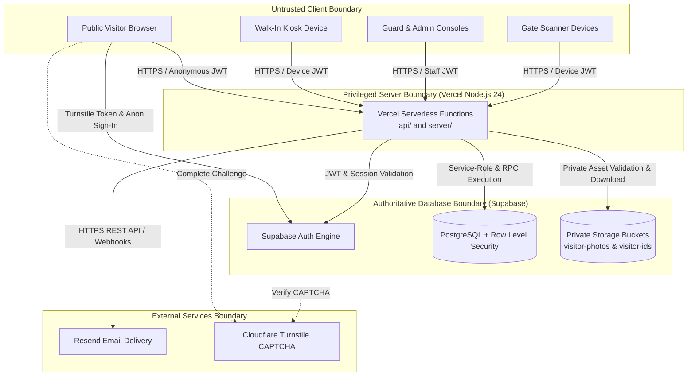

> **CORE AUTHORIZATION PRINCIPLE**: All client-side UI restrictions, role state variables, and route guards are user-experience controls only. Authoritative security enforcement resides exclusively within serverless endpoint middleware, database Row Level Security (RLS) policies, and `SECURITY DEFINER` stored procedures.

---

## 2. Multi-Actor Authentication

Incoming requests present Supabase Auth JSON Web Tokens (JWT) verified cryptographically against Supabase Auth public keys. The system resolves identity across three distinct actor classes:

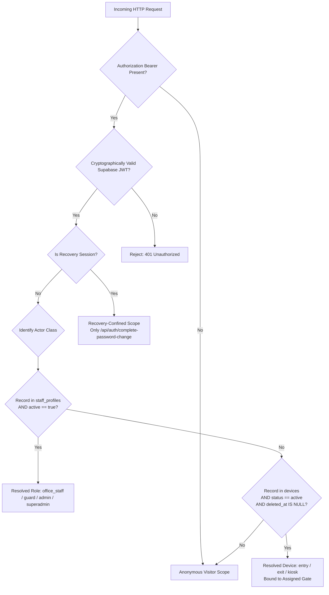

### Identity Resolution Rules:
1. **Anonymous Visitors**: Have valid Supabase Auth anonymous UIDs. Confined to requesting upload intents and submitting pass issuance.
2. **Staff Members**: Identified by a matching row in `public.staff_profiles` where `active = true`. Full operational eligibility also requires a confirmed Auth email (`email_confirmed_at IS NOT NULL`), completed password onboarding (`must_change_password = false`), privacy acceptance (`privacy_accepted_at IS NOT NULL`), an unconfined session (not recovery-confined), and an authorized staff role (`guard`, `admin`, `superadmin`, `office_staff`).
3. **Managed Devices**: Identified by a matching row in `public.devices` where `status = 'active'` and `deleted_at IS NULL`. Types: `entry`, `exit`, `kiosk`, `guard_station`, `emergency_device`. All managed devices are strictly exempt from human 15-minute inactivity sign-out (`HumanInactivityGuard.tsx` & `/api/auth/session-activity`).
4. **Recovery Sessions**: Explicitly flagged when authenticated via recovery magic links. Confined strictly to password reset and blocked from scanner, guard, and admin operations (`recovery_session_forbidden`).

---

## 3. Server-Side Authorization Sequence

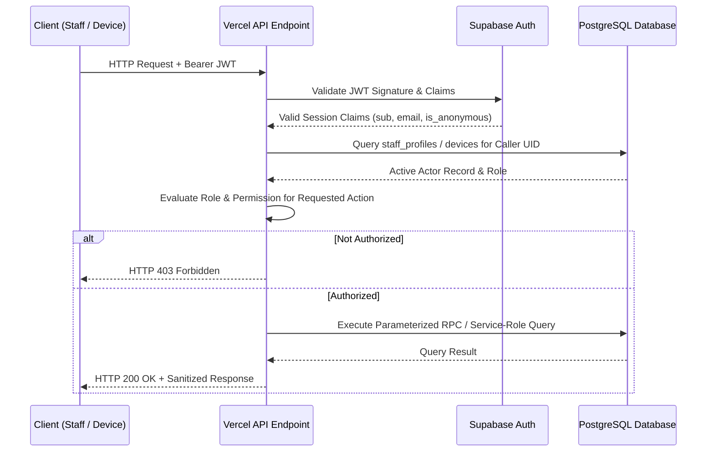

---

## 4. Institutional Role & Permission Matrix

| Operation / Capability | Anonymous Visitor | Kiosk Device | Entry Scanner | Exit Scanner | Office Staff | Guard | Admin | Super Admin |
|---|---|---|---|---|---|---|---|---|
| **Register Visitor Pass** (`/api/passes/issue`) | Allowed | Allowed | Denied | Denied | Denied | Denied | Denied | Denied |
| **Request Upload Intent** (`api.create_upload_intent`) | Allowed | Allowed | Denied | Denied | Denied | Denied | Denied | Denied |
| **Request QR Code by Email** (`/api/passes/email`) | Allowed | Allowed | Denied | Denied | Denied | Denied | Denied | Denied |
| **Request Specific Visit** (`/api/request-office-visit`) | Allowed | Allowed | Denied | Denied | Denied | Denied | Denied | Denied |
| **Office Visits Query** (`/api/office/visits`) | Denied | Denied | Denied | Denied | **Allowed** (Assigned) | Denied | **Allowed** | **Allowed** |
| **Decide Specific Visit** (`/api/office/decide`) | Denied | Denied | Denied | Denied | **Allowed** (Assigned) | Denied | **Allowed** | **Allowed** |
| **Confirm Office Arrival** (`/api/office/confirm-arrival`) | Denied | Denied | Denied | Denied | **Allowed** (Assigned) | Denied | **Allowed** | **Allowed** |
| **Scan Entry Pass** (`/api/scan-pass`, mode: `entry`) | Denied | Denied | **Allowed** | Denied | Denied | Denied | Denied | Denied |
| **Scan Exit Pass** (`/api/scan-pass`, mode: `exit`) | Denied | Denied | Denied | **Allowed** | Denied | Denied | Denied | Denied |
| **Guard Queue RPC** (`api.guard_dashboard_page`) | Denied | Denied | Denied | Denied | Denied | **Allowed** | **Allowed** | **Allowed** |
| **Approve / Reject Pass** (`/api/decide-visit`) | Denied | Denied | Denied | Denied | Denied | **Allowed** | **Allowed** | **Allowed** |
| **Stream Evidence Image** (`/api/evidence`) | Denied | Denied | Denied | Denied | Denied | **Allowed** (Pending) | **Allowed** | **Allowed** |
| **Manage Staff Accounts** (`/api/admin/users`, `/api/create-user`) | Denied | Denied | Denied | Denied | Denied | Denied | **Allowed** | **Allowed** |
| **Manage Hardware Devices** (`/api/admin/devices`, `/api/create-device`) | Denied | Denied | Denied | Denied | Denied | Denied | **Allowed** | **Allowed** |
| **Manage Incident Holds** (`/api/admin/holds`) | Denied | Denied | Denied | Denied | Denied | Denied | View Only | **Allowed** (Create & Release) |
| **Update System Settings** (`/api/update-settings`) | Denied | Denied | Denied | Denied | Denied | Denied | Denied | **Allowed** |
| **Execute Retention Maintenance** (`/api/admin/retention-maintenance`) | Denied | Denied | Denied | Denied | Denied | Denied | Denied | **Allowed** / Cron |
| **Review Reconciliation Tasks** (`/api/reconciliation-items`) | Denied | Denied | Denied | Denied | Denied | Denied | Denied | **Allowed** |
| **Promote Admin to Super Admin** (`POST /api/update-user` -> `api.update_staff_profile`) | Denied | Denied | Denied | Denied | Denied | Denied | Denied | **Allowed** |

---

## 5. Super Admin Bootstrap & Privilege Protection

To eliminate insecure public bootstrap endpoints, the initial Super Admin account is established through a database-level stored procedure:

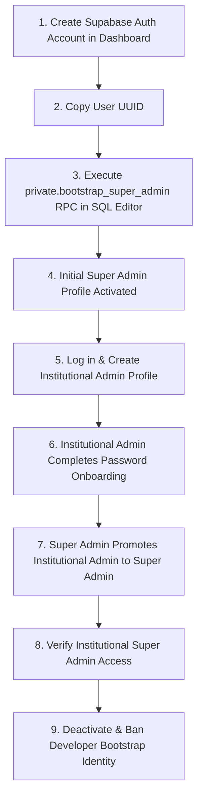

### Safety Invariants:
- **One-Time Lock (Before First Staff Profile)**: Bootstrap is allowed only before the FIRST staff profile exists. Once any row exists in `public.staff_profiles` (whether Guard, Admin, or Super Admin), bootstrap is permanently locked.
- **Confirmed Human Target Validation**: Database logic verifies the target user exists in `auth.users`, is non-anonymous (`is_anonymous = false`), has a confirmed email (`email_confirmed_at IS NOT NULL`), rejects managed device pseudo-identities (`@devices.egatepass.invalid`), and requires display name length between 2 and 120 characters.
- **Database Operator Restriction**: Execution is restricted to authorized database operators (`postgres`, `supabase_admin`) and revoked from `public`, `anon`, and `authenticated`.
- **Last Super Admin Demotion Protection**: Protection is enforced at three distinct layers:
  1. **Database trigger**: `private.protect_last_superadmin` on `public.staff_profiles` blocks any UPDATE that would leave zero active Super Admins.
  2. **Stored Procedure**: `api.update_staff_profile` enforces operator checks and translates trigger violations.
  3. **API Layer**: `POST /api/update-user` translates trigger exception `23514` to HTTP 409 `cannot_remove_last_superadmin`, which the UI presents as *"Cannot demote or deactivate the last remaining Super Admin."*
- **Safe Decommissioning**: Standard decommissioning consists of deactivating the staff profile via Staff Management and suspending the Auth account (`ban_duration: '876000h'`). Direct Auth user deletion in Supabase Dashboard is blocked by `ON DELETE RESTRICT` foreign key constraints on `staff_profiles.user_id`.

---

## 6. QR Code Cryptographic Tokens & Digest Lookup

Gate passes use high-entropy cryptographically derived bearer tokens. Plaintext QR tokens are never stored in the database.

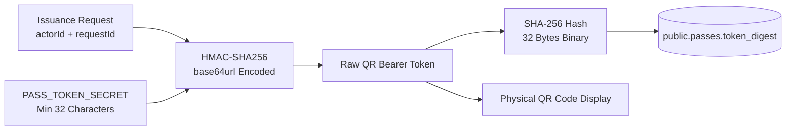

### Cryptographic Properties:
1. **Derivation**: `qrToken = createHmac('sha256', PASS_TOKEN_SECRET).update(actorId + ':' + requestId).digest('base64url')`.
2. **Digest Storage**: PostgreSQL stores only `SHA-256(qrToken)` in `public.passes.token_digest`. A database-only read compromise of token digests does not directly reveal the raw QR bearer, assuming the bearer retains sufficient entropy and `PASS_TOKEN_SECRET` remains uncompromised.
3. **Secret Rotation**: Physical QR code verification relies on the stored digest. Idempotent issuance replay recomputes the bearer using the current secret and safely detects secret rotation without corrupting issued passes.
4. **Visual Branding & Scanner Reliability**: All visitor QR codes (portal display, download, share, kiosk display, browser print, and email attachment) composite the EARIST seal in the center using High Error Correction (`errorCorrectionLevel: 'H'`), a safe 17% width ratio, and a solid white backing box. Center branding alters only visual image rendering; it NEVER mutates the underlying raw `qrToken`, its SHA-256 digest, or gate scanner verification.

---

## 7. Gate Device Scan Authorization Sequence

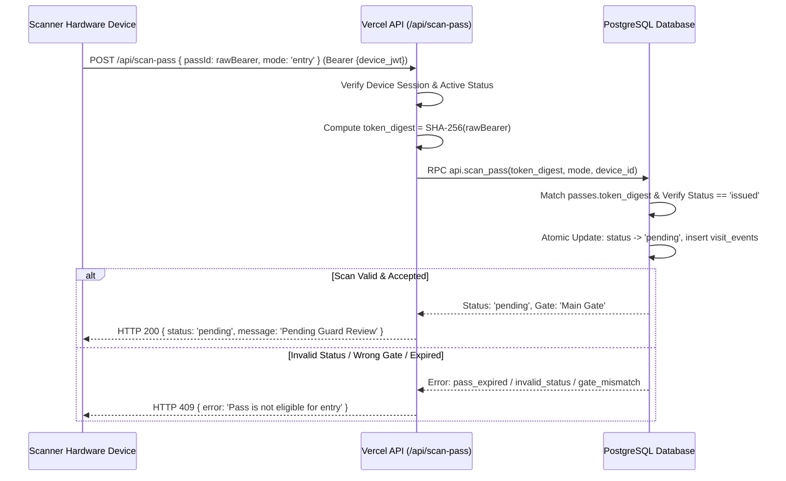

---

## 8. Pass State Machine Invariants

Pass lifecycle transitions are governed by database-enforced state checks:

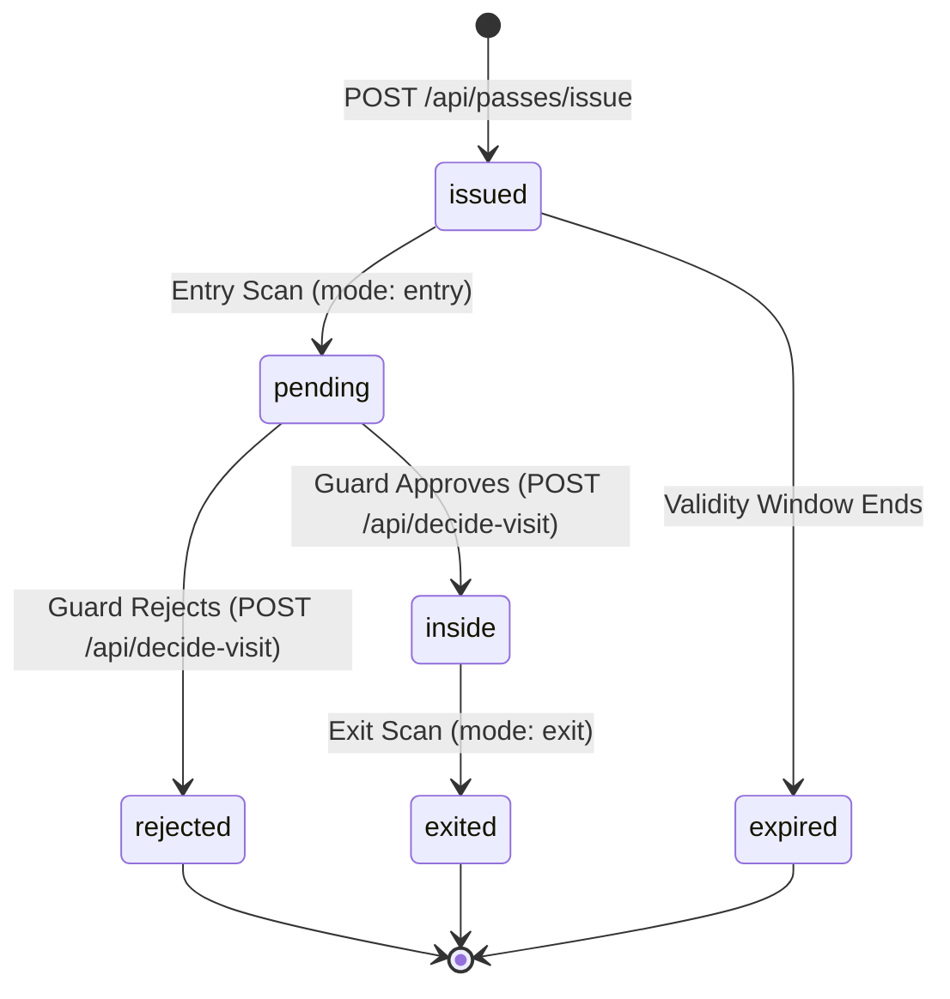

---

## 9. Evidence Ingestion & Upload Intent Architecture

To prevent arbitrary file storage injection, clients cannot upload directly without pre-authorized intents:

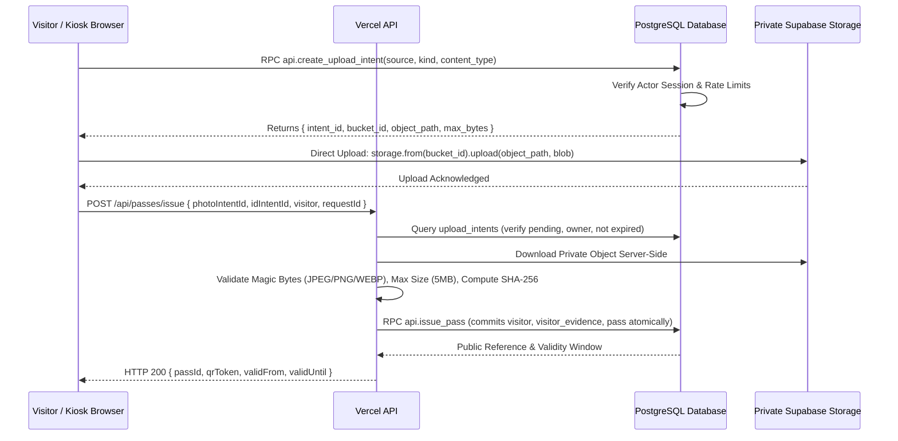

---

## 10. Evidence Retrieval & Viewing Security

Staff review visitor evidence strictly through an authenticated server proxy:

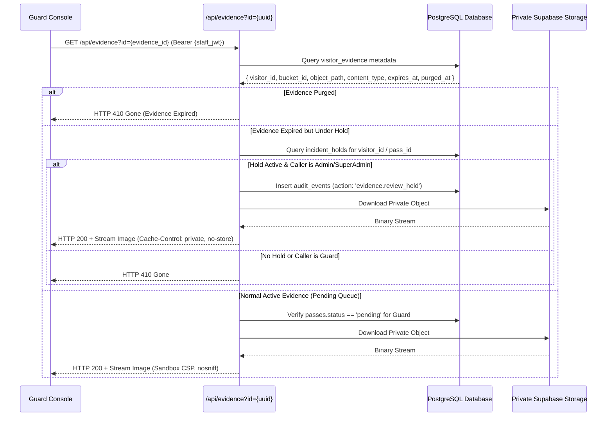

---

## 11. Transactional Email Security & Supply Chain

### 11.1 Supabase Auth Webhook Verification
Supabase Auth dispatches authentication events to `/api/auth/send-email-hook` using standard webhooks:
- Each incoming request is verified using the `standardwebhooks` protocol and `SEND_EMAIL_HOOK_SECRET`.
- Tampered headers, mismatched timestamps (> 5 min skew), or missing signatures are rejected with HTTP 401.

### 11.2 Email Build Supply Chain Architecture
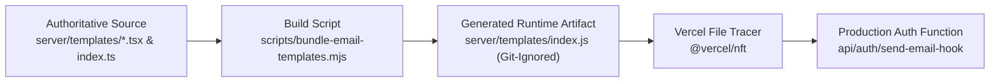

---

## 12. QR Pass Email Verification Challenge

Visitors requesting their QR pass via email must satisfy an anti-abuse challenge:

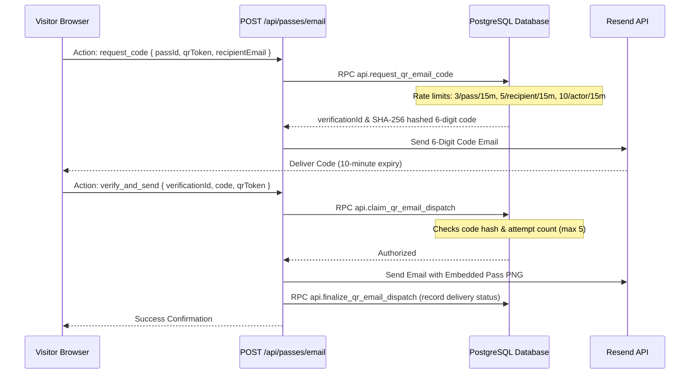

---

## 13. Cloudflare Turnstile Bot Protection & Abuse Controls

### 13.1 Generic Preview Isolation & Server Secret Boundary
To maintain cryptographic boundaries and prevent experimental or pull-request builds from querying production databases or sending live emails:
- **Server Privileged Secret Isolation**: All privileged server credentials (`SUPABASE_SECRET_KEY`, `PASS_TOKEN_SECRET`, `RATE_LIMIT_HMAC_SECRET`, `CRON_SECRET`, `RESEND_API_KEY`, `SEND_EMAIL_HOOK_SECRET`, `RESEND_WEBHOOK_SECRET`) are strictly restricted to the **Production** scope in Vercel. Generic Preview scopes receive ONLY public frontend configuration (`VITE_SUPABASE_URL`, `VITE_SUPABASE_PUBLISHABLE_KEY`, `SUPABASE_URL`).
- **Zero Production Fallback**: Server functions executing in Preview never receive production service-role or signing credentials.
- **SSO Deployment Protection**: Generic Preview deployments are protected by Vercel SSO deployment protection.

### 13.2 Turnstile Fail-Closed Enforcement Across Protected Surfaces
Cloudflare Turnstile is configured in Managed mode for authoritative bot protection:
- `VITE_TURNSTILE_SITE_KEY` is scoped to Production in Vercel.
- In Production, every protected human surface (**Visitor Portal**, **Staff Login**, **Forgot Password**) strictly fails closed: if the Turnstile site key is missing or the client omits a valid CAPTCHA response token, the action is blocked immediately at the client boundary with a security configuration error.
- In preview/local environments where `import.meta.env.PROD` is false, developer flow bypass is safely permitted.

### 13.3 Cryptographic Key Separation & Abuse Control Invariants
- Pass issuance rate limiting uses a dedicated, high-entropy server secret (`RATE_LIMIT_HMAC_SECRET`) with a minimum of 32 characters (256 bits of entropy).
- Cryptographic key separation is complete: the rate limiter NEVER falls back to `PASS_TOKEN_SECRET` or any other system secret. In Production, missing or undersized `RATE_LIMIT_HMAC_SECRET` immediately throws HTTP 503 `abuse_control_unavailable`.

### 13.4 Resend Delivery Webhook Observability & Atomic Idempotency
- Transactional email delivery outcomes are monitored via a dedicated Standard Webhooks receiver (`/api/webhooks/resend` rewritten to `/api/auth/resend-webhook`).
- Webhook payloads are verified cryptographically via Svix / Standard Webhook signatures against `RESEND_WEBHOOK_SECRET`. In Production, missing secrets fail closed with HTTP 503 `webhook_secret_unconfigured`.
- Replay and race protection is guaranteed at the database level via table `public.resend_webhook_events` (`provider_event_id UNIQUE`). Replays return HTTP 200 `already_processed` without duplicate audit logging.
- Recipient email addresses are masked (`v***r@...`) in `audit_events` to preserve privacy.
- **Neither webhook is an inbound email mailbox or reply processor.**

### 13.4 Supabase Free-Tier Security Advisor Review
Supabase Security Advisor reports `auth_leaked_password_protection` as disabled. This feature is restricted to paid Supabase tiers and is an accepted platform limitation on the current Free plan. In accordance with zero-cost architecture guidelines, password security is strictly enforced at the application boundary via mandatory 12+ character complexity, mixed-case, numbers, and symbols.

### 13.5 Content Security Policy (CSP) Directives Justification
The production CSP header enforces tight origins with explicit exemptions:
- `wasm-unsafe-eval`: Authoritatively required for client-side Tesseract.js WebAssembly OCR compilation in browser web workers.
- `style-src 'unsafe-inline'`: Required for dynamic toast notification styling (Sonner) and Radix UI dialog portal locking.
- `script-src 'unsafe-inline'`: Required for Cloudflare Turnstile explicit widget execution.

Cloudflare Turnstile protects public visitor registration, staff/device authentication, and password recovery from automated attacks:
- **Public Visitor Portal**: Non-intrusive challenge required before issuing an anonymous session.
- **Staff & Device Login (`/login`)**: Challenge verification token required for human staff credentials.
- **Password Recovery (`/forgot-password`)**: Challenge verification token required before issuing password reset emails.
- **Anonymous Pass Issuance Abuse Boundary**: Pass issuance is authoritative and concurrency-safe, rate limited by client bucket hex key via the `api.consume_rate_limit` database function on `public.rate_limit_buckets`. Idempotent replay of identical requests remains permitted.

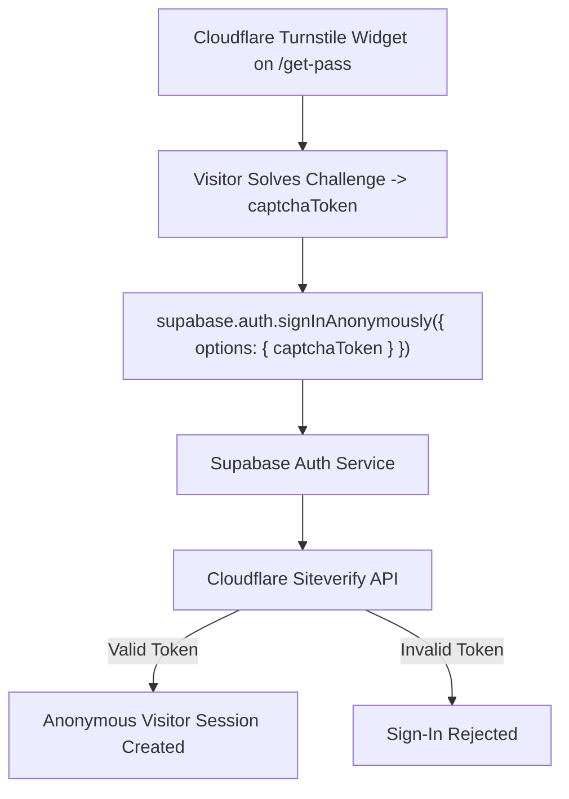

*Note: The Cloudflare Turnstile Secret Key is configured in the Supabase Dashboard under Authentication > CAPTCHA / Bot & Abuse Protection. Vercel server functions do not require `Turnstile server secret`.*

---

## 14. Incident Holds & Evidence Retention

Campus security investigations require evidence preservation beyond standard retention windows:

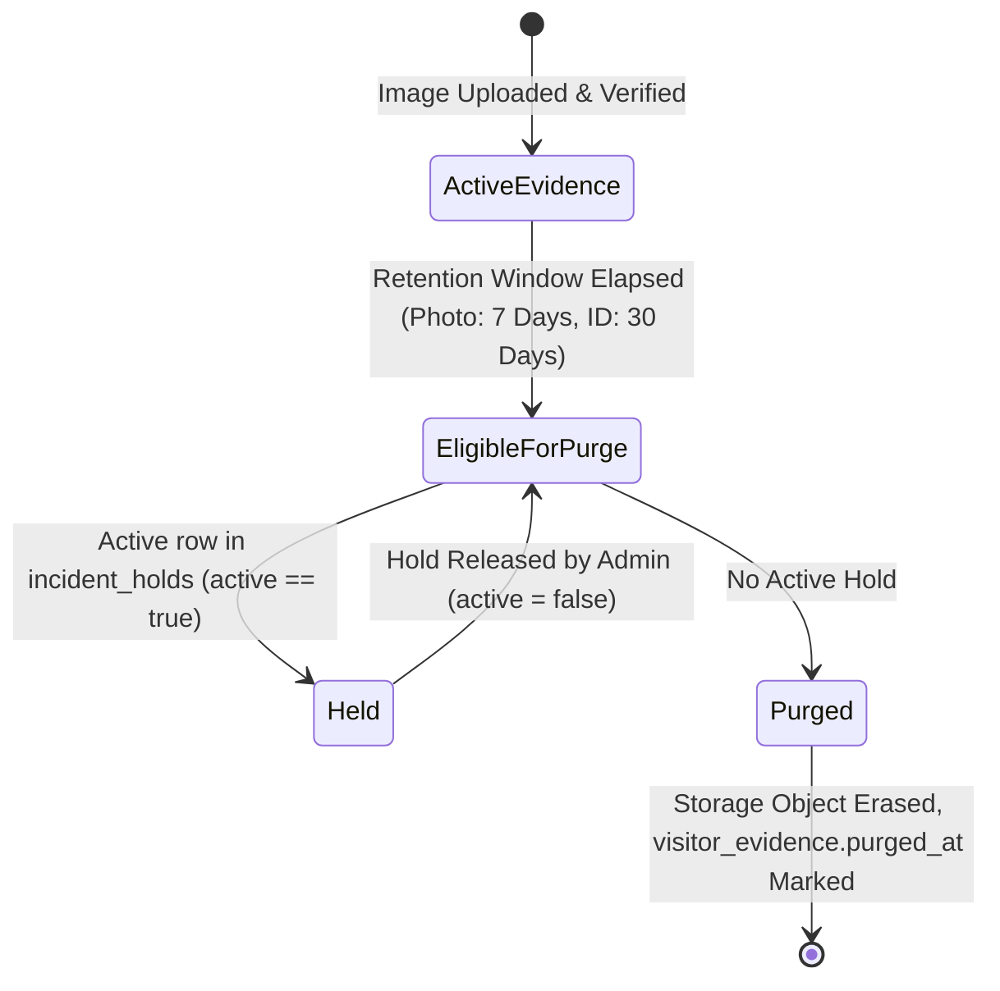

---

## 15. Cross-System Reconciliation

When an operation spans multiple systems (PostgreSQL, Storage, Resend) and encounters partial network failures:
1. The error does not abort without a record.
2. An entry is recorded in `public.reconciliation_tasks` with payload references and error details.
3. Super Admins review, retry, or acknowledge pending reconciliation items via `GET /api/reconciliation-items`.

---

## 16. Browser Security Headers (`vercel.json`)

| Security Header | Directive / Value | Purpose |
|---|---|---|
| **Content-Security-Policy** | Strict origin policy with script, frame, and connect constraints | Mitigates XSS, data exfiltration, and unauthorized frame embedding |
| **Strict-Transport-Security** | `max-age=31536000; includeSubDomains; preload` | Forces HTTPS and protects against SSL stripping |
| **X-Frame-Options** | `DENY` | Prevents clickjacking by blocking iframe rendering |
| **X-Content-Type-Options** | `nosniff` | Blocks MIME-type sniffing by browsers |
| **Referrer-Policy** | `strict-origin-when-cross-origin` | Limits referrer leakage to third-party domains |
| **Permissions-Policy** | `camera=(self), microphone=(), geolocation=()` | Restricts hardware API access to own origin |

---

## 17. Environment Secret Classification

### Browser-Safe Client Configuration (`VITE_*`)
- `VITE_SUPABASE_URL`: Public Supabase API endpoint.
- `VITE_SUPABASE_PUBLISHABLE_KEY`: Supabase publishable browser key (`sb_publishable_...`; intentionally public and governed by RLS).
- `VITE_TURNSTILE_SITE_KEY`: Public site key for Cloudflare Turnstile widget.

### Protected Server Secrets (Vercel Functions Only — Production Scope)
- `SUPABASE_SECRET_KEY`: Service-role key for backend operations; bypasses RLS.
- `PASS_TOKEN_SECRET`: Cryptographic secret (minimum 32 characters) for HMAC QR tokens.
- `RATE_LIMIT_HMAC_SECRET`: Dedicated cryptographic key (minimum 32 characters) for network rate-limiting HMAC.
- `CRON_SECRET`: Bearer authentication token for maintenance endpoints.
- `RESEND_API_KEY`: API key for transactional email delivery.
- `SEND_EMAIL_HOOK_SECRET`: Shared secret for Supabase Auth Send Email Hook verification.
- `RESEND_WEBHOOK_SECRET`: Shared secret for Resend Delivery Webhook verification.
- `RESEND_FROM_EMAIL`: Non-secret server configuration (`EARIST E-GatePass <notifications@egatepass.tech>`).

---

## 18. Threat Model & Mitigation Matrix

| Threat Scenario | Trust Boundary | Primary Mitigation Control | Enforcement Layer | Residual Risk |
|---|---|---|---|---|
| **Client Modifies User Role** | Untrusted Client | Roles stored in `staff_profiles`; client writes blocked | PostgreSQL RLS & Schema | Compromise of server service-role key |
| **Visitor Reads Other IDs** | Untrusted Client | Private Storage buckets; access proxy verifies role | `server/routes/gate/evidence.ts` | Stolen staff credentials |
| **Device Spoofs Device Type** | Managed Device | Hardware type bound to database `devices` row | Database device record | Physical compromise of scanner device |
| **Scanner Used at Wrong Gate** | Scanner Device | Scans checked against device gate assignment | Stored procedure `api.scan_pass` | Human error in gate assignment |
| **Stolen Token Digest** | Database Boundary | Raw token is HMAC-derived; only SHA-256 digest stored | PostgreSQL `passes.token_digest` | Weak secret or brute-force if secret leaked |
| **Replayed QR Bearer** | Gate Scanner | Pass transitions to `pending` upon first scan | Database atomic transaction | Scanning before original visitor arrives |
| **Concurrent Pass Issuance** | Visitor Registration | Idempotency key and unique token digest constraints | PostgreSQL unique constraints | Client timeout with unreturned token |
| **Forged Storage Path** | Storage Ingestion | Pre-authorized upload intents with random paths | RPC `api.create_upload_intent` | Abandoned upload intent before expiry |
| **Email Bombing / Spam** | External Integration | Tiered rate limits (pass, recipient, actor) | RPC `api.request_qr_email_code` | Distributed spam across multiple passes |
| **Forged Email Webhook** | Auth Hook Endpoint | Standard Webhook HMAC signature verification | `/api/auth/send-email-hook` | Leaked webhook secret |
| **Password Recovery Tampering** | Auth Workflow | Recovery session confined; blocked from admin/scanner | `getVerifiedSessionContext` | Attacker controls victim email inbox |
| **Accidental Last Admin Removal** | Staff Governance | Defensive check blocks demoting last Super Admin | Stored procedure & API route | Database manual override via SQL editor |
| **Evidence Deleted During Incident** | Retention Engine | Active `incident_holds` suspend automated purge | Stored procedures & cron handler | Failure of human officer to place hold |
| **Turnstile Challenge Bypass** | Public Registration | Challenge verified by Supabase Auth before session | Supabase Auth CAPTCHA | Sophisticated CAPTCHA solving farms |

---

## 19. Thermal Print Template Security Model

The thermal print template subsystem introduces a dynamic layout engine for physical ticket rendering. To prevent arbitrary code injection, cross-site scripting (XSS), or malicious image exfiltration:

### 19.1 Strict Allowlist Schema Enforcement
- **Client & Server Schema Validation**: All template JSON payloads are validated using the strict Zod schema `thermalTemplateLayoutSchema`.
- **Allowed Element Types**: Only explicit primitives are recognized: `institution_logo`, `institution_name`, `visitor_name`, `visit_date`, `qr_code`, `pass_reference`, `static_text`, `divider`, `rectangle`.
- **Rejection of Arbitrary Markup**: Any unexpected properties, script tags, HTML tags, or remote resource URLs (`http://`, `https://`) are strictly rejected.
- **Canvas Bounds**: Fixed at 384px width with bounded coordinates (`0 <= x <= 384`, `y >= 0`, `height <= 1200`). Coordinate overflow or oversized dimensions trigger immediate schema rejection.

### 19.2 Role Authorization
- **Super Admin Exclusive**: Only authenticated sessions with `staff_profiles.role = 'superadmin'` are authorized to call `api.save_thermal_template_draft` and `api.publish_thermal_template`.
- **Tamper Resistance**: Mandatory elements (`institution_name`, `visitor_name`, `visit_date`, `qr_code`, `pass_reference`) cannot be removed from a published template.

---

## 20. Guard Offline Operations & Device Storage Threat Model

During connectivity outages, operational access authority delegates to the Guard tablet. This section defines the localized storage threat model, retention invariants, and synchronization security controls:

### 20.1 Client Storage Threat Model & Honest Boundaries
- **Storage Technology**: Browser IndexedDB (`egatepass_guard_offline`).
- **Storage Boundary**: Data is isolated by browser Same-Origin Policy (`https://egatepass.tech`) and protected by the physical device screen lock.
- **Honest Security Boundary**: Browser IndexedDB is **NOT** a tamper-proof hardware security module (HSM) or hardware-backed TPM. Physical extraction from an unlocked device or rooted OS is possible.
- **Zero Server Secrets**: No server service-role keys, database passwords, or signing secrets are EVER written to browser local storage, IndexedDB, or client cookies.

### 20.2 Operational Cache Scoping, Actor Isolation & Evidence Stripping
- **Minimal Operational Footprint**: The tablet only caches operationally relevant passes: today's date in `Asia/Manila` in `issued`, `pending`, or `inside` status. Historical passes are excluded.
- **IndexedDB v2 & Strict Actor-Binding Contract**: IndexedDB store (`egatepass_guard_offline`) enforces mandatory `actorId` attributes across `cached_visitors`, `offline_registrations`, and `offline_events`.
- **Fail-Closed Unattributed Record Rejection**: Any legacy or malformed record lacking an authenticating `actorId` is strictly excluded by fail-closed queries (`r.actorId === actorId`) and will NEVER be assigned, read, or executed during sync.
- **Cross-Guard Data Privacy & Identity-Switch Purge**: When switching guards (`transitionGuardOfflineStore(nextActorId)`), if a previous guard was active (`lastActorId` differs from `nextActorId`), all sensitive local stores (`cached_visitors`, `offline_registrations`, `offline_events`, and `meta`) are immediately purged from IndexedDB so Guard B starts with a clean slate and zero remnant biometric or operational data from Guard A.
- **Strictly Blocked Clean Logout with Pending Records**: To prevent evidence loss and audit attribution failure, Guard clean logout is strictly blocked whenever `getPendingSyncCount(actorId) > 0`. Guards must restore network connectivity and synchronize outbox records before signing out.
- **Centralized Failure Classification & Local Evidence Retention**:
  - `classifyOfflineRegistrationSyncFailure` centralizes all sync response and network error triage:
    - `transient_or_internal`: Network timeouts, HTTP 5xx errors, 503 authority outages, unexpected 400 responses, and unknown 422 validation errors leave the offline registration in `pending` status with full local biometric Blobs (`photoBlob`, `idBlob`) and upload intent checkpoints intact for automatic retry.
    - `recoverable_evidence`: Specific 422 metadata/evidence errors clear stale upload checkpoints while preserving binary Blobs for immediate re-upload.
    - `authoritative_conflict`: Only explicit server HTTP 409 conflict responses (`status === 409`) mark the registration as terminal `conflict` and strip local binary evidence blobs (`photoBlob`, `idBlob`) while preserving relational audit metadata for supervisor reconciliation.
  - Daily automatic purge clears previous calendar days' cached visitor records.
  - Absolute Retention Ceiling: Enforcing the institutional 7-day evidence retention policy, any offline registration older than 7 days that fails to synchronize is treated as expired/conflicted and purged of sensitive binary evidence blobs.

### 20.3 Server-Only Synchronization Trust Boundary & Conflict Defense
- **Rebuilt Offline Registration Trust Boundary**: Direct browser execution of `api.guard_sync_offline_registration` is revoked. The RPC is granted strictly to `service_role`.
- **Trusted Server Route (`POST /api/sync-offline-registration`)**:
  - Verifies authenticated Guard bearer token and resolves the guard's staff profile.
  - Performs server-side byte inspection, MIME type validation (WebP magic bytes `RIFF`...`WEBP`), and SHA-256 verification of uploaded photo and ID blobs.
  - Invokes `api.guard_sync_offline_registration` as `service_role` passing verified `requested_actor_id`.
- **Database Defense-in-Depth Authorization**:
  - The database RPC validates that `requested_actor_id` corresponds to an active guard or superadmin in `staff_profiles`.
  - Validates that associated `upload_intents` records exist, are active, belong to `guard_offline`, and are owned by `requested_actor_id`.
  - Evidence retention adheres to institutional configuration (`photo_retention_days` and `id_retention_days` from `app_settings`, defaulting to 7 and 30 days) with Manila calendar day visit window matching `api.issue_pass`.
- **Thermal Template Least Privilege**: The thermal receipt template RPC `api.get_published_thermal_template()` is restricted strictly to `service_role`; direct browser RPC access is revoked.

---

## 21. Institutional Upgrades Security Contracts

### 21.1 Safe Staff Permanent Decommissioning Security Invariants
- **Zero Row Deletion & Attribution Preservation**: Under `staff_profiles.user_id -> auth.users.id ON DELETE RESTRICT`, hard deletion would break historical audit events and attribution. Decommissioning permanently updates `decommissioned_at = now()`, `decommissioned_by`, `decommission_reason`, and forces `active = false` without removing the relational record.
- **Super Admin Re-Authentication**: Destructive permanent decommissioning requires the acting Super Admin's current password. Verification executes on an isolated Supabase Auth client and terminates immediately with `signOut({ scope: 'local' })` to guarantee the Super Admin's primary browser session remains intact.
- **Auth Identity Suspension**: The Auth identity is suspended with an 876,000-hour ban (`banned_until`), disabling credential login. If Supabase Auth synchronization fails, the database change commits and an administrative reconciliation item is registered (`reconciliationRequired: true`) rather than rolling back truthful database status.

### 21.2 Report Export Data Hygiene & Secret Exclusion
Export pipelines generating CSV, XLSX, and PDF files enforce absolute exclusion of sensitive secrets and storage internals:
- Raw QR tokens (`qrToken`) and cryptographic digests (`tokenDigest`) are strictly excluded.
- Private Storage object paths (`photoPublicId`, `idImagePublicId`) and temporary signed URLs are strictly excluded.
- Passwords, email verification codes, API keys, and internal session identifiers are strictly excluded.
- Dynamic modules (`exceljs`, `jspdf`, `jspdf-autotable`) are loaded only on demand at click time to prevent client bundle inflation.

### 21.3 Canonical SVG Pass Artifact Injection Defense
The shared pure SVG template generator (`src/lib/digitalPassArtifact.ts`) uses strict XML escaping on all dynamic visitor-provided fields:
- Visitor Name, Purpose, Pass Reference, Visit Date, and Validity Window are sanitized through `escapeXml(...)` before interpolation into SVG markup.
- Prevents SVG injection, attribute breakout, and script execution across browser DOM, Canvas rasterization, and server `sharp` rendering pipelines.
- Raw QR token is never rendered as SVG text (the QR image contains only the opaque token).

### 21.4 Guard Authoritative Search RPC Authorization
- `api.guard_search_pending_queue` is protected with `REVOKE ALL FROM PUBLIC`, `REVOKE ALL FROM ANON`, and `GRANT EXECUTE TO authenticated`.
- Executed with `SECURITY DEFINER` and `SET search_path = ''`.
- Hard role enforcement inside function body verifies caller is active `guard`, `admin`, or `superadmin`.
- Query validation bounds input between 2 and 100 characters, bounds limit between 1 and 100, and returns only passes with status `pending`. No QR tokens, digests, or storage credentials are included in projections.

---

## 22. Online Pre-Registration Biometric Verification & Privacy Minimization (Migrations 38 & 39)

### 22.1 Zero Biometric Persistence Guarantee
- **Model Execution in RAM**: 1:1 biometric comparison executes on the server via OpenCV Zoo models (`YuNet` face detection + `SFace` feature extraction) using ONNX Runtime.
- **Ephemeral Embeddings**: 128-dimensional L2-normalized feature vectors, 5-point facial landmark coordinates, bounding boxes, and cropped face tensors are generated in transient memory buffers and destroyed immediately upon request completion.
- **Strict Storage Minimization**: Zero biometric embeddings, templates, or facial measurements are persisted to PostgreSQL tables, Redis caches, or Cloud Object Storage. The relational database only stores audit metadata in `portal_identity_verification_attempts` (`outcome`, `model_name`, `model_version`, `verified_at`, and `expires_at`).

### 22.2 Identity Verification Boundary & Rate Limiting
- **Anti-Tampering Correlation**: `/api/passes/verify-identity` validates that `photoIntentId` and `idIntentId` belong to the caller's active anonymous Supabase session and match the transaction's `requestId`.
- **Server-Side Facial Comparison**: Verification executes a server-validated face comparison between the captured visitor image and the face detected in the submitted ID document, recording the result in `public.portal_identity_verification_attempts`. It does NOT claim government-ID authenticity, certified liveness, or verified name, date-of-birth, or contact matching (the request schema does not persist verified identity document attributes).
- **Sliding-Window Rate Limits**: Biometric comparison requests are rate-limited per session actor and client network identifier.
- **Strict Server Authority & Bounded Validity**: Pass issuance via `POST /api/passes/issue` enforces that an unexpired `matched` record exists in `portal_identity_verification_attempts` before executing `api.issue_pass`. Expiry cannot outlive either evidence intent (`min(photoIntent.expires_at, idIntent.expires_at, now + 30m)`). Upload retention holds (`held_until`) are a separate mechanism and do not extend verification validity.

### 22.3 Same-Gate Confinement for Guard Station Devices
- Dedicated hardware devices (`device_type = 'guard_station'`) monitor campus entrance gates.
- **Gate-Scoped Projections**: `/api/guard-station-feed` only returns visit records and scans originating at the device's assigned gate for portal visitors (`source = 'portal'`).
- **Evidence Access Scoping**: `/api/evidence` strictly restricts `guard_station` devices to visitor registration photos (`photo`) for visits scanned at that station's gate. Access to government ID cards (`id`) is denied to guard station devices.

### 22.4 Legacy Guard Role Deprecation (`legacy_guard_role_disabled`)
- To prevent manual approval bypasses on automated online visitor entries, personal guard staff accounts are disabled for operational sign-in with HTTP 403 `legacy_guard_role_disabled`.
- Walk-in kiosk manual approvals are restricted to Administrative actors (`/admin/legacy-guard`).

## 23. Post-Redesign Contract Closure & Fail-Closed Gate Invariants (Migration 40)

### 23.1 Canonical Database Schema as Single Source of Truth
- Migration 39 / 40 table `portal_identity_verification_attempts` is the authoritative contract: `(owner_id, request_id, photo_intent_id, id_intent_id, outcome, model_name, model_version, verified_at, expires_at)`.
- All routes write and read directly against this canonical schema. No invented legacy columns (`actor_id`, `status`, `matched`, `score`) are used or persisted.

### 23.2 Fail-Closed Wrong-Gate Exit Invariant
- In `api.scan_pass`, exit scanning requires `target.gate is not distinct from scanner.gate`.
- If an exit scan occurs at a mismatched gate, pass status remains `inside`, no `time_out` is recorded, result returns `wrong_gate`, and canonical `invalid_scan` event is logged.

### 23.3 Strict Canonical Visit Event Logging
- In `api.scan_pass`, every scan writes exclusively canonical `visit_event_type` enums: `scan_entry` (successful entry), `scan_exit` (successful exit), or `invalid_scan` (wrong gate, expired, unknown QR).
- Decommissioned / non-existent enum values (`scan_failed`, `exit`) are eliminated.

### 23.4 Total Operational Guard Deprecation
- `api.decide_visit` authorizes strictly `admin` and `superadmin` roles; legacy human `guard` calls are rejected with 42501 `active administrator required`.
- `api.create_staff_profile` and `api.update_staff_profile` reject `guard` role assignments with `legacy_guard_role_disabled`.
- UI `/guard` route is restricted to `guard_station` devices and administrators.

### 23.5 Biometric Capture Integrity & Trusted Preflight
- **Unmirrored Captured Evidence**: Front-facing webcam preview is visually mirrored for user convenience, but captured biometric blobs are strictly non-mirrored (`allowCaptureMirroring: false`, `faceWebcam.capture({ mirror: false })`).
- **Trusted Server Face Preflight**: Live face photo undergoes server-side presence and geometry preflight via YuNet (`mode: 'preflight_face'`) before the visitor can advance to the Valid ID step.
- **High-Resolution ID Normalization**: `normalizeIdentityDocumentImage` standardizes identity document images to long edge ~2000px (max 2400px) at WebP quality 0.92 without upscaling, replacing the generic 1024px @ 0.8 compressor.
- **OCR ID Direct Reuse**: Documents uploaded during optional OCR are normalized and saved for identity verification without prompting the visitor for a second upload.
- **Exact-Pinned Model Runtime**: `onnxruntime-node: 1.31.1` is exact-pinned, with model provenance, licenses (MIT for YuNet, Apache-2.0 for SFace), and SHA-256 hashes documented in `server/models/README.md`.

## 24. Portal Actor Continuity & Hardware Guard Station Device Security (Migrations 40–42)

### 24.1 Portal Actor Continuity & Operator Token Isolation
- **Storage Key Isolation**: Public pre-registration portal requests execute strictly against `requirePortalSupabase()` configured with `storageKey: 'egatepass-portal-auth'`. Operator and administrative sessions execute against `requireSupabase()` with `storageKey: 'egatepass-operator-auth'`. This separation eliminates token collision or leakage on shared or operator devices.
- **Anonymous Visitor Assertion**: Every portal issuance transaction validates that `session.user.is_anonymous === true` and matches `transaction.actorId`. Transactions with non-anonymous sessions or mismatched identities are rejected with `portal_actor_not_anonymous` or `portal_session_mismatch`.
- **Bearer Token Verification**: Evidence upload intents (`api.create_upload_intent(requested_source => 'portal')`), face preflight checks, and identity comparisons require a valid anonymous visitor token in the `Authorization: Bearer <token>` header.

### 24.2 Guard Station Hardware Devices & Legacy Role Decommissioning
- **Hardware Device Authority**: Live gate monitoring is performed strictly by hardware devices provisioned in the `devices` table with `device_type = 'guard_station'`.
- **Legacy Guard Decommissioning**: Personal human guard accounts (`role = 'guard'`) have been decommissioned. Attempts to authenticate with a guard account are rejected and immediately signed out.
- **Strict Administrator Role Boundary**: System user creation (`server/routes/system/create-user.ts`) schema enforces `role: z.literal('admin')` and requires superadmin caller privileges.
- **Legacy Admin Walk-in Compatibility**: Administrators and superadmins retain the authority to issue `guard_offline` upload intents and execute emergency offline registrations. Ordinary guards are rejected with SQLSTATE 42501 `administrator required`.

---

## 25. 1:1 Returning Visitor Biometric Verification, PSGC Address Invariants & Advisor Hardening (Migrations 50 & 51)

### 25.1 Returning Visitor 1:1 Biometric Verification Architecture
- **Frontdoor Discovery Without Plaintext PII Leakage (`/api/passes/lookup-returning`)**:
  - Unauthenticated attackers cannot enumerate visitor records. Lookup requires an active Supabase Auth anonymous session and is governed by dual token-bucket rate limits:
    - **Actor limit**: 10 lookup attempts per 5 minutes per anonymous session (`portal.lookup_returning`).
    - **Network limit**: 30 lookup attempts per 5 minutes per client network IP/subnet (`portal.network_lookup`).
  - Search results return privacy-masked candidate records only:
    - `maskedName`: Initial and truncated asterisks (e.g., `Juan D. C***`). Full middle and last names are never returned.
    - `maskedContact`: Truncated Philippine mobile number (e.g., `0917***1234`).
    - `partialLocality`: Barangay and City/Municipality names only. Specific building, street, or house numbers are excluded from discovery.
- **Strict 1:1 Biometric Matching (`/api/passes/identify-returning`)**:
  - Full retirement of 1:N gallery matching and arbitrary 1st-to-2nd candidate margin checks (`RETURNING_FACE_MIN_MARGIN`).
  - Visitor captures a fresh live selfie. No government ID re-upload is required or permitted for returning visitors.
  - The server decrypts the selected profile's enrolled face template from `returning_face_templates` using AES-256-GCM. Decryption failures fail closed with HTTP 500 `biometric_decryption_failed`.
  - Performs 1:1 cosine similarity comparison against the fresh selfie descriptor using calibrated threshold `RETURNING_FACE_MIN_COSINE` (0.45).
  - Cosine score `< 0.45` fails closed with HTTP 200 `{ matched: false, reason: "low_similarity" }` and records an audit attempt with outcome `low_similarity`.
  - Successful comparison issues a single-use, cryptographically signed `matchToken` (HMAC-SHA256) bound to `actorId`, `requestId`, `profileId`, and `photoIntentId` with 15-minute expiration.
- **Pass Issuance Token Binding (`/api/passes/issue`)**:
  - When `registrationMode === 'returning'`, pass issuance requires both `profileId` and `matchToken`.
  - The server verifies that the token matches the stored HMAC digest in `returning_identity_attempts`, matches the active actor session, has not expired, and has not been previously consumed.

### 25.2 Philippine Standard Geographic Code (PSGC) Structured Address Invariants
- **Zero Fallback & Elimination of Silent Substitution**:
  - Pass issuance rejects new portal registrations without complete PSGC address components (`psgc_region_code`, `psgc_city_code`, `psgc_barangay_code`) with HTTP 422 `psgc_address_required`.
  - Silent default fallback to Manila / EARIST Barangay 408 is eliminated.
  - Legacy Leaflet map coordinates, Nominatim reverse geocoding, and browser GPS prompts are retired from online registration.
- **Symmetric Idempotency Replay**:
  - Replay requests on `/api/passes/issue` compare all incoming PSGC fields (`psgc_region_code`, `psgc_province_code`, `psgc_city_code`, `psgc_barangay_code`, `home_building`, `home_street`, `postal_code`) against the stored `visitors` record.
  - Any discrepancy in address or vehicle declaration returns HTTP 409 `payload_mismatch`.

### 25.3 Migration 51 Database Hardening & Performance Advisor
- **Covering Indexes on Foreign Keys**:
  - Supabase Database Advisor unindexed foreign key warnings resolved by adding covering indexes across `staff_profiles`, `devices`, `app_settings`, `visitors`, `audit_events`, `thermal_templates`, `offline_sync_receipts`, `portal_identity_verification_attempts`, `visit_vehicle_declarations`, and `returning_identity_attempts`.
  - Eliminates full-table share locks on parent updates/deletions.
- **Functional Lookup Indexes**:
  - Added expression index `returning_visitor_profiles (lower(first_name), lower(last_name)) where revoked_at is null` to accelerate 1:1 name lookups without sequential table scans.
  - Added covering index `returning_visitor_profiles (contact_number_e164) where revoked_at is null`.
- **Default-Deny RLS Reinforcement**:
  - Internal utility tables `public.nominatim_rate_limiter` and `public.location_search_cache` have RLS enabled with default-deny policies, revoking all permissions from `public`, `anon`, and `authenticated`, with access granted strictly to `service_role`.

## 26. Returning Visitor Production Readiness, 1:1 Calibration & Postal Address Governance

### 26.1 Returning Visitor Calibration & Cryptographic Readiness Gate
- **Safe Capability Introspection (`/api/passes/capabilities`)**:
  - Returns safe diagnostic booleans (`returningVisitorAvailable`, `facialRecognitionConfigured`, `returningCryptoConfigured`, `returningCalibrationConfigured`).
  - Strict secret isolation: never exposes raw encryption keys, HMAC secrets, or numeric cosine thresholds to client browsers.
  - Fail-closed security rule: If `RETURNING_FACE_MIN_COSINE`, `RETURNING_VISITOR_TEMPLATE_KEY`, or `RETURNING_MATCH_TOKEN_SECRET` is unset or fails length checks, `returningVisitorAvailable` reports `false` and the safety gate modal blocks returning visitor entry.
- **Pairwise 1:1 Biometric Calibration (`scripts/calibrate-returning-face.mjs`)**:
  - Implements genuine vs impostor 1:1 pairwise cosine similarity distributions.
  - Prevents arbitrary, unvalidated biometric thresholds from being deployed to production without empirical evidence.
  - Test manifests and calibration image vectors are strictly gitignored (`*.manifest.json`, `calibration/`).

### 26.2 Postal Code Resolution & Manila Barangay 856 Multi-Code Handling
- **PHLPost Locality Resolution Architecture**:
  - `resolvePostalCode(cityCode, barangayCode)` classifies resolution outcomes into:
    - `exact_barangay`: Verified 1:1 barangay mapping (e.g. Barangay 408 -> 1008). Auto-filled.
    - `unique_city`: Single postal code across all barangays in municipality (e.g. Mandaluyong -> 1550). Auto-filled.
    - `multi_code_city`: Multiple postal delivery zones across the city without an authoritative barangay-level publication (e.g. City of Manila, Barangay 856). Prompts user entry/confirmation.
    - `unmapped`: Locality absent from postal reference tables. Prompts manual entry.
    - `service_unavailable`: Database reference table connection failure. Informs user and gracefully permits manual entry without blocking registration.
  - Institutional Light Design System Integrity: Full contrast compliance across all address selection and confirmation dialogs using institutional maroon (`#7A0A0A`), gold accent (`#F2C94C`), dark text (`#172033`), and white surfaces (`#FFFFFF`).

## 27. Provisional Biometric Threshold Governance & Decoupled Enrollment Security

### 27.1 Provisional SFace Threshold Governance
- **Provisional Reference vs Campus Calibration**:
  - The threshold `0.363` (`RETURNING_FACE_MIN_COSINE=0.363`) is derived from OpenCV Zoo's published baseline for SFace 2021dec on LFW/CASIA-WebFace.
  - It is labeled strictly as `provisional` (`RETURNING_FACE_THRESHOLD_MODE=provisional`).
  - It is NOT an empirically calibrated EARIST campus threshold. Campus calibration on real EARIST turnstile hardware with physical test subjects across daylight, artificial, and nocturnal lighting remains required before institutional production reliance.
- **Physical Guard Verification Retained**:
  - Biometric 1:1 match alone DOES NOT authorize campus entry.
  - Guards on duty at physical gate stations perform mandatory visual face-to-photo verification against the digital pass displayed on the Guard terminal.
  - Pass QR validity, business-hour enforcement, and single-entry/exit rules remain strictly active.

### 27.2 Decoupled Enrollment Security Boundaries
- **Transparent Institutional Retention**:
  - Registration records and historical reference portraits/IDs are retained according to the institution's configured data retention policies.
- **Safe Template Key Management**:
  - Face templates are encrypted with AES-256-GCM using `RETURNING_VISITOR_TEMPLATE_KEY` (32 bytes / 64 hex characters).
  - Enrollment requires ONLY the template key and does not depend on verification threshold or match token secret readiness.
  - Decryption occurs transiently in RAM during 1:1 verification; raw embeddings and decrypted vectors are never persisted or returned to the browser.
- **Match Token Cryptographic Defense**:
  - Upon successful 1:1 verification, server issues a short-lived opaque `matchToken` (300 seconds / 5 minutes TTL).
  - Database stores only `match_token_digest` (SHA-256 of `${matchToken}:${RETURNING_MATCH_TOKEN_SECRET}`).
  - Five-minute expiration and request binding prevent token replay, cross-actor replay, and profile impersonation.

### 27.3 Ephemeral Selfie Handling & Memory Cleanup Boundaries
- **Zero Durable Storage of Returning Selfies**:
  - A returning visitor's fresh selfie is processed via transient in-memory multipart payload directly at `/api/passes/identify-returning`.
  - It is NEVER uploaded to Supabase Storage, never written to `visitor_evidence`, never creates an upload intent, and never enrolls a new face template.
  - The historical registration portrait and ID image remain the sole reference evidence under the configured institutional retention policy.
- **Best-Effort In-Memory Clearing**:
  - Processing buffers for live selfies undergo best-effort clearing in server route `finally` blocks (`selfieBuffer.fill(0)`).
  - Note: V8 garbage collection and Node.js runtime memory management cannot guarantee immediate hardware-level RAM zeroing; documentation honestly reports this as best-effort in-memory clearing rather than guaranteed cryptographically secure memory erasure.

### 27.4 V3 Actor-Bound Preview Token & Authenticated Image Loading
- **Actor-Bound V3 Token Format**:
  - Preview tokens use the format `v3.<profileId>.<actorId>.<kind>.<expiresAt>.<nonce>.<sig>` with an explicit 300-second (5-minute) TTL signed with `RETURNING_MATCH_TOKEN_SECRET`.
  - Preview tokens are cryptographically bound to the authenticated actor ID (`actorId`). Calling the preview endpoint from a different session or without Bearer authentication fails with 401/403 `actor_mismatch`.
  - Candidate selection tokens are strictly bound to `kind=photo`. Calling the preview endpoint with `kind=id` using a photo token is rejected with 403 `forbidden_evidence_kind`.
- **Authenticated Image Loading & Memory Revocation**:
  - Image rendering in the browser uses `AuthenticatedImage.tsx`, which fetches image binary data via `Authorization: Bearer <sessionToken>`, creates an ephemeral `blob:` Object URL, and immediately revokes it upon component unmount (`URL.revokeObjectURL`).
  - Emits `Cache-Control: private, no-store, max-age=0` and `X-Content-Type-Options: nosniff` on all preview endpoints.
- **Atomic Single-Use Consumption for Historical ID Preview**:
  - Access to a returning visitor's historical ID image requires a valid calibrated biometric match attempt (`threshold_mode === 'calibrated'`).
  - ID preview authorization is consumed atomically via database RPC `api.consume_id_preview_authorization_v1`. Replay attempts fail immediately with 403 `id_authorization_already_consumed`.
  - In provisional mode (`RETURNING_FACE_THRESHOLD_MODE=provisional`), ID preview is strictly prohibited (403 `provisional_mode_cannot_authorize_id_access`) and historical ID URLs are never returned.

### 27.5 Profile Linkage Isolation & "Continue as New Visitor" Boundaries
- **Independent Identity on New Visitor Choice**:
  - When a visitor selects "Continue as New Visitor", `api.issue_online_pass_v6` creates an independent identity record without searching for or linking to any existing returning profile, even if first name, last name, and contact number match.
- **Strict Conditional Profile Updates (`saveUpdates`)**:
  - The `saveUpdates` decision is passed into `api.issue_online_pass_v6` as `requested_save_profile_updates`.
  - When `saveUpdates=false`, stored contact number and residential address in `returning_visitor_profiles` remain unchanged.
  - When `saveUpdates=true`, only validated contact numbers and PSGC-verified residential addresses are updated.

### 27.6 Cryptographic Calibration Verification (Ed25519 Authority)
- To advance from `provisional` mode to `calibrated` mode, the runtime strictly requires an authentic digital signature verified by `server/lib/calibration-verifier.ts`:
  1. **Ed25519 Signature**: Verified against pinned public authority key `PINNED_CALIBRATION_PUBLIC_KEY`.
  2. **Authority Identity**: Must be issued by `EARIST_BIOMETRICS_CALIBRATION_AUTHORITY`.
  3. **Model & Engine Binding**: Target model must match `yunet_sface` and inference engine must match `onnxruntime-node`.
  4. **Strict Schema (1.0.0)**: Contains dataset size, FAR/FRR distributions, issued and expiry timestamps.
  5. **Revocation Tracking**: Active version is checked against `revokedVersions`.
- In the absence of a verified artifact, explicit calibrated mode fails closed (503 `calibration_unavailable` or safe fallback). Production remains in provisional mode (`0.363`), requiring physical guard verification at the gate.

## 28. Cloudflare Turnstile CAPTCHA & Abuse Defense Architecture

- **Primary Defense (Supabase Auth Boundary)**:
  - Anonymous visitor sign-in is gated behind Cloudflare Turnstile Bot Protection in Supabase Auth.
  - The private Turnstile Secret Key is configured securely in the Supabase Dashboard under **Authentication > Bot Protection / CAPTCHA**.
  - `client.auth.signInAnonymously({ options: { captchaToken } })` verifies the Turnstile challenge before issuing an anonymous JWT.
- **Secondary Defense (Server Siteverify & Anti-Replay)**:
  - If the server-side Turnstile verification secret is present in serverless environment variables, `server/lib/turnstile.ts` validates challenge tokens on returning visitor searches (`/api/passes/lookup-returning`).
  - Employs an in-memory SHA-256 token replay cache (300-second TTL) to block duplicate or replayed tokens.
  - Enforces permitted hostname validation (`egatepass.tech`, `localhost`, etc.) to prevent domain token stealing.
  - Enforces bounded HTTP timeouts (5000ms via `AbortController`) and fails closed on provider outages.

## 29. Office Visit Management Security, Token Cryptography & Safety Guarantees

### 29.1 Pre-Approval Boundary & Zero Pre-Issuance Guarantee
- **Strict Invariant**: Specific-person visit requests submit to `public.office_visits` in `pending` approval status.
- **Zero Pass Generation Prior to Approval**: The database RPC `api.create_specific_person_visit_request` explicitly leaves `pass_id` and `qr_token` as null. No row is inserted into `public.passes`, no cryptographic pass token is synthesized, and no entry QR code is displayed to the visitor.
- **Approval-Bound Pass Creation**: Only an authorized staff member executing `api.decide_office_visit` with `requested_decision = 'approved'` invokes pass issuance. The pass reference, bearer token, and expiration timestamp are generated atomically and dispatched via encrypted TLS email.

### 29.2 Cryptographic Email Ownership Verification (HMAC-SHA256)
- Specific-person visits require pre-submission proof of email ownership to guarantee that approved passes reach the verified recipient.
- An ephemeral 6-digit challenge code is emailed to the visitor and verified against `public.office_visit_email_verifications`. Challenges are strictly actor-bound: queries require `actor_id = session.user.id` and normalized email, bounded to 5 attempts, preventing cross-session challenge hijacking.
- Successful verification generates a time-bounded cryptographic token:
  `v_email.<b64urlEmail>.<actorId>.<expiresAt>.<sig>`
  signed exclusively with the dedicated `OFFICE_VISIT_HMAC_SECRET` (minimum 32 characters, failing closed on boot without fallback).
- The request handler (`POST /api/request-office-visit`) recomputes the HMAC digest, checks expiration (1-hour TTL), and verifies exact equality against the current authenticated visitor session (`actorId`).

### 29.3 Office Staff Role & Scope Isolation (`office_staff`)
- Staff accounts with `role = 'office_staff'` are linked to one or more registered offices via `public.office_staff_assignments`.
- `requireOfficeStaffActor` strictly enforces that office staff can only query visits (`/api/office/visits`) and decide requests (`/api/office/decide`) belonging to their assigned offices (`assignedOfficeIds`).
- Any attempt to access or modify records of an unassigned office is immediately terminated with HTTP 403 `unauthorized_for_this_office`.
- System administrators (`admin`, `superadmin`) retain institutional oversight across all campus offices.

### 29.4 Ephemeral Visitor Portrait Preview Tokens
- Office staff reviewing incoming requests inspect visitor portraits without exposing permanent storage bucket URLs or disclosing direct Supabase Storage service keys.
- The server generates short-lived, actor-bound portrait preview tokens:
  `office_p.<visitId>.<actorId>.<expiresAt>.<sig>`
  with an explicit 600-second (10-minute) TTL, signed strictly with `OFFICE_VISIT_HMAC_SECRET`.
- The preview proxy endpoint (`GET /api/office/portrait-preview`) verifies caller identity, enforces staff assignment via `requireOfficeStaffActor`, checks signature validity with `timingSafeEqual`, fetches the private photo from storage, and streams the binary image with `Cache-Control: private, no-store`.

### 29.5 Campus Egress Safety & Attendance Integrity
- When a visitor departs campus through the exit gate without completing office arrival confirmation, physical exit is **never blocked or delayed**.
- The scanner RPC `api.scan_pass` updates pass status to `exited`, marks `attendance_status = 'exited_unconfirmed'`, returns `code: 'office_unconfirmed'`, and logs an `unconfirmed_exit` event in `public.office_visit_events`.
- Gate security guards receive an immediate amber visual banner and distinct warning audio feedback (two triangle pulses at 587Hz / 440Hz), preserving physical safety while maintaining an uncompromised attendance audit trail.

### 29.6 Visitor Identity & Record Ownership Invariant
- **Strict Invariant**: The approving office staff member NEVER becomes the owner of the visitor record (`public.visitors.owner_id`).
- When a visitor submits a specific-person visit request, their anonymous visitor UUID is captured and immutably stored in `public.office_visits.visitor_actor_id`.
- Upon staff approval in `api.decide_office_visit`, the canonical visitor entity is created with `owner_id = target_visit.visitor_actor_id`. The approving staff member is recorded strictly in `decided_by` and audit event metadata.
- Canonical evidence records are registered in `public.visitor_evidence` with SHA-256 integrity digests, matching the core system architecture.

### 29.7 Recoverable Pass Token Outbox & AES-256-GCM Cryptography
- Pass bearer tokens generated upon approval must reach the visitor via email even if external provider outages or transient network errors occur during approval.
- Plaintext bearer tokens are **never stored** in the database. Instead, the pass payload is encrypted using authenticated AES-256-GCM with a dedicated 256-bit key (`OFFICE_VISIT_DELIVERY_ENCRYPTION_KEY`), a 96-bit cryptographically random IV, and a 128-bit authentication tag.
- The encrypted ciphertext is stored in `public.office_visit_email_outbox` alongside delivery status tracking (`pending`, `processing`, `sent`, `delivered`, `failed`, `unknown`, `reconciliation_required`).
- Office staff and administrators can safely trigger email dispatch or re-delivery via `POST /api/office/retry-email` with actions `retry`, `mark_delivered`, or `permit_retry`. The retry handler decrypts the stored payload and re-dispatches the exact same pass token; zero new tokens or pass rows are generated, guaranteeing strict idempotency and pass integrity.
- **Provider Request Metadata Correlation**: To reconcile unknown outcomes where Resend accepts a message but transport fails before receiving `provider_message_id`, every outgoing dispatch attaches a stable non-PII correlation identifier (`outbox_id`) via Resend tags (`[{ name: 'outbox_id', value }]`) and headers (`X-Entity-Ref-ID`). Webhook delivery events correlate via `requested_outbox_id` in `api.record_resend_delivery_event`, matching without requiring `provider_message_id`.
- **Claim Lease & Terminal State Protection**: Outbox dispatches acquire leases via `api.claim_office_visit_email_for_delivery` with a unique `claim_id` and 5-minute timeout. `api.record_office_visit_email_result` enforces active claim matching, rejecting stale workers (`stale_or_invalid_claim_cannot_overwrite` or `expired_claim_cannot_overwrite`). Terminal `delivered` status is strictly protected against regression from out-of-order errors.

### 29.8 Upload Intent Hold Lifecycle & Fail-Closed Approval Validation
- Visitor evidence uploads (selfie photo, government ID, optional vehicle photo) submitted with pending visit requests must be preserved until office review is complete.
- `public.upload_intents` features a `held_until` timestamp column. Request creation places an active hold extending through visit date + 2 days (minimum 7 days).
- Background retention maintenance (`/api/admin/retention-maintenance`) explicitly ignores upload intents with active `held_until` holds (`held_until is null or held_until < now()`).
- Rejection or cancellation immediately releases the hold (`held_until = null`), allowing standard lifecycle pruning. Approval claims the intents (`status = 'claimed'`), binding them permanently to the canonical visitor.
- **Fail-Closed Evidence Validation in `api.decide_office_visit`**: Approval enforces that photo and ID upload intents are in status `uploaded`, non-expired, unreleased (`storage_cleaned_at is null`), actually present in `storage.objects` with positive byte counts, and possess a genuine non-zero SHA-256 digest (zero fake `1024` or all-zero SHA defaults). Missing or defective evidence immediately rejects the visit and releases holds.
- **Transaction-Safe Non-Rollback Rejections**: Rather than raising uncaught exceptions that roll back status updates in PostgreSQL, `api.decide_office_visit` returns structured result tuples `(ok, decision, pass_id, public_reference, valid_from, valid_until, message)`, guaranteeing that rejection status and hold releases persist cleanly to disk while reporting descriptive failure codes to the caller.

### 29.9 Manila-Authoritative Dynamic Scheduling & Office Hours
- Visit date validation dynamically checks the configured `scheduling_days_ahead` (default: 30 days) and campus operating hours (`working_hours_start = '08:00'`, `working_hours_end = '22:00'`) in `public.app_settings` under the `Asia/Manila` time zone.
- Pass validity windows on approval are bounded strictly to `working_hours_start` and `working_hours_end` of the requested visit date in Manila local time.

---

## 30. Emergency Device Cryptography, Human Inactivity Timeout, Retention Freeze & Truthful Runtime Controls

### 30.1 Emergency Device Signed Manifests & AES-GCM Vault
- Offline gate continuity runs exclusively on managed `emergency_device` terminals (`/device/emergency`). Online sync fetches a 24-hour gate-scoped manifest signed server-side via ECDSA P-256 SHA-256 (`IEEE P1363`, `server/lib/emergency-manifest.ts`) and verified in browser WebCrypto (`src/lib/offline/emergencyManifestVerifier.ts`). Signing keys reside in `private.emergency_signing_keys` (`api.get_active_emergency_signing_key`, `api.store_emergency_signing_key`, optional `EMERGENCY_MANIFEST_SIGNING_PRIVATE_KEY` override) with `service_role`-only access.
- Offline visitor entries are stored encrypted in browser IndexedDB using AES-GCM (`src/lib/offline/emergencyCryptoIdb.ts`), require physical ID visual inspection attestation (`PHYSICAL_ID_ATTESTATION_TEXT`), respect the default-OFF Superadmin exception toggle (`allow_emergency_exception`), synchronize monotonically (`api.record_emergency_sync_item`), carry the permanent `OFFLINE MODE RECORDED` classification (zero automatic QR issuance), and require Admin/Superadmin manual reconciliation (`api.reconcile_emergency_gate_record`).

### 30.2 Human 15-Minute Inactivity Timeout & Device Exemption
- Human staff sessions (`admin`, `superadmin`, `office_staff`) track server-side sliding expiration in `public.staff_sessions` (`api.touch_staff_session`, `api.expire_staff_session` via `/api/auth/session-activity`) coordinated across browser tabs with a 60-second countdown warning (`HumanInactivityGuard.tsx`). Managed device sessions never enter `staff_sessions` and never time out for inactivity.

### 30.3 Institutional Global Retention Freeze & Restricted Anonymous Settings Privileges
- Superadmin `global_retention_freeze` (`public.app_settings` updated atomically via `api.save_system_settings_v2`) immediately halts `/api/purge-images` (fail-closed `503`), `/api/admin/retention-maintenance` (halted with `maintenance.retention_halted_by_freeze` audit log), and `api.anonymize_expired_emergency_gate_record` (`global_retention_freeze_active`).
- Column-level `SELECT` privilege on `public.app_settings` for `anon` is restricted strictly to 7 public schedule/display columns (`working_hours_start`, `working_hours_end`, `peak_mode`, `scheduling_days_ahead`, `visitor_instructions`, `visit_purposes`, `rejection_reasons`), denying access to internal retention/freeze/policy flags.

### 30.4 Biometric Storage Retirement & Turnstile Server Runtime Reporting
- `/api/passes/capabilities` reports `biometricStorageRetired: true` accurately, matching zero server-side biometric vector storage by default.
- `/api/passes/lookup-returning` fails closed with HTTP `503 missing_validation_runtime_secret` whenever the server Turnstile secret key is unconfigured in serverless environment variables, and `/api/passes/capabilities` exposes real server Turnstile readiness (`turnstile.verified`) so UI advisories remain truthful.

### 30.5 Office Directory Schema, Admin Credential Authorization, and Returning Visitor Retention Rules
- **Office Hydration Resilience & Schema Alignment**: `/api/admin/offices` queries strictly canonical schema columns (`OFFICE_SELECT_COLUMNS`), omitting non-existent legacy fields such as `archive_reason`. Mutation responses gracefully fallback to structured RPC results with `hydrationWarning: true` if post-mutation queries fail, preventing cascading errors.
- **Admin Credential-Reset Authorization Boundary**: Password resets triggered via `/api/admin/offices` are strictly scoped: regular `admin` callers can only reset credentials for staff assigned to their own office (`actor.officeId === targetStaff.office_id` and `targetStaff.role === 'office_staff'`). Superadmins are prohibited from self-reset (`cannot_reset_self`) and peer Superadmin resets (`cannot_reset_superadmin`) through the office endpoint. Obsolete 3-argument RPC overloads are removed in favor of caller-verified 4-argument procedures.
- **Returning Visitor Portrait Retention Invariant**: Registration portraits stored in `visitor_evidence` for approved returning visitors are retained for the full 30-day returning profile validity window (`app_settings.returning_profile_retention_days`). `api.claim_evidence_for_purge` explicitly holds active returning profile portraits, while raw biometric template embeddings (`returning_face_templates`) are truncated. Identify-returning workflows enforce live front-camera selfie buffers and reject detached upload intents (`photoIntentId`).

### 30.6 Emergency Recovery Sync, Atomic Local IDB Vault, and Protected Reconciliation
- **Recovery Sync for Retired Emergency Devices**: Retired emergency hardware (`status = 'retired'`) is granted access to `/api/gate/emergency-device` exclusively with `action: 'recovery_sync'`. Records recorded prior to retirement with valid manifests are quarantined into `needs_review` without restoring device operational status.
- **Atomic Local Vault Transactions**: Local offline intake records allocate their sequence counter and insert record blobs in a single atomic IndexedDB transaction across `[STORE_META, STORE_RECORDS]`. Upon server synchronization confirmation, local record payloads purge all PII while retaining audit receipt metadata (`piiClearedAt`).
- **Emergency Keyset Pagination & Finalized Decision Integrity**: `/api/admin/emergency-records` implements compound keyset cursor pagination `(server_received_at, id)` and computes summary metrics across the full filtered dataset. Reconciliations require a client-generated `requestId` for idempotency and reject modifications to finalized decisions (`accepted` or `rejected`) with HTTP 409 Conflict.
- **Stale Pass Expiry Continuity**: Under `global_retention_freeze`, destructive purges are suspended, but pass validity expiration (`api.expire_stale_passes`) continues running to maintain authoritative pass states.

