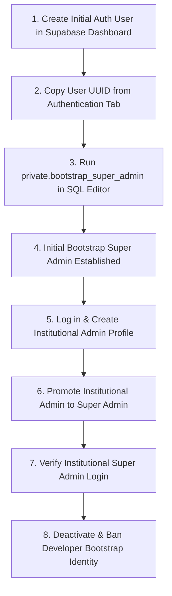

# First Super Admin Bootstrap Runbook

E-GatePass intentionally exposes no public registration or administrative promotion endpoint for the initial Super Admin. This runbook details the secure, one-time bootstrap procedure using the PostgreSQL `private.bootstrap_super_admin` RPC function in Supabase.

---

## 1. Lifecycle of the Bootstrap Process



---

## 2. Invariants & Security Boundaries

1. **Strict Table Boundary & Staff Role Governance**:
   - The `staff_profiles` table rejects direct client-side insertions via RLS policies.
   - Normal staff creation (`POST /api/create-user`):
     - **Admin**: may create Guard accounts.
     - **Super Admin**: may create Guard or Admin accounts.
     - **Neither**: may directly create a Super Admin account.
     - **Super Admin role**: obtained exclusively through initial bootstrap for the first identity, or through controlled role promotion of an existing staff profile afterward via Staff Management (`POST /api/update-user` calling `api.update_staff_profile`).
2. **One-Time Bootstrap Constraint (Zero Staff Profiles Lock)**:
   - Bootstrap is allowed only before the FIRST staff profile exists. Once any row exists in `public.staff_profiles`, bootstrap is permanently locked.
   - The PostgreSQL RPC `private.bootstrap_super_admin(target_user_id uuid, target_display_name text)` contains explicit database-enforced invariants:
     ```sql
     if exists (select 1 from public.staff_profiles) then
       raise exception using errcode = '23514', message = 'bootstrap is allowed only before the first staff profile';
     end if;
     ```
   - Bootstrap is rejected if any staff profile exists (whether Guard, Admin, or Super Admin). This ensures bootstrap cannot be abused to hijack an established deployment.
3. **Confirmed Human Identity Requirement**: The target must be a confirmed human identity.
   - Before insertion, `private.bootstrap_super_admin` validates the target against `auth.users` and rejects:
     - Non-existent Auth users
     - Anonymous users (`is_anonymous = true`)
     - Missing or blank email addresses
     - Unconfirmed email addresses (`email_confirmed_at IS NULL`)
     - Managed device pseudo-identities (`@devices.egatepass.invalid` namespace)
     - Display names outside the trimmed length bound (2 to 120 characters)
4. **Authorized Database Operator Check**:
   - The function verifies `current_user in ('postgres', 'supabase_admin')` and EXECUTE permissions are strictly revoked from `public`, `anon`, and `authenticated`.
5. **Last Active Super Admin Protection**:
   - Once established, the database trigger (`private.protect_last_superadmin`) strictly prevents demoting or deactivating the last active Super Admin.

---

## 3. Step-by-Step Execution Guide

### Step 1: Create Supabase Auth Account
1. Open the **Supabase Dashboard** for the production project.
2. Navigate to **Authentication > Users**.
3. Click **Add User > Create User**.
4. Enter the authorized administrative email (e.g. `sysadmin-bootstrap@earist.edu.ph`) and a strong, temporary password.
5. Ensure **Auto Confirm User?** is checked so email verification is immediately satisfied (`email_confirmed_at IS NOT NULL`).
6. Click **Create User**.

### Step 2: Retrieve User UUID
1. In the **Users** table, locate the newly created user.
2. Click the copy icon next to the **User UID** column (e.g. `a1b2c3d4-e5f6-7890-abcd-ef1234567890`).

### Step 3: Execute `private.bootstrap_super_admin` in SQL Editor
1. In the Supabase Dashboard, open the **SQL Editor**.
2. Run the parameterized SQL call:

```sql
SELECT private.bootstrap_super_admin(
    'a1b2c3d4-e5f6-7890-abcd-ef1234567890'::uuid,
    'System Administrator (Initial Bootstrap)'
);
```

*(Note: The function returns `void` on success).*

### Step 4: Authoritative SQL Verification
Verify the newly created Super Admin staff profile and audit trail using authoritative SQL:

```sql
-- Verify staff profile state
SELECT
  user_id,
  display_name,
  role,
  active,
  must_change_password
FROM public.staff_profiles
WHERE user_id = 'a1b2c3d4-e5f6-7890-abcd-ef1234567890'::uuid;
```

**Expected Result**:
- `role = 'superadmin'`
- `active = true`
- `must_change_password = true`
- `display_name = 'System Administrator (Initial Bootstrap)'`

Verify immutable audit log entry:
```sql
SELECT action, actor_id, actor_kind, actor_role, target_type, target_id, after_state
FROM public.audit_events
WHERE action = 'superadmin.bootstrap'
  AND target_id = 'a1b2c3d4-e5f6-7890-abcd-ef1234567890';
```

**Expected Result**:
- `action = 'superadmin.bootstrap'`
- `actor_kind = 'system'`
- `actor_role = 'bootstrap'`

### Step 5: Log into Admin Portal & Establish Institutional Administrator
1. Open `https://egatepass.tech/login`.
2. Enter the bootstrap credentials.
3. Complete initial password change (flagged with `must_change_password = true`).
4. In **Staff Management**, click **Add Staff Member**.
5. Enter the official email of the permanent EARIST institutional administrator (e.g. `ict.director@earist.edu.ph`).
6. Set role to `Admin` and submit (`POST /api/create-user`).
7. Have the institutional owner log in and complete password setup.
8. In **Staff Management**, promote the institutional administrator to `Super Admin` (via `POST /api/update-user` calling `api.update_staff_profile`).
9. Log out of the bootstrap account and log in with the new institutional Super Admin account.

### Step 6: Safe Decommission Procedure
Deleting the Auth user directly in the Supabase Dashboard will fail with a foreign key violation because `public.staff_profiles.user_id` references `auth.users(id)` with `ON DELETE RESTRICT`. The standard supported decommission procedure is:

1. **Verify Sovereignty**: Confirm the permanent institutional Super Admin can log in successfully.
2. **Verify Redundancy**: Confirm another active Super Admin exists so the last-superadmin safeguard is satisfied.
3. **Deactivate via UI**: In **Staff Management**, deactivate the temporary bootstrap account (`POST /api/update-user`).
4. **Confirm Access Denied**: Confirm the deactivated account cannot access administrative routes (HTTP 403).
5. **Confirm Auth Suspended**: The `POST /api/update-user` handler automatically synchronizes with Supabase Auth to ban the identity (`ban_duration: '876000h'`).
6. **Audit Trail Preservation**: Leave the deactivated staff profile row in place to preserve historical audit attribution.

> **PERMANENT DELETION NOTICE**: If physical database deletion is institutionally required, it must be performed as a separate **OWNER-AUTHORIZED DATABASE-OPERATOR CLEANUP** in SQL that strictly respects foreign key order (`public.audit_events`, `public.staff_profiles`, then `auth.users`) and verifies the last-active-Super-Admin constraint.
