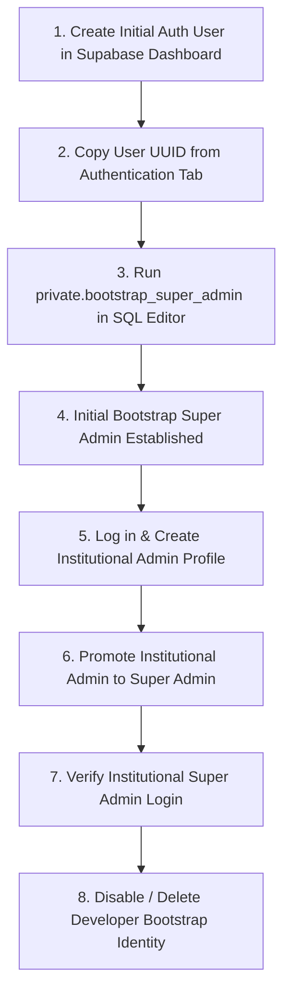

# First Super Admin Bootstrap Runbook

E-GatePass intentionally exposes no public registration or administrative promotion endpoint for the initial Super Admin. This runbook details the secure, one-time bootstrap procedure using the PostgreSQL `private.bootstrap_super_admin` RPC function in Supabase.

---

## 1. Lifecycle of the Bootstrap Process



---

## 2. Invariants & Security Boundaries

1. **Strict Table Boundary**:
   - The `staff_profiles` table rejects direct client-side insertions of `superadmin` roles via RLS policies.
   - Normal staff creation (`POST /api/create-user`) requires an existing active Super Admin session and can only create `admin` or `guard` accounts.
2. **One-Time Bootstrap Constraint**:
   - The PostgreSQL RPC `private.bootstrap_super_admin(target_user_id uuid, admin_name text)` contains an explicit defensive check:
     ```sql
     IF EXISTS (SELECT 1 FROM staff_profiles WHERE role = 'superadmin' AND active = true) THEN
         RAISE EXCEPTION 'Active Super Admin already exists. Bootstrap procedure locked.';
     END IF;
     ```
   - This ensures the bootstrap function cannot be abused to hijack an established production deployment.
3. **Last Active Super Admin Protection**:
   - Once established, the system strictly prevents demoting, deactivating, or deleting the last active Super Admin.

---

## 3. Step-by-Step Execution Guide

### Step 1: Create Supabase Auth Account
1. Open the **Supabase Dashboard** for the production project.
2. Navigate to **Authentication > Users**.
3. Click **Add User > Create User**.
4. Enter the authorized administrative email (e.g. `sysadmin-bootstrap@earist.edu.ph`) and a strong, temporary password.
5. Check **Auto Confirm User?** so email verification is immediately satisfied.
6. Click **Create User**.

### Step 2: Retrieve User UUID
1. In the **Users** table, locate the newly created user.
2. Click the copy icon next to the **User UID** column (e.g. `a1b2c3d4-e5f6-7890-abcd-ef1234567890`).

### Step 3: Execute `private.bootstrap_super_admin` in SQL Editor
1. In the Supabase Dashboard, open the **SQL Editor**.
2. Run the following parameterized SQL query:

```sql
SELECT private.bootstrap_super_admin(
    'a1b2c3d4-e5f6-7890-abcd-ef1234567890'::uuid,
    'System Administrator (Initial Bootstrap)'
);
```

3. Confirm the output:
```text
Success: User a1b2c3d4-e5f6-7890-abcd-ef1234567890 bootstrapped as Super Admin.
```

### Step 4: Log into Admin Portal & Verify Access
1. Open `https://egatepass.tech/login`.
2. Enter the bootstrap credentials.
3. Confirm successful login and redirect to the **Super Admin Dashboard**.
4. Verify full access to **Staff Management**, **Device Management**, and **System Settings**.

### Step 5: Transfer Ownership to Institutional Staff
1. In **Staff Management**, click **Add Staff Member**.
2. Enter the official email of the permanent EARIST institutional administrator (e.g. `ict.director@earist.edu.ph`).
3. Set role to `Admin` and send the invitation.
4. Have the institutional owner complete their password setup.
5. In **Staff Management**, promote the institutional account to `Super Admin`.
6. Log out of the bootstrap account and log in with the new institutional Super Admin account.

### Step 6: Decommission Bootstrap Account
1. While logged in as the institutional Super Admin:
   - Navigate to **Staff Management**.
   - Deactivate the temporary bootstrap account (`sysadmin-bootstrap@earist.edu.ph`).
2. In Supabase Dashboard > Authentication > Users, delete or disable the bootstrap auth user.
3. The institutional team now maintains permanent, sovereign control of the system.
