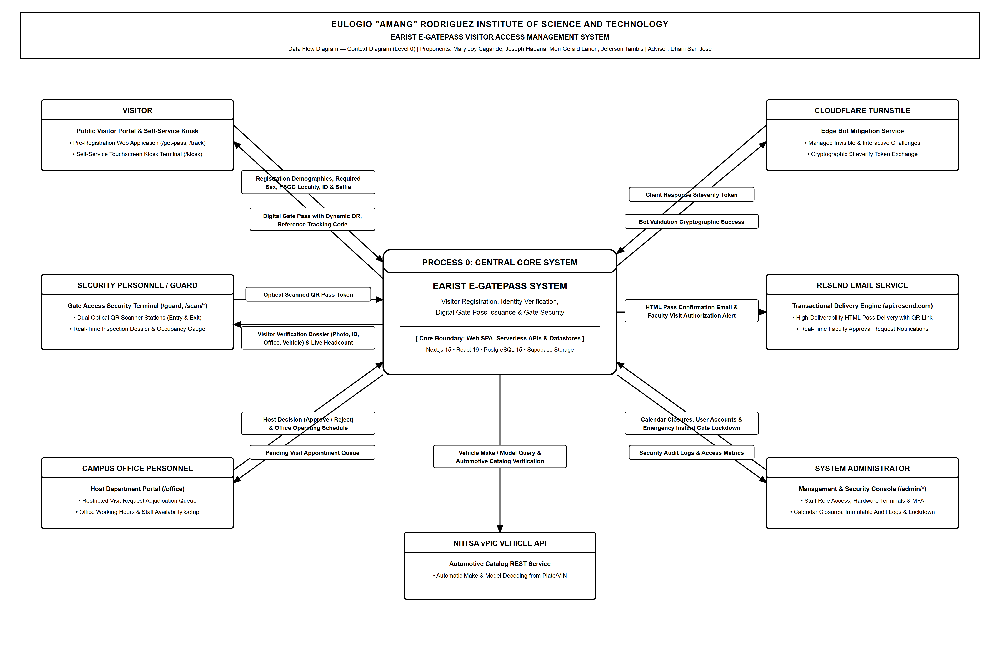
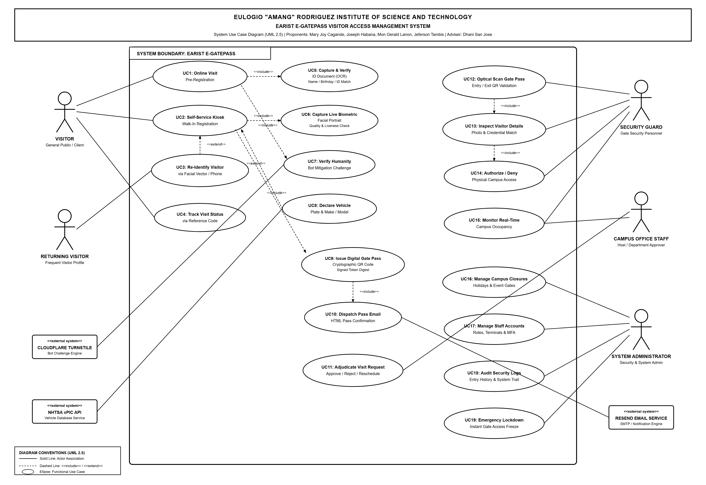
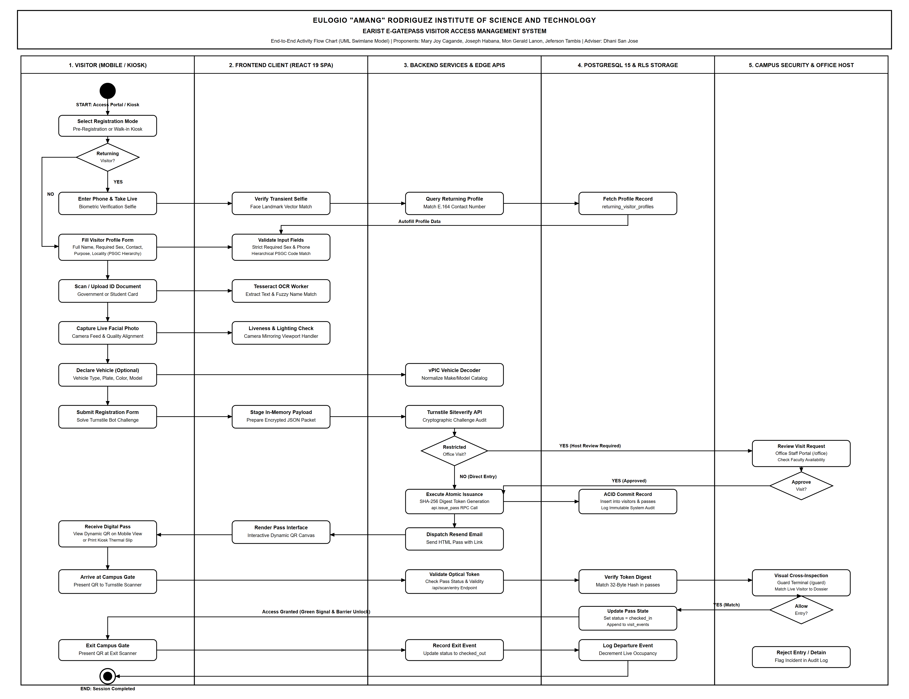
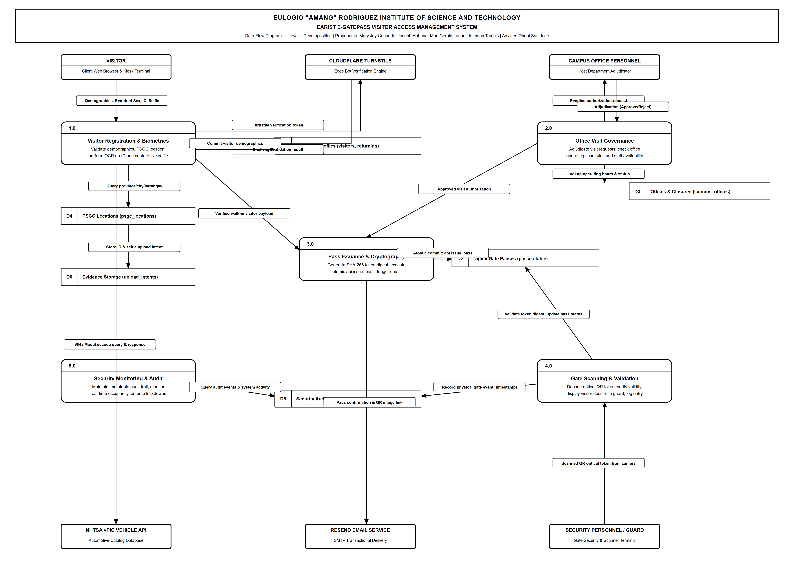
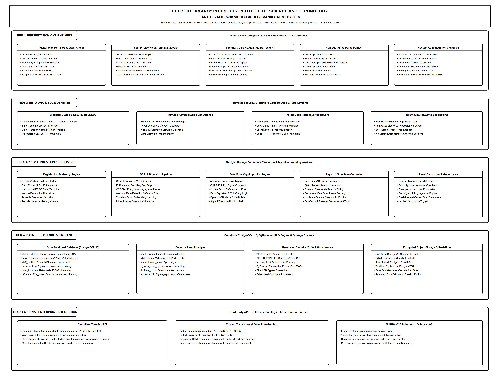
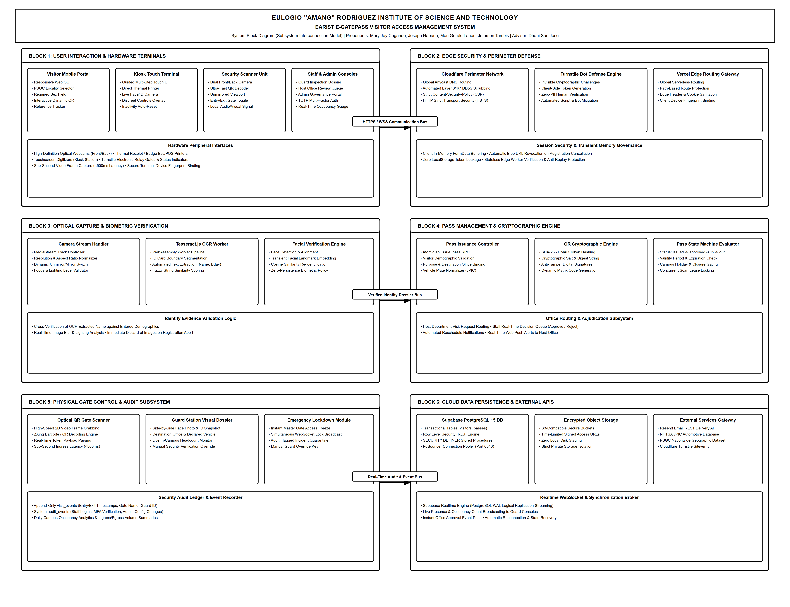
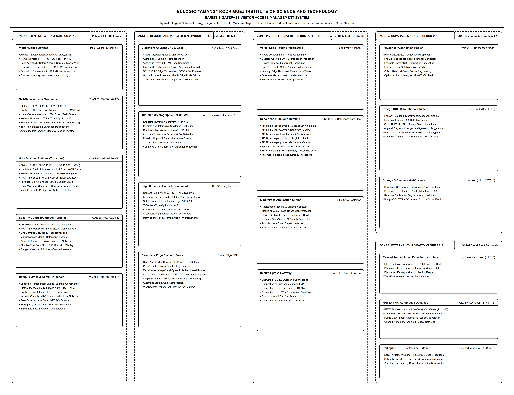
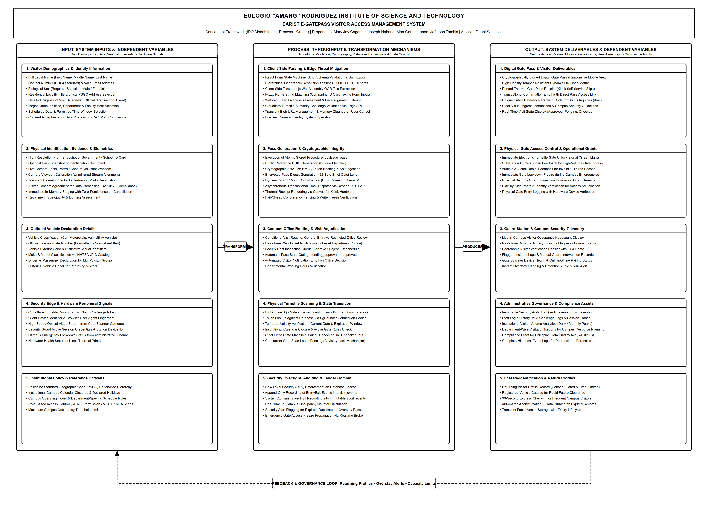
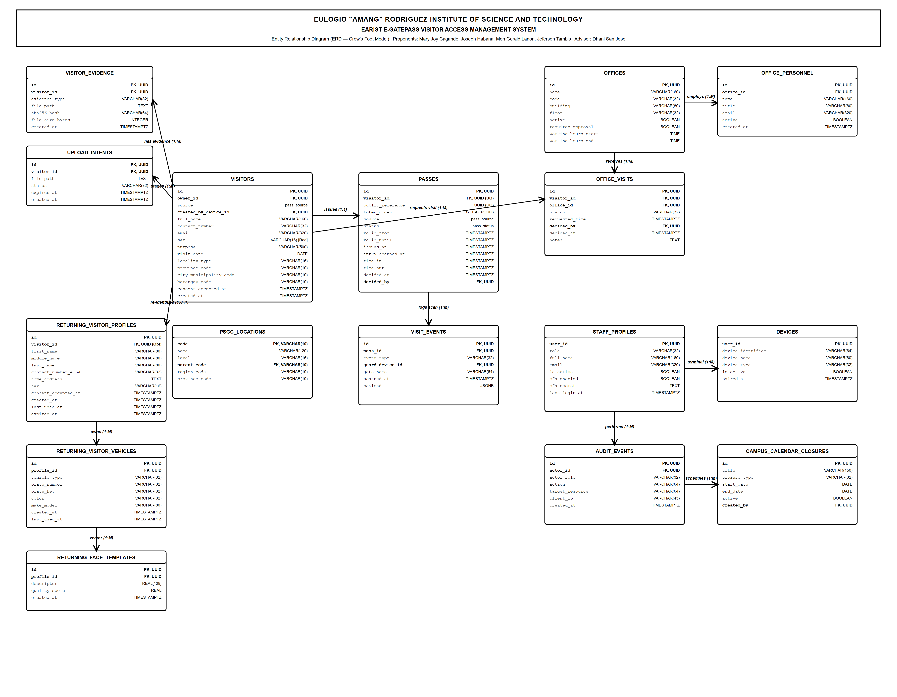
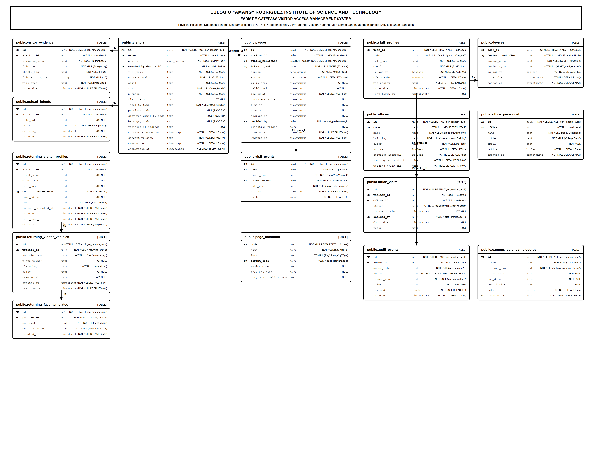

# EARIST E-GatePass — System Architecture & Engineering Diagrams Documentation

### Eulogio "Amang" Rodriguez Institute of Science and Technology
**College of Engineering / College of Computer Studies**  
**Capstone Project Technical Documentation**

---

- **Project:** EARIST E-GatePass Visitor Access Management System
- **Repository:** `jsphhbna/egatepass`
- **Production Domain:** [https://egatepass.tech](https://egatepass.tech)
- **Capstone Proponents:** Mary Joy Cagande, Joseph Habana, Mon Gerald Lanon, and Jeferson Tambis
- **Capstone Adviser:** Dhani San Jose
- **Academic Year:** 2026–2027 | November 2026
- **Word Document (.docx) Deliverable:** [`EARIST_E-GatePass_System_Diagrams_Documentation.docx`](./EARIST_E-GatePass_System_Diagrams_Documentation.docx)

---

## Deliverables Summary

All 10 system diagrams are stored as High-Resolution PNG, Scalable Vector Graphic (SVG), and editable Draw.io XML (`.drawio`) deliverables in [`diagram-output/`](../diagram-output):

1. **Figure 1: Context Diagram (Level 0 DFD)** — Gane & Sarson / Yourdon & DeMarco Notation
2. **Figure 2: Use Case Diagram** — UML 2.5 Use Case Specification
3. **Figure 3: Activity Flow Chart** — UML 2.5 Swimlane Activity Model
4. **Figure 4: Data Flow Diagram (Level 1 Decomposition)** — DFD Level 1
5. **Figure 5: Multi-Tier Architectural Framework** — 5-Tier Layered Software Architecture
6. **Figure 6: System Block Diagram** — IEEE Subsystem Interconnection Model
7. **Figure 7: Physical & Logical Network Topology Diagram** — Campus Network & Cloud Infrastructure
8. **Figure 8: Conceptual Framework (IPO Model)** — Input-Process-Output Research Paradigm
9. **Figure 9: Entity Relationship Diagram (ERD)** — Crow's Foot Relational Data Model
10. **Figure 10: Physical Database Schema Diagram** — PostgreSQL 17 Physical Schema

> **Synchronization Note:** Several static SVG/PNG/Draw.io diagram exports were authored prior to later releases and retain simplified/thesis labels; the prose specifications below describe the verified current production system implementation.

---

## 1. Context Diagram (Data Flow Diagram Level 0)

- **Deliverables:** [PNG](../diagram-output/egatepass-dfd-context-level-0.png) | [SVG](../diagram-output/egatepass-dfd-context-level-0.svg) | [Draw.io](../diagram-output/egatepass-dfd-context-level-0.drawio)
- **Standard / Model Notation:** Gane & Sarson / Yourdon & DeMarco DFD Notation
- **Architectural Scope & Boundary:**
  - **Process 0 (Central System):** React 19 + TypeScript + Vite 8 Single Page Application (`src/`), Vercel Node.js 24 Serverless Functions (`api/` + `server/`), Supabase PostgreSQL 17 database, Supabase Auth, and private Supabase Storage (`visitor-photos`, `visitor-ids`).
  - **Human & Terminal Actors:**
    - `Visitor`: Submits registration details, live selfie (camera-only), and valid ID (camera or JPEG/PNG/WebP upload online; camera-only on kiosk) via `/get-pass` or `/kiosk`; verifies email OTPs and receives QR passes.
    - `Guard Station & Scanners`: Entry (`/scan/entry`) and Exit (`/scan/exit`) scanner terminals scan QR passes via `html5-qrcode` / `jsqr`; `/guard` displays live station feeds (`GET /api/guard-station-feed`) and photo/vehicle evidence (`GET /api/evidence`) for `portal` passes; `/emergency-device` handles offline gate intake during outages.
    - `Campus Office Personnel`: Reviews specific-person visit requests via `/office`, confirms physical arrivals, manages office closures, and tracks attendance.
    - `System Administrator / Super Admin`: Configures campus closures, retention policies, SMS broadcasts, device accounts, staff accounts, thermal print templates, accountability resolution, and audit logs via `/admin/*`.
  - **Verified External Cloud Services:**
    - `Cloudflare Turnstile` (bot protection ONLY): Managed widget verified inside Supabase Auth (`signInAnonymously` / Auth recovery).
    - `Resend`: Transactional emails and signed delivery webhooks (`api.resend.com`).
    - `NHTSA vPIC API`: Vehicle make/model reference lookup (`vpic.nhtsa.dot.gov/api/vehicles/`) with in-memory fallback.
    - `SMS Gateway for Android`: Cloud relay (`api.sms-gate.app`) for emergency/overdue SMS broadcasts and `sms-intake` webhooks.

---

## 2. Use Case Diagram

- **Deliverables:** [PNG](../diagram-output/egatepass-use-case-diagram.png) | [SVG](../diagram-output/egatepass-use-case-diagram.svg) | [Draw.io](../diagram-output/egatepass-use-case-diagram.drawio)
- **Standard / Model Notation:** UML 2.5 Use Case Specification Standard
- **Architectural Scope & Boundary:**
  - **Primary Actors:** Visitor, Returning Visitor, Scanner/Guard Station Devices, Emergency Device, Office Staff, Admin / Super Admin.
  - **Supporting External Services:** Cloudflare Turnstile, Resend, NHTSA vPIC, Android SMS Gateway.
  - **Key Flows:** Online registration (`/get-pass`), Kiosk walk-in (`/kiosk`) with MXW01 BLE or browser print fallback, optional browser OCR name autofill, optional vehicle declaration, office pre-approval for restricted personnel visits, QR scanning (`/api/scan-pass`), live guard monitoring (`/guard`), accountability reporting, and emergency outage intake (`/emergency-device`).

---

## 3. Activity Flow Chart (UML Swimlane Model)

- **Deliverables:** [PNG](../diagram-output/egatepass-activity-flowchart.png) | [SVG](../diagram-output/egatepass-activity-flowchart.svg) | [Draw.io](../diagram-output/egatepass-activity-flowchart.drawio)
- **Standard / Model Notation:** UML 2.5 Activity Diagram with Swimlane Partitioning
- **Swimlane Execution Architecture:**
  - **1. Visitor (Mobile / Kiosk):** Completes Turnstile + Data Privacy consent, enters demographics and PSGC cascading address (optional sex/gender on online portal), captures live selfie + valid ID (skipped for ID when Peak Mode applies), requests upload intents (`api.create_upload_intent`), submits `POST /api/passes/issue`, verifies email before QR reveal (with 5-second timed skip), and scans QR at entry/exit turnstiles.
  - **2. Frontend Client (React 19 + Vite 8 SPA):** Runs client validation, local Tesseract.js/PaddleOCR name extraction, oval framing checks, and `/api/passes/abandon-intent` cleanup on abort.
  - **3. Vercel Serverless APIs (`Node.js 24`):** Validates upload intent magic bytes/sizes/SHA-256, invokes `api.issue_online_pass_v6` (or `api.issue_pass`), issues HMAC-SHA256 bearer tokens, and dispatches Resend emails.
  - **4. Supabase PostgreSQL 17 & Private Storage:** Enforces RLS, stores SHA-256 `token_digest`, appends immutable `visit_events` & `audit_events`, and maintains `office_visits`.

---

## 4. Data Flow Diagram — Level 1 Decomposition

- **Deliverables:** [PNG](../diagram-output/egatepass-dfd-level-1.png) | [SVG](../diagram-output/egatepass-dfd-level-1.svg) | [Draw.io](../diagram-output/egatepass-dfd-level-1.drawio)
- **Standard / Model Notation:** Gane & Sarson DFD Level 1 Functional Decomposition
- **Relational Data Stores:**
  - `D1`: Visitors & Returning Profiles (`visitors`, `returning_visitor_profiles`)
  - `D2`: Digital Gate Passes (`passes`)
  - `D3`: Campus Directory & Closures (`offices`, `office_personnel`, `office_visits`, `campus_calendar_closures`)
  - `D4`: Philippine PSGC Locations (`psgc_locations`, plus bundled `data/reference/psgc/*.json`)
  - `D5`: Security Audit Ledger & Events (`audit_events`, `visit_events`, `visitor_accountability_resolutions`)
  - `D6`: Evidence Storage & Uploads (`upload_intents`, `visitor_evidence`, private Storage buckets `visitor-photos` & `visitor-ids`)

---

## 5. Multi-Tier Architectural Framework

- **Deliverables:** [PNG](../diagram-output/egatepass-architectural-framework.png) | [SVG](../diagram-output/egatepass-architectural-framework.svg) | [Draw.io](../diagram-output/egatepass-architectural-framework.drawio)
- **Standard / Model Notation:** 5-Tier Layered Software Architecture Model
- **Architectural Layers:**
  - **Tier 1 (Presentation):** Vite 8 + React 19 SPA (`/`, `/get-pass`, `/track`, `/kiosk`, `/scan/entry`, `/scan/exit`, `/guard`, `/emergency-device`, `/office`, `/account/security`, `/admin/*`).
  - **Tier 2 (Domain & Perimeter Security):** Authoritative DNS on `get.tech` / `Orderbox`, Cloudflare Turnstile bot challenge (Managed mode ONLY), strict CSP/HSTS/XFO headers in `vercel.json`.
  - **Tier 3 (Serverless Application & Business Logic):** 6 grouped Vercel Node.js 24 Serverless Functions (`api/admin`, `api/auth`, `api/device`, `api/gate`, `api/passes`, `api/system`), client Tesseract.js / PaddleOCR workers, YuNet/SFace ephemeral RAM comparison (`onnxruntime-node`), and `sharp` QR/pass image rendering.
  - **Tier 4 (Data Persistence):** Supabase PostgreSQL 17 with RLS & PgBouncer, private Supabase Storage (`visitor-photos`, `visitor-ids`), append-only audit ledgers, and AES-GCM IndexedDB vaults on `/emergency-device`.
  - **Tier 5 (External Services):** Resend transactional email & delivery webhooks, NHTSA vPIC API, and Android SMS Gateway (`api.sms-gate.app`).

---

## 6. System Block Diagram

- **Deliverables:** [PNG](../diagram-output/egatepass-block-diagram.png) | [SVG](../diagram-output/egatepass-block-diagram.svg) | [Draw.io](../diagram-output/egatepass-block-diagram.drawio)
- **Standard / Model Notation:** IEEE Standard Subsystem Block Interconnection Model
- **Modular Subsystems:**
  - `Block 1: User Interaction & Terminals`: Mobile web clients, kiosk stations, MXW01 58mm BLE thermal printer (+ browser fallback), optical scanning cameras, and emergency/guard terminals.
  - `Block 2: Perimeter & Browser Security`: `get.tech` / `Orderbox` DNS, Cloudflare Turnstile widget, Vercel TLS/headers, and isolated portal vs. operator Supabase browser storage keys.
  - `Block 3: Optical Capture, OCR & Ephemeral Matching`: Browser WebRTC webcam capture, Tesseract.js / PaddleOCR name extraction, and in-memory 1:1 SFace provisional comparison against original portrait evidence (without storing templates).
  - `Block 4: Pass Management & Cryptography`: `POST /api/passes/issue`, HMAC-SHA256 bearer tokens (`token_digest bytea`), `office_visits` approval workflows, and AES-256-GCM delivery outbox.
  - `Block 5: Gate Control, Accountability & Emergency Mode`: `html5-qrcode` / `jsqr` decoding, `POST /api/scan-pass`, `GET /api/guard-station-feed`, `api.resolve_visitor_accountability`, and signed ECDSA P-256 `/emergency-device` continuity.
  - `Block 6: Cloud Data & External SaaS`: Supabase PostgreSQL 17, RLS, Storage, Edge Functions (`send-sms`, `sms-intake`), Resend, and NHTSA vPIC.

---

## 7. Physical & Logical Network Topology Diagram

- **Deliverables:** [PNG](../diagram-output/egatepass-network-diagram.png) | [SVG](../diagram-output/egatepass-network-diagram.svg) | [Draw.io](../diagram-output/egatepass-network-diagram.drawio)
- **Standard / Model Notation:** OSI Layered Network & Cloud Infrastructure Topology Model
- **Network Segmentation & Protocols:**
  - **Client & Campus Terminals:** Visitor mobile browsers, kiosk stations, gate scanners, guard station displays, office portals, and admin workstations over HTTPS (Port 443).
  - **Authoritative DNS & Bot Challenge:** `get.tech` / `Orderbox` resolves `egatepass.tech` directly to Vercel (`@ A 216.198.79.1`); Cloudflare provides Turnstile challenge verification (`challenges.cloudflare.com`) only.
  - **Vercel Serverless Compute:** Runs the Vite SPA static assets and 6 grouped Node.js 24 Serverless API handlers (`/api/admin/*`, `/api/auth/*`, `/api/device/*`, `/api/gate/*`, `/api/passes/*`, `/api/system/*`), including `POST /api/scan-pass` (entry & exit modes).
  - **Supabase Managed Cloud & Edge Functions:** PostgreSQL 17 (RLS + PgBouncer), Auth + Bot Protection, private S3 Storage (`visitor-photos`, `visitor-ids`), Realtime, and Deno Edge Functions (`send-sms`, `sms-intake`).
  - **External Endpoints:** Resend (`api.resend.com`), NHTSA vPIC (`vpic.nhtsa.dot.gov`), and SMS Gateway (`api.sms-gate.app`).

---

## 8. Conceptual Framework (IPO Model)

- **Deliverables:** [PNG](../diagram-output/egatepass-conceptual-framework.png) | [SVG](../diagram-output/egatepass-conceptual-framework.svg) | [Draw.io](../diagram-output/egatepass-conceptual-framework.drawio)
- **Standard / Model Notation:** Academic Thesis Input - Process - Output (IPO) Model
- **Research Paradigm Structure:**
  - `INPUT`: Visitor registration data, optional sex/gender (portal), Philippine PSGC locality codes, ID images, live webcam selfies, optional vehicle details, destination office parameters, Turnstile challenge tokens, and optical QR camera streams.
  - `PROCESS`: Client validation, local OCR name extraction, upload intent verification (magic bytes, MIME, size, SHA-256), `api.issue_online_pass_v6` / `api.issue_pass` atomic issuance, SHA-256 token digest derivation, Resend transactional email delivery, QR scanning via `/api/scan-pass`, guard station monitoring, office arrival confirmation, and end-of-day accountability reconciliation.
  - `OUTPUT`: Signed digital QR passes, MXW01/browser printed kiosk badges, branded HTML pass emails, guard station dossiers, real-time occupancy counts, office attendance logs, accountability exception reports, and immutable audit ledgers.

---

## 9. Entity Relationship Diagram (ERD)

- **Deliverables:** [PNG](../diagram-output/egatepass-entity-relationship-diagram.png) | [SVG](../diagram-output/egatepass-entity-relationship-diagram.svg) | [Draw.io](../diagram-output/egatepass-entity-relationship-diagram.drawio)
- **Standard / Model Notation:** Crow's Foot Relational Data Model Specification
- **Core Entities & Cardinalities:**
  - `visitors (1)` ||--|| `passes (1)`: Strict 1-to-1 pass per visit (`passes.visitor_id UNIQUE`).
  - `visitors (1)` ||--o{ `visitor_evidence (M)` & `upload_intents (M)`: Staged upload intents (`pending | claimed | expired | abandoned`) and claimed evidence (`photo`, `id`, `vehicle_photo`).
  - `returning_visitor_profiles (1)` ||--o{ `visitors (M)` & `returning_visitor_vehicles (M)`: Consent/operational profile reuse without persistent face templates (`returning_face_templates` is retired).
  - `passes (1)` ||--o{ `visit_events (M)` & `0..1` `visit_vehicle_declarations`: Append-only gate scans (`scan_entry`, `scan_exit`, `approved`, `rejected`, `gate_exit_unconfirmed`, etc.) and optional vehicle records.
  - `offices (1)` ||--o{ `office_personnel (M)` & `office_visits (M)`: Office directory (`draft | published | archived`), staff assignments, and pre-approval/arrival workflows.
  - `staff_profiles (1)` ||--o{ `audit_events (M)` & `visitor_accountability_resolutions (M)`: Staff identity governance (TOTP MFA managed by Supabase `auth.mfa_factors`) and accountability resolutions.

---

## 10. Physical Database Schema Diagram

- **Deliverables:** [PNG](../diagram-output/egatepass-database-schema.png) | [SVG](../diagram-output/egatepass-database-schema.svg) | [Draw.io](../diagram-output/egatepass-database-schema.drawio)
- **Standard / Model Notation:** PostgreSQL 17 Physical Schema Specification
- **Physical Relational Tables & Invariants:**
  - `public.visitors`: Identity (`full_name`, `contact_number`, optional `sex`), PSGC codes/labels (`psgc_region_*`, `psgc_province_*`, `psgc_city_*`, `psgc_barangay_*`), `purpose`, `visit_date`, and RLS enforcement.
  - `public.passes`: `pass_status` enum (`issued`, `pending`, `inside`, `rejected`, `exited`, `expired`), 32-byte `token_digest bytea UNIQUE`, `public_reference`, `valid_from`, `valid_until`, `entry_scanned_at`, `time_in`, `time_out`.
  - `public.visit_events`: Append-only gate event log (`event`, `pass_id`, `device_id`, `gate`, JSONB `meta`).
  - `public.staff_profiles`: Staff accounts (`admin`, `superadmin`, `office_staff`; legacy `guard` disabled), `active`, `must_change_password`, `privacy_accepted_at` (`ON DELETE CASCADE` to `auth.users` managed via `api.delete_staff_account`).
  - `public.devices`: Managed terminal identities (`kiosk`, `entry`, `exit`, `guard_station`, `emergency_device`).
  - `public.offices`, `public.office_personnel`, `public.office_visits`, `public.campus_calendar_closures`: Institutional office directory, closures, and appointment/arrival records.
  - `public.audit_events`, `public.visitor_accountability_resolutions`, `public.sms_logs`, `public.sms_daily_quotas`: Audit ledger, end-of-day reconciliation records, and SMS quota/activity telemetry.
