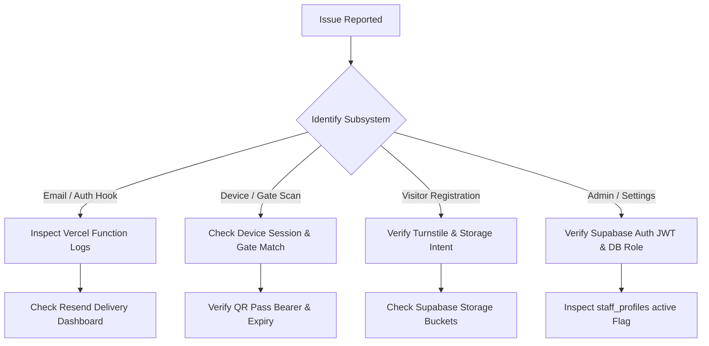

# System Troubleshooting & Diagnostic Guide

This guide provides structured triage, root-cause diagnosis, and step-by-step remediation procedures for operational anomalies in the EARIST E-GatePass platform.

---

## 1. Quick Diagnostic Flowchart



---

## 2. Issue Resolution Matrix

### 2.1 Auth Email Hook Returning HTTP 500 (`ERR_MODULE_NOT_FOUND`)

- **Symptom**:
  Supabase Auth user creation or password reset fails; Vercel Function log for `/api/auth/send-email-hook` shows:
  ```text
  Error: Cannot find module './StaffInviteEmail.js' or 'ERR_MODULE_NOT_FOUND'
  ```
- **Likely Cause**:
  Vercel Node File Trace (`@vercel/nft`) failed to package email templates because `.js` import specifiers pointed to `.tsx` sources without a compiled runtime bundle.
- **How to Diagnose**:
  1. Inspect the production build output:
     ```bash
     npx vercel build --prod
     ```
  2. Check `.vercel/output/functions/api/auth/[...route].func/server/templates/index.js`.
  3. If missing, `scripts/bundle-email-templates.mjs` was skipped during prebuild.
- **Safe Resolution**:
  1. Run template bundling:
     ```bash
     npm run build:templates
     ```
  2. Ensure `prebuild` in `package.json` includes `npm run build:templates`.
  3. Redeploy to Vercel.

---

### 2.2 Resend Email Rejection / Missing Sender Identity

- **Symptom**:
  Vercel logs show HTTP 403 or 422 from Resend:
  ```text
  ResendError: 'from' email address is not verified
  ```
- **Likely Cause**:
  The `RESEND_FROM_EMAIL` environment variable does not match the verified domain in Resend, or get.tech / Orderbox DNS records for Resend have not propagated.
- **How to Diagnose**:
  1. Open Resend dashboard at `https://resend.com/domains`.
  2. Confirm status of `egatepass.tech` is **Verified** (Green).
  3. Verify `RESEND_FROM_EMAIL` in Vercel is set to `EARIST E-GatePass <notifications@egatepass.tech>`.
- **Safe Resolution**:
  Correct the environment variable in Vercel and trigger a redeployment.

---

### 2.3 Send Email Hook Signature Verification Failure (HTTP 401)

- **Symptom**:
  Supabase Auth logs show Webhook failed with HTTP 401 Unauthorized.
- **Likely Cause**:
  `SEND_EMAIL_HOOK_SECRET` in Vercel does not match the secret in Supabase Auth Hooks configuration.
- **How to Diagnose**:
  Compare the secret string configured in Supabase Dashboard (**Authentication > Hooks > Send Email**) with `process.env.SEND_EMAIL_HOOK_SECRET` in Vercel.
- **Safe Resolution**:
  Synchronize the secret in both dashboards.

---

### 2.4 Device Login Failure / Inactive Device

- **Symptom**:
  Entry or Exit scanner device cannot log in; displays "Invalid Device Identity" or "Device Inactive".
- **Likely Cause**:
  The device record in the `devices` table has `status != 'active'` or `deleted_at IS NOT NULL`.
- **How to Diagnose**:
  In Supabase SQL Editor:
  ```sql
  SELECT user_id, alias, name, type, gate, status, deleted_at FROM public.devices WHERE user_id = '<user_id>';
  ```
- **Safe Resolution**:
  Ensure `status = 'active'` and `deleted_at IS NULL` or re-register the device via the Admin console.

---

### 2.5 RLS Permission Denied / Empty Data on Admin Dashboard

- **Symptom**:
  Staff user logs into the dashboard, but all tables return 0 rows or console displays:
  ```text
  PostgrestError: new row violates row-level security policy
  ```
- **Likely Cause**:
  The user exists in Supabase Auth, but lacks a corresponding active row in `staff_profiles` (`active = true`).
- **How to Diagnose**:
  ```sql
  SELECT user_id, display_name, role, active FROM public.staff_profiles WHERE user_id = auth.uid();
  ```
- **Safe Resolution**:
  Ensure `staff_profiles` contains an active profile (`active = true`) with valid role (`guard`, `admin`, or `superadmin`).

---

### 2.6 Visitor Issuance Failure / Turnstile Verification Failure

- **Symptom**:
  Visitor submits registration on portal, but receives:
  ```text
  Error: Visitor registration could not be started.
  ```
- **Likely Cause**:
  Turnstile challenge failed or token rejected during `supabase.auth.signInAnonymously({ options: { captchaToken } })`.
- **How to Diagnose**:
  Verify Turnstile configuration in Supabase Dashboard under **Authentication > Bot Protection / CAPTCHA**.
- **Safe Resolution**:
  Ensure Cloudflare Turnstile Secret Key is properly set in the Supabase Dashboard and `VITE_TURNSTILE_SITE_KEY` is set in Vercel.

---

### 2.7 Supabase Storage Upload Failure (Evidence Missing)

- **Symptom**:
  Visitor capture fails during ID/photo upload with HTTP 400 or HTTP 403.
- **Likely Cause**:
  Upload intent expired, file size exceeds 5MB limit, or MIME type is not `image/jpeg`, `image/png`, or `image/webp`.
- **How to Diagnose**:
  Inspect browser Network tab for `POST /storage/v1/object/visitor-photos` or `visitor-ids`.
- **Safe Resolution**:
  Ensure user uploads a valid image under 5MB. Check that Supabase Storage buckets `visitor-photos` and `visitor-ids` exist and are accessible to authenticated upload intents.

---

### 2.8 QR Code Rejection at Gate Scanner

- **Symptom**:
  Entry device displays "Pass is not eligible for entry" or "Invalid scan request".
- **Likely Cause**:
  1. Pass is expired (`valid_until < now()`).
  2. Pass is already in `pending` or `inside` status.
  3. Scanner assigned to a different physical gate than the pass constraint.
- **How to Diagnose**:
  Query the pass by its SHA-256 digest in the database:
  ```sql
  SELECT id, status, valid_from, valid_until FROM public.passes WHERE token_digest = decode('<hex_digest>', 'hex');
  ```
- **Safe Resolution**:
  If expired, instruct visitor to request a new gate pass.

---

### 2.9 Camera Permissions Blocked on Kiosk or Mobile

- **Symptom**:
  Camera viewfinder is black; "NotFoundError" or "NotAllowedError: Permission denied".
- **Likely Cause**:
  1. Browser denied camera permissions.
  2. Page served over non-HTTPS origin (browsers require HTTPS for WebRTC/MediaDevices).
- **How to Diagnose**:
  Check browser permission icon in URL bar.
- **Safe Resolution**:
  Ensure site is accessed via HTTPS (`https://egatepass.tech`). Click the lock icon in the browser address bar and set Camera to **Allow**.

---

### 2.10 Local Tesseract OCR Parsing Failures

- **Symptom**:
  Kiosk fails to recognize visitor name fields, or OCR text is garbled/empty.
- **Likely Cause**:
  Low lighting, glare on laminated ID card, or unaligned text.
- **How to Diagnose**:
  Inspect OCR debug bounding box in Kiosk UI.
- **Safe Resolution**:
  Tesseract runs client-side. Have the visitor adjust the ID angle to reduce glare, or manually edit the fields in the correction step. OCR never makes an automated gate decision.

---

### 2.11 Retention Maintenance Invocation Failures

- **Symptom**:
  Invocation of `/api/admin/retention-maintenance` returns HTTP 401 Unauthorized.
- **Likely Cause**:
  Missing or mismatched `Authorization: Bearer <CRON_SECRET>` header.
- **How to Diagnose**:
  Verify `CRON_SECRET` in request header matches `process.env.CRON_SECRET` in Vercel.
- **Safe Resolution**:
  Provide the correct bearer token when triggering maintenance.

---

### 2.12 Rate Limiting HTTP 503 (`abuse_control_unavailable`)

- **Symptom**:
  Pass issuance fails with HTTP 503 error code `abuse_control_unavailable`.
- **Likely Cause**:
  In Production, the dedicated `RATE_LIMIT_HMAC_SECRET` environment variable is missing, blank, or fewer than 32 characters. The system strictly fails closed and refuses to fall back to other secrets.
- **How to Diagnose**:
  Check Vercel Production environment variables for `RATE_LIMIT_HMAC_SECRET`.
- **Safe Resolution**:
  Set a dedicated, cryptographically secure 256-bit (minimum 32-character) secret for `RATE_LIMIT_HMAC_SECRET` in Vercel Production scope and redeploy.

---

### 2.13 Resend Webhook HTTP 503 (`webhook_secret_unconfigured`) or 400 (`invalid_signature`)

- **Symptom**:
  Resend webhook delivery log displays failed delivery attempts to `https://egatepass.tech/api/webhooks/resend` with HTTP 503 or HTTP 400.
- **Likely Cause**:
  `RESEND_WEBHOOK_SECRET` is missing in Vercel Production scope (returns 503) or does not match the webhook signing secret from the Resend Dashboard (returns 400).
- **How to Diagnose**:
  Compare the signing secret (`whsec_...`) in Resend Dashboard (**Webhooks > Signing Secret**) with `RESEND_WEBHOOK_SECRET` in Vercel Production.
- **Safe Resolution**:
  Copy the authoritative signing secret from Resend to `RESEND_WEBHOOK_SECRET` in Vercel Production scope and redeploy.

---

### 2.14 Turnstile Fail-Closed Security Blocks on Login or Forgot Password

- **Symptom**:
  Staff login or password reset submission is blocked with:
  ```text
  Authentication blocked: security challenge required.
  ```
  or
  ```text
  Authentication blocked: missing security configuration.
  ```
- **Likely Cause**:
  In Production, Turnstile fails closed if the user attempts form submission before completing the challenge, or if `VITE_TURNSTILE_SITE_KEY` is missing in the production bundle.
- **How to Diagnose**:
  Confirm the Turnstile challenge box is rendered and solved before clicking submit. Inspect browser console to confirm `VITE_TURNSTILE_SITE_KEY` is loaded.
- **Safe Resolution**:
  Ensure `VITE_TURNSTILE_SITE_KEY` is configured in Vercel Production and solve the Turnstile challenge before submitting.

---

### 2.15 MXW01 Bluetooth Thermal Printer Fails to Connect

- **Symptom**:
  Kiosk operator taps **Connect MXW01**, but the browser displays:
  ```text
  Bluetooth adapter not available or Web Bluetooth disabled.
  ```
  or the browser device picker fails to appear.
- **Likely Cause**:
  1. Tablet Bluetooth radio is turned off.
  2. Kiosk page is not accessed over a secure HTTPS origin (`navigator.bluetooth` requires HTTPS).
  3. Browser is not Chromium-based (e.g. Safari on iOS does not support Web Bluetooth).
  4. Device permissions were previously blocked for the origin.
- **How to Diagnose**:
  1. Verify the tablet's system Bluetooth toggle is ON.
  2. In Chrome on Android, check `chrome://flags/#enable-web-bluetooth`.
  3. Ensure URL is `https://...` (not `http://`).
- **Safe Resolution**:
  Enable Bluetooth in Android settings, ensure HTTPS is active, and select the printer in the device picker. If on iOS/Safari, use the standard browser print fallback (`window.print()`).

---

### 2.16 MXW01 Printer Powers Off or Disconnects Mid-Print

- **Symptom**:
  Walk-in pass issuance completes successfully, but the printer does not output a ticket or stops printing halfway through.
- **Likely Cause**:
  1. Printer battery depleted or powered off.
  2. Printer ran out of thermal paper roll.
  3. Bluetooth range exceeded.
- **How to Diagnose**:
  Inspect MXW01 status LED (red indicates paper out or low battery; blinking blue indicates pairing mode).
- **Safe Resolution**:
  - Remember the **Pass Issuance Immunity Invariant**: the visitor's pass is authoritative and **ALREADY ISSUED**.
  - Reload paper roll or plug into USB-C charger and power on.
  - In Kiosk UI, tap **Reconnect Printer** or **Print Again**.
  - Alternatively, tap **Browser Print** to print immediately using the tablet's system printer.

---

### 2.17 Thermal Template Corrupted or Fails to Load

- **Symptom**:
  Kiosk displays warning:
  ```text
  Failed to load remote thermal template. Falling back to bundled default.
  ```
- **Likely Cause**:
  Network connectivity lost during kiosk startup, or remote template JSON was modified outside schema boundaries.
- **How to Diagnose**:
  Inspect browser console logs for `[useThermalPrinter] Template fetch error`.
- **Safe Resolution**:
  The system automatically activates the bundled known-good default template. Printing continues normally. Super Admin can review and republish the template at `/admin/templates`.

---

### 2.18 Visitor Cannot Be Found in Guard Visitor Recovery

- **Symptom**:
  Visitor claims to have registered online, but Guard searches by name or reference and receives 0 results.
- **Likely Cause**:
  1. The visit was scheduled for a different calendar date (recovery search strictly filters for today's date in `Asia/Manila`).
  2. The pass is already in `exited` or `expired` status.
  3. Typo in name or contact number search.
- **How to Diagnose**:
  Search by reference number (`EG-XXXXXXXX`) or broad last name. Check the visitor's email confirmation to verify their selected Visit Date.
- **Safe Resolution**:
  If the visitor scheduled for a future or past date, direct them to register a new pass or perform walk-in intake.

---

### 2.19 Scanner Displays Network Unavailable During Outage

- **Symptom**:
  Visitor presents a valid QR code at Entry or Exit scanner during an internet outage, and scanner displays:
  ```text
  NETWORK UNAVAILABLE
  Entry verification is temporarily unavailable.
  Please proceed directly to the Guard for manual verification.
  ```
- **Likely Cause**:
  Scanner tablet cannot reach Supabase or Vercel serverless backend.
- **Truthful Behavior**:
  This is the intentional fail-closed outage behavior. The scanner differentiates network unreachable from an invalid QR code.
- **Safe Resolution**:
  Direct visitor to the Guard console station for offline recovery or walk-in intake.

---

### 2.20 Offline Outbox Synchronization Conflicts

- **Symptom**:
  Guard tablet displays:
  ```text
  1 conflict logged in reconciliation tasks.
  ```
- **Likely Cause**:
  An offline action conflicted with server state recorded before the outage (e.g. an offline approval was queued for a pass that was already rejected on the server).
- **How to Diagnose**:
  In Super Admin Dashboard, navigate to **Reconciliation Tasks** (`/admin/reconciliation`).
- **Safe Resolution**:
  Inspect the conflicting payload and prior state. The server intentionally did NOT overwrite data. The administrator reviews and marks the task resolved.


---

### 2.21 Returning Visitor Search Fails with "Verification challenge required to start registration"

- **Symptom**:
  A returning visitor enters their First and Last Name on the Returning Visitor frontdoor search screen (`returning_lookup`) and clicks "Search Profile". The form fails with:
  ```text
  Verification challenge required to start registration.
  ```
- **Root Cause**:
  The Cloudflare Turnstile widget (`TurnstileWidget`) was previously conditionally mounted only inside `step === 'id'` (New Visitor step 2) and `step === 'returning_capture'` (Returning Visitor step 2). On `step === 'returning_lookup'`, no Turnstile widget was mounted in the DOM, leaving `turnstileRef.current` as `null`. When `onSearchReturningProfile()` executed, it attempted to obtain a fresh CAPTCHA token, found `turnstileRef.current === null`, and passed `undefined` to `createPortalIssueTransaction()`. The production `evaluateTurnstilePolicy()` correctly and strictly failed closed, throwing the challenge required error.
- **Safe Resolution**:
  1. Refactor `GetPassPage.tsx` to maintain a single persistent `TurnstileWidget` instance mounted at the root of the active registration `<Card>` container.
  2. The single widget remains mounted continuously throughout all navigation between `frontdoor`, `returning_lookup`, `returning_capture`, `returning_confirm`, and New Visitor steps (`form`, `visit`, `id`, `photo`, `verify`, `review`).
  3. Remove duplicate step-specific Turnstile instances to prevent widget ID collisions or stale refs.
  4. Once established via `createPortalIssueTransaction(freshCaptchaToken)`, the authenticated anonymous Supabase portal session is retained in `portalTransactionRef` and reused across lookup and selfie capture without redundant challenges. If expired, `validatePortalSession` detects invalidity and triggers a fresh challenge.

---

### 2.22 iPhone Mobile UX: Email Modal Keyboard Layout & Returning Visitor Freeze/Review Workflow

- **Symptoms**:
  1. **Remember Me Overlooked**: Visitors completing registration fail to enroll for Returning Visitor status because the enrollment checkbox was small, low-contrast, and placed at the very bottom of the Review step after extensive information sections.
  2. **Email Modal Touch & Overlapping Dialogs**: On iPhone Safari (e.g. iPhone 12, 390px width), autofocus on email inputs immediately opened the iOS software keyboard, obscuring primary actions. Tapping "Continue without email" mounted `TimedSkipWarningModal` while `EmailPassModal` remained open in the DOM, creating competing focus traps and backdrop overlaps. Action buttons were side-by-side with narrow touch targets.
  3. **Returning Visitor Verification Without Preview**: Capturing a selfie in `returning_capture` immediately submitted the image to the biometric comparison endpoint while the live camera remained active with a loading spinner, offering no frozen preview, retake option, or explicit confirmation before biometric evaluation.
- **Root Causes**:
  - `rememberVisitor` checkbox was rendered late in `step === 'review'` with minimal visual hierarchy and native `<input type="checkbox">` sizing (~16px).
  - `EmailPassModal` and `TimedSkipWarningModal` were both controlled independently with Radix `Dialog`, causing DOM collisions when both were open (`showEmailModal && showSkipWarning`).
  - Inputs used `autoFocus`, triggering native WebKit virtual keyboard focus events on modal mount.
  - `onCaptureReturningFace()` combined frame capture, upload, and 1:1 comparison into an atomic function without an intermediate review sub-stage.
- **Safe Resolutions**:
  1. **Institutional Remember Me Card**: Replaced the small checkbox with a prominent institutional enrollment card styled in EARIST maroon (`#7A0A0A`) with gold/amber accents, min-height ≥ 72px, 28px custom checkbox, 16px title, 14px description, and gold "Optional" badge. Moved to the very top of `step === 'review'` (immediately following the Biometric Identity Verified badge).
  2. **Sequential Email Skip Lifecycle**: Bound `EmailPassModal` to `isOpen={showEmailModal && !showSkipWarning}`. Selecting "Continue without email" closes the email modal portal while preserving component state; canceling the warning reopens the email modal with input values and consent intact; confirming skip advances to completed pass screen.
  3. **Mobile-Hardened Inputs & Buttons**: Removed `autoFocus` from recipient email and verification code inputs. Added `min-h-[52px]` and `text-base` (≥ 16px) to prevent iOS auto-zoom. Replaced side-by-side modal buttons on mobile with a full-width vertical stack with `min-h-[56px]`, `gap-3` (12px vertical spacing), and full button styling for skip actions.
  4. **Returning Visitor 7-Stage Workflow**:
     - *Stage 1 (Live)*: Live camera feed with oval guide, "Capture Your Selfie" heading, and "Capture Selfie" action.
     - *Stage 2 (Freeze)*: Capturing a frame freezes the still image into state, stops the camera, and transitions to review.
     - *Stage 3 (Review)*: Displays frozen selfie preview with prominent "Retake Photo" and "Verify This Photo" buttons.
     - *Stage 4 (Verify)*: "Verify This Photo" runs client-side quality evaluation, validates session, uploads still image, and calls `identifyReturningVisitor()`.
     - *Stage 5 (Match Accepted)*: Retains matched selfie blob for subsequent pass issuance and advances to `returning_confirm`.
     - *Stage 6 (Match Rejected)*: Displays clear inline error near still image preview with "Retake Selfie" button without navigating away or losing selected profile candidate.
     - *Stage 7 (Cleanup)*: Cleans up object URLs and camera streams on navigation, reset, or unmount.

---

### 2.23 Returning Visitor Camera Orientation, iPhone Retake Lifecycle & False Blur Rejection

- **Symptoms**:
  1. **Selfie Orientation Flipping**: Returning visitor sees a horizontally mirrored live preview, but capturing a selfie produces an unmirrored image; freezing the image flips the visitor's face horizontally.
  2. **Blank Camera Viewport After Retake**: On iPhone 12 (Safari/WebKit), clicking "Retake Photo" leaves the camera preview permanently blank and non-functional.
  3. **False Blurry Photo Rejections**: Clear, high-resolution iPhone front-camera selfies are repeatedly rejected with "Your photo is too blurry. Please hold the device steady and try again."
  4. **Stale Evidence Reuse**: When Retake was clicked and a replacement photo was captured, the upload system reused the previous photo's upload intent ID and Storage object.
- **Root Causes**:
  - *Orientation Mismatch*: Live video element in `returningCaptureStage === 'live'` had CSS `style={{ transform: faceWebcam.mirrorPreview ? 'scaleX(-1)' : 'none' }}`, but `faceWebcam.capture({ mirror: false })` captured an unmirrored pixel buffer and the frozen review `` had no transform.
  - *Camera Startup Cancellation Race*: `GetPassPage.tsx` had an effect `useEffect(..., [returningSelfieUrl])` that called `faceWebcam.stop()`. When Retake called `setReturningSelfieUrl(null)` and `faceWebcam.start()`, the effect cleanup ran, incremented `generationRef.current`, and cancelled the active `getUserMedia()` call when it resolved, leaving `video.srcObject = null`.
  - *Dual-Stage Sharpness Discrepancy*: Browser-side `evaluateLiveFaceQuality()` computed Laplacian variance across a 320×240 whole-image resize and strictly required `sharpness >= 45`. On mobile cameras, shallow depth of field or smooth indoor room walls easily diluted whole-frame Laplacian variance below 45 even when facial features were sharp. Furthermore, server-side pre-detection check had a whole-frame threshold of 35 that also blocked selfies before YuNet could isolate the face.
  - *Missing Checkpoint Invalidation*: Retake cleared local component state but did not invoke `invalidatePortalEvidenceCheckpoint(portalTransactionRef.current, 'photo')`.
- **Safe Resolutions**:
  1. **Consistent Unmirrored Returning Orientation**: Removed CSS horizontal mirroring (`scaleX(-1)`) from Returning Visitor live camera `<video>` (`transform: 'none'`). Live preview, captured blob (`capture({ mirror: false })`), frozen preview ``, and server face engine all share an identical 1:1 unmirrored coordinate space. New Visitor and Kiosk mirroring remain unchanged.
  2. **Camera Lifecycle Separation**: Decoupled camera unmount cleanup (`useEffect(() => () => faceWebcam.stop(), [])`) from preview URL management. Retake now revokes the old URL without triggering camera teardown, surviving delayed WebKit `getUserMedia()` resolutions. Added `disabled={!faceWebcam.isActive || faceWebcam.isStarting}` to the Capture button.
  3. **Authoritative Server Face-Crop Quality**: Introduced `evaluateReturningSelfiePrecheck(blob)` in `src/lib/imageQuality.ts`. The browser precheck strictly validates decodability, minimum resolution ($\ge 240\times 240$), extreme darkness ($< 25$), and extreme glare ($> 245$), while deferring fine-grained facial sharpness to the server's face-crop analysis. On the server (`server/lib/face-engine.ts`), whole-frame pre-blur threshold was adjusted to catch only severe defocus ($< 12$), while `evaluateFaceCropQuality` strictly enforces `faceBlur >= 25` on the extracted face bounding box. Diagnostic metadata (`origin`, `code`, `details`, `byteSize`, `mimeType`) is included in 422 responses.
  4. **Strict Upload Checkpoint Invalidation**: Added `invalidatePortalEvidenceCheckpoint(portalTransactionRef.current, 'photo')` to Retake, Capture, Back, and candidate selection handlers, ensuring every new capture receives a new upload intent and storage path while preserving verified evidence after successful match.

---

### 2.24 Returning Visitor Structured Address Hydration on Welcome Back Screen

- **Symptoms**:
  1. **Missing Additional Address Fields on Welcome Back Screen**: After successful Returning Visitor 1:1 biometric identification, the Welcome Back screen does not display previously saved `home_building`, `home_street`, or `postal_code`, even though the returning profile record in `returning_visitor_profiles` has non-empty values.
  2. **Stale Session Address Leakage**: If a visitor session previously entered address details and subsequent returning visitor matching is attempted, truthy guards could cause the second visitor to retain the previous session's house/street inputs if the second profile lacked those fields.
  3. **Locality Name Blanking**: When older returning visitor profiles did not have denormalized `psgc_*_name` strings saved, the locality selector rendered blank or comma-only strings (`", "` or `", City of Manila"`).
- **Root Causes**:
  - *Conditional State Guard Bug*: In `src/pages/GetPassPage.tsx`, `onConfirmReturningVerification()` assigned address fields using `if (p.psgc.houseBuilding) setHomeBuilding(...)`, `if (p.psgc.street) setHomeStreet(...)`, and `if (p.psgc.postalCode) setPostalCode(...)`. These conditional guards prevented empty/null values from being assigned explicitly, allowing prior session values to persist and preventing a clean, deterministic state hydration contract.
  - *Missing PSGC Locality Name Fallback in Backend*: `server/routes/passes/identify-returning.ts` serialized `region.name: profile.psgc_region_name || ''`. For returning profiles created before denormalized name columns were added, names defaulted to empty strings instead of falling back to looking up `psgc_locations` by their foreign key codes.
  - *Missing Structured Address Persistence on Profile Update*: In `server/routes/passes/issue.ts`, the `saveUpdates` flow for returning visitors only persisted `contact_number_e164`, `home_address`, and coordinates back to `returning_visitor_profiles`, omitting edited PSGC structured fields (`psgc_*_code`, `home_building`, `home_street`, `postal_code`).
- **Safe Resolutions**:
  1. **Typed Pure Address Hydration Helper**: Created `src/lib/returningAddressHydration.ts` with `hydrateReturningAddress(profile)`. Guarantees a fully-specified `HydratedAddressState` (`selectedPsgc`, `homeBuilding`, `homeStreet`, `postalCode`) with explicit `?? ''` fallbacks, eliminating conditional assignments and cross-profile session leaks.
  2. **Unconditional State Hydration in GetPassPage**: `onConfirmReturningVerification()` invokes `hydrateReturningAddress(p)` and applies all four setters unconditionally before navigating to `step === 'returning_confirm'`.
  3. **Backend Locality Name Fallback Resolution**: In `server/routes/passes/identify-returning.ts`, if `profile.psgc_region_name`, `profile.psgc_city_municipality_name`, or `profile.psgc_barangay_name` are missing, a query against `public.psgc_locations` resolves the exact administrative names from the dataset without altering existing database records.
  4. **Complete Profile Update Persistence**: In `server/routes/passes/issue.ts`, the `saveUpdates` handler now resolves and updates all structured address columns (`psgc_region_code`, `psgc_province_code`, `psgc_city_code`, `psgc_barangay_code`, `psgc_*_name`, `home_building`, `home_street`, `postal_code`, `postal_code_source`) in `returning_visitor_profiles` when the visitor opts in.

---

### 2.26 Step 1 Candidate Lookup Turnstile Error, Profile Linkage Privacy & Calibration Fail-Closed Handling

- **Symptoms**:
  1. **Silent Fallback to Visit Step**: In New Visitor registration Step 1 (`form`), automatic candidate lookup fails silently without displaying matches or error toast, immediately progressing to `step = 'visit'`.
  2. **Accidental Profile Linkage on "Continue as New Visitor"**: A visitor choosing "Continue as New Visitor" with identical name or contact number as an existing profile was previously linked to that returning profile in PostgreSQL.
  3. **Photo Preview Token Substituted for ID Preview**: An attacker attempting to call `/api/passes/returning-photo-preview?kind=id` using a candidate photo preview token was previously able to retrieve the original ID document.
  4. **Provisional Mode Claiming Full Verification**: A face match score in provisional mode (`0.363`) displaying a green "Verified Identity" badge.
- **Root Causes**:
  1. `onFormNext()` in `GetPassPage.tsx` called `createPortalIssueTransaction()` without obtaining a Cloudflare Turnstile token from `turnstileRef.current.executeChallenge()`, failing closed and being caught in a generic catch block that called `setStep('visit')`.
  2. `api.issue_online_pass_v6` in Migration 56 linked existing returning profiles by name and contact even when `registration_mode = 'new'`.
  3. Preview tokens in `returning-photo-preview.ts` were not bound to the `kind` parameter in the HMAC signature.
  4. Provisional mode did not distinguish between calibrated verification and provisional assistance.
- **Safe Resolutions**:
  1. **Step 1 Turnstile Token Acquisition**: `onFormNext()` executes `turnstileRef.current.executeChallenge()` and provides the acquired token to `createPortalIssueTransaction(freshCaptchaToken)`. On challenge failure or expiration, it halts and displays an error toast without advancing to `step = 'visit'`.
  2. **Profile Isolation for New Visitors**: Migration 60 (`20261104170754_returning_visitor_privacy_hardening_and_linkage_repair.sql`) updates `api.issue_online_pass_v6` so `registration_mode = 'new'` never links or reuses an existing returning profile, instead inserting an independent profile.
  3. **V2 Evidence-Kind Binding & Single-Use ID Authorization**: Preview tokens use format `v2.<profileId>.<kind>.<expiresAt>.<nonce>.<sig>` with 300s TTL. Tokens issued for `kind=photo` are rejected with 403 `forbidden_evidence_kind` if requested for `kind=id`. ID preview requires calibrated verification and is consumed atomically via `api.consume_id_preview_authorization_v1`.
  4. **Provisional Mode Separation**: Provisional mode returns `verificationState = 'provisional'`, `guardVerificationRequired = true`, and sets `historicalIdUrl = null`. The UI displays an amber "Provisional Match (Guard Verification at Gate)" banner. Calibrated mode requires documented calibration evidence (`RETURNING_FACE_CALIBRATION_VERSION`) or fails closed.


- **Symptoms**:
  1. **Silent Profile Update Failure**: A returning visitor opts in to update their saved profile on the Welcome Back screen (`saveReturningUpdates: true`), and pass issuance succeeds with a 201 response, but changes to their address or contact number are not saved to `returning_visitor_profiles`.
  2. **Postal Code Source Degradation**: A returning visitor whose postal code was verified by PHLPost (`postalCodeSource: 'PHLPost'`) opens the AddressCascadingSelector and clicks "Confirm Address" without making changes; the saved postal code source changes from `'PHLPost'` to `'manual'`, losing its auto-filled badge.
- **Root Causes**:
  - *Unchecked PostgREST Error & Zero Row Update*: In `server/routes/passes/issue.ts`, `saveUpdates` awaited `.update(profileUpdate).eq('id', ret.profileId)` without checking `{ error }` and without verifying `updatedRows.length > 0`. If a database constraint failed or the profile ID did not match an active row, the failure was silently swallowed and the response claimed success.
  - *Missing Postal Resolution in Address Hydration*: `hydrateReturningAddress()` initialized `postalCode` and `postalCodeSource`, but did not reconstruct `postalResolution`. Consequently, when `AddressCascadingSelector` opened, `postalResolution` was null, leading `handleConfirm()` to treat the postal code as a manual entry.
- **Safe Resolutions**:
  1. **PostgREST Inspection & Row Count Verification**: `issue.ts` executes `.update(profileUpdate).eq('id', ret.profileId).select('id')`, explicitly checks `updateErr`, checks `updatedRows.length === 0`, and fails closed if PSGC location lookup fails.
  2. **Pass Issuance Survival & Status Reporting**: Pass issuance always succeeds regardless of profile update status. The 201 response includes `returningProfileUpdate: 'updated' | 'failed' | 'not_requested'`, allowing `GetPassPage.tsx` to surface an honest, non-blocking toast notification if profile persistence fails.
  3. **PHLPost Metadata Reconstruction**: `hydrateReturningAddress()` reconstructs `postalResolution` (`isAutoFilled: true`, `mappingType: 'exact_barangay'`) whenever `postalCode` exists with source `PHLPost`.
  4. **Preservation of Unchanged Source**: In `AddressCascadingSelector.tsx`, `handleConfirm()` verifies `isUnchangedPostal` and preserves `initialAddress.postalCodeSource` and `postalResolution`, preventing degradation to `'manual'`.

