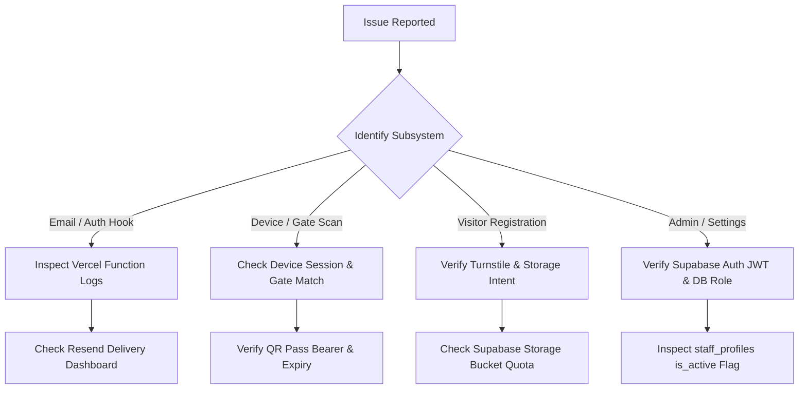

# System Troubleshooting & Diagnostic Guide

This guide provides structured triage, root-cause diagnosis, and step-by-step remediation procedures for operational anomalies in the EARIST E-GatePass platform.

---

## 1. Quick Diagnostic Flowchart



---

## 2. Issue Resolution Matrix

### 2.1 Auth Email Hook Returning HTTP 500 (`ERR_MODULE_NOT_FOUND`)

- **Symptom**:
  Supabase Auth user creation or password reset fails; Vercel Function log for `/api/auth/send-email-hook` shows:
  ```text
  Error: Cannot find module './StaffInviteEmail.js' or 'ERR_MODULE_NOT_FOUND'
  ```
- **Likely Cause**:
  Vercel Node File Trace (`@vercel/nft`) failed to package email templates because `.js` import specifiers pointed to `.tsx` sources without a compiled runtime bundle.
- **How to Diagnose**:
  1. Inspect the production build output:
     ```bash
     vercel build --prod
     ```
  2. Check `.vercel/output/functions/api/auth/[...route].func/server/templates/index.js`.
  3. If missing, `scripts/bundle-email-templates.mjs` was skipped during prebuild.
- **Safe Resolution**:
  1. Run template bundling:
     ```bash
     npm run build:templates
     ```
  2. Ensure `prebuild` in `package.json` includes `npm run build:templates`.
  3. Redeploy to Vercel.

---

### 2.2 Resend Email Rejection / Missing Sender Identity

- **Symptom**:
  Vercel logs show HTTP 403 or 422 from Resend:
  ```text
  ResendError: 'from' email address is not verified
  ```
- **Likely Cause**:
  The `RESEND_FROM_EMAIL` environment variable does not match the verified domain in Resend, or DNS records have not propagated.
- **How to Diagnose**:
  1. Open Resend dashboard at `https://resend.com/domains`.
  2. Confirm status of `egatepass.tech` is **Verified** (Green).
  3. Verify `RESEND_FROM_EMAIL` in Vercel is set to `EARIST E-GatePass <notifications@egatepass.tech>`.
- **Safe Resolution**:
  Correct the environment variable in Vercel and trigger a redeployment.

---

### 2.3 Send Email Hook Signature Verification Failure (HTTP 401)

- **Symptom**:
  Supabase Auth logs show Webhook failed with HTTP 401 Unauthorized.
- **Likely Cause**:
  `SEND_EMAIL_HOOK_SECRET` in Vercel does not match the secret in Supabase Auth Hooks configuration.
- **How to Diagnose**:
  Compare the secret string configured in Supabase Dashboard (**Authentication > Hooks > Send Email**) with `process.env.SEND_EMAIL_HOOK_SECRET` in Vercel.
- **Safe Resolution**:
  Synchronize the secret in both dashboards.

---

### 2.4 Device Login Failure / Inactive Device

- **Symptom**:
  Entry or Exit scanner device cannot log in; displays "Invalid Device Identity" or "Device Inactive".
- **Likely Cause**:
  The device record in the `devices` table has `is_active = false`, or device type/gate mismatch.
- **How to Diagnose**:
  In Supabase SQL Editor:
  ```sql
  SELECT id, device_name, device_type, gate, is_active FROM devices WHERE id = '<device_id>';
  ```
- **Safe Resolution**:
  Set `is_active = true` or re-register the device via the Admin console.

---

### 2.5 RLS Permission Denied / Empty Data on Admin Dashboard

- **Symptom**:
  Staff user logs into the dashboard, but all tables return 0 rows or console displays:
  ```text
  PostgrestError: new row violates row-level security policy
  ```
- **Likely Cause**:
  The user exists in Supabase Auth, but lacks a corresponding active row in `staff_profiles`, or their role has expired.
- **How to Diagnose**:
  ```sql
  SELECT * FROM staff_profiles WHERE id = auth.uid();
  ```
- **Safe Resolution**:
  Ensure `staff_profiles` contains an active profile with valid role (`guard`, `admin`, or `superadmin`).

---

### 2.6 Visitor Issuance Failure / Turnstile Verification Failure

- **Symptom**:
  Visitor submits registration on portal, but receives:
  ```text
  Error: Security verification failed. Please try again.
  ```
- **Likely Cause**:
  Turnstile secret key mismatch or visitor network blocked by Cloudflare risk rules.
- **How to Diagnose**:
  Check Vercel API logs for `/api/passes` response from `https://challenges.cloudflare.com/turnstile/v0/siteverify`.
- **Safe Resolution**:
  Verify `TURNSTILE_SECRET_KEY` in Vercel environment variables. In local development, ensure dummy test site keys are used.

---

### 2.7 Supabase Storage Upload Failure (Evidence Missing)

- **Symptom**:
  Visitor capture fails during ID/photo upload with HTTP 400 or HTTP 403.
- **Likely Cause**:
  Upload intent expired, file size exceeds 5MB limit, or MIME type is not `image/jpeg` or `image/png`.
- **How to Diagnose**:
  Inspect browser Network tab for `POST /storage/v1/object/visitor-evidence`.
- **Safe Resolution**:
  Ensure user uploads a valid image under 5MB. Check that Supabase Storage bucket `visitor-evidence` RLS policies are applied.

---

### 2.8 QR Code Rejection at Gate Scanner

- **Symptom**:
  Entry device displays "Invalid QR Code Token".
- **Likely Cause**:
  1. `PASS_TOKEN_SECRET` was rotated while passes were unconsumed.
  2. QR code was generated for a different campus gate.
  3. Pass is expired.
- **How to Diagnose**:
  Query the pass by its SHA-256 digest in the database:
  ```sql
  SELECT status, expires_at FROM gate_passes WHERE qr_token_hash = '<hash>';
  ```
- **Safe Resolution**:
  If expired, instruct visitor to request a new gate pass.

---

### 2.9 Camera Permissions Blocked on Kiosk or Mobile

- **Symptom**:
  Camera viewfinder is black; "NotFoundError" or "NotAllowedError: Permission denied".
- **Likely Cause**:
  1. Browser denied camera permissions.
  2. Page served over non-HTTPS origin (browsers require HTTPS for WebRTC/MediaDevices).
- **How to Diagnose**:
  Check browser permission icon in URL bar.
- **Safe Resolution**:
  Ensure site is accessed via HTTPS (`https://egatepass.tech`). Click the lock icon in the browser address bar and set Camera to **Allow**.

---

### 2.10 Local Tesseract OCR Parsing Failures

- **Symptom**:
  Kiosk fails to extract name or ID number; text output is garbled or empty.
- **Likely Cause**:
  Low lighting, glare on laminated ID card, or unaligned text.
- **How to Diagnose**:
  Inspect OCR debug bounding box in Kiosk UI.
- **Safe Resolution**:
  Tesseract runs client-side. Have the visitor adjust the ID angle to reduce glare, or manually edit the fields in the correction step. OCR never makes an automated gate decision.

---

### 2.11 Retention Cleanup Cron Failures

- **Symptom**:
  Expired passes or storage files remain beyond the configured retention period.
- **Likely Cause**:
  Vercel Cron not configured or `CRON_SECRET` mismatch.
- **How to Diagnose**:
  Inspect Vercel Dashboard > **Cron Jobs** tab for execution status and HTTP response code.
- **Safe Resolution**:
  Verify `/api/cron/retention-maintenance` returns HTTP 200 when invoked with the configured `CRON_SECRET`.