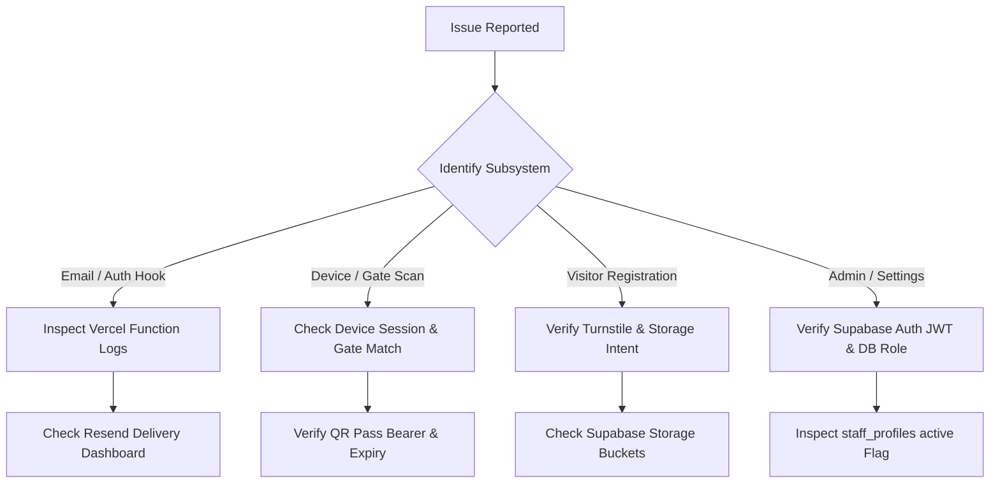

# System Troubleshooting & Diagnostic Guide

This guide provides structured triage, root-cause diagnosis, and step-by-step remediation procedures for operational anomalies in the EARIST E-GatePass platform.

---

## 1. Quick Diagnostic Flowchart



---

## 2. Issue Resolution Matrix

### 2.1 Auth Email Hook Returning HTTP 500 (`ERR_MODULE_NOT_FOUND`)

- **Symptom**:
  Supabase Auth user creation or password reset fails; Vercel Function log for `/api/auth/send-email-hook` shows:
  ```text
  Error: Cannot find module './StaffInviteEmail.js' or 'ERR_MODULE_NOT_FOUND'
  ```
- **Likely Cause**:
  Vercel Node File Trace (`@vercel/nft`) failed to package email templates because `.js` import specifiers pointed to `.tsx` sources without a compiled runtime bundle.
- **How to Diagnose**:
  1. Inspect the production build output:
     ```bash
     npx vercel build --prod
     ```
  2. Check `.vercel/output/functions/api/auth/[...route].func/server/templates/index.js`.
  3. If missing, `scripts/bundle-email-templates.mjs` was skipped during prebuild.
- **Safe Resolution**:
  1. Run template bundling:
     ```bash
     npm run build:templates
     ```
  2. Ensure `prebuild` in `package.json` includes `npm run build:templates`.
  3. Redeploy to Vercel.

---

### 2.2 Resend Email Rejection / Missing Sender Identity

- **Symptom**:
  Vercel logs show HTTP 403 or 422 from Resend:
  ```text
  ResendError: 'from' email address is not verified
  ```
- **Likely Cause**:
  The `RESEND_FROM_EMAIL` environment variable does not match the verified domain in Resend, or get.tech / Orderbox DNS records for Resend have not propagated.
- **How to Diagnose**:
  1. Open Resend dashboard at `https://resend.com/domains`.
  2. Confirm status of `egatepass.tech` is **Verified** (Green).
  3. Verify `RESEND_FROM_EMAIL` in Vercel is set to `EARIST E-GatePass <notifications@egatepass.tech>`.
- **Safe Resolution**:
  Correct the environment variable in Vercel and trigger a redeployment.

---

### 2.3 Send Email Hook Signature Verification Failure (HTTP 401)

- **Symptom**:
  Supabase Auth logs show Webhook failed with HTTP 401 Unauthorized.
- **Likely Cause**:
  `SEND_EMAIL_HOOK_SECRET` in Vercel does not match the secret in Supabase Auth Hooks configuration.
- **How to Diagnose**:
  Compare the secret string configured in Supabase Dashboard (**Authentication > Hooks > Send Email**) with `process.env.SEND_EMAIL_HOOK_SECRET` in Vercel.
- **Safe Resolution**:
  Synchronize the secret in both dashboards.

---

### 2.4 Device Login Failure / Inactive Device

- **Symptom**:
  Entry or Exit scanner device cannot log in; displays "Invalid Device Identity" or "Device Inactive".
- **Likely Cause**:
  The device record in the `devices` table has `status != 'active'` or `deleted_at IS NOT NULL`.
- **How to Diagnose**:
  In Supabase SQL Editor:
  ```sql
  SELECT user_id, alias, name, type, gate, status, deleted_at FROM public.devices WHERE user_id = '<user_id>';
  ```
- **Safe Resolution**:
  Ensure `status = 'active'` and `deleted_at IS NULL` or re-register the device via the Admin console.

---

### 2.5 RLS Permission Denied / Empty Data on Admin Dashboard

- **Symptom**:
  Staff user logs into the dashboard, but all tables return 0 rows or console displays:
  ```text
  PostgrestError: new row violates row-level security policy
  ```
- **Likely Cause**:
  The user exists in Supabase Auth, but lacks a corresponding active row in `staff_profiles` (`active = true`).
- **How to Diagnose**:
  ```sql
  SELECT user_id, display_name, role, active FROM public.staff_profiles WHERE user_id = auth.uid();
  ```
- **Safe Resolution**:
  Ensure `staff_profiles` contains an active profile (`active = true`) with valid role (`guard`, `admin`, or `superadmin`).

---

### 2.6 Visitor Issuance Failure / Turnstile Verification Failure

- **Symptom**:
  Visitor submits registration on portal, but receives:
  ```text
  Error: Visitor registration could not be started.
  ```
- **Likely Cause**:
  Turnstile challenge failed or token rejected during `supabase.auth.signInAnonymously({ options: { captchaToken } })`.
- **How to Diagnose**:
  Verify Turnstile configuration in Supabase Dashboard under **Authentication > Bot Protection / CAPTCHA**.
- **Safe Resolution**:
  Ensure Cloudflare Turnstile Secret Key is properly set in the Supabase Dashboard and `VITE_TURNSTILE_SITE_KEY` is set in Vercel.

---

### 2.7 Supabase Storage Upload Failure (Evidence Missing)

- **Symptom**:
  Visitor capture fails during ID/photo upload with HTTP 400 or HTTP 403.
- **Likely Cause**:
  Upload intent expired, file size exceeds 5MB limit, or MIME type is not `image/jpeg`, `image/png`, or `image/webp`.
- **How to Diagnose**:
  Inspect browser Network tab for `POST /storage/v1/object/visitor-photos` or `visitor-ids`.
- **Safe Resolution**:
  Ensure user uploads a valid image under 5MB. Check that Supabase Storage buckets `visitor-photos` and `visitor-ids` exist and are accessible to authenticated upload intents.

---

### 2.8 QR Code Rejection at Gate Scanner

- **Symptom**:
  Entry device displays "Pass is not eligible for entry" or "Invalid scan request".
- **Likely Cause**:
  1. Pass is expired (`valid_until < now()`).
  2. Pass is already in `pending` or `inside` status.
  3. Scanner assigned to a different physical gate than the pass constraint.
- **How to Diagnose**:
  Query the pass by its SHA-256 digest in the database:
  ```sql
  SELECT id, status, valid_from, valid_until FROM public.passes WHERE token_digest = decode('<hex_digest>', 'hex');
  ```
- **Safe Resolution**:
  If expired, instruct visitor to request a new gate pass.

---

### 2.9 Camera Permissions Blocked on Kiosk or Mobile

- **Symptom**:
  Camera viewfinder is black; "NotFoundError" or "NotAllowedError: Permission denied".
- **Likely Cause**:
  1. Browser denied camera permissions.
  2. Page served over non-HTTPS origin (browsers require HTTPS for WebRTC/MediaDevices).
- **How to Diagnose**:
  Check browser permission icon in URL bar.
- **Safe Resolution**:
  Ensure site is accessed via HTTPS (`https://egatepass.tech`). Click the lock icon in the browser address bar and set Camera to **Allow**.

---

### 2.10 Local Tesseract OCR Parsing Failures

- **Symptom**:
  Kiosk fails to recognize visitor name fields, or OCR text is garbled/empty.
- **Likely Cause**:
  Low lighting, glare on laminated ID card, or unaligned text.
- **How to Diagnose**:
  Inspect OCR debug bounding box in Kiosk UI.
- **Safe Resolution**:
  Tesseract runs client-side. Have the visitor adjust the ID angle to reduce glare, or manually edit the fields in the correction step. OCR never makes an automated gate decision.

---

### 2.11 Retention Maintenance Invocation Failures

- **Symptom**:
  Invocation of `/api/admin/retention-maintenance` returns HTTP 401 Unauthorized.
- **Likely Cause**:
  Missing or mismatched `Authorization: Bearer <CRON_SECRET>` header.
- **How to Diagnose**:
  Verify `CRON_SECRET` in request header matches `process.env.CRON_SECRET` in Vercel.
- **Safe Resolution**:
  Provide the correct bearer token when triggering maintenance.

---

### 2.12 Rate Limiting HTTP 503 (`abuse_control_unavailable`)

- **Symptom**:
  Pass issuance fails with HTTP 503 error code `abuse_control_unavailable`.
- **Likely Cause**:
  In Production, the dedicated `RATE_LIMIT_HMAC_SECRET` environment variable is missing, blank, or fewer than 32 characters. The system strictly fails closed and refuses to fall back to other secrets.
- **How to Diagnose**:
  Check Vercel Production environment variables for `RATE_LIMIT_HMAC_SECRET`.
- **Safe Resolution**:
  Set a dedicated, cryptographically secure 256-bit (minimum 32-character) secret for `RATE_LIMIT_HMAC_SECRET` in Vercel Production scope and redeploy.

---

### 2.13 Resend Webhook HTTP 503 (`webhook_secret_unconfigured`) or 400 (`invalid_signature`)

- **Symptom**:
  Resend webhook delivery log displays failed delivery attempts to `https://egatepass.tech/api/webhooks/resend` with HTTP 503 or HTTP 400.
- **Likely Cause**:
  `RESEND_WEBHOOK_SECRET` is missing in Vercel Production scope (returns 503) or does not match the webhook signing secret from the Resend Dashboard (returns 400).
- **How to Diagnose**:
  Compare the signing secret (`whsec_...`) in Resend Dashboard (**Webhooks > Signing Secret**) with `RESEND_WEBHOOK_SECRET` in Vercel Production.
- **Safe Resolution**:
  Copy the authoritative signing secret from Resend to `RESEND_WEBHOOK_SECRET` in Vercel Production scope and redeploy.

---

### 2.14 Turnstile Fail-Closed Security Blocks on Login or Forgot Password

- **Symptom**:
  Staff login or password reset submission is blocked with:
  ```text
  Authentication blocked: security challenge required.
  ```
  or
  ```text
  Authentication blocked: missing security configuration.
  ```
- **Likely Cause**:
  In Production, Turnstile fails closed if the user attempts form submission before completing the challenge, or if `VITE_TURNSTILE_SITE_KEY` is missing in the production bundle.
- **How to Diagnose**:
  Confirm the Turnstile challenge box is rendered and solved before clicking submit. Inspect browser console to confirm `VITE_TURNSTILE_SITE_KEY` is loaded.
- **Safe Resolution**:
  Ensure `VITE_TURNSTILE_SITE_KEY` is configured in Vercel Production and solve the Turnstile challenge before submitting.
